AMBA® AXI 协议规范

文档编号 ARM IHI 0022

文档质量 已发布

文档版本 L 版

文档保密级别 非机密

发布日期 2025 年 8 月 27 日

版权所有 © 2003-2025 Arm Limited 或其关联公司。保留所有权利。

# AMBA® AXI 协议规范

## 发布信息

日期 版本 变更

2025/8/27 L • L 版的 EAC-0 发布。

• 信用式传输选项。

• Arm 压缩技术。

• 保护信令的新选项。

• RME - 细粒度数据隔离。

• 未翻译事务 v4。

• 面向物理存储点的 CMO。

• 其他细微的补充、更正和澄清。

2023/9/29 K • K 版的 EAC-0 发布。

• 内存加密上下文（MEC）。

• 内存系统资源分区与监控（MPAM）扩展。 • 内存标记扩展（MTE）简化选项。

• 其他细微的补充、更正和澄清。

2023/3/1 J • J 版的 EAC-0 发布。

• 简化的文档结构。

• 移除了 AXI3、AXI4、AXI4-Lite、ACE 和 ACE5 的内容。

• 为 AXI5、AXI5-Lite、ACE5-Lite、ACE5-LiteDVM 和

ACE5-LiteACP 接口类新增的内容。

2021/1/26 H.c • 更正了表 D13-22 中关于 AxADDR[15] 的错误。 2021/1/11 H.b • 规范了术语，使用管理者（Manager）表示发起读和

写请求的代理，使用从属者（Subordinate）表示响应读和写请求的代理。

2020/3/31 H • H 版的 EAC-0 发布。

• 为 AMBA 5 接口变体定义的新可选特性。

2019/7/30 G • G 版的 EAC-0 发布。

• 为 AMBA 5 接口变体定义的新可选特性。

2017/12/21 F.b • EAC-1 发布，以解决在 F 版的 EAC-0 发布中发现的问题。 2017/12/18 F • F 版的 EAC-0 发布。

• 为 AMBA 协议定义的新接口：AXI5、AXI5-Lite、ACE5、ACE5-Lite、

ACE5-LiteDVM 和 ACE5-LiteACP。

2013/2/22 E • AMBA AXI 和 ACE 协议规范的第二版发布。 2011/10/28 D • AMBA AXI 和 ACE 协议规范的第一版发布。 2011/6/3 D-2c • AMBA AXI 和 ACE 协议规范的公开测试版草稿。 2010/3/3 C • AXI 规范 v2.0 的第一版发布。 2004/3/19 B • AXI 规范 v1.0 的第一版发布。 2003/6/16 A • 首次发布。

*ARM IHI 0022 · 第 ii 页*

## 非机密专有声明

本文档受版权及其他相关权利保护，本文档所含信息的使用或实现可能受一项或多项专利或待审专利申请的保护。未经 Arm Limited（“Arm”）事先明确的书面许可，不得以任何形式、任何手段复制本文档的任何部分。除非另有明确说明，本文档不授予任何知识产权的任何许可，无论是明示的还是默示的、基于禁止反言的还是其他形式的。

您对本文档中信息的访问，以您接受以下条件为前提：您不会将相关信息用于、也不会允许他人将相关信息用于判定本文档的主题事项是否侵犯任何第三方专利。

本文档的内容仅供参考。本文中提出的任何解决方案均可能随条件、信息、范围和数据的改变而变化。本文档是基于截至其发布日期可获得的信息，经合理努力编制而成的。本文档中的信息范围可能超出 Arm 必须提供的范围，此类附加信息仅旨在进一步帮助接收方，不代表 Arm 对其义务范围的看法。您确认并同意，您拥有系统安全与功能安全方面必要的专业知识，并且，尽管 Arm 在本文中可能提供任何信息或支持，您仍应自行负责遵守与您的产品相关的所有法律、法规要求以及安全和安防相关要求。此外，您还需对与本文档所述任何 Arm 技术结合使用的任何应用负责，并且为降低风险，您应提供充分的设计与运行防护措施。

本文档可能包含技术性错误或排版错误。本文档按“原样”提供。对于本文档，ARM 不作任何明示、默示或法定的陈述和保证，包括但不限于对适销性、满意质量、不侵权或特定用途适用性的默示保证。为免疑义，Arm 未就任何专利、版权、商业秘密、商标或其他权利作出任何陈述，也未开展任何分析以识别或了解上述权利的范围和内容。

在法律未禁止的范围内，对于因使用本文档而引起的任何损害，ARM 在任何情况下均不承担责任，包括但不限于任何直接、间接、特殊、附带、惩罚性或后果性损害，无论其如何引起，也无论基于何种责任理论，即使 ARM 已被告知发生此类损害的可能性。

Arm 在本文档中提及任何第三方的产品或服务，并不构成对其使用的明示或默示的批准或认可。

本文档仅由商业物项构成。您应负责确保对本文档的任何被许可的使用、复制或披露完全符合任何相关出口法律和法规，以保证本文档或其任何部分不会以违反此类出口法律的方式被直接或间接出口。使用“partner”一词来指代 Arm 的客户，无意建立或指代与任何其他公司的合伙关系。Arm 可随时更改本文档，恕不另行通知。

为方便起见，本文档可翻译为其他语言；您同意，若本文档英文版本与任何译文之间存在任何冲突，应以本文档英文版本的条款为准。

本声明的有效性、解释与履行应受英格兰法律管辖。

Arm 公司徽标以及标有 ® 或 ™ 的字词均为 Arm Limited（或其关联公司）的注册商标或商标

在美国和/或其他地区。请遵循 Arm 的商标使用指南，网址为 [http://www.arm.com/company/policies/trademarks.](http://www.arm.com/company/policies/trademarks) 保留所有权利。本文档中提及的其他品牌和名称可能是其各自所有者的商标。

版权所有 © 2003-2025 Arm Limited 或其关联公司。保留所有权利。

Arm Limited。公司编号 02557590，在英格兰注册。

110 Fulbourn Road, Cambridge, England CB1 9NJ.

PRE-21451 版本 3

*ARM IHI 0022 · 第 iii 页*

## **AMBA 规范许可协议**

本最终用户许可协议（“许可协议”）是您（单一自然人或单一法律实体）与 Arm Limited（“Arm”）之间就本许可协议所附相关 AMBA 规范中 Arm 的知识产权（包括但不限于任何版权）的使用而达成的法律协议。Arm 将相关 AMBA 规范许可给您，前提是您接受本许可协议的全部条款。单击“我同意”，或以其他方式使用或复制相关 AMBA 规范，即表示您同意受本许可协议全部条款的约束。

“被许可方”指您及您的子公司。“子公司”指：在您为单一实体的情况下，其多数有表决权股份现在或以后由您直接或间接拥有或控制的任何公司。仅在该控制存在的期间内，某公司才属于子公司。

1\. 在遵守第 2、3 和 4 条各项规定的前提下，Arm 特此向被许可方授予一项永久、非排他、

不可转让、免版税、全球范围的许可，用于：

\(i\) 为开发和委托开发符合相关 AMBA 规范的

产品之目的，使用和复制相关 AMBA 规范；

\(ii\) 制造和委托制造具有以下任一情形的产品：(a) 由被许可方或为被许可方在

第 1(i) 条授予的许可下创建的；或 (b) 集成了由第三方在该第三方的 AMBA 规范许可协议第 1(i) 条中由 Arm 授予的许可下创建的一项或多项产品的；以及

\(iii\) 要约出售、出售、供应或以其他方式分销具有以下任一情形的产品：(a) 由被许可方或为被许可方

在第 1(i) 条授予的许可下创建的；或 (b) 由被许可方或为被许可方在第 1(ii) 条授予的许可下制造的。

2\. 被许可方特此同意，第 1 条授予的许可须遵守以下限制：

\(i\) 若根据第 1(i) 条创建的产品是包含 CPU 的集成电路，则：(a) 此类 CPU

应仅在获得 Arm 许可的情况下制造；或 (b) 此类 CPU 既不实质性符合、也未以符合 Arm 不时许可的 Arm 指令集的名义进行营销；

\(ii\) 第 1(iii) 条授予的许可不得延伸至产品中本身不符合

相关 AMBA 规范某一部分的任何部分或功能；以及

\(iii\) 未向被许可方授予再许可本协议项下授予被许可方的权利的任何权利。

3\. 除按第 1 条明确许可的情形外，被许可方不获得对任何 Arm

技术或其中所含任何知识产权的任何权利、所有权或权益。在任何情况下，均不得将按第 1 条授予的许可解释为以明示、默示、禁止反言或其他方式向被许可方授予使用相关 AMBA 规范以外的任何 Arm 技术的许可。

4\. 相关 AMBA 规范按“原样”提供，不附带任何明示、

默示或法定的陈述或保证，包括但不限于对令人满意的质量、适销性、不侵权或特定用途适用性的任何保证，也不保证对此类 Arm 技术的任何使用或实现不会侵犯任何第三方专利、版权、商业秘密或其他知识产权。

5\. 尽管本协议中有任何相反规定，在法律允许的

最大限度内，对于就本协议标的向 Arm 提出的所有索赔（无论是基于合同、侵权还是其他），Arm 的合计最大责任（包括但不限于 (I) 被许可方对 Arm 技术的使用；以及 (II) 在本协议项下由被许可方创建的任何产品中对 Arm 技术的实现）不得超过被许可方根据本协议向 Arm 支付的费用（如有）。存在一项以上索赔或诉讼不会扩大或延长该限额。被许可方免除 Arm 超出该限额的一切义务、责任、索赔或要求。

*ARM IHI 0022 · 第 iv 页*

6\. 根据第 1 条的规定，未向被许可方授予任何明示、默示或其他形式的许可，以使用 Arm

商号或 AMBA 商标来关联相关 AMBA 规范或基于其的任何产品。第 1 条中的任何内容均不得解释为授权被许可方就相关 AMBA 规范代表 Arm 作出任何陈述。

7\. 本许可协议在由您或 Arm 终止前持续有效。在不损害其任何其他权利的前提下，

若被许可方违反本许可协议的任何条款和条件，则 Arm 可在向您发出书面通知后立即终止本许可协议。您可以随时终止本许可协议。在本许可协议由您或 Arm 期满或终止后，被许可方应停止使用相关 AMBA 规范，并销毁您持有的相关 AMBA 规范的所有副本以及所有文档和相关材料。本许可协议期满或终止后，第 6 条和第 7 条的规定继续有效。

8\. 本协议的有效性、解释和履行应受英国法律管辖。

PRE-21451 version 3

**保密状态**

本文件为非机密文件。使用、复制和披露本文件的权利可能须遵守 Arm 与 Arm 向其交付本文件的一方所订立协议条款中的许可限制。

**产品状态**

本文件中的信息为最终信息，即针对已开发完成的产品。

**网址**

<http://www.arm.com>

*ARM IHI 0022 · 第 v 页*

## **目录**

**AMBA® AXI 协议规范**

  - 发布信息 · ii
  - 非保密专有声明 · iii
  - AMBA 规范许可证 · iv
  - 保密状态 · v
  - 产品状态 · v
  - 网址 · v
  - 前言
  - 目标读者 · xiii
  - 如何使用本规范 · xiii
  - 约定 · xv
  - 排版约定 · xv
  - 时序图 · xv
  - 信号 · xvi
  - 数字 · xvi
  - 伪代码说明 · xvi
  - 延伸阅读 · xvii
  - 反馈 · xviii
  - 关于本规范的反馈 · xviii
  - 包容性术语承诺 · xviii
- **第 A 部分 规范**
  - **第 A1 章 简介**
    - A1.1 关于 AXI 协议 · 21
    - A1.2 AXI 架构 · 22
      - A1.2.1 接口与互连 · 24
    - A1.3 术语 · 25
      - A1.3.1 AXI 组件与拓扑 · 25
      - A1.3.2 AXI 事务与传输 · 25
      - A1.3.3 缓存与缓存操作 · 25
      - A1.3.4 时序描述 · 25
  - **第 A2 章 AXI 传输**
    - A2.1 时钟与复位 · 27
      - A2.1.1 时钟 · 27
      - A2.1.2 复位 · 27
    - A2.2 AXI 传输选项 · 28
    - A2.3 Valid-Ready 传输 · 29
      - A2.3.1 Valid-Ready 信号 · 30
      - A2.3.2 通道握手信号之间的依赖关系 · 31
    - A2.4 信用式传输 · 33
      - A2.4.1 信用式流控 · 34
      - A2.4.2 资源平面 · 35
      - A2.4.3 共享信用 · 36
      - A2.4.4 传输级时钟门控 · 38
      - A2.4.5 信用式传输信号 · 39
    - A2.5 流水线与寄存器级 · 40
    - A2.6 AXI 事务与传输 · 41
  - **第 A3 章 AXI 事务**
    - A3.1 事务请求 · 43
      - A3.1.1 大小属性 · 43
      - A3.1.2 长度属性 · 44
      - A3.1.3 事务中的最大字节数 · 45
      - A3.1.4 突发属性 · 46
      - A3.1.5 传输地址 · 49
      - A3.1.6 事务等式 · 49
      - A3.1.7 传输的伪代码描述 · 51
      - A3.1.8 常规事务 · 52
    - A3.2 写数据与读数据 · 53
      - A3.2.1 写数据通道（W） · 53
      - A3.2.2 读数据通道（R） · 55
      - A3.2.3 窄传输 · 55
      - A3.2.4 字节不变性 · 56
      - A3.2.5 非对齐传输 · 58
    - A3.3 事务响应 · 61
      - A3.3.1 写响应 · 61
      - A3.3.2 读响应 · 62
      - A3.3.3 从属者 Busy 指示 · 64
  - **第 A4 章 请求属性**
    - A4.1 从属者类型 · 67
    - A4.2 内存属性 · 68
      - A4.2.1 可缓冲，AxCACHE[0] · 68
      - A4.2.2 可修改，AxCACHE[1] · 69
      - A4.2.3 分配与其他分配，AxCACHE[2] 和 AxCACHE[3] · 70
    - A4.3 内存类型 · 71
      - A4.3.1 内存类型要求 · 71
      - A4.3.2 不匹配的内存属性 · 74
      - A4.3.3 更改内存属性 · 74
      - A4.3.4 事务缓冲 · 74
      - A4.3.5 Device 内存类型的使用示例 · 75
    - A4.4 协议错误 · 76
      - A4.4.1 软件协议错误 · 76
      - A4.4.2 硬件协议错误 · 76
    - A4.5 保护属性 · 77
      - A4.5.1 保护属性的信令 · 77
      - A4.5.2 特权与指令属性 · 78
      - A4.5.3 物理地址空间（PAS） · 79
      - A4.5.4 领域管理扩展 · 79
      - A4.5.5 细粒度数据隔离 · 79
    - A4.6 内存加密上下文 · 81
      - A4.6.1 MEC 信令 · 81
      - A4.6.2 MECID 用法 · 82
      - A4.6.3 MEC 与 GDI · 83
    - A4.7 多区域接口 · 84
      - A4.7.1 区域标识符信令 · 84
      - A4.7.2 使用区域标识符 · 84
    - A4.8 QoS 信令 · 86
      - A4.8.1 QoS 标识符 · 86
      - A4.8.2 QoS 接受指示 · 87
  - **第 A5 章 事务标识符与排序**
    - A5.1 事务标识符 · 90
      - A5.1.1 事务 ID 信号 · 90
    - A5.2 唯一 ID 指示符 · 91
    - A5.3 请求排序 · 93
      - A5.3.1 内存位置与外设区域 · 93
      - A5.3.2 Device 与 Normal 请求 · 94
      - A5.3.3 观察与完成定义 · 94
      - A5.3.4 管理者排序保证 · 94
      - A5.3.5 从属者排序要求 · 95
      - A5.3.6 互连排序要求 · 96
      - A5.3.7 端点前的响应 · 96
      - A5.3.8 不同内存类型的请求之间的排序 · 97
      - A5.3.9 有序写观察 · 97
    - A5.4 互连对事务标识符的使用 · 99
    - A5.5 写数据与响应排序 · 100
    - A5.6 读数据排序 · 101
      - A5.6.1 读数据交织 · 101
      - A5.6.2 读数据分块 · 102
  - **第 A6 章 原子访问**
    - A6.1 单副本原子性大小 · 108
    - A6.2 多副本写原子性 · 109
    - A6.3 独占访问 · 110
      - A6.3.1 独占访问序列 · 110
      - A6.3.2 从管理者的角度看独占访问 · 111
      - A6.3.3 独占访问限制 · 111
      - A6.3.4 从从属者的角度看独占访问 · 112
    - A6.4 原子事务 · 113
      - A6.4.1 概述 · 113
      - A6.4.2 原子事务操作 · 114
      - A6.4.3 原子事务属性 · 114
      - A6.4.4 原子事务的 ID 使用 · 116
      - A6.4.5 原子事务的请求属性限制 · 117
      - A6.4.6 原子事务信号 · 117
      - A6.4.7 事务结构 · 118
      - A6.4.8 响应信号 · 119
      - A6.4.9 原子事务依赖 · 120
      - A6.4.10 对原子事务的支持 · 121
  - **第 A7 章 请求操作码**
    - A7.1 操作码信号 · 124
    - A7.2 AWSNOOP 编码 · 126
    - A7.3 ARSNOOP 编码 · 129
  - **第 A8 章 缓存**
    - A8.1 AXI 中的缓存 · 132
    - A8.2 缓存行大小 · 133
    - A8.3 缓存一致性与域 · 134
      - A8.3.1 系统域 · 134
      - A8.3.2 不可共享域 · 134
      - A8.3.3 可共享域 · 134
      - A8.3.4 域信号 · 135
      - A8.3.5 域一致性 · 136
      - A8.3.6 域与内存类型 · 136
    - A8.4 I/O 一致性 · 137
    - A8.5 缓存可共享行 · 138
      - A8.5.1 支持读写完整缓存行的操作码 · 139
      - A8.5.2 可共享缓存支持的配置 · 140
    - A8.6 预取事务 · 142
      - A8.6.1 预取事务的规则 · 142
      - A8.6.2 预取数据的响应 · 143
    - A8.7 缓存暂存 · 144
      - A8.7.1 暂存事务操作码 · 144
      - A8.7.2 暂存事务信号 · 145
      - A8.7.3 暂存请求域 · 145
      - A8.7.4 暂存目标标识符 · 146
      - A8.7.5 暂存事务的事务 ID · 147
      - A8.7.6 对暂存事务的支持 · 148
    - A8.8 解除分配读事务 · 149
      - A8.8.1 解除分配读操作码 · 149
      - A8.8.2 规则与建议 · 149
    - A8.9 无效化提示 · 151
      - A8.9.1 无效化提示信号 · 151
      - A8.9.2 无效化提示支持 · 152
  - **第 A9 章 缓存维护**
    - A9.1 缓存维护操作 · 154
    - A9.2 收到 CMO 时的操作 · 155
    - A9.3 CMO 请求属性 · 156
    - A9.4 CMO 传播 · 157
    - A9.5 写通道上的 CMO · 158
    - A9.6 带 CMO 的写 · 160
      - A9.6.1 带 CMO 的写的属性 · 161
      - A9.6.2 带 CMO 的写的传播 · 161
      - A9.6.3 对带 CMO 的写的响应 · 161
      - A9.6.4 带写加 CMO 的示例流程 · 162
    - A9.7 读通道上的 CMO · 163
    - A9.8 用于持久化的 CMO · 164
      - A9.8.1 持久化点与深度持久化 · 164
      - A9.8.2 持久化 CMO (PCMO) 事务 · 164
      - A9.8.3 PCMO 传播 · 165
      - A9.8.4 写通道上的 PCMO · 165
      - A9.8.5 读通道上的 PCMO · 167
    - A9.9 缓存维护与领域管理扩展 · 168
      - A9.9.1 发往 PoPA 的 CMO · 168
      - A9.9.2 发往 PoPA 的 CMO 传播 · 169
    - A9.10 对物理存储点的缓存维护 · 170
    - A9.11 处理器缓存维护指令 · 172
      - A9.11.1 软件缓存维护的不可预测行为 · 172
  - **第 A10 章 附加请求限定符**
    - A10.1 非安全访问标识符 (NSAID) · 175
      - A10.1.1 NSAID 信号 · 175
      - A10.1.2 缓存与 NSAID · 176
    - A10.2 基于页的硬件属性 (PBHA) · 177
      - A10.2.1 PBHA 值 · 177
    - A10.3 子系统标识符 · 178
      - A10.3.1 子系统 ID 用法 · 178
    - A10.4 Arm 压缩技术 (ACT) · 179
      - A10.4.1 ACT 信号 · 180
      - A10.4.2 ACT 请求 · 180
      - A10.4.3 修改 ACT 事务 · 181
  - **第 A11 章 其他写事务**
    - A11.1 WriteZero 事务 · 183
    - A11.2 WriteDeferrable 事务 · 184
      - A11.2.1 WriteDeferrable 事务支持 · 184
      - A11.2.2 WriteDeferrable 信号 · 184
      - A11.2.3 对 WriteDeferrable 请求的响应 · 185
  - **第 A12 章 系统监控、调试与用户扩展**
    - A12.1 内存系统资源分区与监控 (MPAM) · 187
      - A12.1.1 MPAM 信号 · 187
      - A12.1.2 MPAM 字段 · 188
      - A12.1.3 MPAM 组件交互 · 189
    - A12.2 内存标记扩展 (MTE) · 190
      - A12.2.1 MTE 支持 · 190
      - A12.2.2 MTE 信号 · 191
      - A12.2.3 缓存标记 · 191
      - A12.2.4 传输标记 · 192
      - A12.2.5 带标记的读 · 193
      - A12.2.6 带标记的写 · 194
      - A12.2.7 内存标记互操作性 · 197
      - A12.2.8 MTE 与原子事务 · 197
      - A12.2.9 MTE 与预取事务 · 198
      - A12.2.10 A12.2.10 MTE 与毒化 · 198
    - A12.3 跟踪信号 · 199
    - A12.4 用户环回信号 · 200
    - A12.5 用户自定义信号 · 202
      - A12.5.1 配置 · 202
      - A12.5.2 用户信号 · 202
      - A12.5.3 使用注意事项 · 203
  - **第 A13 章 未翻译事务**
    - A13.1 分布式虚拟内存简介 · 205
    - A13.2 对未翻译事务的支持 · 206
    - A13.3 未翻译事务信号 · 207
    - A13.4 翻译标识符 · 209
      - A13.4.1 安全流标识符 (SECSID) · 209
      - A13.4.2 StreamID (SID) · 210
      - A13.4.3 SubstreamID (SSID) · 210
      - A13.4.4 未翻译事务与 GDI · 211
    - A13.5 PCIe 注意事项 · 212
      - A13.5.1 PCIe XT 模式 · 212
    - A13.6 翻译故障流程 · 214
      - A13.6.1 Stall 流程 · 215
      - A13.6.2 ATST 流程 · 215
      - A13.6.3 NoStall 流程 · 215
      - A13.6.4 PRI 流程 · 216
    - A13.7 未翻译事务限定符 · 217
    - A13.8 MMU 信号与 PAS 的允许组合 · 218
    - A13.9 StashTranslation 操作码 · 219
    - A13.10 UnstashTranslation 操作码 · 220
  - **第 A14 章 接口时钟与电源门控**
    - A14.1 使用 Valid-Ready 传输的接口门控 · 223
      - A14.1.1 AWAKEUP 规则与建议 · 223
      - A14.1.2 AWAKEUP 与一致性连接信令 · 224
      - A14.1.3 ACWAKEUP 规则与建议 · 224
    - A14.2 使用信用式传输的接口门控 · 225
      - A14.2.1 通道状态 · 226
      - A14.2.2 停止请求信号， ASKSTOP · 227
      - A14.2.3 信用控制信号规则 · 227
      - A14.2.4 流水线化通道 · 227
      - A14.2.5 时钟门控与电源门控 · 228
    - A14.3 时序图 · 229
    - A14.4 波形示例 · 230
      - A14.4.1 传输一个读事务 · 230
  - **第 A15 章 分布式虚拟内存消息**
    - A15.1 DVM 事务简介 · 232
    - A15.2 对 DVM 消息的支持 · 233
    - A15.3 DVM 消息 · 234
      - A15.3.1 DVM 消息字段 · 234
      - A15.3.2 TLB 无效化消息 · 239
      - A15.3.3 分支预测器无效化消息 · 243
      - A15.3.4 指令缓存无效化 · 244
      - A15.3.5 同步消息 · 247
      - A15.3.6 提示消息 · 247
    - A15.4 传输 DVM 消息 · 248
      - A15.4.1 DVM 消息的信令 · 249
      - A15.4.2 使用 Valid-Ready 传输的侦听通道 · 250
      - A15.4.3 使用信用式传输的侦听通道 · 250
      - A15.4.4 DVM 消息中的地址宽度 · 250
      - A15.4.5 将消息字段映射到信号 · 251
    - A15.5 DVM 同步与完成 · 258
    - A15.6 一致性连接信令 · 260
      - A15.6.1 一致性连接握手 · 260
    - A15.7 侦听通道信用控制 · 263
  - **第 A16 章 接口与数据保护**
    - A16.1 使用 Poison 的数据保护 · 265
    - A16.2 数据与接口信号的奇偶校验保护 · 266
      - A16.2.1 奇偶校验保护的配置 · 266
      - A16.2.2 错误检测行为 · 266
      - A16.2.3 奇偶校验检查信号 · 267
- **第 B 部分 附录**
  - **第 B1 章 信号列表**
    - B1.1 写通道 · 275
      - B1.1.1 写请求通道 · 275
      - B1.1.2 写数据通道 · 277
      - B1.1.3 写响应通道 · 278
    - B1.2 读通道 · 279
      - B1.2.1 读请求通道 · 279
      - B1.2.2 读数据通道 · 281
    - B1.3 侦听通道 · 282
      - B1.3.1 侦听请求通道 · 282
      - B1.3.2 侦听响应通道 · 282
    - B1.4 接口级信号 · 283
      - B1.4.1 时钟与复位信号 · 283
      - B1.4.2 信用控制信号 · 283
      - B1.4.3 唤醒信号 · 283
      - B1.4.4 QoS Accept 信号 · 284
      - B1.4.5 一致性连接信号 · 284
      - B1.4.6 接口控制信号 · 284
  - **第 B2 章 接口类**
    - B2.1 接口类概述 · 286
      - B2.1.1 AXI5 · 287
      - B2.1.2 ACE5-Lite · 287
      - B2.1.3 ACE5-LiteDVM · 287
      - B2.1.4 ACE5-LiteACP · 287
      - B2.1.5 AXI5-Lite · 288
    - B2.2 信号矩阵 · 289
    - B2.3 奇偶校验信号矩阵 · 296
    - B2.4 属性矩阵 · 300
  - **第 B3 章 ID 约束汇总**
  - **第 B4 章 修订记录**
    - B4.1 H.c 版与 J 版之间的差异 · 307
    - B4.2 J 版与 K 版之间的差异 · 309
    - B4.3 K 版与 L 版之间的差异 · 311
- **第 C 部分 词汇表**
  - **第 C1 章 词汇表**

## 前言

本前言描述本规范的内容组织方式与文档约定。

### 目标读者

本规范面向希望熟悉 AMBA 协议、并设计与 AXI 协议兼容的系统及模块的硬件与软件工程师。

### 使用本规范

本规范中的信息按部分进行组织，如本节所述：

第 A 部分 规范

- **第 A1 章 简介**

介绍本规范中使用的 AXI 协议架构与术语。

- **第 A2 章 AXI 传输层**

描述 AXI 传输层，以及两种流控选项。

- **第 A3 章 AXI 事务**

包含 AXI 协议事务的相关信息，例如事务请求、事务响应，以及读数据和写数据。

- **第 A4 章 请求属性**

描述内存属性、内存类型、内存保护以及多区域接口。

- **第 A5 章 事务标识符与排序**

描述事务 ID 信号、请求排序、写数据与响应排序，以及读数据排序。

- **第 A6 章 原子访问**

包含有关原子访问、单副本原子性与多副本原子性，以及独占访问的信息。

- **第 A7 章 请求操作码**

提供有关操作码字段的信息，该字段描述请求的功能，并指示从属者必须如何处理该请求。

- **第 A8 章 缓存**

描述 AXI 协议中的缓存，包括 I/O 一致性、缓存可共享行，以及使用特定事务管理缓存分配。

- **第 A9 章 缓存维护**

介绍如何使用缓存维护操作来控制缓存内容，以确保数据的可见性。

- **第 A10 章 附加请求限定符**

描述 AXI 协议中的附加请求限定符，例如 Non-secure Access Identifier (NSAID)、Page-based Hardware Attributes (PBHA) 和 Subsystem Identifier。

- **第 A11 章 其他写事务**

*ARM IHI 0022 · 第 xiii 页*

包含 AXI 协议中其他写事务的相关信息，例如 WriteDeferrable 和 WriteZero。

- **第 A12 章 系统监控、调试和用户扩展**

描述了 AXI 协议的系统调试、跟踪和监控特性，例如内存系统资源分区与监控（MPAM）、内存标记扩展（MTE），以及用户回环和用户定义信号。

- **第 A13 章 未翻译事务**

描述 AXI 如何为系统内存管理单元（SMMU）上游的组件支持虚拟地址与翻译暂存提示的使用。

- **第 A14 章 接口时钟与电源门控**

描述如何为时钟门控或电源门控停止和启动接口。

- **第 A15 章 分布式虚拟内存消息**

描述 AXI 如何使用分布式虚拟内存（DVM）消息支持分布式系统 MMU，以维护虚拟内存系统中的所有 MMU。

- **第 A16 章 接口与数据保护**

说明如何使用毒化信号和奇偶校验信号来保护数据或接口。

第 B 部分 附录

- **第 B1 章 信号列表**

AXI 协议中定义的所有信号的列表。

- **第 B2 章 接口类**

介绍所有 AMBA 5 AXI 接口类，包括信号表和属性表。

- **第 B3 章 ID 约束汇总**

AXI 协议中 ID 约束的汇总。

- **第 B4 章 修订记录**

本版规范与上一版规范之间变更的详细信息。

第 C 部分 词汇表

- **第 C1 章 术语表**

了解 AXI 协议的术语与概念。

> **【典型场景 · 前言-1】三类读者应有不同的阅读路径**
>
> 场景：初学者、实现者与查表者需求各异。选择：初学者从第 A1 章简介依序读到 A 部分末章；实现者以 A 部分为规定正文，接口细节查第 B1 章信号列表与第 B2 章接口类；查表者直接翻 B 部分附录和 C 词汇表。代价：抄近路查附录虽快，但会漏掉协议意图，概念有争议时仍须回到 A 部分正文。

*ARM IHI 0022 · 第 xiv 页*

约定

**约定**

**排版约定**

排版约定如下：

斜体

突出显示重要说明，引入特殊术语，并表示内部交叉引用和引用。

粗体

表示信号名，并在适当情况下用于描述性列表中的术语。

> **【辨析 · 前言-2】粗体标信号名，等宽标伪代码**
>
> 排版上粗体专门表示信号名，等宽字体表示伪代码、源代码示例和指令助记符，斜体则用于强调、引入术语及交叉引用。区别在于：看到粗体应理解为接口端口信号，看到等宽应理解为代码或规定动作。混用会把伪代码里的标识符当成信号名，或把正文中的信号当成代码示例。

等宽字体

用于汇编语法描述、伪代码和源代码示例。

也用于正文中表示指令助记符，以及对汇编语法描述、伪代码和源代码示例中出现的其他项的引用。

小型大写字母

在正文中用于少数具有特定技术含义的术语。

彩色文本

表示链接。可以是：

• 交叉引用，如果被引用的信息不在当前页，则包含该信息的页码。

• 一个 URL，例如 [http://developer.arm.com。](http://developer.arm.com) • 指向某章或附录、术语表条目，或文档中定义该彩色术语的小节的链接。

**时序图**

时序图中所用的组件在图 1 中说明。若有变化，会有清晰的标记。不要假设图中未明确给出的任何时序信息。

> **【约束 · 前言-3】时序图只对明确画出的关系负责**
>
> 这条约束贯穿全部时序图：图只说明它明确画出的信号与时序关系，凡未画出或未标注的信息都不得推断。若凭图的空白处臆测额外延迟、插入的周期或事件先后，常与真实实现不符。判断某种次序是否被允许，应回到正文条款，而不是从示意图推想。

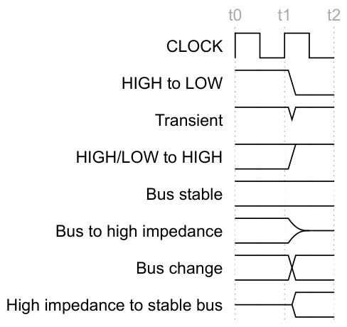
**图 1：时序图约定图例**

时序图有时会将单比特信号同时显示为高电平和低电平，它们看起来类似于图 1 中所示的总线变化。如果时序图以这种方式显示单比特信号，那么它的值不影响随附的说明。

> **【关键点 · 前言-4】单比特信号画成双电平表示取值无关**
>
> 时序图中若某个单比特信号在同一拍内被画成一高一低、形似总线变化，那只是绘制约定，表示它此刻的取值与说明无关。读图时要把它当作不关心，切勿误认为该信号在翻转，或是多比特总线。忽略这条约定，就会读错随附说明中真正的时序关系。

*ARM IHI 0022 · 第 xv 页*

约定

**信号**

信号约定如下：

• 信号电平 - 已置位信号的电平取决于该信号是高电平有效还是低电平有效。

置位意味着：

-- 对于高电平有效信号，为高电平。

-- 对于低电平有效信号，为低电平。

> **【关键点 · 前言-5】置位不等于高电平，取决于有效极性**
>
> 规范用置位表示信号处于有效状态，而不必然是高电平：高电平有效信号置位即为高，低电平有效信号置位即为低。后文大量条款以置位与撤销描述握手和事件，若把置位直接当成高电平，就会在低有效信号上读反有效条件。判断有效性前须先确认该信号的有效极性。

• 小写 n - 位于信号名的开头或末尾时，表示低电平有效信号。

> **【关键点 · 前言-6】信号名中的小写 n 表示低电平有效**
>
> 这是读全篇信号表的第一把钥匙：信号名开头或末尾出现的小写 n 表示该信号低电平有效，即置位意味着它是低电平。若误当作高电平有效，会把复位、使能一类信号的极性读反，导致接口逻辑与协议相反。本规范的信号名多以 n 结尾表示低有效，少数以 n 开头。

• 小写 x - 位于信号名的第二个字母时，表示读和写两者的统称。例如，AxCACHE 同时指 ARCACHE 和 AWCACHE 信号。

> **【关键点 · 前言-7】小写 x 是读写同名信号的统称**
>
> 凡见 Ax 形式的信号名，都应理解为一组同名信号的统称：x 只占第二个字母位，替换为 R 即读通道信号，替换为 W 即写通道信号，例如 AxCACHE 同时指 ARCACHE 与 AWCACHE。它便于把读写对称的规则一次讲清，读者须自行按通道还原为具体信号，后文大量信号名都依赖此规则。

**数字**

数字通常以十进制书写。二进制数字以 0b 为前缀，十六进制数字以 0x 为前缀。在这两种情况下，前缀和关联的值都以等宽字体书写，例如 0xFFFF0000。为提高可读性，长数字可以在每四个字符之间使用下划线分隔符书写，例如 0xFFFF_0000_0000_0000。在解释数字的值时，忽略任何下划线。

> **【关键点 · 前言-8】0b 为二进制，0x 为十六进制**
>
> 读数字时以 0b 开头即二进制，以 0x 开头即十六进制，无前缀者按十进制理解。长数字中每四位插入的下划线仅为便于阅读，求值时必须忽略，如 0xFFFF_0000_0000_0000 等同于 0xFFFF000000000000。地址与位域掩码常以十六进制给出，换算时勿把下划线当作字符。

**伪代码描述**

本规范使用一种伪代码形式来精确描述所规定的功能。该伪代码以等宽字体书写。伪代码语言在 Arm® Architecture Reference Manual for A-profile architecture 中描述。

> **【关键点 · 前言-9】伪代码是规定动作而非示例代码**
>
> 本规范以等宽字体书写的伪代码给出所规定功能的精确定义，凡以这种形式出现的片段都具有规范效力，而不是可选的示例代码。其语法在 A-profile 架构参考手册中定义，遇到陌生函数或写法应查该手册，不要凭语言直觉推测。读懂伪代码是理解 A 部分各章规定行为的关键。

*ARM IHI 0022 · 第 xvi 页*

进一步阅读

**进一步阅读**

本节列出了 Arm 及第三方发布的出版物。

有关 Arm 文档的获取方式，请访问 Arm Developer，<http://developer.arm.com>。[1] AMBA® AXI and ACE Protocol Specification.（ARM IHI 0022 H.c）

> **【典型场景 · 前言-10】借延伸阅读定位本文档在 AMBA 家族的位置**
>
> 场景：当你分不清某项特性属于本文档还是别处规范时。选择：先看进一步阅读列出的出版物，ACE、CHI、RME、MPAM、SMMU 等各有独立文档，本文档只覆盖 AXI。代价：这些属于外部资料，需另行获取并对齐版本，跨规范引用时不能把别处的规则直接搬到 AXI 上。

[2] AMBA® AXI Protocol Specification.（ARM IHI 0022 K）

[3] Arm® Architecture Reference Manual for A-profile architecture.（ARM DDI 0487）

[4] Arm® Realm Management Extension (RME) System Architecture.（ARM DEN 0129）

[5] AMBA® 5 CHI Architecture Specification.（ARM IHI 0050）

[6] Arm® Architecture Reference Manual Supplement, Memory System Resource Partitioning and Monitoring

(MPAM), for A-profile architecture.（ARM DDI 0598）

[7] Arm® System Memory Management Unit Architecture Specification, SMMU architecture version 3.（ARM

IHI 0070）

*ARM IHI 0022 · 第 xvii 页*

反馈

**反馈**

Arm 欢迎对其文档提出反馈。

**关于本规范的反馈**

如果您有任何评论或关于补充和改进的建议，请在

[https://support.developer.arm.com.](https://support.developer.arm.com) 创建工单。作为工单的一部分，请包含：

• 标题（AMBA® AXI Protocol Specification）。

• 编号（ARM IHI 0022 L 版）。

• 您的评论所适用的页码。

• 对您评论的简要说明。

Arm 也欢迎关于补充和改进的一般性建议。

注意

Arm 仅在 Adobe Acrobat 和 Acrobat Reader 中测试 PDF，无法保证使用任何其他 PDF 阅读器查看任何文档时的外观或行为。

**包容性术语承诺**

Arm 重视包容性社区。Arm 认识到我们和我们的行业曾使用过可能具有冒犯性的术语。

Arm 致力于引领行业并创造变革。

本文档以前的版本包含可能具有冒犯性的术语。我们已替换这些术语。如果您在本文档中发现具有冒犯性的术语，请联系 [terms@arm.com。](mailto:terms@arm.com)

> **【关键点 · 前言-11】包容性术语承诺意味着旧称已被替换**
>
> Arm 声明本文档已替换以往版本中可能具有冒犯性的术语，这解释了你为何会看到某些名称与旧版资料不一致。若代码或既有文档仍沿用旧术语，升级到本版时需留意二者的对应关系。发现遗漏的术语可通过文末邮箱反馈，但这不影响任何协议条款的技术含义。

*ARM IHI 0022 · 第 xviii 页*

# **第 A 部分**

**规范**

**引言**

本章介绍 AXI 协议的架构以及本规范中使用的术语。

本章包含以下小节：

• A1.1 关于 AXI 协议

• A1.2 AXI 架构

• A1.3 术语

*ARM IHI 0022 · 第 20 页*

## 第 A1 章 引言

A1.1. 关于 AXI 协议

**A1.1 关于 AXI 协议**

AXI 协议支持高性能、高频率的系统设计，用于管理者与从属者组件之间的通信。

AXI 协议的特性包括：

• 适用于高带宽和低延迟的设计。

• 无需使用复杂的桥接即可实现高频运行。

• 该协议满足广泛组件的接口要求。

• 适用于具有高初始访问延迟的存储器控制器。

• 提供了互连体系结构实现上的灵活性。

• 与 AHB 和 APB 接口向后兼容。

AXI 协议的关键特性包括：

• 独立的地址/控制阶段与数据阶段。

> **【关键点 · A1.1-1】地址控制阶段与数据阶段分离是根特性**
>
> AXI 把地址与控制信息放在独立的请求通道，与数据通道彻底解耦，后续的未完成事务、乱序完成和寄存器级插入都建立在这一分离之上。若地址与数据被绑定在同一阶段，互连必须等到数据就绪才能转发地址，流水线深度与乱序能力都会受到限制。

• 支持使用字节选通的非对齐数据传输。

• 使用基于突发的事务，仅需发出起始地址。

• 独立的写数据通道和读数据通道，可实现低成本的直接内存访问（DMA）。

• 支持发出多个未完成地址。

• 支持乱序完成事务。

> **【辨析 · A1.1-2】未完成事务与乱序完成不是一回事**
>
> 支持多个未完成地址说的是管理者可以在收到响应前连续发出多个请求，约束的是能否同时有多笔在途；乱序完成说的是从属者可以按与请求不同的顺序返回响应，约束的是响应回来的顺序。两者可以独立存在：允许未完成事务但不允许乱序完成，是常见的保守实现。

• 允许轻松添加寄存器级，以实现时序收敛。

本规范以前的各版本，请参见 [1] 和 [2]

*ARM IHI 0022 · 第 21 页*

A1.2. AXI 架构

**A1.2 AXI 架构**

AXI 协议定义了用于读写数据、或控制数据与翻译的缓存的事务。事务通过在通道上发送传输来执行：

• 写请求，其信号名以 AW 开头。

• 写数据，其信号名以 W 开头。

• 写响应，其信号名以 B 开头。

• 读请求，其信号名以 AR 开头。

• 读数据，其信号名以 R 开头。

请求通道携带描述待传输数据性质的控制信息。这称为请求。

数据在管理者与从属者之间使用以下任一方式传输：

• 写数据通道，用于将数据从管理者传输到从属者。在写事务中，

从属者使用写响应通道向管理者发出传输完成的信号。

• 读数据通道，用于将数据从从属者传输到管理者。

AXI 协议：

• 允许在实际数据传输之前发出地址信息。

• 支持多个未完成事务。

• 支持事务的乱序完成。

图 A1.1 展示了写事务如何使用写请求、写数据和写响应通道。

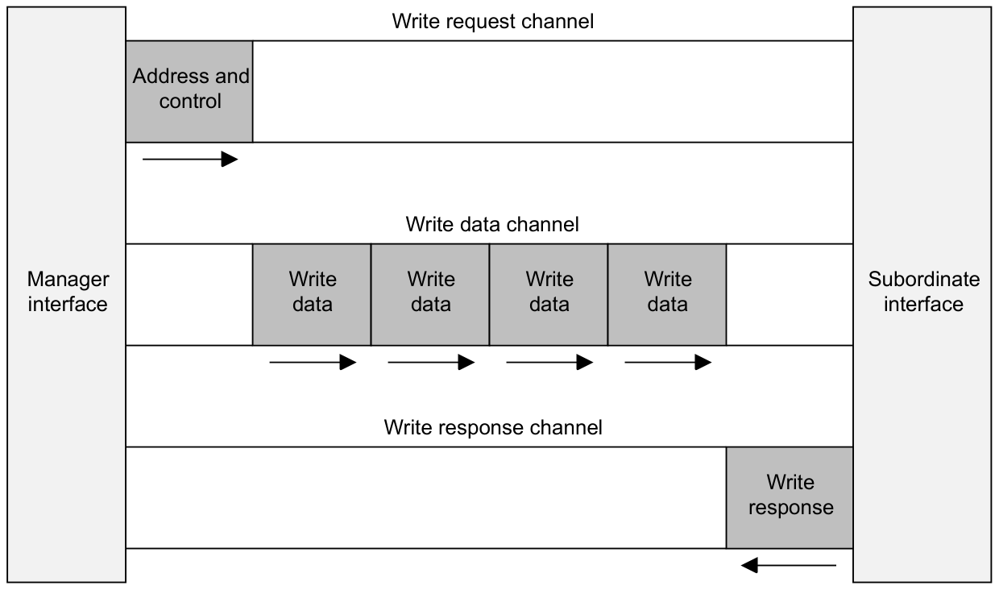
**图 A1.1：写操作的通道架构**

图 A1.2 展示了读事务如何使用读请求和读数据通道。

*ARM IHI 0022 · 第 22 页*

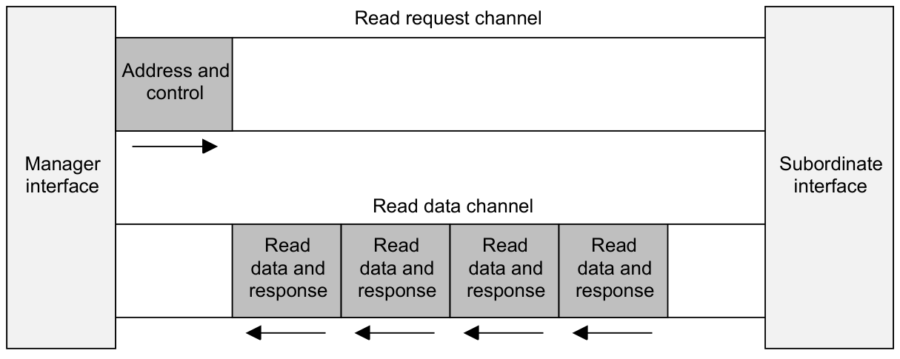
**图 A1.2：读操作的通道架构**

**写和读请求通道**

存在独立的写请求通道与读请求通道。相应的请求通道携带事务所需的全部地址与控制信息。

**写数据通道**

写数据通道携带从管理者到从属者的写数据。写数据的宽度最大可达 1024 位，并且每八个数据位对应一个字节通道选通信号，用于指示哪些数据字节有效。

写数据通道信息始终被视为可缓冲，因此管理者无需从属者确认先前的写事务，即可执行写事务。

> **【关键点 · A1.2-1】写数据默认可缓冲，写无需等待确认**
>
> 规范把写数据通道上的信息一律视为可缓冲，因此管理者发出写事务后不必等待从属者确认前一笔写是否完成，就可以继续发出后续写。这一前提是写通道能深度流水、获得高写吞吐的根本原因，但也意味着从属者必须自行用写响应来回收资源，不能指望管理者停下来等确认。

**写响应通道**

从属者使用写响应通道对写事务进行响应。所有写事务都要求在写响应通道上发出完成信号。

如 图 A1.1 所示，仅为完整事务发出完成信号，而不是为事务中的每一次数据传输发出。

> **【约束 · A1.2-2】完成信号只对整个事务发一次**
>
> 写响应通道上的完成信号是针对整个写事务发出的，事务内部每一次数据传输都不各发一次。因此从属者必须先把该事务的全部写数据传输收完，再一次性置位 BVALID，而不能收一拍就回一拍。违反这一点会让管理者误判事务已经结束，读写顺序与资源释放都会出错。

**读数据通道**

读数据通道携带从从属者到管理者的读数据以及读响应信息。读数据的宽度最大可达 1024 位。

*ARM IHI 0022 · 第 23 页*

A1.2. AXI 架构

**A1.2.1 接口与互连**

典型系统由若干管理者与从属者设备组成，这些设备通过某种形式的互连连接在一起，如 图 A1.3 所示。

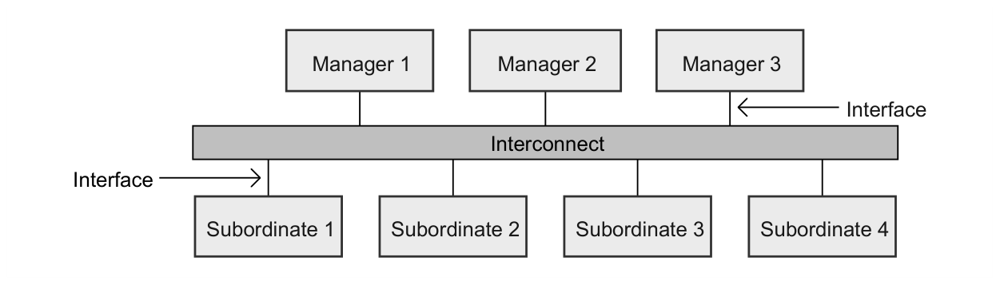
**图 A1.3：接口与互连**

AXI 协议为以下各方之间的接口提供了单一的接口定义：

• 管理者与互连

• 从属者与互连

• 管理者与从属者

该接口定义支持多种不同的互连实现方式。

设备之间的互连等效于另一台具有对称的管理者端口与从属者端口的设备，真实的管理者与从属者设备可以连接到该设备上。

> **【关键点 · A1.2.1-1】互连被视为带对称端口的设备**
>
> 规范把互连建模为一台自身带有对称管理者端口与从属者端口的设备，真实的管理者与从属者设备直接挂到这些端口上。这样接口定义只需一套，任何拓扑的互连都能用同样的管理者侧与从属者侧接口对接，设计者也不必为不同拓扑更换接口逻辑。

**A1.2.1.1 典型系统拓扑**

大多数系统使用以下三种互连拓扑之一：

• 共享请求通道与数据通道

• 共享请求通道与多条数据通道

• 多层结构，具有多条请求通道与数据通道

在大多数系统中，请求通道的带宽需求显著低于数据通道的带宽需求。此类系统通过使用一条共享请求通道与多条数据通道来实现并行数据传输，从而在系统性能与互连复杂度之间取得良好的平衡。

> **【关键点 · A1.2.1.1-1】请求通道带宽需求远低于数据通道**
>
> 多数系统中请求通道的带宽需求明显低于数据通道，因此用一条共享请求通道配多条数据通道，就能让数据传输并行起来，在性能与互连复杂度之间取得折衷。反过来，如果对请求通道也做多重化，收益有限却会显著抬高互连规模与仲裁复杂度。

*ARM IHI 0022 · 第 24 页*

A1.3. 术语

**A1.3 术语**

本节汇总了本规范中使用的术语，这些术语在 第 C1 章 术语表， 或其他位置定义。在适当的情况下，本节所列术语会链接到相应的术语表定义。

**A1.3.1 AXI 组件与拓扑**

以下术语用于描述 AXI 组件：

• 组件

• 管理者组件

• 从属者组件， 其中包括 存储器从属者组件 和 外设从属者

组件

• 互连组件

对于特定的 AXI 事务，上游 和 下游 指的是 AXI 组件在 AXI 拓扑中的相对位置。

**A1.3.2 AXI 事务与传输**

通道是一种单向连接，能够在发送端（Tx）和接收端（Rx）之间承载传输。

接口是组件上的一组通道发送端和接收端，其中各通道具有确定的用途。AXI 接口定义为管理者或从属者。

AXI 传输是在一个周期内 AXI 通道上的通信。

AXI 事务是 AXI 管理者与 AXI 从属者通信所需的一组传输。例如，读事务由一次请求传输和一次或多次读数据传输组成。

> **【辨析 · A1.3.2-1】传输是单拍动作，事务是完整过程**
>
> 传输是在一个周期内通道上的一次通信，是构成事务的最小动作；事务是管理者与从属者完成一次通信所需的全部传输，例如读事务由一次请求传输加上一次或多次读数据传输组成。区别在于粒度：一次事务包含多次传输，而握手规则作用在传输这一层。

**A1.3.3 缓存与缓存操作**

本规范不定义任何缓存参考文献中所定义的标准缓存术语。

但是，缓存 和 缓存行 的术语表条目说明了这些术语在本文档中的使用方式。

> **【关键点 · A1.3.3-1】缓存术语以术语表条目为准**
>
> 本规范不另行定义标准缓存参考文献里的缓存术语，缓存与缓存行的确切含义要回到术语表条目去看。这意味着阅读后续关于可缓存属性、缓存行维护的章节时，不能按教科书中模糊的缓存概念去推断，而应以术语表给出的用法为准。

**A1.3.4 时间描述**

AXI 规范使用了 及时地。 这一术语。

*ARM IHI 0022 · 第 25 页*

**AXI 传输**

AXI 使用通道在组件之间传输请求、数据和响应传输。

本章描述 AXI 传输，其中可选择使用 VALID-READY 握手或信用式通道。本章包含以下小节：

• A2.1 时钟与复位

• A2.2 AXI 传输选项

• A2.3 Valid-Ready 传输

• A2.4 信用式传输

• A2.5 流水线与寄存器级

• A2.6 AXI 事务与传输

*ARM IHI 0022 · 第 26 页*

## 第 A2 章 AXI 传输

A2.1. 时钟与复位

**A2.1 时钟与复位**

本节描述了实现 AXI 全局时钟与复位信号 ACLK 和 ARESETn 的要求。

**A2.1.1 时钟**

每个 AXI 接口都有一个时钟信号 ACLK。所有输入信号都在 ACLK 的上升沿被采样。所有输出信号的变化只能发生在 ACLK 的上升沿之后。

接口上的输入信号与输出信号之间必须不存在组合路径。

> **【约束 · A2.1.1-1】接口内不得存在输入到输出的组合路径**
>
> 规范要求同一接口的输入信号与输出信号之间不得有组合路径，即任何输出都不能直接由输入经组合逻辑产生。违反后接口内部形成组合环，既无法做静态时序分析，也无法安全插入寄存器级来做时序收敛，跨组件连接时还会引入难以定位的时序违例。

**A2.1.2 复位**

AXI 协议使用单个低电平有效的复位信号 ARESETn。该复位信号可以异步置位，但取消置位只能与 ACLK 的上升沿同步。

> **【约束 · A2.1.2-1】复位可异步置位但只能同步取消**
>
> ARESETn 是低电平有效的单一复位，允许异步置位，但取消置位必须与 ACLK 上升沿同步。这条约束把复位释放点对齐到时钟边沿，避免各触发器在不同时刻退出复位而产生亚稳态；若把取消置位做成异步，复位释放附近的电路行为将不可预测。

在复位期间要求取消置位的信号，必须至少保持取消置位状态，直到 ARESETn 为高电平之后的 ACLK 上升沿。这些信号能够置位的最早时刻是 ARESETn 为高电平之后的某个 ACLK 上升沿。

> **【约束 · A2.1.2-2】复位期间要求取消置位的信号须保持**
>
> 凡在复位期间要求取消置位的信号，必须保持取消置位到 ARESETn 变高之后的那个 ACLK 上升沿，最早也只能从该上升沿起才允许置位。以 VALID 为例，违反这条会让接收方在退出复位的瞬间看到非法的有效指示，握手状态机可能直接进入错误状态。

其他信号在复位期间可以取任意值。

例如，对于 VALID，这就是 图 A2.1 中的点 b。

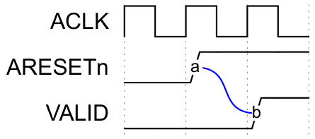
**图 A2.1：退出复位**

*ARM IHI 0022 · 第 27 页*

A2.2. AXI 传输选项

**A2.2 AXI 传输选项**

AXI 传输有两种可用选项：

• Ready（就绪式），其中每个通道都包含 VALID 和 READY 信号。发送方在有传输要发送时置位 VALID。当 VALID 和 READY 同时为高电平时，发生一次传输。

• Credited（信用式），其中每个通道都包含 VALID 和 CRDT 信号。接收方使用 CRDT 信号向发送方授予信用。如果发送方拥有适当的信用，就可以置位 VALID 来发送传输。这种传输方式适合高频运行，并支持在链路上使用资源平面（Resource Plane）。

> **【辨析 · A2.2-1】信用式与 Valid-Ready 的本质差别**
>
> 两者都要用 VALID 表示发送方有传输，区别在于谁来决定流控：Valid-Ready 由接收方用 READY 逐拍表示此刻能否接收，信用式则由接收方用 CRDT 预先授权，发送方有信用即可发送。前者逐拍反馈、对回程延迟敏感；后者把许可提前发放，更适合高频长链路。

接口上的所有 AXI 通道都使用同一类型的传输，表 A2.1 展示了如何通过 AXI_Transport 属性进行配置。

> **【典型场景 · A2.2-2】高频长链路且需业务隔离时选信用式**
>
> 场景是需要高频运行、链路上又存在多类需要彼此隔离的业务流量；选择是启用信用式传输，借资源平面把流量分开，并靠预授权消除逐拍回程依赖；代价是该选项只适用于 AXI5 接口，且发送端要维护信用计数、接收端要管理授权，实现复杂度明显高于就绪式。

**表 A2.1：AXI_Transport 属性**
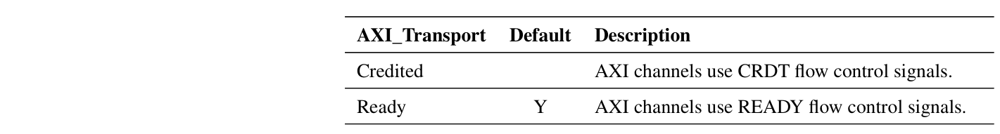

以下规则适用于传输配置：

• 相连的管理者接口和从属者接口必须具有相同的 AXI_Transport 属性值。

> **【约束 · A2.2-3】相连两侧的传输类型必须相同**
>
> 规范要求相连的管理者接口与从属者接口具有相同的 AXI_Transport 属性值，并且信用式传输只能用于 AXI5 接口。也就是说 Ready 与 Credited 不能在同一条连接的两侧混用，也不能让老版本接口使用信用式；接错后握手信号语义不一致，传输无法被正确确认。

• 信用式传输只能与 AXI5 接口一起使用。

*ARM IHI 0022 · 第 28 页*

A2.3. Valid-Ready 传输

**A2.3 Valid-Ready 传输**

使用 Valid-Ready 传输时，所有 AXI 通道都采用相同的 VALID-READY 握手过程来传输地址、数据和控制信息。这种双向流控机制意味着管理者与从属者都能控制信息在管理者与从属者之间移动的速率。发送方生成 VALID 信号，以指示地址、数据或控制信息何时可用。接收方生成 READY 信号，以指示其可以接受该信息。仅当 VALID 和 READY 信号均为高电平时，才会发生传输。

> **【关键点 · A2.3-1】VALID 与 READY 同时为高才发生传输**
>
> 传输只在 VALID 与 READY 同时为高、且该状态在上升时钟沿被识别的那个周期发生，缺一不可。这是一种双向流控：发送方用 VALID 表示信息已就绪，接收方用 READY 表示此刻能收，双方共同决定速率，任何一方都不能单方面推动传输。

在复位期间，VALID 信号必须为低电平。

图 A2.2、图 A2.3 和 图 A2.4 展示了握手过程的示例。

发送方在第 1 个边沿之后给出信息并置位 VALID 信号，如 图 A2.2 所示。接收方在第 2 个边沿之后置位 READY 信号。发送方必须保持其信息稳定，直至第 3 个边沿发生传输、该置位被识别到为止。

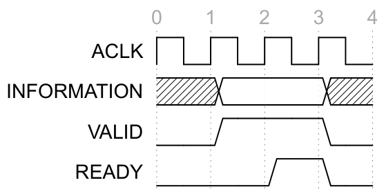
**图 A2.2：VALID 先于 READY 的握手**

发送方不得等到 READY 置位之后才置位 VALID。

> **【约束 · A2.3-2】发送方不得等 READY 才置 VALID**
>
> 发送方不得在置位 VALID 之前等待 READY，也就是不能形成先看到 READY 再发 VALID 的依赖。若双方都等对方先动作，握手将永久停滞并造成死锁；这条约束与接收方可以等待 VALID 再置 READY 的许可合起来，明确划定了合法的先后关系。

当 VALID 置位后，它必须保持置位状态，直至在 VALID 与 READY 均置位的上升时钟沿发生握手为止。

> **【约束 · A2.3-3】VALID 置位后不得撤销**
>
> VALID 一旦置位，必须保持到 VALID 与 READY 同时为高的那个上升沿完成握手为止，其间该通道的地址、数据或控制信息也必须保持稳定。不允许先置位再撤回，否则接收方可能在采样窗内看到不一致的信息；这条与 READY 可以置位后再取消的许可形成鲜明对比。

在 图 A2.3 中，接收方在第 1 个边沿之后、地址、数据或控制信息有效之前就置位了 READY。该置位表示其可以接受该信息。发送方在第 2 个边沿之后给出信息并置位 VALID，随后在第 3 个边沿发生传输、该置位被识别到。在这种情况下，传输在单个周期内完成。

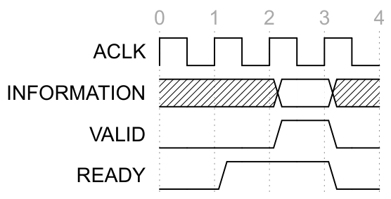
**图 A2.3：READY 先于 VALID 的握手**

接收方可以等待 VALID 置位之后，再置位相应的 READY。

如果 READY 已置位，则允许在 VALID 置位之前取消置位 READY。

> **【关键点 · A2.3-4】READY 可以先置位也可中途取消**
>
> 接收方既可以等 VALID 置位之后再置 READY，也可以在 VALID 之前就先置 READY；而一旦 READY 置位，仍允许在 VALID 到来前把它取消。这条不对称规则给接收方留出撤销接收意愿的余地，但因此发送方不能把曾经看到的 READY 当作已经完成握手的凭证。

*ARM IHI 0022 · 第 29 页*

A2.3. Valid-Ready 传输

在 图 A2.4 中，发送方和接收方恰好在边沿 1 之后都指示它们可以传输地址、数据或控制信息。在这种情况下，当 VALID 和 READY 的同时置位能够被识别时，传输发生在时钟上升沿。这些置位意味着传输发生在边沿 2。

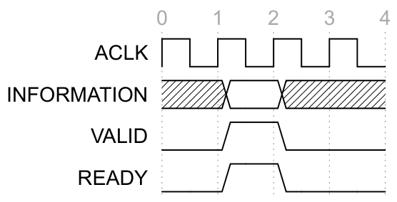
**图 A2.4：VALID 与 READY 握手**

READY 信号的默认状态既可以是高电平，也可以是低电平。

对于请求通道，建议使用高电平作为默认状态，以最小化延迟。在这种情况下，从属者必须能够接受呈现给它的任何有效请求。

> **【典型场景 · A2.3-5】请求通道 READY 默认拉高以省延迟**
>
> 场景是请求通道对延迟敏感、从属者又有能力及时受理；选择是把 READY 默认置为高电平，使第一个有效请求不必再等一拍 READY；代价是从属者必须能够接受呈现给它的任何有效请求，接受不了时只能先拉低 READY，反而破坏了默认高电平带来的延迟优势。

**A2.3.1 Valid-Ready 信号**

表 A2.2 展示了 VALID 和 READY 信号。无论使用 Valid-Ready 传输还是信用式传输，都存在 VALID 信号。

**表 A2.2：VALID 和 READY 信号**
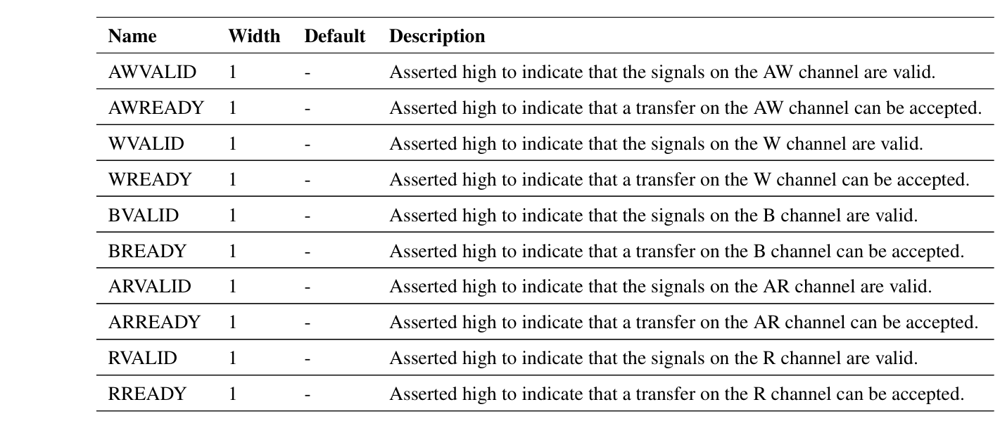

*ARM IHI 0022 · 第 30 页*

A2.3. Valid-Ready 传输

**A2.3.2 通道握手信号之间的依赖关系**

写事务、读事务和侦听事务的各通道之间存在依赖关系。下文各节对此进行了描述，并包含依赖关系图，其中：

• 单箭头指向的信号，可以在箭头起点处的信号之前或之后置位。

• 双箭头指向的信号，只能在箭头起点处的信号置位之后才能置位。

> **【关键点 · A2.3.2-1】单箭头允许乱序，双箭头是硬依赖**
>
> 依赖关系图里的单箭头表示所指信号可以在起点信号之前或之后置位，双方顺序自由；双箭头表示所指信号只能在起点信号置位之后才能置位，是不可违背的先后约束。读图时若把双箭头当成单箭头，会写出违反协议的握手逻辑，典型后果就是死锁。

**A2.3.2.1 写事务依赖关系**

对于写通道上的事务，图 A2.5 展示了握手信号依赖关系。规则如下：

• 管理者不得在置位 AWVALID 或 WVALID 之前，等待从属者置位 AWREADY 或 WREADY。该规则适用于事务中的每一次写数据传输。

> **【关键点 · A2.3.2.1-1】管理者发写不能等从属者先给 READY**
>
> 规范禁止管理者在置位 AWVALID 或 WVALID 之前去等从属者的 AWREADY 或 WREADY，而且这一要求对事务中的每一次写数据传输都成立。它把等待的责任单向压给从属者：从属者可以等 VALID 再给 READY，但管理者必须先表态，这样两侧才不会互等。

• 从属者可以在置位 AWREADY 之前，等待 AWVALID 或 WVALID，或两者。

• 从属者可以在 AWVALID 或 WVALID，或两者置位之前，就置位 AWREADY。

• 从属者可以在置位 WREADY 之前，等待 AWVALID 或 WVALID，或两者。

• 从属者可以在 AWVALID 或 WVALID，或两者置位之前，就置位 WREADY。

• 从属者必须等待 AWVALID、AWREADY、WVALID 和 WREADY 均已置位之后，才能置位 BVALID。

• 从属者必须等待最后一次写数据传输之后，才能置位 BVALID。最后一次写数据传输中 WLAST 已置位，参见 A3.2.1 写数据通道 (W)。

• 从属者不得在置位 BVALID 之前，等待管理者置位 BREADY。

• 管理者可以在置位 BREADY 之前，等待 BVALID。

• 管理者可以在 BVALID 置位之前就置位 BREADY。

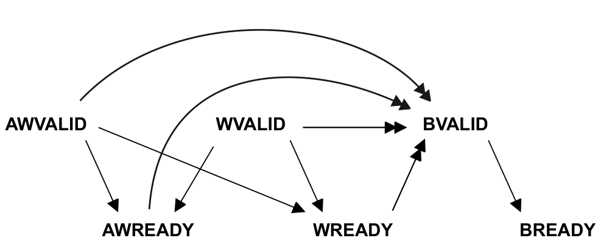
**图 A2.5：写事务握手依赖关系**

对于不包含数据的写通道事务，依赖关系中不包含 WVALID 和 WREADY。

*ARM IHI 0022 · 第 31 页*

A2.3. Valid-Ready 传输

**A2.3.2.2 读事务依赖关系**

对于读通道上的事务，图 A2.6 展示了握手信号的依赖关系。规则如下：

• 管理者不得等到从属者置位 ARREADY 之后，才置位 ARVALID。

• 从属者可以等待 ARVALID 置位之后，再置位 ARREADY。

• 从属者可以在 ARVALID 置位之前就置位 ARREADY。

• 从属者必须等到 ARVALID 和 ARREADY 均置位之后，才能置位 RVALID，以指示有效数据可用。

> **【约束 · A2.3.2.2-1】RVALID 必须先看到完整的读请求握手**
>
> 从属者必须等到 ARVALID 与 ARREADY 都置位之后，才能置位 RVALID 来表示有效读数据可用；同时它不得等管理者置位 RREADY 才给出 RVALID。这两条合起来保证读数据一定对应已经完成的读请求，又不会因为等 RREADY 而与管理者形成互等。

• 从属者不得等到管理者置位 RREADY 之后，才置位 RVALID。

• 管理者可以等待 RVALID 置位之后，再置位 RREADY。

• 管理者可以在 RVALID 置位之前就置位 RREADY。

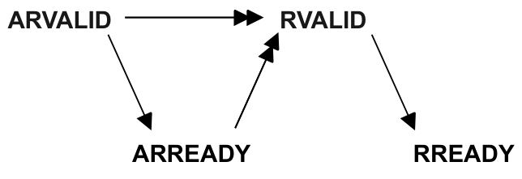
**图 A2.6：读事务握手依赖关系**

*ARM IHI 0022 · 第 32 页*

A2.4. 信用式传输

**A2.4 信用式传输**

当 AXI_Transport 属性为 Credited 时，AXI 通道使用信用式传输。

表 A2.3 列出了使用信用式传输时可添加到通道的所有信号。信号名称为基本名称，实例化时每个名称都包含一个前缀，以指示其属于哪个通道。

一个通道有一个发送器（Tx）和一个接收器（Rx）。

**表 A2.3：信用式通道信号**
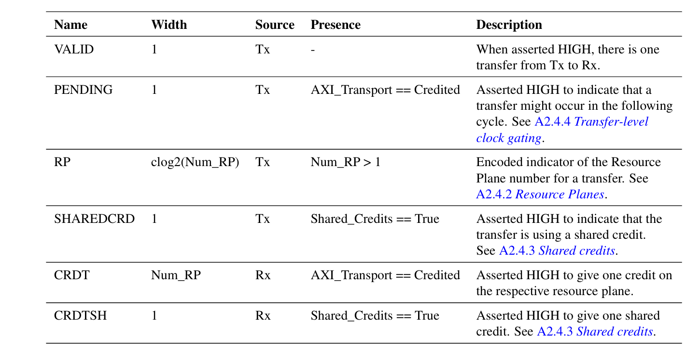

*ARM IHI 0022 · 第 33 页*

A2.4. 信用式传输

**A2.4.1 信用式流控**

以下规则适用于信用式通道：

• 复位期间，通道发送端没有信用，接收端拥有全部可用信用。所有 CRDT 和 CRDTSH 信号必须为低电平。

• CRDT 或 CRDTSH 置位的每个周期，每置位一个比特即向通道发送端给出一个信用。

• 通道发送端在 VALID 置位的每个周期使用一个信用。

• 当通道发送端信用为零时，不得置位 VALID。

> **【约束 · A2.4.1-1】无信用时发送端不得置 VALID**
>
> 通道发送端在 VALID 置位的每个周期消耗一个信用，信用为零时禁止置位 VALID；接收端给出的信用每资源平面最少 1 个、最多 15 个，另有 15 个共享信用。若发送端在无信用时仍置 VALID，接收端会把它当成合法授权而接收，缓冲区随之被写坏。

• 接收端可以给出的最小信用数为每个资源平面 1 个。

• 接收端可以给出的最大信用数为每个资源平面 15 个，另有 15 个共享信用。

在任一方向上，信用信号与通道上的其他信号之间都不得存在组合路径。该限制带来以下后果：

• 信用不能在其给出的同一周期内用于一次传输。

• 信用不能在其被一次传输使用的同一周期内被给出。

通道上传输的一个示例如 图 A2.7. 所示。在本示例中，接收端有两个可用信用。

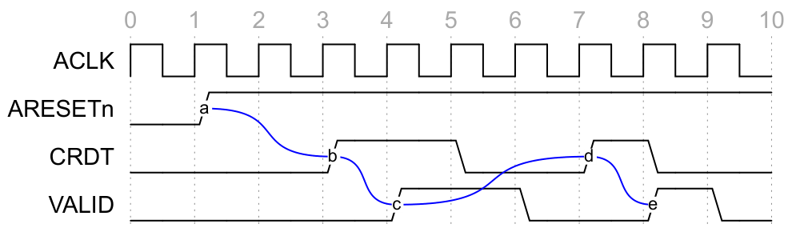
**图 A2.7：示例传输**

周期 0 复位时 Tx 没有信用。

周期 3 Rx 给出一个信用。

周期 4 Tx 使用该信用进行一次传输。Rx 又给出一个信用。

周期 5 Tx 使用第二个信用进行一次传输。

周期 7 周期 4 中使用的信用被归还给 Tx。

周期 8 Tx 使用该信用进行一次传输。

*ARM IHI 0022 · 第 34 页*

A2.4. 信用式传输

**A2.4.2 资源平面**

资源平面（Resource Planes，RP）用于实现共享同一通道的业务流量之间的独立性。这可以是为了避免死锁场景，或者是为了改善服务质量。每个 RP 都有专用的信用，因此可以只为某一个 RP 授予信用，使它在一个 RP 阻塞等待信用时仍能继续推进。

• 使用不同资源平面的传输在发送方与接收方之间不得相互阻塞。

> **【关键点 · A2.4.2-1】资源平面让不同业务流量互不阻塞**
>
> 资源平面给共享同一通道的各类业务流量分配各自的专用信用，因此可以为某个资源平面单独授予信用，使它在别的平面等待信用时仍能继续推进。这一机制用于避免死锁或改善服务质量；需要注意的是，这种非阻塞保证只在传输始终使用相互独立的资源平面时才成立。

如果传输在跨多条链路时始终处于相互独立的资源平面上，那么这种非阻塞保证就可以扩展。

参数 Num_RP 指定了一个通道上支持的 RP 数量。

RP 信号指示每个传输所用的资源平面编号，其取值范围从 0 到 Num_RP-1。

RP 的位宽为 clog2(Num_RP)。例如，如果 Num_RP 为 5，则 RP 的位宽为 3。如果 Num_RP 为 1，则不存在 RP 信号。

信用按每个资源平面分别授予。CRDT 信号对每个资源平面有一个比特，因此接收方每个周期最多可以为每个 RP 授予一个信用。各个 RP 的信用数量允许不同。

• 只有当发送方对某个特定 RP 至少拥有一个信用时，它才能在该 RP 上发出传输。

• 接收方必须能够为其支持的每个 RP 至少授予一个专用信用。

• AR、AW 和 W 通道可以有多个 RP。

• 同一事务中的 AW 与 W 传输必须使用相同的 RP 编号。

使用不同 RP 的传输之间不提供任何排序保证。这意味着：

• 管理者不得发出这样一个请求传输：它与同一

通道上某个未完成事务具有相同的 ID，但 RP 不同。

• 如果不同事务使用不同的 RP，管理者可以交织这些事务的写数据传

输。参见

A5.5 写数据与响应排序。

B 和 R 通道只有一个 RP。

表 A2.5 列出了定义 RP 数量的各项属性。

**表 A2.5：资源平面数量属性**
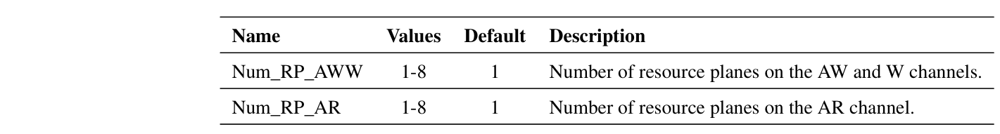

相连的接口可以配置为具有不同数量的 RP，但管理者不得要求使用超过所连接从属者能够提供的 RP 数量。

如果 AXI_Transport 属性为 Ready：则 Num_RP_AWW 和 Num_RP_AR 必须为 1。

*ARM IHI 0022 · 第 35 页*

A2.4. 信用式传输

**A2.4.3 共享信用**

任何包含多个 RP 的通道都可以可选地包含共享信用，以在不同 RP 上的吞吐量变化时提高缓冲区利用率。支持共享信用的接收器可以在专用于某一个 RP 的缓冲区与可用于任意 RP 的缓冲区之间分配其缓冲区。

> **【辨析 · A2.4.3-1】资源平面管隔离，共享信用管利用率**
>
> 资源平面是把通道流量按用途切成互相独立、各自持有专用信用的平面，解决的是隔离与不阻塞；共享信用则是额外的一类信用，可在任意资源平面上使用，解决的是各平面吞吐起伏时的缓冲区利用率。区别在于一个划分权限，一个放宽权限，接收器无论发放哪种信用都要维持各平面间的独立性。

表 A2.6 列出了定义是否支持共享信用的各项属性。

**表 A2.6：共享信用属性**
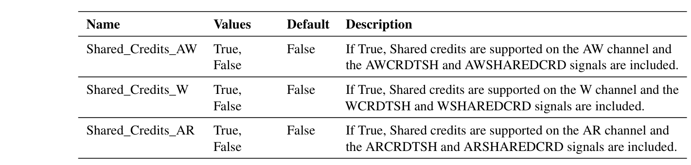

以下规则适用：

• 如果 AXI_Transport 属性为 Ready：Shared_Credits_AW、Shared_Credits_W 和 Shared_Credits_AR

必须为 False。

• 如果 Num_RP_AWW 为 1：Shared_Credits_AW 和 Shared_Credits_W 必须为 False。

• 如果 Num_RP_AR 为 1：Shared_Credits_AR 必须为 False。

• 接收器置位 CRDTSH 信号，以向发送器给出一个共享信用。可以在不置位 CRDT 的情况下置位

CRDTSH。

• 发送器可以使用一个共享信用在任意 RP 上发送传输。

• 无论发送器使用的是共享信用还是专用信用，接收器都必须提供各 RP 之间的独立性保证。

• 发送器在置位 VALID 的同时置位 SHAREDCRD 信号，以指示该传输

正在使用共享信用。

建议发送器在同时拥有专用信用和共享信用时，为传输使用专用信用而非共享信用。这是因为共享信用更灵活，因此可以保留给没有专用信用的传输使用。

> **【典型场景 · A2.4.3-2】专用信用优先用，共享信用留给缺口**
>
> 场景是发送器同时握有专用信用和共享信用；选择是本次传输优先消耗专用信用，把更灵活的共享信用留着；代价是逻辑上要多做一次信用类型判断。这样安排的好处是当某个资源平面的专用信用恰好耗尽时，共享信用仍能顶上，整体吞吐不会因为信用分配不均而掉下来。

根据 Shared_Credits 属性的取值，管理者接口与从属者接口之间的兼容性

如 表 A2.7. 所示。

**表 A2.7：共享信用兼容性**
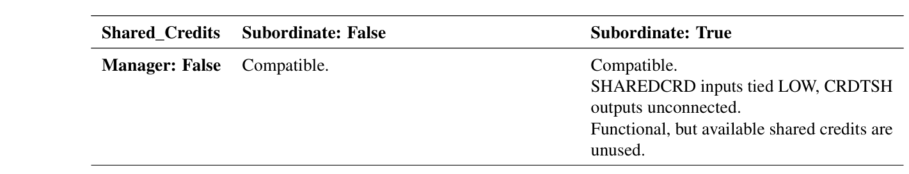
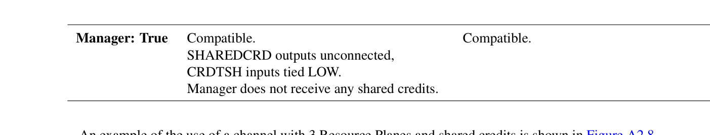

*ARM IHI 0022 · 第 36 页*

A2.4. 信用式传输

管理者：True 兼容。兼容。

SHAREDCRD 输出未连接，

CRDTSH 输入接 LOW。

管理者不会收到任何共享信用。

图 A2.8. 中给出了一个使用带 3 个资源平面和共享信用的通道的示例。

0 1 2 3 4 5 6 7 8 9 10

ACLK

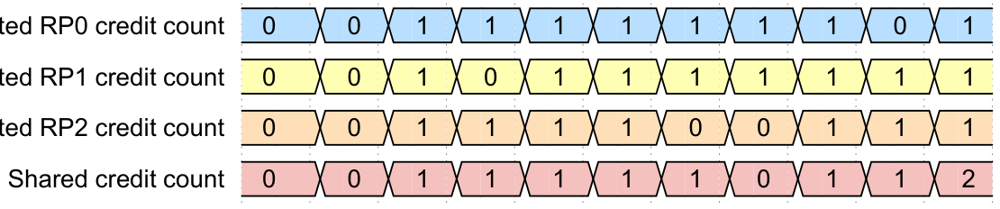
**图 A2.8：具有 3 个资源平面的通道示例**

周期 0 发送器没有任何信用。

周期 1 接收器为每个 RP 各给出一个信用，并给出一个共享信用。

周期 2 发送器使用一个专用信用在 RP1 上发送一个传输。

周期 3 接收器为 RP1 向发送器返还一个专用信用。

周期 5 发送器使用一个专用信用在 RP2 上发送一个传输。

周期 6 由于没有可用的专用信用，发送器使用一个共享信用在 RP2 上发送一个传输。

周期 7 接收器向发送器返还一个共享信用，以及一个用于 RP2 的专用信用。

周期 8 发送器使用一个专用信用在 RP0 上发送一个传输

周期 9 接收器为 RP0 向发送器返还一个专用信用，同时附加一个

共享信用。

*ARM IHI 0022 · 第 37 页*

A2.4. 信用式传输

**A2.4.4 传输级时钟门控**

与某个通道关联的 PENDING 信号保证在发送传输的前一个周期被置位，因此可用于对接收器电路的时钟进行门控。

> **【典型场景 · A2.4.4-1】用 PENDING 对接收器做传输级门控**
>
> 场景是接收器希望在确定有传输即将到来前关掉局部时钟以省电；选择是用该通道的 PENDING 信号，因为规范要求它在 VALID 置位的前一个周期就置位，时钟可以提前一个周期被唤醒；代价是发送端必须能提前预判传输时机，否则只能一直把 PENDING 拉高，省电效果就没了。

以下规则适用：

• 每个通道有一个 PENDING 信号。

• 要求 PENDING 在 VALID 被置位的前一个周期被置位。

• 当 PENDING 被取消置位时，要求 VALID 在下一个周期被取消置位。

• 当 PENDING 被置位时，允许但不要求 VALID 在下一个周期被置位。

PENDING 信号与信用及信用控制无关。例如，允许发送器执行以下任一操作：

• 永久保持 PENDING 置位，包括在复位期间。如果发送器无法提前确定何时发送传输，它可能会这样做。

• 在没有信用时置位 PENDING。

• 置位然后取消置位 PENDING，而不发送传输。

图 A2.9. 中给出了使用 PENDING 的一个示例。

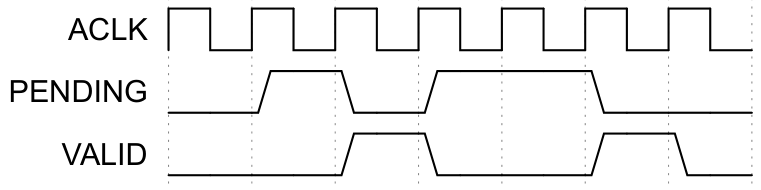
**图 A2.9：PENDING 信号的用法示例**

有关使用信用式通道对接口进行门控的信息，请参见 A14.2 使用信用式传输的接口门控。

*ARM IHI 0022 · 第 38 页*

A2.4 信用式传输

**A2.4.5 信用式传输信号**

表 A2.9 显示了当 AXI_Transport 为信用式传输时可以包含的信号。每个通道还具有一个

VALID 信号，如 表 A2.2 所示。

**表 A2.9：使用信用式传输时的信号**
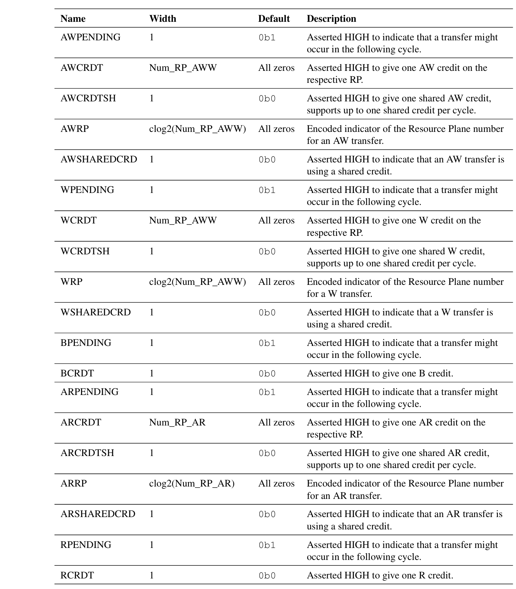

*ARM IHI 0022 · 第 39 页*

A2.5. 流水线与寄存器级

**A2.5 流水线与寄存器级**

每个 AXI 通道仅沿一个方向传输信息，并且架构不要求各通道之间存在任何固定关系。这意味着可以在任何通道的任何位置插入寄存器级，代价是增加一个时钟周期的延迟。

> **【关键点 · A2.5-1】通道可任意插寄存器，代价是一拍延迟**
>
> 由于每个通道只单向传输、通道之间又没有架构上的固定关系，寄存器级可以插在任何通道的任何位置，代价是增加一个时钟周期的延迟。这让设计者能在延迟与最高工作频率之间做权衡，也是 AXI 能同时连接高性能存储器和路径较长的低速外设的原因。

这些特性使得以下情况成为可能：

• 在延迟周期数与最高工作频率之间进行权衡。

• 处理器与高性能存储器之间的直接、快速连接，同时使用简单的寄存器切片来隔离通往性能不太关键的外设的较长路径。

以下规则适用于通道的寄存：

• 组件之间的 VALID、READY 和 CRDT 路径上可以有任意数量的寄存器级。

• 不同通道可以具有不同数量的寄存器级，取决于其时序要求。

• VALID 信号必须与该通道的负载信号（包括 RP 和 SHAREDCRD 信号，如果存在）进行相同周期数的流水线处理。

> **【约束 · A2.5-2】VALID 必须与负载信号同拍数流水**
>
> 规范要求 VALID 与该通道的负载信号，包括 RP 与 SHAREDCRD 信号，做相同周期数的流水线处理，PENDING 也要保持它在 VALID 为高前一个周期为高的关系。若只给数据打拍而不给 VALID 打拍，接收方就会把信号对齐错误，看到 VALID 与实际负载错位的传输。

• PENDING 信号必须保持这样的关系：它们在 VALID 为 HIGH 之前的那个周期为 HIGH。

*ARM IHI 0022 · 第 40 页*

A2.6. AXI 事务与传输

**A2.6 AXI 事务与传输**

AXI 协议要求保持以下关系：

• 写响应必须始终跟在写事务中的最后一个写传输之后。

• 读数据和响应必须始终跟在读请求之后。

• 当管理者发出写请求时，它必须能够提供该事务的所有写数据，而不依赖于该管理者发出的其他事务。

• 当管理者已发出写请求和所有写数据时，它必须能够接受该事务的所有响应，而不依赖于该管理者发出的其他事务。

• 当管理者已发出读请求时，它必须能够接受该事务的所有读数据，而不依赖于该管理者发出的其他事务。

-- 请注意，管理者可以依赖使用相同 ID 的事务按顺序返回读数据，因此管理者只需为具有不同 ID 的事务的读数据提供足够的存储空间。

• 允许管理者在发出另一个事务请求之前等待一个事务完成。

• 允许从属者在接受另一个请求、给出信用或为另一个事务发送传输之前等待一个事务完成。

• 从属者不得因带有前置写数据的事务而阻塞对无数据写请求的接受。

协议未定义通道之间的任何其他关系。

缺少关系意味着，例如，写数据可以在该事务的写请求之前出现在接口上。如果写请求通道比写数据通道包含更多的寄存器级，就可能发生这种情况。类似地，写数据可能与请求在同一个周期出现。

> **【关键点 · A2.6-1】协议不保证写数据晚于写请求出现**
>
> 协议除写响应、读数据等少数关系外，没有定义通道之间的其他关系，因此写数据完全可以在同一事务的写请求之前出现在接口上，也可能与请求同周期出现，写请求通道寄存器级更多时就会这样。互连因此必须在需要时重新对齐请求与写数据，避免把写数据误判给错误的从属者。

当需要互连来确定目标地址空间或从属者空间时，它必须重新对齐请求与写数据。需要这种重新对齐，以确保写数据仅对其所指向的从属者被标示为有效。

*ARM IHI 0022 · 第 41 页*

**AXI 事务**

AXI 协议使用事务在管理者与从属者之间进行通信。所有事务都包含一个请求和一个响应。写事务和读事务还包含一个或多个数据传输。

本章描述事务请求、响应和数据传输。

它包含以下小节：

• A3.1 事务请求

• A3.2 写数据与读数据

• A3.3 事务响应

*ARM IHI 0022 · 第 42 页*

## 第 A3 章 AXI 事务

A3.1. 事务请求

**A3.1 事务请求**

AXI 管理者通过向从属者发出请求来发起事务。请求包含事务属性以及第一次数据传输的地址。如果事务包含不止一次数据传输，则从属者必须计算后续传输的地址。

事务不得跨越 4KB 地址边界。这可防止事务跨越两个从属者之间的边界。它还可限制从属者必须支持的地址递增次数。

> **【约束 · A3.1-1】事务不得跨越 4KB 地址边界**
>
> 这是硬性约束：一个事务的地址区间必须完整落在同一个 4KB 对齐块内。其目的一是防止事务跨越两个从属者之间的译码边界，二是限制从属者需要支持的地址递增次数。若管理者要访问跨越 4KB 边界的大块数据，必须自行拆成多个事务，协议不做自动拆分，越界事务的行为不受保证。

**A3.1.1 Size 属性**

Size 表示每次数据传输的最大字节数。

对于读事务，Size 表示每次读数据传输中必须有多少数据字节有效。

对于写事务，Size 表示允许激活多少个数据字节通道。写选通信号指示每次传输中这些字节中的哪些是有效的。

Size 不得超过接口的数据宽度，该宽度由 DATA_WIDTH 属性确定。

> **【约束 · A3.1.1-1】Size 不得超过接口的数据宽度**
>
> Size 表示每次数据传输的最大字节数，其取值上限受 DATA_WIDTH 属性限定的数据宽度约束。若 Size 大于数据宽度，单拍无法承载这些字节，接口连接即不合法。反之 Size 小于数据宽度虽合法，但每次传输只占用字节通道的一个子集，这正是窄传输的由来，带宽也随之下降。

如果 Size 小于 DATA_WIDTH，则每次传输使用字节通道的一个子集。

Size 分别通过写请求通道和读请求通道上的 AWSIZE 和 ARSIZE 信号传递。在本规范中，AxSIZE 表示 AWSIZE 和 ARSIZE。

**表 A3.1：AxSIZE 信号**
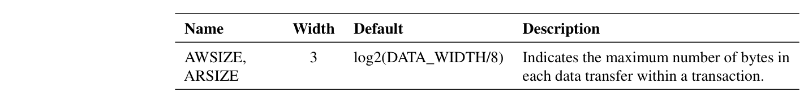

Size 在 AxSIZE 信号上的编码如 表 A3.2 所示。

**表 A3.2：AxSIZE 编码**
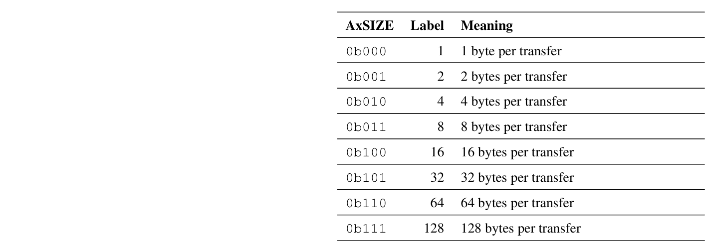

属性 SIZE_Present 用于确定 AxSIZE 信号是否存在。

*ARM IHI 0022 · 第 43 页*

A3.1. 事务请求

**表 A3.3：SIZE_Present 属性**

如果管理者只发出全数据宽度的请求，则可以从其接口中省略 AxSIZE 输出。所连接的从属者的 AxSIZE 输入必须根据数据宽度进行连接。

**A3.1.2 Length 属性**

Length 属性定义了事务中数据传输的次数。

Size x Length 是事务中能够传输的最大字节数。如果地址非对齐或者存在被取消置位的写选通，则实际传输的字节数可能低于 Size x Length。

> **【辨析 · A3.1.2-2】容器上限不等于实际传输字节数**
>
> 区别在于 Size 乘 Length 只是事务容器的上限，即起始地址对齐且写选通全部置位时才可能触及的字节总数；实际传输字节数还要受地址非对齐、写选通被取消置位的影响，可能低于该上限。容器的作用是界定哪些字节通道合法，它是一个地址范围边界，而不是数据量的承诺。

管理者必须根据 Length 发出相应次数的写数据传输。

从属者必须根据 Length 发出相应次数的读数据传输。

Length 分别通过写请求通道和读请求通道上的 AWLEN 和 ARLEN 信号进行传递。在本规范中，AxLEN 表示 AWLEN 和 ARLEN。

**表 A3.4：AxLEN 信号**
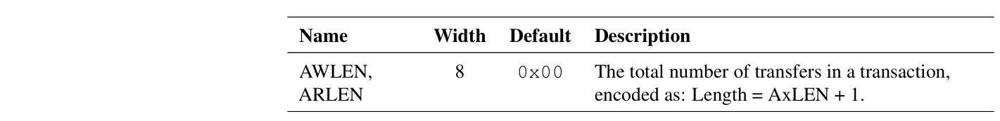

属性 LEN_Present 用于确定这些信号是否存在。表 A3.5 给出了 LEN_Present 的合法取值。

**表 A3.5：LEN_Present 属性**

如果管理者只发出 Length 为 1 的请求，则可以从其接口中省略 AxLEN 输出。所连接的从属者的 AxLEN 输入必须连接至 0x00。

> **【关键点 · A3.1.2-1】AxLEN 编码值比实际拍数少一**
>
> Length 表示事务中的数据传输次数，但 AxLEN 信号上的编码值是次数减一，例如 AxLEN 取 0x00 时事务只含一拍。原文给出的印证是：只发出 Length 为 1 请求的管理者可省略 AxLEN 输出，此时从属者的 AxLEN 输入接 0x00。计算实际字节数时必须用 AxLEN 加一，否则会少算一拍。

以下规则适用于事务 Length：

• 对于回绕突发，Length 可以是 2、4、8 或 16。

• 对于固定突发，Length 最大可达 16。

• 事务不得跨越 4KB 地址边界。

• 不支持事务的提前终止。

任何组件都不能提前终止事务。然而，为了减少写事务中的数据传输次数，管理者可以通过取消置位所有写选通来禁止后续写入。在这种情况下，管理者必须完成事务中剩余的传输。在读事务中，管理者可以丢弃读数据，但必须完成事务中的所有传输。

> **【约束 · A3.1.2-3】事务一旦发出就不得提前终止**
>
> 原文明确任何组件都不能提前终止事务，管理者与从属者都不例外。管理者若想减少写数据，只能通过取消置位全部写选通让某些拍不产生写入，但仍必须完成剩余各拍；读事务中管理者可以丢弃读数据，同样必须收完全部 Length 指示的拍。违反会破坏双方的传输计数与互连状态。

*ARM IHI 0022 · 第 44 页*

A3.1. 事务请求

**A3.1.3 事务中的最大字节数**

事务中的最大字节数为 4KB，且不允许事务跨越 4KB 边界。不过，许多管理者发起的事务总是小于该值。

从属者或互连可能会从这一信息中获益。例如，从属者或许能够据此优化掉一些译码逻辑。以小于 4KB 的粒度进行条带化的互连，如果知道事务不会跨越条带边界，则或许能够避免突发拆分。

属性 Max_Transaction_Bytes 定义了事务的最大字节数，如 表 A3.6 所示。

**表 A3.6：Max_Transaction_Bytes 属性**

在连接管理者接口与从属者接口时，表 A3.7 给出了 Max_Transaction_Bytes 的兼容组合。

**表 A3.7：Max_Transaction_Bytes 互操作性**

*ARM IHI 0022 · 第 45 页*

A3.1. 事务请求

**A3.1.4 突发属性**

突发属性描述事务中各次传输之间地址的递增方式。

突发分别通过写请求通道和读请求通道上的 AWBURST 和 ARBURST 信号进行传送。在本规范中，AxBURST 表示 AWBURST 和 ARBURST。

**表 A3.8：AxBURST 信号**
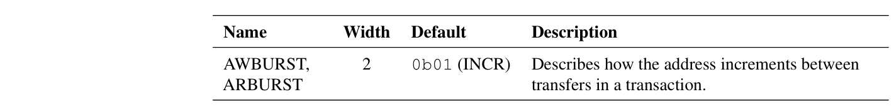

突发在 AxBURST 信号上按下述 表 A3.9. 所示进行编码。

**表 A3.9：AxBURST 编码**

属性 BURST_Present 用于确定 AxBURST 信号是否存在。

仅发出 Burst 类型为 INCR 的请求的管理者，可以从其接口中省略 AxBURST 输出。所连接的从属者必须将其 AxBURST 输入连接到 0b01。

**表 A3.10：BURST_Present 属性**

共有三种不同的突发类型：

**递增地址（INCR）**

采用此突发类型时，每次传输的地址都是前一次传输地址的递增值。递增量取决于事务的 Size。例如，对于对齐的起始地址，Size 为 4 字节的事务中每次传输的地址都是前一地址加 4。此突发类型用于对常规顺序存储器的访问。

*ARM IHI 0022 · 第 46 页*

### A3.1. 事务请求

**回绕地址（WRAP）**

此突发类型与 INCR 相似，区别在于：如果到达更高的地址上限，地址会回绕到更低的地址。适用以下限制：

• 起始地址必须与每次传输的大小对齐。

• 突发的 Length 必须为 2、4、8 或 16 次传输。

回绕事务的行为是：

• 该事务访问的最低地址，是按待传输数据的总大小（即 Size \* Length）对齐后的起始地址。该地址被定义为回绕边界。

• 在每次传输之后，地址的递增方式与 INCR 突发相同。但是，如果该递增后的地址为 ((回绕边界)+ (Size \* Length))，则地址回绕到回绕边界。

• 事务中的第一次传输可以使用高于回绕边界的地址，但要受适用于回绕事务的限制约束。当第一个地址高于回绕边界时，地址发生回绕。此突发类型用于缓存行访问。

> **【辨析 · A3.1.4-1】三种突发类型的地址推进方式各异**
>
> 区别在于地址如何推进：INCR 每拍在上一次地址上递增一个 Size，适合连续存储器访问；WRAP 递增到回绕边界后折回容器最低地址，访问范围被限制在对齐容器内；FIXED 每拍地址保持不变，反复访问同一位置。三者可用的 Length 与容器各不相同，选错会使访问地址偏离预期。

回绕突发主要用于读和写缓存行。可以使用 Wrap_CLS_Modifiable 属性将回绕突发限制为缓存行大小且为 Modifiable（AxCACHE[1] 为 0b1）。使用此属性约束回绕突发，可以简化解码器以及在不同协议或数据位宽之间进行转换的桥接器的设计。

> **【典型场景 · A3.1.4-2】缓存行访问首选回绕突发**
>
> 场景是按缓存行访问存储器、起始地址未必在行首时，选 WRAP 突发，让地址在缓存行边界内回绕，一个事务覆盖整条缓存行。代价是起始地址须与 Size 对齐、Length 只能是 2、4、8 或 16，且需处理回绕逻辑。实践中可用 Wrap_CLS_Modifiable 把回绕突发约束为缓存行大小，简化译码器和桥接器。

表 A3.11 描述了 Wrap_CLS_Modifiable 属性。

**表 A3.11：Wrap_CLS_Modifiable 属性**
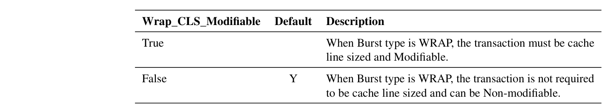
False Y 当突发类型为 WRAP 时，不要求事务为缓存行大小，且可以是 Non-modifiable。

注意，回绕的 AtomicCompare 不受此属性影响，见 A6.4 原子事务。

表 A3.12 显示了 Wrap_CLS_Modifiable 属性的兼容性。

**表 A3.12：Wrap_CLS_Modifiable 兼容性**

此突发类型用于对同一位置的重复访问，例如装载或清空 FIFO 时。

> **【典型场景 · A3.1.4-3】FIFO 反复访问宜用固定突发**
>
> 场景是反复读写同一寄存器或端口，例如装载、清空 FIFO，选择 FIXED 突发，每拍地址不变、字节通道恒定，只在同一位置反复传送数据。代价是限制较多：Length 最多 16，只能配合 NoSnoop 操作码，且部分组件通过 Fixed_Burst_Disable 声明不支持，集成前需核对互操作性。

• 突发中每次传输的地址都相同。

• 有效的字节通道对所有传输都是恒定的。但是，在这些字节通道内，置位了 WSTRB 的实际字节在每次传输中可以不同。

• 突发的 Length 最多可为 16 次传输。

*ARM IHI 0022 · 第 47 页*

A3.1. 事务请求

• FIXED 突发类型只能与 WriteNoSnoop 或 ReadNoSnoop 操作码一起使用。更多信息请参见 第 A7 章

> **【约束 · A3.1.4-4】FIXED 突发只能配合 NoSnoop 操作码**
>
> 原文规定 FIXED 突发类型只能与 WriteNoSnoop 或 ReadNoSnoop 操作码一起使用，详见请求操作码章节。这意味着任何带有侦听或缓存一致性语义的操作码都不得携带 FIXED 突发。设计译码器时可据此简化判断；集成时若违反该组合，事务语义将得不到保证。

请求操作码。

FIXED 突发类型不常用，表 A3.13 中定义了一个属性 Fixed_Burst_Disable，用于指示某组件是否支持它。

**表 A3.13：Fixed_Burst_Disable 属性**
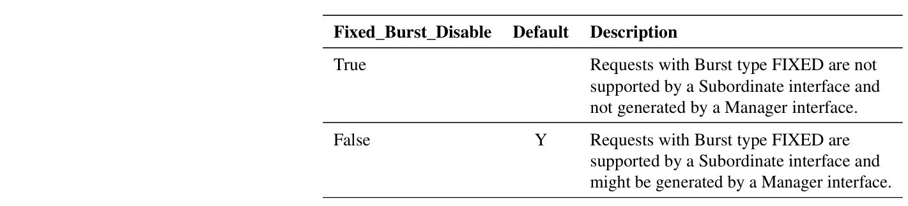

根据 Fixed_Burst_Disable 属性的取值，管理者接口与从属者接口之间的兼容性

如 表 A3.14 所示。

**表 A3.14：Fixed_Burst_Disable 兼容性**

*ARM IHI 0022 · 第 48 页*

A3.1. 事务请求

**A3.1.5 传输地址**

本节提供了确定事务中各次传输的地址和字节通道的方法。

事务的起始地址通过 AxADDR 信号指示。

**表 A3.15：AxADDR 信号**
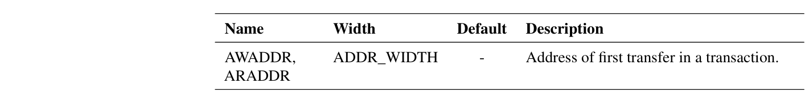

**地址宽度**

属性 ADDR_WIDTH 用于定义地址宽度。

**表 A3.16：ADDR_WIDTH 属性**
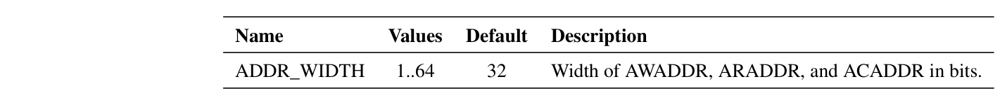

协议支持物理地址空间大小不同的组件之间进行通信。物理地址空间大小不同的组件必须按如下方式进行通信：

• 物理地址空间较小的组件必须位于较大物理地址空间内的一个对齐窗口中。通常，该窗口位于较大物理地址空间的底部。不过，物理地址空间较小的组件也可以位于较大物理地址空间内的一个带偏移的窗口中。

• 出向事务必须向其事务地址添加所需的额外高位。

• 入向事务必须经过检查，以便：

-- 位于地址窗口内的事务，其高位地址位被移除后直接通过。

-- 不具有所需高位地址位的事务被抑制。

提供所需功能是互连的责任。

**A3.1.6 事务方程**

此处列出的方程用于确定事务中每次传输的地址和有效数据字节通道。这些方程使用以下附加变量：

• Start_Addr：由管理者发出的起始地址。

• Data_Bytes：数据通道的宽度，以字节为单位（DATA_WIDTH/8）。

• Aligned_Addr：起始地址的对齐形式。

• Address_N：事务中第 N 次传输的地址。对于事务中的第一次传输，N 为 1。

• Wrap_Boundary：回绕事务中的最低地址。

• Lower_Byte_Lane：一次传输中地址最低的字节所在的字节通道。

• Upper_Byte_Lane：一次传输中地址最高的字节所在的字节通道。

• INT(x)：x 向下取整后的整数值。

*ARM IHI 0022 · 第 49 页*

以下等式确定了突发中各个传输的地址：

Start_Addr = AxADDR

Aligned_Addr = INT(Start_Addr / Size)\* Size

以下等式确定了突发中第一个传输的地址：

Address_1 = Start_Addr

对于 INCR 突发，以及地址尚未回绕的 WRAP 突发，以下等式确定了突发中第一个传输之后任一传输的地址：

Address_N = Aligned_Addr + (N - 1)\* Size

> **【关键点 · A3.1.6-1】后续拍地址由对齐地址递推得出**
>
> 对 INCR 以及尚未发生回绕的 WRAP，第二拍及其后地址等于 Aligned_Addr 加上 N 减一倍的 Size，其中 Aligned_Addr 是起始地址按 Size 向下对齐的结果。可见地址推进以对齐地址为基准，而不是从非对齐的起始地址逐拍累加。这正是非对齐事务首拍被截断、后续各拍才恢复对齐的根本原因。

对于 WRAP 突发，Wrap_Boundary 变量定义了回绕边界：

Wrap_Boundary = INT(Start_Addr / (Size \* Length))\* Size \* Length

对于 WRAP 突发，如果 Address_N = Wrap_Boundary + Size \* Length，则：

• 对当前传输使用以下等式：

Address_N = Wrap_Boundary

• 对任何后续传输使用以下等式：

Address_N = Aligned_Addr + ((N - 1)\* Size)- (Size \* Length)

以下等式确定了突发中第一个传输要使用的字节通道：

Lower_Byte_Lane = Start_Addr - (INT(Start_Addr/Data_Bytes)\* Data_Bytes)

Upper_Byte_Lane = Aligned_Addr + (Size-1)- (INT(Start_Addr/Data_Bytes)\* Data_Bytes)

以下等式确定了突发中第一个传输之后所有传输要使用的字节通道：

Lower_Byte_Lane = Address_N - (INT(Address_N / Data_Bytes)\* Data_Bytes)

Upper_Byte_Lane = Lower_Byte_Lane + Size - 1

数据通过以下字节通道传输：

DATA((8 \* Upper_Byte_Lane)+ 7: (8 \* Lower_Byte_Lane))

事务容器描述了在地址对齐且选通信号置位的情况下，该事务中可能访问的所有字节：

Container_Size = Size \* Length

对于 INCR 突发：

Container_Lower = Aligned_Addr

Container_Upper = Aligned_Addr + Container_Size

对于 WRAP 突发：

Container_Lower = Wrap_Boundary

Container_Upper = Wrap_Boundary + Container_Size

*ARM IHI 0022 · 第 50 页*

**A3.1.7 传输的伪代码描述**

// DataTransfer()

DataTransfer(Start_Addr, Size, Length, Data_Bytes, Burst, IsWrite) // 写操作时 IsWrite 为 TRUE，读操作时为 FALSE

addr = Start_Addr; // 当前地址变量 Aligned_Addr = (INT(addr/Size) \* Size);

aligned = (Aligned_Addr == addr); // 检查 addr 是否按 Size 对齐 Container_Size = Size \* Length;

if Burst == WRAP then

Lower_Wrap_Boundary = (INT(addr/Container_Size) \* Container_Size); // 对于回绕突发，addr 必须是对齐的

Upper_Wrap_Boundary = Lower_Wrap_Boundary + Container_Size;

for n = 1 to Length

Lower_Byte_Lane = addr - (INT(addr/Data_Bytes) \* Data_Bytes); if aligned then

Upper_Byte_Lane = Lower_Byte_Lane + Size - 1

else

Upper_Byte_Lane = Aligned_Addr + Size - 1

- (INT(addr/Data_Bytes) \* Data_Bytes);

// 执行数据传输

if IsWrite then

dwrite(addr, Lower_Byte_Lane, Upper_Byte_Lane)

else

dread(addr, Lower_Byte_Lane, Upper_Byte_Lane);

// 如有必要则递增地址

if Burst != FIXED then

if aligned then

addr = addr + Size;

if Burst == WRAP then

if addr \>= Upper_Wrap_Boundary then addr = Lower_Wrap_Boundary;

else

addr = Aligned_Addr + Size;

aligned = TRUE; // 第一次传输之后的所有传输都是对齐的

> **【关键点 · A3.1.7-1】非对齐只影响首拍其余各拍对齐**
>
> 伪代码在首拍之后把 aligned 置为真，并注释所有后续传输都是对齐的，说明非对齐只体现在事务的第一拍：首拍从非对齐地址起，其字节通道上界被对齐地址限制，因而是被截断的一拍；从第二拍开始地址已对齐，每拍都使用完整的 Size 字节。理解这点才能正确解读非对齐事务的字节通道分布。

return;

*ARM IHI 0022 · 第 51 页*

A3.1. 事务请求

**A3.1.8 常规事务**

一个事务有多种突发、大小和长度选项。但是，某些接口和事务类型可能只使用这些选项的一个子集。如果某个从属者组件连接到一个只使用事务选项子集的管理者，则可以将其设计为采用简化的译码逻辑。

定义 Regular 属性，用于识别满足以下条件的事务：

• Length 为 1、2、4、8 或 16 次传输。

• 如果 Length 大于 1，则 Size 与数据通道宽度相同。

• Burst 为 INCR 或 WRAP，而不是 FIXED。

• 对于 INCR 事务，地址与事务容器对齐。

• 对于 WRAP 事务，地址与 Size 对齐。

> **【关键点 · A3.1.8-1】常规事务是全体事务的真子集**
>
> Regular 属性识别满足条件的事务：Length 为 1、2、4、8 或 16；Length 大于 1 时 Size 必须等于数据宽度；突发只能是 INCR 或 WRAP；INCR 地址与事务容器对齐、WRAP 地址与 Size 对齐。常规事务是全部合法事务的子集，一方只支持常规事务时，双方都能简化译码逻辑。

Regular_Transactions_Only 属性用于定义管理者是否只发出 Regular 类型的事务，以及从属者是否只支持 Regular 事务。

**表 A3.17：Regular_Transactions_Only 属性**

Regular 事务的互操作规则如 表 A3.18 所示。

**表 A3.18：Regular_Transactions_Only 互操作性**
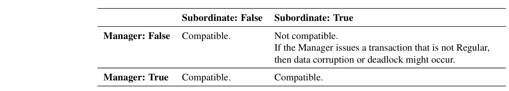

*ARM IHI 0022 · 第 52 页*

A3.2. 写和读数据

**A3.2 写和读数据**

本节介绍 AXI 写数据通道和读数据通道，以及接口如何执行混合端序和非对齐传输。

写数据信号和读数据信号具有相同的宽度，通过 DATA_WIDTH 属性指定。

**表 A3.19：DATA_WIDTH 属性**
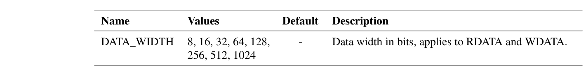

**A3.2.1 写数据通道（W）**

写数据通道的数据信号和最后信号如 表 A3.20. 所示

**表 A3.20：写数据信号**
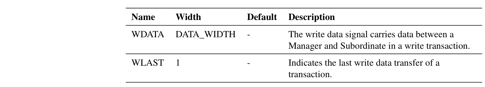

以下规则适用：

• 管理者在驱动事务中的最后一次写传输期间，必须置位 WLAST 信号。

> **【约束 · A3.2.1-1】WLAST 必须在最后一次写传输置位**
>
> 原文规定管理者在驱动事务中最后一次写传输期间必须置位 WLAST。该信号向从属者标出事务边界，从属者据此确定何时完成写事务并返回该事务的写响应。若 WLAST 置位时机错误，从属者通常会误判事务结束，导致多收或少收写数据，写响应也会提前或延后返回，故它不是可选装饰，而是必须遵守的时序要求。

• 建议对非活动字节通道将 WDATA 驱动为 0。

• 不使用 WLAST 的从属者可以从其接口中省略该输入。

属性 WLAST_Present 用于确定 WLAST 信号是否存在。

**表 A3.21：WLAST_Present 属性**

*ARM IHI 0022 · 第 53 页*

A3.2. 写数据和读数据

**A3.2.1.1 写选通**

WSTRB 信号携带写选通，用于指示写数据通道的哪些字节通道包含有效信息。

**表 A3.22：WSTRB 信号**
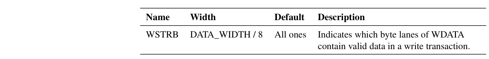

写数据通道每 8 位对应一个写选通，因此 WSTRB[n] 对应于 WDATA[(8n)+7:(8n)]。

> **【关键点 · A3.2.1.1-1】WSTRB 每一位对应一个字节通道**
>
> 写数据通道每 8 位对应一个写选通，WSTRB 的第 n 位控制 WDATA 中第 n 个字节通道是否有效，因此选通与字节通道是严格一一对应的。当 WVALID 为高时，只有被置位的选通所对应的数据字节才写入，未置位的字节通道不产生写操作。这种按字节选通的能力，使部分写与非对齐写都能在单拍内表达。

当 WVALID 为高电平时：

• 要写入的数据字节有对应的写选通被置为高电平。

• 在事务容器内部，任意数量的写选通都可以为高电平。如果所有写选通均为低电平，

则该传输不写入任何数据。

• 在事务容器外部，所有写选通必须为低电平。

> **【约束 · A3.2.1.1-2】事务容器外部的写选通必须为低**
>
> 原文规定在事务容器外部所有写选通必须为低电平，即管理者不得对本次事务容器未覆盖的字节通道置位选通。容器由 Size 乘 Length 与起始地址共同界定，违反这一点等于一次事务写到了范围之外的地址，会使从属者收到越界写入。作为对照，容器内部允许任意数量的选通置位，甚至全部为零表示该拍不写数据。

当 WVALID 为低电平时：

• 写选通可以取任意值，不过建议将其驱动为低电平或保持其先前的值。

• 对于选通为低电平的字节通道，建议将 WDATA 驱动为零。

属性 WSTRB_Present 用于指示接口上是否存在 WSTRB 信号。

**表 A3.23：WSTRB_Present 属性**
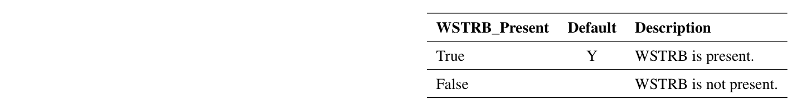

只发起所有写选通均已置位的事务的管理者，可以从其接口中省略 WSTRB 输出。所连接的从属者必须将其 WSTRB 输入接为高电平。

*ARM IHI 0022 · 第 54 页*

A3.2. 写数据和读数据

**A3.2.2 读数据通道（R）**

读数据信号和最后信号如 表 A3.24. 所示。

**表 A3.24：读数据通道控制信号**
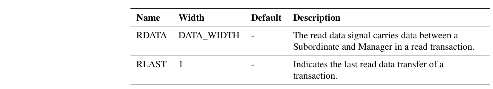

以下规则适用：

• 即使从属者只有一个读数据来源，它也必须仅响应请求而置位 RVALID 信号。

• 当从属者驱动事务中的最后一次读传输时，它必须置位 RLAST 信号。

> **【约束 · A3.2.2-1】RLAST 必须在最后一次读传输置位**
>
> 原文规定从属者驱动事务中最后一次读传输时必须置位 RLAST。它与写侧的 WLAST 对称，用于向管理者标出读事务的结束位置，管理者据此判断哪些数据属于本次事务。由于读数据由从属者产生，RLAST 置位错误会让管理者错配数据与事务，在多个读事务未完成交织时问题尤为明显。

• 建议对非活动字节通道将 RDATA 驱动为零。

• 不使用 RLAST 的管理者可以从其接口中省略该输入。

属性 RLAST_Present 用于确定是否存在 RLAST 信号。

**表 A3.25：RLAST_Present 属性**

**A3.2.3 窄传输**

当管理者生成的传输比其数据通道窄时，地址和控制信息决定该传输使用的字节通道：

• 当 Burst 为 INCR 或 WRAP 时，事务中的每次数据传输使用不同的字节通道。

> **【典型场景 · A3.2.3-1】窄外设访问用窄传输更省连线**
>
> 场景是位宽较窄的外设，例如对接 8 位寄存器而互连数据通道为 32 位或 64 位，选择窄传输，让每次传输只使用一个字节通道子集，从而无需为外设单独布线。代价是完成同样数据量需要更多拍，带宽利用率下降；若外设地址固定不变，还应改用 FIXED 突发，让所有拍复用同一字节通道。

• 当 Burst 为 FIXED 时，事务中的每次数据传输使用相同的字节通道。

> **【关键点 · A3.2.3-2】窄传输的字节通道随突发类型变化**
>
> 窄传输使用哪些字节通道由地址和控制信息决定，并取决于突发类型：INCR 与 WRAP 事务中每次数据传输使用不同的字节通道，地址推进驱动选通窗口移动；FIXED 事务中每次传输使用相同的字节通道。这一差异是窄传输实现的核心，也是把窄传输下推到不同位宽接口时必须保持一致的行为。

图 A3.1 和 图 A3.2. 中给出了两个字节通道使用示例。阴影单元格表示未传输的字节。

在 图 A3.1: 中：

• 该事务有五次数据传输。

• 起始地址为 0。

• 每次传输为 8 位。

• 这些传输位于 32 位数据通道上。

• 突发类型为 INCR。

*ARM IHI 0022 · 第 55 页*

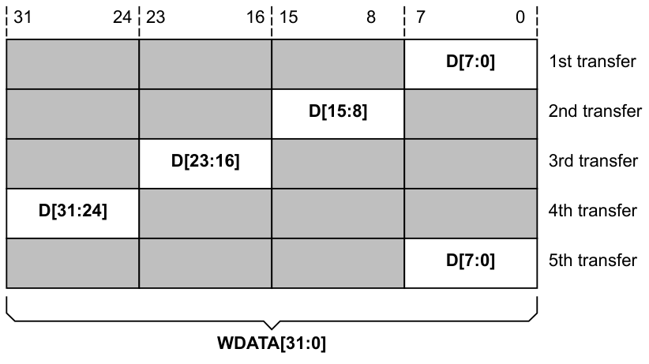
**图 A3.1：8 位传输的窄传输示例**

在 图 A3.2： 中

• 该事务有三次数据传输。

• 起始地址为 4。

• 每次传输为 32 位。

• 这些传输位于 64 位数据通道上。

63 56 55 48 47 40 39 32 31 24 23 16 15 8 7 0

**D[63:56]D[55:48]D[47:40]D[39:32]** 第 1 次传输

**D[31:24]D[23:16]D[15:8]D[7:0]** 第 2 次传输

**D[63:56]D[55:48]D[47:40]D[39:32]** 第 3 次传输

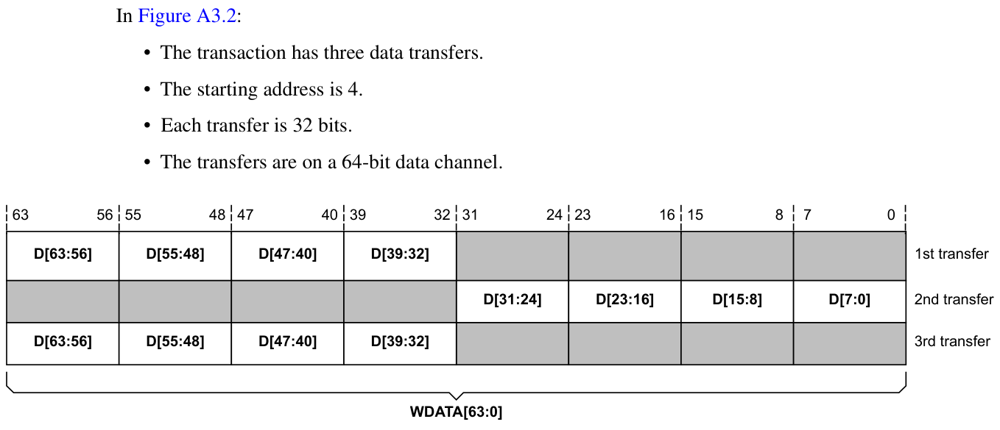
**图 A3.2：32 位传输的窄传输示例**

**A3.2.4 字节不变性**

为在单个内存空间中访问混合端序的数据结构，AXI 协议使用一种字节不变的端序方案。

字节不变端序意味着，对于数据结构中的任何多字节元素：

• 无论数据的端序如何，该元素都使用内存中相同的连续字节。

• 端序决定这些字节在内存中的顺序，即决定内存中的第一个字节是该元素的最高有效字节（MSB）还是最低有效字节（LSB）。

• 对某个地址的任何字节传输，都将这 8 位数据经相同的数据通道连线传递到相同的地址位置，而无论它作为组成部分所属的更大数据元素的端序如何。

> **【辨析 · A3.2.4-1】字节不变与大小端转换是两件事**
>
> 区别在于字节不变性保证同一地址的字节始终经相同的数据通道连线到达相同的内存字节位置，与它所属更大数据元素的端序无关；而大小端转换则会重新排列多字节元素内部各字节的顺序。字节不变使大端与小端数据结构能在同一存储空间并存而不互相破坏，转换函数只在接口本身并非字节不变时才需要。

仅具有一种传输宽度的组件，必须将其字节通道连接到数据通道中相应的字节通道。支持多种传输宽度的组件，可能需要更复杂的接口，来转换一个本身并非字节不变的接口。

*ARM IHI 0022 · 第 56 页*

A3.2. 写数据与读数据

大多数小端组件可以直接连接到字节不变接口。仅支持大端传输的组件需要一个转换函数才能实现字节不变操作。

图 A3.3 和 图 A3.4 中的示例展示了一个 32 位数 0x0A0B0C0D，它分别存储在寄存器和存储器中。

图 A3.3 中给出了大端、字节不变数据结构的示例。在该结构中：

• 数据的 MSB，即 0x0A，存储在寄存器中的 MSB 位置。

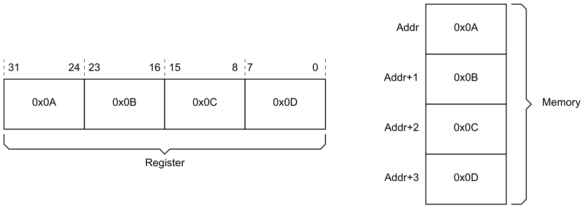
**图 A3.3：大端字节不变数据结构示例**

图 A3.4 中给出了小端、字节不变数据结构的示例。在该结构中：

• 数据的 LSB，即 0x0D，存储在寄存器中的 LSB 位置。

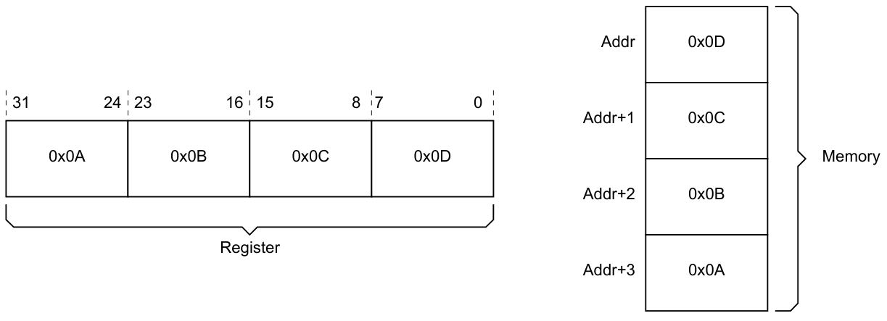
**图 A3.4：小端字节不变数据结构示例**

图 A3.3 和 图 A3.4 中的示例表明，字节不变性确保大端和小端结构可以在同一存储空间中并存而不会发生损坏。

图 A3.5 中给出了一个需要字节不变访问的数据结构示例。在该示例中，头部字段使用小端排序，而有效载荷使用大端排序。

*ARM IHI 0022 · 第 57 页*

A3.2. 写数据与读数据

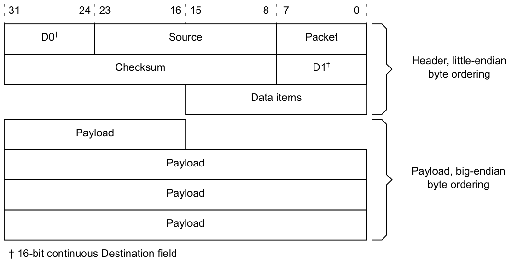
**图 A3.5：混合端序数据结构示例**

在此示例结构中，数据项是一个两字节的小端元素，意味着其最低地址即其 LSB。使用字节不变性可确保对大端有效载荷的访问不会破坏该小端元素。

**A3.2.5 非对齐传输**

AXI 支持非对齐传输。对于任何由宽度大于 1 字节的数据传输构成的事务，所访问的首个字节可能与自然地址边界不对齐。例如，一个从字节地址 0x1002 开始的 32 位数据包，并不与 32 位自然地址边界对齐。

> **【典型场景 · A3.2.5-1】非对齐访问的代价是多一次传输**
>
> 场景是数据结构起点落在自然边界之内，例如从 0x1002 开始的 32 位数据包，可用低位地址线或字节通道选通直接表达非对齐起始。代价是首拍被截断、只传部分字节，剩余字节被推到后续拍，因此同样数据量往往需要多一拍；若与前后数据组合，还可能触及 4KB 边界限制，需管理者自行拆包。

管理者可以：

• 使用低位地址线来指示非对齐的起始地址。

• 提供一个对齐地址，并使用字节通道选通信号来指示非对齐的起始地址。

低位地址线上的信息必须与字节通道选通信号上的信息一致。

> **【约束 · A3.2.5-2】低位地址线必须与字节选通一致**
>
> 原文规定低位地址线上的信息必须与字节通道选通信号上的信息一致。管理者既可用低位地址线表示非对齐起始地址，也可以给出对齐地址并用选通表示，但两种表示不得互相矛盾。从属者虽不要求据此采取特殊操作，一致性仍是强制要求：一旦矛盾，从属者对起始位置的理解即不唯一，写入选通会落到错误字节。

不要求从属者根据管理者的任何对齐信息采取特殊操作。

在 图 A3.6 中给出了 32 位数据通道上对齐与非对齐 32 位事务的示例。图中的每一行代表一次传输，阴影单元格表示未传输的字节。

*ARM IHI 0022 · 第 58 页*

A3.2. 写数据和读数据

31 24 23 16 15 8 7 0

0x03 0x02 0x01 0x00 第 1 次传输

地址：0x00 0x07 0x06 0x05 0x04 第 2 次传输

传输大小：32 位

突发类型：递增

0x0B 0x0A 0x09 0x08 第 3 次传输

突发长度：4 次传输

0x0F 0x0E 0x0D 0x0C 第 4 次传输

[WDATA[31:0]]

31 24 23 16 15 8 7 0

0x03 0x02 0x01 0x00 第 1 次传输

地址：0x01 0x07 0x06 0x05 0x04 第 2 次传输

传输大小：32 位

突发类型：递增

0x0B 0x0A 0x09 0x08 第 3 次传输

突发长度：4 次传输

0x0F 0x0E 0x0D 0x0C 第 4 次传输

[WDATA[31:0]]

31 24 23 16 15 8 7 0

0x03 0x02 0x01 0x00 第 1 次传输

0x07 0x06 0x05 0x04 第 2 次传输

地址：0x01

传输大小：32 位 0x0B 0x0A 0x09 0x08 第 3 次传输

突发类型：递增

突发长度：5 次传输

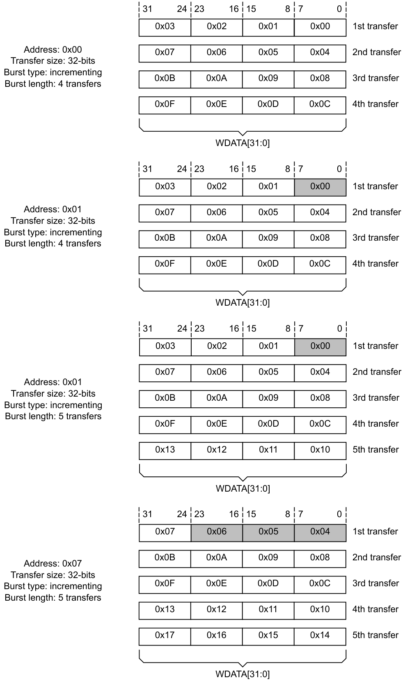
**图 A3.6：32 位数据通道上的对齐和非对齐传输**

在 图 A3.7 中给出了 64 位数据通道上对齐和非对齐 32 位事务的示例。每一行

*ARM IHI 0022 · 第 59 页*

A3.2. 写数据和读数据

在图中代表一次传输，阴影单元格表示未传输的字节。

63 56 55 48 47 40 39 32 31 24 23 16 15 8 7 0

0x07 0x06 0x05 0x04 0x03 0x02 0x01 0x00 第 1 次传输

地址：0x00 0x07 0x06 0x05 0x04 0x03 0x02 0x01 0x00 第 2 次传输

传输大小：32 位

突发类型：递增

0x0F 0x0E 0x0D 0x0C 0x0B 0x0A 0x09 0x08 第 3 次传输

突发长度：4 次传输

0x0F 0x0E 0x0D 0x0C 0x0B 0x0A 0x09 0x08 第 4 次传输

[WDATA[63:0]]

63 56 55 48 47 40 39 32 31 24 23 16 15 8 7 0

0x07 0x06 0x05 0x04 0x03 0x02 0x01 0x00 第 1 次传输

地址：0x07 0x0F 0x0E 0x0D 0x0C 0x0B 0x0A 0x09 0x08 第 2 次传输

传输大小：32 位

突发类型：递增

0x0F 0x0E 0x0D 0x0C 0x0B 0x0A 0x09 0x08 第 3 次传输

突发长度：4 次传输

0x17 0x16 0x15 0x14 0x13 0x12 0x11 0x10 第 4 次传输

[WDATA[63:0]]

63 56 55 48 47 40 39 32 31 24 23 16 15 8 7 0

0x07 0x06 0x05 0x04 0x03 0x02 0x01 0x00 第 1 次传输

0x0F 0x0E 0x0D 0x0C 0x0B 0x0A 0x09 0x08 第 2 次传输

地址：0x07

突发类型：递增 传输大小：32 位 0x0F 0x0E 0x0D 0x0C 0x0B 0x0A 0x09 0x08 第 3 次传输 突发长度：5 次传输

0x17 0x16 0x15 0x14 0x13 0x12 0x11 0x10 第 4 次传输

0x17 0x16 0x15 0x14 0x13 0x12 0x11 0x10 第 5 次传输

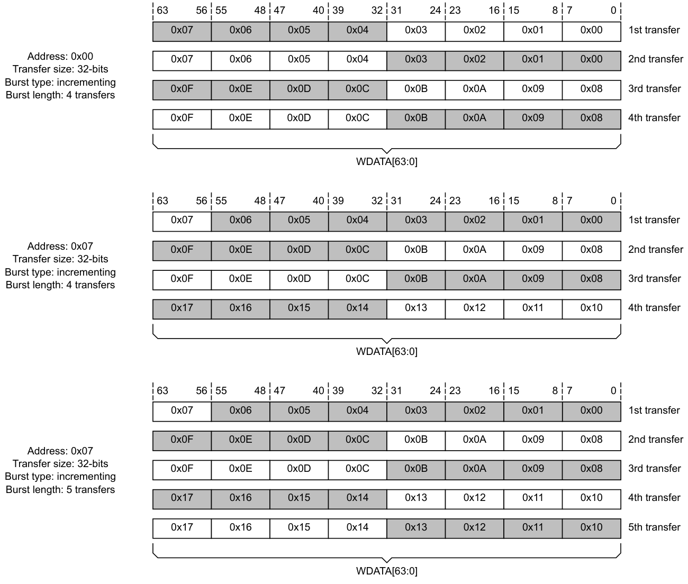
**图 A3.7：64 位数据通道上的对齐和非对齐传输**

在 图 A3.8 中给出了 64 位数据通道上对齐的 32 位回绕事务的示例。图中的每一行代表一次传输，阴影单元格表示未传输的字节。

63 56 55 48 47 40 39 32 31 24 23 16 15 8 7 0

0x07 0x06 0x05 0x04 0x03 0x02 0x01 0x00 第 1 次传输

地址：0x04 0x0F 0x0E 0x0D 0x0C 0x0B 0x0A 0x09 0x08 第 2 次传输

传输大小：32 位

突发类型：回绕

0x0F 0x0E 0x0D 0x0C 0x0B 0x0A 0x09 0x08 第 3 次传输

突发长度：4 次传输

0x07 0x06 0x05 0x04 0x03 0x02 0x01 0x00 第 4 次传输

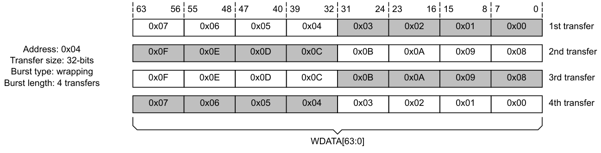
**图 A3.8：64 位通道上的对齐回绕传输**

*ARM IHI 0022 · 第 60 页*

A3.3. 事务响应

**A3.3 事务响应**

每个 AXI 事务都包含一个或多个由从属者发送的响应传输，用于指示该事务的结果。

写通道上的事务具有一个或多个写响应。

读通道上的事务具有一个或多个读响应。

原子事务具有写响应和读响应，见 A6.4 原子事务。

**A3.3.1 写响应**

写响应通过写响应通道上的 BRESP 信号传输。写通道上的所有事务都有一个完成响应，用于指示该事务的结果。有些事务还

具有第二个写响应，例如用于指示持久性，见 A9.8.4 B 通道上的 PCMO 响应。

BRESP 和 BCOMP 信号用于发送写响应。

**表 A3.26：BRESP 和 BCOMP 信号**
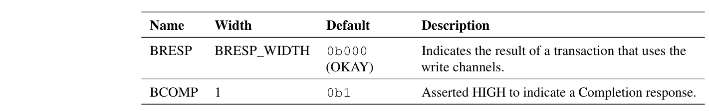

BRESP_WIDTH 属性定义于 表 A3.27

**表 A3.27：BRESP_WIDTH 属性**
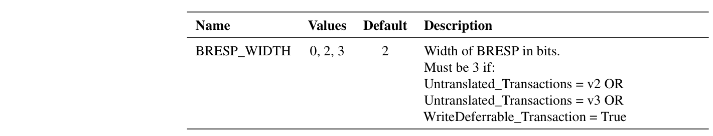

BRESP 是可选信号。如果 BRESP_WIDTH 属性为 0，则该信号不存在，并假定为 0b000（OKAY）。

仅当接口使用了可能具有两个写响应的特性时才存在 BCOMP，这些特性包括：

• 针对持久性的缓存维护，见 A9.8 针对持久性的 CMO。

• 内存标记，见 A12.2 内存标记扩展（MTE）。

如果存在 BCOMP，则对于写通道上的每个事务，都必须在其一个响应传输中将其置位。

BRESP 的编码见 表 A3.28

*ARM IHI 0022 · 第 61 页*

A3.3. 事务响应

**表 A3.28：BRESP 编码**
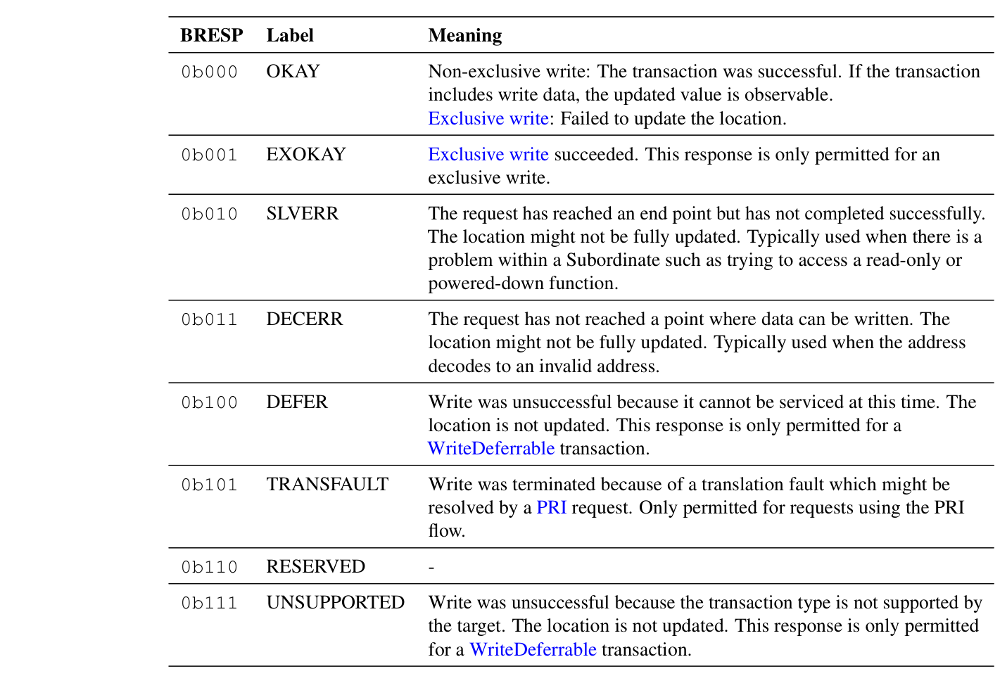

**A3.3.2 读响应**

读响应指示读是否成功，以及该传输中的数据是否有效。

读响应使用读数据通道上的 RRESP 信号传输。事务中的每次读数据传输都伴随一个读响应。不要求事务中每次读数据传输的响应值都相同。

> **【关键点 · A3.3.2-1】每次读传输各带一个读响应**
>
> 原文指出事务中的每次读数据传输都伴随一个读响应，且不要求各次传输的响应值相同。也就是说读响应是逐拍给出的，而不是每个事务只给一个总响应；同一事务中前面的拍可能成功、后面的拍可能报错。管理者因此需逐拍检查响应，或借助 Consistent_DECERR 属性确认错误在整个事务内一致出现。

要求无论响应如何，由 Length 指示的所有数据传输始终完成。对于某些响应，不要求该传输中的数据有效。

> **【约束 · A3.3.2-2】无论响应如何全部读传输都要完成**
>
> 原文规定无论响应如何，由 Length 指示的所有数据传输必须始终完成，即使某些响应下数据本身不被要求有效。这意味着从属者不得因出错而提前中止剩余拍，管理者也必须收完所有拍。与此相关的一个安全提示是：对不要求数据有效的响应，管理者仍可能采样 RDATA，因此从属者不应指望用该响应隐藏敏感数据。

RRESP 信号的定义见 表 A3.29

**表 A3.29：RRESP 信号**
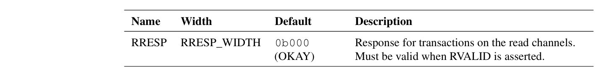

*ARM IHI 0022 · 第 62 页*

A3.3. 事务响应

RRESP_WIDTH 属性定义于 表 A3.30

**表 A3.30：RRESP_WIDTH 属性**
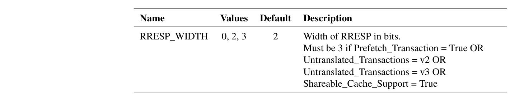

RRESP 是可选信号。如果 RRESP_WIDTH 属性为 0，则该信号不存在，并假定为 0b000（OKAY）。

RRESP 的编码见 表 A3.31

对于不要求数据有效的响应，管理者仍可能采样 RDATA 值，因此从属者不应依赖该响应来隐藏敏感数据。

**表 A3.31：RRESP 编码**
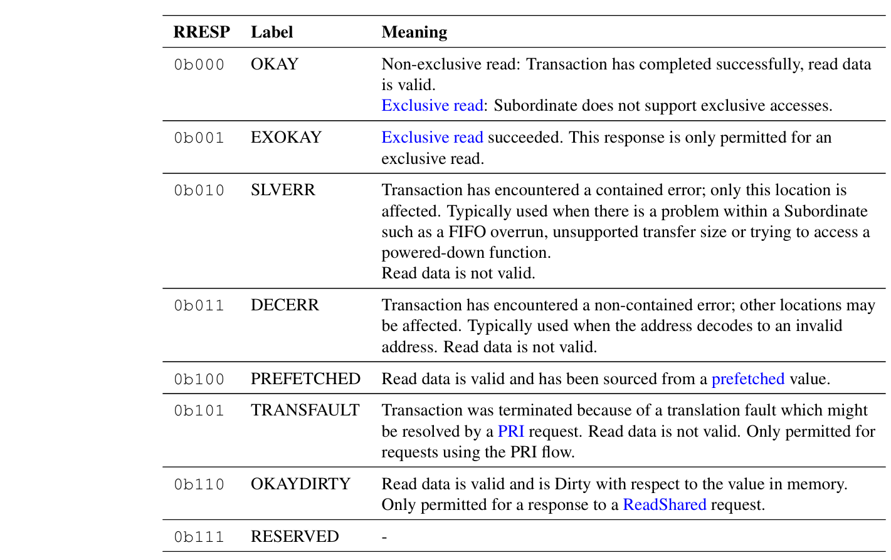

RRESP 的值并不要求在一个事务的每次传输中都相同。当访问从属者出现问题时，通常使用 DECERR 响应，在这种情况下，读数据的每次传输都会一致地发出 DECERR 信号。如果管理者只需检查一次读数据传输就能确定是否发生了 DECERR，可能会带来好处。

Consistent_DECERR 属性用于定义从属者是否在一个

事务内一致地发出 DECERR 信号，如 表 A3.32 所示。

*ARM IHI 0022 · 第 63 页*

A3.3. 事务响应

**表 A3.32：Consistent_DECERR 属性**
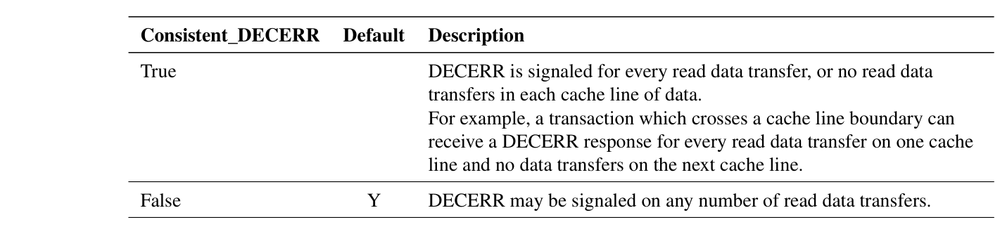

不使用 DECERR 响应的从属者接口可以将 Consistent_DECERR 属性设置为 True。

Consistent_DECERR 设置为 True 的管理者可以检查单个数据传输，以确定是否发生了 DECERR。

在 AXI 与 CHI 之间进行桥接时，将本属性设置为 True 会很有帮助，此时 DECERR 会转换为 Non-data Error。

在连接管理者接口和从属者接口时，表 A3.33 给出了兼容的 Consistent_DECERR 组合。

**表 A3.33：Consistent_DECERR 互操作性**

**A3.3.3 从属者忙指示**

在提供响应时，从属者可以使用忙（Busy）指示来表明其当前的活动水平。该信息可用于控制管理者的发出速率，或控制其产生的推测事务数量。

忙指示对于具有共享资源的组件（例如内存控制器或系统缓存）很有用。例如，忙指示可以表明：

• 共享队列的水平。

• 读或写请求队列的水平，具体取决于事务的方向。

• 组件对资源的使用量是高于还是低于其分配值。

如 表 A3.34 所示的 Busy_Support 属性用于定义某个接口是否包含忙指示信号。

*ARM IHI 0022 · 第 64 页*

A3.3 事务响应

**表 A3.34：Busy_Support 属性**

当 Busy_Support 为 True 时，接口上包含以下信号。

**表 A3.35：忙指示信号**

对于具有多个读数据传输的事务，Busy 必须有效，但每次传输可以取不同的值。

对于具有多个写响应的事务，Busy 必须在 BCOMP 置位的响应中有效。对于其他写响应，Busy 不适用，可以取任意值。

对于具有写响应和读响应的原子事务，BBUSY 和 RBUSY 预期具有相同的值，但不要求如此。

Busy 指示值的具体用法是 IMPLEMENTATION DEFINED，表 A3.36 中给出了一个关于如何使用它的示例。在此示例中，如果从属者无法生成动态忙指示，则默认值 0b01 是合适的。

**表 A3.36：忙指示的用法示例**

在连接管理者接口和从属者接口时，表 A3.37 给出了兼容的 Busy_Support 组合。

**表 A3.37：Busy_Support 互操作性**

*ARM IHI 0022 · 第 65 页*

**请求属性**

本章介绍请求属性，这些属性用于指示下游组件应如何处理请求。本章包含以下小节：

• A4.1 从属者类型

• A4.2 内存属性

• A4.3 内存类型

• A4.4 协议错误

• A4.5 保护属性

• A4.6 内存加密上下文

• A4.7 多区域接口

• A4.8 QoS 信令

*ARM IHI 0022 · 第 66 页*

## 第 A4 章 请求属性

A4.1. 从属者类型

**A4.1 从属者类型**

从属者被分类为内存从属者或外设从属者。

**内存从属者**

内存从属者需要正确处理所有事务类型。

**外设从属者**

外设从属者具有 IMPLEMENTATION DEFINED 的访问方式。通常，该访问方式在组件数据手册中定义，其中描述了该从属者能够正确处理的事务类型。

对不属于 IMPLEMENTATION DEFINED 访问方式的任何外设从属者访问，都必须以符合协议的方式完成。但是，当进行了此类访问后，并不要求外设从属者继续正确运行。只要求该从属者继续以符合协议的方式完成后续事务。

> **【关键点 · A4.1-1】协议合规不等于外设功能正确**
>
> 外设从属者的访问方式由实现定义，规范只要求它对越界访问也以符合协议的方式完成握手与响应，并不要求其继续正确运行。因此超范围访问可能返回错误数据却依然是合法事务，软件不能据此判断访问有效。

*ARM IHI 0022 · 第 67 页*

### A4.2. 内存属性

**A4.2 内存属性**

本节描述了决定缓存、缓冲区和内存控制器等系统组件应如何处理请求的属性。

> **【辨析 · A4.2-1】可缓冲讨论时机，可缓存讨论位置**
>
> 可缓冲针对的是写响应能否提前发出、事务何时到达最终目的地；可缓存针对的是数据能否留在缓存中以服务后续访问。两者由 AxCACHE 的不同位独立控制，进而组合出写穿、写回、Device 等内存类型，因此不可混为一谈。

AWCACHE 和 ARCACHE 信号指定请求的内存属性。它们控制：

• 事务如何在系统中推进。

• 系统级缓冲区和缓存如何处理该事务。

在本规范中，术语 AxCACHE 统称 AWCACHE 和 ARCACHE 信号。表

A4.1 描述了 AWCACHE 和 ARCACHE 信号。

**表 A4.1：AxCACHE 信号**

CACHE_Present 属性用于确定接口上是否存在 AxCACHE 信号。

**表 A4.2：CACHE_Present 属性**

AWCACHE 各位的编码如下：

• [0] 可缓冲

• [1] 可修改

• [2] 其他分配

• [3] 分配

ARCACHE 各位的编码如下：

• [0] 可缓冲

• [1] 可修改

• [2] 分配

• [3] 其他分配

注意，对于读请求和写请求，分配位与其他分配位处于不同的位置。

> **【辨析 · A4.2-2】读写分配位在 AxCACHE 中位置相反**
>
> AWCACHE 的 [3] 为分配、[2] 为其他分配，而 ARCACHE 恰好相反，[2] 为分配、[3] 为其他分配。读请求与写请求对同一内存类型使用不同编码，实现译码时须分别处理，否则会把分配提示搞反。

**A4.2.1 可缓冲，AxCACHE[0]**

对于写事务：

• 如果可缓冲位取消置位，且 AWCACHE[3:2] 均取消置位，则写响应表示数据已到达其最终目的地。

• 如果可缓冲位置位，则在满足可观测性要求时，可以从中间点发送写响应。

> **【关键点 · A4.2.1-1】可缓冲位放宽写响应的发送点**
>
> 可缓冲位置位后，写响应只要满足可观测性要求即可从中间点发出，管理者因此无法确认数据已抵达最终目的地；取消置位则响应即代表数据已到达最终目的地。这让缓冲在换取吞吐量的同时牺牲了完成语义。

*ARM IHI 0022 · 第 68 页*

A4.2. 内存属性

对于 ARCACHE[3:2] 被取消置位（Non-cacheable，不可缓存）且 ARCACHE[1] 被置位（Modifiable，可修改）的读事务：

• 如果 Bufferable 位被取消置位，则读数据必须从最终目的地获取。

• 如果 Bufferable 位被置位，则读数据可以从最终目的地、或从正在向最终目的地

推进的写操作中获取。

对于 ARCACHE[3:1] 的其他组合，Bufferable 位没有影响。

> **【关键点 · A4.2.1-2】可缓冲位只对一类读事务起作用**
>
> 只有 ARCACHE 的 [3:2] 均取消置位且 [1] 置位，即不可缓存但可修改的读事务，其数据来源才受可缓冲位约束；对 ARCACHE[3:1] 的其他组合，Bufferable 位没有影响。因此不能认为可缓冲位会改变所有读事务的行为。

**A4.2.2 可修改，AxCACHE[1]**

当 AxCACHE[1] 被置位时，该事务是 Modifiable（可修改）的，这表示该事务的特性可以被修改。当 AxCACHE[1] 被取消置位时，该事务是 Non-modifiable（不可修改）的。

> **【关键点 · A4.2.2-1】可修改指的是事务特性而非数据内容**
>
> AxCACHE[1] 置位表示该事务的地址、大小、长度、突发类型乃至数量结构可被拆分合并修改，取消置位则这些特性被冻结。它与数据本身能否改变无关，是描述事务形态是否可重组的标志。

以下各节描述不可修改事务和可修改事务的性质。

**不可修改事务**

不可修改事务不得被拆分为多个事务，也不得与其他事务合并。

> **【约束 · A4.2.2-2】不可修改事务不得拆分也不得合并**
>
> 对不可修改事务，协议禁止把它拆成多个事务，也禁止与其他事务合并。违反该条会破坏其固有的传输形态与可见性保证，下游组件可能观察到与原始请求不同的访问序列，因此互连不得随意重组此类事务。

在不可修改事务中，表 A4.3 中所示的参数不得被更改。

**表 A4.3：固定为不可修改的参数**

AxCACHE 属性只可被修改，以将事务从 Bufferable（可缓冲）转换为 Non-bufferable（不可缓冲）。不允许对 AxCACHE 做其他任何更改。

> **【约束 · A4.2.2-3】不可修改事务的 AxCACHE 只能单向降级**
>
> 对不可修改事务，AxCACHE 只允许把 Bufferable 改为 Non-bufferable，任何其他改动都被禁止。这是唯一放宽的方向，因为降级只会使行为更保守，不会引入原本不存在的缓冲或缓存语义，反向修改则会破坏事务的确定行为。

事务 ID 和 QoS 值可以被修改。

长度大于 16 的不可修改事务可以被拆分为多个事务。得到的每个事务必须满足本小节中给出的要求，但以下情况除外：

• 长度被缩短。

• 所生成事务的地址被相应地调整。

对于由 AxLOCK 置位所指示的独占访问类的不可修改事务，如果访问的总字节数保持不变，则允许修改大小 AxSIZE 和长度 AxLEN。

在某些情况下无法满足不可修改事务的要求。例如，当降级到比 Size 所要求的更窄的数据宽度时，该事务必须被修改。

执行此类操作的组件可以选择性地包含一个 IMPLEMENTATION DEFINED（实现定义）机制，用以指示已发生修改。该机制可以帮助软件调试。

**可修改事务**

可修改事务可以通过以下方式被修改：

• 一个事务可以被拆分为多个事务。

• 多个事务可以被合并为一个事务。

*ARM IHI 0022 · 第 69 页*

A4.2. 内存属性

• 一次读事务可以获取比所需更多的数据。

• 一次写事务可以使用 WSTRB 信号访问比所需更大的地址范围，以确保

只更新相应的位置。

• 在每个生成的事务中，可以修改以下属性：

-- 地址，AxADDR

-- 大小，AxSIZE

-- 长度，AxLEN

-- 突发类型，AxBURST

以下项不得更改：

• 独占访问指示：AxLOCK

• 访问和地址空间属性：AxPROT、AxINST、AxPRIV、AxNSE、AxPAS、

AxMMUPASUNKNOWN。

AxCACHE 可以修改，但任何修改都必须确保其他组件对事务的可见性不会降低，无论是通过阻止事务传播到所需的点，还是通过更改在缓存中查找事务的需求。对内存属性的任何修改，对于到同一地址范围的所有事务必须保持一致。

> **【约束 · A4.2.2-4】可修改事务的属性改动不得降低可见性**
>
> 可修改事务允许修改 AxCACHE，但任何改动都必须保证其他组件对事务的可见性不降低，无论是阻止事务传播到所需的观察点，还是改变在缓存中查找该事务的需求都不允许。否则会破坏一致性，故只能向更保守方向调整。

> **【约束 · A4.2.2-5】同一地址范围的属性修改必须一致**
>
> 对内存属性的任何修改，对于到同一地址范围的所有事务必须保持一致，不能对一部分事务放宽、对另一部分收紧。这保证了系统内各组件对该区域形成统一视图，避免因属性分歧导致的数据损坏。

事务 ID 和 QoS 值可以修改。

不允许进行具有以下任何效果的事务修改：

• 导致访问的 4KB 地址空间与原始事务的 4KB 地址空间不同。

• 导致对单拷贝原子性大小的区域的单次访问被执行多次访问。

参见 A6.1 单拷贝原子性大小。

**A4.2.3 Allocate 和 Other Allocate，AxCACHE[2] 和 AxCACHE[3]**

如果 Allocate 位置位：

• 数据之前可能已被分配，因此必须在缓存中查找该行。

• 建议将数据分配到缓存中，以供将来使用。

如果 Other Allocate 位置位：

• 数据之前可能已被分配，因此必须在缓存中查找该行。

• 不建议分配该数据，因为预计不会再访问它。

如果 Allocate 和 Other Allocate 都取消置位，则该请求不需要在任何缓存中查找。

> **【辨析 · A4.2.3-1】分配与不分配位都强制缓存查找**
>
> Allocate 与 Other Allocate 置位时都要求必须在缓存中查找该行，区别只在于是否建议把数据分配进缓存；两者都取消置位时才免除查找。因此查找要求是硬约束，而分配与否只是性能提示。

*ARM IHI 0022 · 第 70 页*

A4.3. 内存类型

**A4.3 内存类型**

AxCACHE 信号的组合指示一种内存类型。表 A4.4 给出了内存类型编码。方括号中的值是被允许的，但不是首选。表中未列出的值为保留值。

> **【约束 · A4.3-1】非首选编码可用，未列出的编码保留**
>
> 内存类型编码表中，方括号内的取值是被允许的但不是首选，未列出的取值则为保留值。实现不得使用保留编码，否则行为未定义；而选用非首选编码虽然合法，却可能在性能与互操作性上付出代价。

**表 A4.4：内存类型编码**

**A4.3.1 内存类型要求**

本节规定了各内存类型所要求的行为。

**Device 不可缓冲**

Device 不可缓冲内存所要求的行为是：

• 写响应必须从最终目的地获得。

• 读数据必须从最终目的地获得。

• 事务是不可修改的，参见 A4.2.2 不可修改事务。

• 不得预取读数据。

• 不得合并写事务。

**Device 可缓冲**

Device 可缓冲内存类型所要求的行为是：

• 写响应可以从中间点获得。

• 写事务必须在最终目的地及时地变为可见。

• 读数据必须从最终目的地获得。

• 事务是不可修改的，参见 A4.2.2 不可修改事务。

• 不得预取读数据。

• 不得合并写事务。

*ARM IHI 0022 · 第 71 页*

A4.3. 内存类型

两种设备内存类型都是不可修改的。在本规范中，术语“设备内存”与“不可修改内存”可以互换使用。

> **【辨析 · A4.3.1-1】设备内存与不可修改内存是可互换术语**
>
> Device 不可缓冲与 Device 可缓冲两种类型都不可修改，故规范把设备内存与不可修改内存当作同义说法。区别在于普通内存类型通常可修改，可用于缓存、预取与合并；设备内存则被冻结，以保证对设备的访问次序与副作用。

对于读事务，设备不可缓冲内存类型与设备可缓冲内存类型所要求的行为没有差别。

**普通非可缓存非可缓冲**

普通非可缓存非可缓冲内存类型所要求的行为是：

• 写响应必须从最终目的地获取。

• 读数据必须从最终目的地获取。

• 事务是可修改的，参见 A4.2.2 可修改事务。

• 写事务可以合并。

**普通非可缓存可缓冲**

普通非可缓存可缓冲内存类型所要求的行为是：

• 写响应可以从中间点获取。

• 写事务必须按照术语表中的定义，及时地在最终目的地可见。

没有任何机制能够确定写事务何时在其最终目的地可见。

• 读数据必须从以下任一来源获取：

-- 最终目的地。

-- 一笔正在向其最终目的地推进的写事务。

• 如果读数据是从写事务中获取的：

-- 它必须从该写的最新版本中获取。

-- 不得缓存该数据以服务后续的读操作。

• 事务是可修改的，参见 A4.2.2 可修改事务。

• 写事务可以合并。

对于普通非可缓存可缓冲读，数据可以从一笔仍在向其最终目的地推进的写事务中获取。这种数据与读事务和写事务同时传播到达最终目的地的情况无法区分。以这种方式返回的读数据并不表示该写事务在最终目的地可见。

> **【关键点 · A4.3.1-2】从在途写读回的数据不代表写已可见**
>
> 普通非可缓存可缓冲的读可以从一笔仍在向最终目的地推进的写中取数，这种数据与读写同时抵达最终目的地无法区分，但返回它并不表示该写已在最终目的地可见。因此不能用读回值来推断全局可见性。

**写穿不分配**

写穿不分配内存类型所要求的行为是：

• 写响应可以从中间点获取。

• 写事务必须按照术语表中的定义，及时地在最终目的地可见。

没有任何机制能够确定写事务何时在其最终目的地可见。

• 读数据可以从中间缓存副本中获取。

• 事务是可修改的，参见 A4.2.2 可修改事务。

• 读数据可以预取。

• 写事务可以合并。

• 对读事务和写事务都需要进行缓存查找。

• No-Allocate 属性是一种分配提示，也就是说，它是向内存系统提出的一项建议：出于

性能原因，这些事务不被分配。但是，并不禁止对读事务和写事务进行分配。

*ARM IHI 0022 · 第 72 页*

A4.3. 存储器类型

**写通读分配**

写通读分配存储器类型所要求的行为与写通不分配相同。出于性能原因：

• 建议对读事务进行分配。

• 不建议对写事务进行分配。

**写通写分配**

写通写分配存储器类型所要求的行为与写通不分配相同。出于性能原因：

• 不建议对读事务进行分配。

• 建议对写事务进行分配。

**写通读和写分配**

写通读和写分配存储器类型所要求的行为与写通不分配相同。出于性能原因：

• 建议对读事务进行分配。

• 建议对写事务进行分配。

**写回不分配**

写回不分配存储器类型所要求的行为是：

• 写响应可以从某个中间点获得。

• 写事务不要求在最终目的地可见。

> **【典型场景 · A4.3.1-3】追求吞吐选写回，追求可见性选写通**
>
> 当写数据会被反复修改且可容忍脏数据延迟回写时，选写回，代价是需要缓存维护与容量管理；当需要写尽快在最终目的地可见、便于其他管理者或设备及早观察时，选写通，代价是每次写都要向内存推进而增加带宽压力。

• 读数据可以从中间缓存的副本获得。

• 事务是可修改的（Modifiable），参见 A4.2.2 可修改事务。

• 读数据可以被预取。

• 写事务可以被合并。

• 读事务和写事务都需要进行缓存查找。

• 不分配属性是一个分配提示，即它是向存储器系统提出的建议：出于性能原因，这些事务不进行分配。但是，并不禁止对读事务和写事务进行分配。

**写回读分配**

写回读分配存储器类型所要求的行为与写回不分配相同。出于性能原因：

• 建议对读事务进行分配。

• 不建议对写事务进行分配。

**写回写分配**

写回写分配存储器类型所要求的行为与写回不分配相同。出于性能原因：

• 不建议对读事务进行分配。

• 建议对写事务进行分配。

*ARM IHI 0022 · 第 73 页*

A4.3. 内存类型

**写回读和写分配**

写回读和写分配内存类型所要求的行为与写回不分配相同。出于性能原因：

• 建议对读事务进行分配。

• 建议对写事务进行分配。

> **【典型场景 · A4.3.1-4】按访问局部性选择读分配与写分配**
>
> 若数据主要被反复读取，选读分配，让读入的行留在缓存以服务后续访问；若数据写入后还会被再次访问，选写分配，可避免先读后写造成的额外读流量。两者都只是分配提示，代价是缓存被不常复用的数据占用。

**A4.3.2 内存属性不匹配**

多个正在访问同一内存区域的代理可以使用不匹配的内存属性。但是，为了功能正确性，必须遵守以下规则：

• 所有访问同一内存区域的管理者在任何层次级别上，都必须对该内存区域的可缓存性有一致的视图。应采用的规则如下：

> **【约束 · A4.3.2-1】同一区域的可缓存性视图必须一致**
>
> 访问同一内存区域的所有管理者，在任何层次级别上都必须对该区域的可缓存性有一致的看法：不可缓存区域所有管理者都要用 AxCACHE[3:2] 均取消置位的事务，可缓存区域则须任一位置位。视图不一致会造成一致性丢失与数据损坏。

-- 如果地址区域是不可缓存的，所有管理者都必须使用 AxCACHE[3:2] 两者均取消置位的事务。

-- 如果地址区域是可缓存的，所有管理者都必须使用 AxCACHE[3:2] 中任一位置位的事务。

• 不同的管理者可以使用不同的分配提示。

• 如果被寻址的区域是 Normal 不可缓存，则任何管理者都可以使用 Device 内存事务访问它。

• 如果被寻址的区域具有 Bufferable 属性，则任何管理者都可以使用不允许可缓冲行为的事务访问它。例如，要求从最终目的地获得响应的事务不允许可缓冲行为。

> **【关键点 · A4.3.2-2】属性不匹配被允许但有方向性**
>
> 不同管理者可使用不匹配的内存属性，但方向受限：Normal 不可缓存区域可被 Device 事务访问，可缓冲区域可被不允许可缓冲行为的事务访问。反之，用不可缓存事务访问可缓存区域则不被允许，因为那会绕过必要的缓存查找。

**A4.3.3 更改内存属性**

某个特定内存区域的属性可以从一种类型更改为另一种不兼容的类型。例如，属性可以从写通可缓存更改为 Normal 不可缓存。这种更改需要一个适当的过程来执行该更改。

通常，执行以下过程：

1\. 所有管理者停止访问该区域。

2\. 由单个管理者执行任何所需的缓存维护操作。

3\. 所有管理者使用新属性重新开始访问该内存区域。

> **【约束 · A4.3.3-1】更换内存属性必须走完三步流程**
>
> 把区域属性改为不兼容类型时，通常按三步执行：先让所有管理者停止访问该区域，再由单个管理者完成所需的缓存维护操作，最后全体管理者用新属性恢复访问。跳过缓存维护或让多个管理者同时更改会导致旧缓存副本与新属性冲突。

**A4.3.4 事务缓冲**

对以下内存类型的写访问不要求来自最终目的地的事务响应，但要求写事务在最终目的地及时地变为可见：

• Device 可缓冲

• Normal 不可缓存 可缓冲

• 写通

对于写事务，这三种内存类型要求相同的行为。

对于读事务，所要求的行为如下：

• 对于 Device 可缓冲内存，读数据必须从最终目的地获得。

• 对于 Normal 不可缓存 可缓冲内存，读数据必须从最终目的地获得，或从正在向最终目的地推进的写事务获得。

*ARM IHI 0022 · 第 74 页*

A4.3. 内存类型

• 对于写通内存，读数据可以从中间缓存副本获得。

除确保写事务及时地向最终目的地推进外，中间缓冲区的行为还必须如下：

• 能够响应对某事务的中间缓冲区必须确保：随着时间推移，任何对 Normal 不可缓存 可缓冲的读事务都会向其目的地传播。这种传播意味着，在转发读事务时，所尝试的转发不得无限期地持续下去，并且用于转发的任何数据不得无限期地保留。协议未定义用于确定转发读事务所用数据可被保留时长的机制。但是，在这样的机制中，读取数据的行为不得重置数据超时期限。

如果没有这一要求，对同一位置的持续轮询可能会阻止缓冲区中所保持读事务的超时，从而阻止该读事务向其目的地推进。

• 能够保持并合并写事务的中间缓冲区必须确保事务不会无限期地留在其缓冲区中。例如，合并写事务不得重置确定写何时向最终目的地排空的机制。

如果没有这一要求，对同一位置的持续写入可能会阻止缓冲区中所保持写事务的超时，从而阻止该写事务向其目的地推进。

> **【约束 · A4.3.4-1】合并写不得无限期滞留缓冲区**
>
> 能保持并合并写事务的中间缓冲区必须确保事务不会无限期留在缓冲中，例如合并写不得重置使数据向最终目的地排空的机制。否则对同一位置的持续写入会不断刷新超时，使写永远无法到达目的地，破坏前向推进。

有关对这些内存类型的读访问所需行为的信息，参见：

• A4.3.1 Device 可缓冲

• A4.3.1 Normal 不可缓存 可缓冲

• A4.3.1 写通 不分配

**A4.3.5 Device 内存类型的使用示例**

本规范支持组合使用 Device 不可缓冲和 Device 可缓冲内存类型，以强制写事务到达其最终目的地，并确保发起管理者知道该事务何时对所有其他管理者可见。

标记为 Device 可缓冲的写事务要求及时地到达其最终目的地。但是，该事务的写响应可以由中间缓冲区发出。因此，发起管理者无法知道写何时对所有其他管理者可见。

如果管理者发出一个 Device 可缓冲写事务，或一串写事务，随后发出一个 Device 不可缓冲写事务，并且所有事务使用相同的 AXI ID，那么 AXI 排序要求会强制所有 Device 可缓冲写事务在对 Device 不可缓冲事务给出响应之前到达最终目的地。因此，对 Device 不可缓冲事务的响应表明所有事务对所有管理者均可见。

> **【典型场景 · A4.3.5-1】用不可缓冲写充当可见性栅栏**
>
> 当管理者需要确认此前一串可缓冲写已对所有其他管理者可见时，可在一串 Device 可缓冲写之后，用相同 AXI ID 发出一个 Device 不可缓冲写。AXI 排序会强制前者在其响应前到达最终目的地，代价是该栅栏写必须等待真正的完成。

Device 不可缓冲事务只能保证那些以相同 ID 发出、且发往同一从属者设备的 Device 可缓冲事务的完成。

> **【约束 · A4.3.5-2】不可缓冲写只保证同 ID 同从属者**
>
> Device 不可缓冲事务只能保证那些以相同 ID 发出、且发往同一从属者设备的 Device 可缓冲事务已完成。对具有不同 ID 或发往其他从属者的事务没有保证，因此把单个不可缓冲写当作全局栅栏是错误的用法。

*ARM IHI 0022 · 第 75 页*

A4.4. 协议错误

**A4.4 协议错误**

AXI 协议定义了两类协议错误，即软件协议错误和硬件协议错误。

**A4.4.1 软件协议错误**

当对同一位置的多次访问使用了不匹配的共享属性或可缓存属性时，就会发生软件协议错误。软件协议错误可能导致一致性丢失，并造成数据值损坏。协议要求系统不得因软件协议错误而死锁，并且事务始终能在系统中向前推进。

> **【约束 · A4.4.1-1】系统不得因软件协议错误而死锁**
>
> 软件协议错误源于对同一位置的访问使用了不匹配的共享或可缓存属性，可能导致一致性丢失与数据损坏，但协议仍要求系统不因此死锁，事务必须始终能在系统中向前推进。这保证了错误只会污染数据，不会冻结整个系统。

针对某个 4KB 内存区域中访问的软件协议错误，不得导致另一个不同的 4KB 内存区域中的数据损坏。对于存放在 Normal 内存中的位置，可以使用适当的软件屏障和缓存维护，使内存位置恢复到已定义的状态。

在访问外设设备时，如果使用了 Modifiable（可修改）事务（AxCACHE[1] 被置位），则无法保证该外设的正确运行。唯一的要求是该外设继续以符合协议的方式响应事务。要将被错误访问过的外设设备恢复到已知的运行状态，需要执行一系列 IMPLEMENTATION DEFINED 的事件。

> **【关键点 · A4.4.1-2】对外设使用可修改事务不保证正确**
>
> 对使用实现定义访问方式的外设，若管理者发出 Modifiable 事务，规范不再保证该外设正常运行，只要求它继续以符合协议的方式响应事务。要恢复被错误访问过的外设，需要执行一系列实现定义的操作，软件无法依赖通用手段复位。

**A4.4.2 硬件协议错误**

硬件协议错误定义为任何不属于软件协议错误的协议错误。不要求对硬件协议错误提供支持。

如果发生硬件协议错误，则不保证能够从该错误中恢复。系统可能会崩溃、锁死，或出现其他某种不可恢复的故障。

*ARM IHI 0022 · 第 76 页*

A4.5. 保护属性

**A4.5 保护属性**

AXI 请求可以具有一些属性，用于保护内存免受意外访问。这些属性是物理地址空间（PAS）、特权（Privileged）和指令（Instruction）。

**A4.5.1 保护属性的信号**

表 A4.5 显示了可用于指示保护属性的信号。

**表 A4.5：保护信号**

表 A4.6 显示了用于定义保护信号方式的属性。

**表 A4.6：保护属性**

用于指示保护属性的 AxPROT 和 AxNSE 信号已被 AxPRIV、AxINST 和 AxPAS 取代。一个接口不得同时包含这两组信号，适用以下规则：

> **【约束 · A4.5.1-1】新旧两组保护信号不得同时存在**
>
> 用于指示保护属性的 AxPROT 和 AxNSE 已被 AxPRIV、AxINST 和 AxPAS 取代，一个接口不得同时包含这两组信号。若 PROT_Present 为 True，则 PAS_WIDTH 必须为 0 且 INSTPRIV_Present 必须为 False，否则接口定义自相矛盾。

• 如果 PROT_Present 为 True，则 PAS_WIDTH 必须为 0。

• 如果 PROT_Present 为 True，则 INSTPRIV_Present 必须为 False。

> **【关键点 · A4.5.1-2】保护信号缺省值反映接口的实际能力**
>
> PROT_Present 为 False 表示接口不再提供旧式 AxPROT 与 AxNSE，保护属性改由 AxPRIV、AxINST、AxPAS 表达；PAS_WIDTH 为 0 则表示接口不提供 AxPAS，物理地址空间信息无法表达。二者是互斥的两代方案，不能并存。

*ARM IHI 0022 · 第 77 页*

A4.5. 保护属性

**A4.5.2 特权与指令属性**

AXI 管理者可能支持多于一个级别的操作特权，并且可以选择将该特权概念扩展到内存访问。某些处理器支持多个特权级别，具体请参见所选处理器的文档，以确定到 AXI 特权级别的映射。AXI 所能提供的唯一区分就是特权访问与非特权访问之间的区分。

访问特权可以通过 AxPROT[0] 或 AxPRIV 来表示：

• 0b0：非特权

• 0b1：特权

一次访问可以被标记为指令访问或数据访问，使用 AxPROT[2] 或 AxINST：

• 0b0：数据访问

• 0b1：指令访问

AXI 协议将该指示定义为一种提示。它并非在所有情况下都准确，例如，当事务中混合包含指令项和数据项时。建议管理者指示为数据访问，除非已知该访问是指令访问。

> **【关键点 · A4.5.2-1】指令与数据只是提示，缺省报数据访问**
>
> AxINST 或 AxPROT[2] 对指令访问的标记被定义为提示，当事务混合包含指令与数据项时并不准确。因此建议管理者除确知为指令访问外一律标为数据访问，下游组件也不应把该位当作可靠的安全判据。

*ARM IHI 0022 · 第 78 页*

A4.5. 保护属性

**A4.5.3 物理地址空间（PAS）**

AXI 请求可以包含物理地址空间标识符。地址相同但物理地址空间不同的请求可以解码到不同的内存位置。某些内存位置可能基于 PAS 具有访问限制。

> **【关键点 · A4.5.3-1】相同地址在不同 PAS 下可指向不同位置**
>
> 物理地址空间标识符参与地址译码，地址相同而 PAS 不同的请求可以解码到不同的内存位置，某些位置还可能基于 PAS 施加访问限制。因此仅凭地址相等不能断定访问目标相同，跨 PAS 的别名关系必须由系统地址映射定义。

表 A4.7 显示了各物理地址空间及其信号编码，以及要使管理者能够使用该编码而必须为 True 的属性。接口可以包含 AxPAS 或 AxPROT/AxNSE 信号，但不能同时包含两者。

**表 A4.7：物理地址空间编码**

AxPAS 的其他取值保留。

**A4.5.4 领域管理扩展**

可以使用领域管理扩展（RME）扩展内存保护 [3] 这提供了基于硬件的隔离，使执行上下文能够在不同的安全状态下运行并共享系统中的资源。

> **【关键点 · A4.5.4-1】RME 新增 Root、Realm 地址空间**
>
> 领域管理扩展提供基于硬件的隔离，使不同执行上下文能在不同安全状态下共享系统资源。启用后它会增加 Root 和 Realm 两个物理地址空间，影响缓存维护操作的行为，并扩展 MPAM 信号，因此 PAS 编码与相关属性必须随之升级。

使用 RME 时，它会增加 Root 和 Realm 物理地址空间，影响 缓存

维护操作 的行为，并扩展 MPAM 信号。

RME 支持情况通过 RME_Support 属性定义。

**表 A4.8：RME_Support 属性**

**A4.5.5 细粒度数据隔离**

细粒度数据隔离（GDI）是 Arm 领域管理扩展（RME）的一项扩展。

GDI 特性旨在在 RME 系统内实现处理单元（PE）与非处理单元的数据流之间的内存隔离。为此，针对特定用例定义了两种物理地址空间（PAS）：

• 非安全受保护（NSP）

-- 面向媒体流水线，具有灵活的非安全软件管理和强数据

机密性。

-- 内存由处理单元（PE）使用 SMMU 代为受保护模式下的非安全设备

管理。

*ARM IHI 0022 · 第 79 页*

A4.5. 保护属性

• 系统代理（SA）

-- 供需要在请求时进行内存分配的、安全性更高的片上子系统使用。

-- 与 PE 完全隔离，并且任何额外的内存管理都独立于 PE。

-- 对系统代理 PAS 的请求采用物理寻址，但可能需要访问检查。

不允许 PE 直接访问这两个新 PAS 中的任何一个，除非是为了执行直至物理别名点（PoPA）的缓存维护。

> **【约束 · A4.5.5-1】PE 原则上不得直接访问 NSP 与 SA**
>
> 非安全受保护与系统代理这两个 PAS 面向媒体流水线与高安全片上子系统，不允许处理单元直接访问，唯一例外是为执行直至物理别名点的缓存维护。违反该限制会破坏细粒度数据隔离所要求的隔离边界。

这两个新的物理地址空间都允许使用 RME 内存加密上下文（MEC）特性，参见 A4.6 内存加密上下文。

有关 GDI 体系结构的更多信息，参见 [3]

NSP 和 SA 物理地址空间的编码参见 表 A4.7。

属性 GDI_Support 决定接口是否支持细粒度数据隔离。

**表 A4.9：GDI_Support 属性**

以下规则适用于 GDI_Support 属性：

• 当 RME_Support 为 False 时，GDI_Support 必须为 False。

• 当 GDI_Support 为 True 时，PAS_WIDTH 必须为 3。

> **【约束 · A4.5.5-2】GDI 支持要求 PAS_WIDTH 为 3**
>
> 细粒度数据隔离是 RME 的扩展，故 RME_Support 为 False 时 GDI_Support 必须为 False；GDI_Support 为 True 时 PAS_WIDTH 必须为 3。这些约束保证 NSP 与 SA 的编码在接口上真正可用。

• 当 GDI_Support 为 True 时，Untranslated_Transactions 必须为 False 或 v4。

*ARM IHI 0022 · 第 80 页*

A4.6. 内存加密上下文

**A4.6 内存加密上下文**

内存加密上下文（MEC）是 Arm 领域管理扩展（RME）的一个扩展，它允许每个领域拥有自己唯一的加密上下文。MEC 扩展为领域物理地址空间内的所有内存访问分配内存加密上下文。所有内存事务都与一个 MECID 相关联，该 MECID 由安全状态、翻译机制、翻译表和 MEC 系统寄存器确定。内存加密引擎将 MECID 用作加密上下文表的索引，这些加密上下文（密钥或 tweak）参与外部内存加密。

使用 MEC 有助于保护内存中的领域数据，因为它使每一组领域数据能够以不同方式加密。这意味着，一个能够访问物理内存设备并破解了某一组领域数据的恶意实体，无法使用相同的解密方法去访问其他组的领域数据。在加密点（PoE）之前，组件之间移动的数据为明文形式。

R-EL2 处的领域管理软件控制 MECID 策略及其向各领域的分配。

有关 MEC 的更多信息，请参见 [3] 和 [4]

注意，MEC 架构规范 [3] 详细说明了发生 MECID 值不匹配时的若干实现选项。本 MEC 实现假定管理者和缓存不执行任何 MECID 检查。例如，如果一次与某 MECID 相关联的读访问所指向的位置在缓存中存在副本，且该副本与另一个不同的 MECID 相关联，则该读访问会成功，就如同 MECID 值没有不匹配一样。此处不需要额外保护，因为在 R-EL2 的领域管理软件确保可以阻止一个上下文访问属于另一上下文的位置，从而确保不会发生明文泄露。

**A4.6.1 MEC 信号**

MEC_Support 属性决定接口是否支持内存加密上下文。

**表 A4.10：MEC_Support 属性**

MEC 是 RME 的扩展，因此如果 RME_Support 属性为 False，则 MEC_Support 必须为 False。

> **【约束 · A4.6.1-1】MEC 支持以 RME 支持为前提**
>
> 内存加密上下文是领域管理扩展的扩展，因此如果 RME_Support 属性为 False，则 MEC_Support 必须为 False；反之 MEC 支持需要额外的 MECID 信号与 MECID_WIDTH 非零。属性间的这种依赖必须在接口定义时保持一致。

支持 MEC 需要以下信号。

**表 A4.11：MECID 信号**

*ARM IHI 0022 · 第 81 页*

A4.6. 内存加密上下文

参数 MECID_WIDTH 定义 AxMECID 信号的宽度。

**表 A4.12：MECID_WIDTH 属性**

以下规则适用于 MECID_WIDTH 属性：

• 如果 MECID_WIDTH 为 0，则接口上不存在 AWMECID 和 ARMECID。

• 如果 MEC_Support 为 False，则 MECID_WIDTH 必须为 0。

• 如果 MEC_Support 为 True，则 MECID_WIDTH 不得为 0。

注意，MECID 的宽度并不表示一个组件使用了多少个不同的值。通过使用更窄的内部宽度，可能可以降低 MECID 的存储需求。

根据 MEC_Support

属性的取值，管理者接口与从属者接口之间的兼容性如 表 A4.13. 所示。

**表 A4.13：MEC_Support 兼容性**

**A4.6.2 MECID 用法**

MECID 的取值范围是有界的，具体取决于所访问的物理地址空间。

**表 A4.14：MECID 约束**

a 取决于 MEC_Support 和 MECID_Width 属性。

对于以下请求操作码，MECID 不适用，可以取任意值：

• CMO

• CleanInvalid

*ARM IHI 0022 · 第 82 页*

A4.6 内存加密上下文

• MakeInvalid

• CleanShared

• CleanSharedPersist

• InvalidateHint

• StashTranslation

• UnstashTranslation

对于以下请求操作码，MECID 不适用，必须为 0：

• DVM Complete

对于在其从属者接口和管理者接口上转发事务并支持 MECID 的组件，必须在其适用的请求上保留 MECID。执行地址转换的组件可能会更改 MECID。

存储具有关联 MECID 的数据的缓存，也必须存储该 MECID，并在写回期间随数据一起提供该 MECID。

> **【约束 · A4.6.2-1】缓存必须随数据保存并回写 MECID**
>
> 存储具有关联 MECID 的数据的缓存，也必须存储该 MECID，并在写回期间随数据一起提供。若缓存只存数据而丢弃 MECID，回写时将无法确定正确的加密上下文，可能导致领域数据被错误解密或泄露。

可以使用 CleanInvalidPoPA 操作来确保某条缓存行被清理，并从加密点（Point of Encryption）上游的所有缓存中失效

有关 CleanInvalidPoPA 的更多信息，请参见 A9.9 缓存维护与领域管理扩展。

**A4.6.3 MEC 与 GDI**

使用 MEC 和 GDI 时，对所有访问 Non-secure Protected 或 System Agent 物理地址空间的访问，MECID 都必须有效。MECID 不匹配不得导致内存加密上下文之间的数据机密性丧失。

当传入请求的 MECID 与先前缓存的 MECID 值不同时，对于 System Agent 和 Non-secure Protected 物理地址空间，缓存必须强制执行以下规则。

• 对于读事务：

-- 任何返回的数据都必须屏蔽为某个 实现特定 的值。Arm 建议（但不

要求）该值为全 1。

-- 允许缓存保留该缓存行。

• 对于部分写事务：

-- 缓存的数据必须屏蔽为某个 实现特定 的值。Arm 建议（但不

要求）该值为全 1。

-- 随后将部分写数据合并到该屏蔽后的值中。

-- 该位置的缓存 MECID 必须更新为传入写的 MECID。

• 对于整条缓存行写事务：

-- 写数据覆盖先前缓存的值。

-- 缓存 MECID 必须更新为传入写的 MECID。

有关 GDI 的更多信息，请参见 A4.5.5 细粒度数据隔离.

*ARM IHI 0022 · 第 83 页*

A4.7. 多区域接口

**A4.7 多区域接口**

本节描述如何将区域标识符与请求一起使用，以支持在单个接口内具有多个地址区域的接口。

**A4.7.1 区域标识符信令**

属性 REGION_Present 决定接口是否支持区域标识符信令。

**表 A4.15：REGION_Present 属性**

用于指示区域的信号见 表 A4.16.

**表 A4.16：区域信号**

**A4.7.2 使用区域标识符**

4 位的区域标识符可用于唯一标识最多 16 个不同的区域。区域标识符可以提供高位地址位的译码。区域标识符在任何 4K 字节地址空间内必须保持不变。

使用区域标识符意味着，从属者上的单个物理接口可以提供多个逻辑接口，每个逻辑接口在系统地址映射中具有不同的位置。使用区域标识符意味着从属者不必支持不同逻辑接口之间的地址译码。

本规范期望，当互连为具有多个逻辑接口的单个从属者执行地址译码功能时，互连生成 AxREGION 信号。如果从属者在系统地址映射中只有一个物理接口，则互连必须使用默认的 AxREGION 值。

区域标识符有多种使用模型，包括但不限于以下这些：

• 外设可以将其主数据通路和控制寄存器的位置放在地址映射中的不同位置，并通过

单个接口进行访问，而从属者无需执行地址译码。

• 从属者可以在不同的内存区域中表现出不同的行为。例如，从属者

可能在一个区域中提供读访问和写访问，而在另一个区域中只提供只读访问。

从属者必须确保保持正确的协议信令以及正确的事务排序。从属者必须确保以正确的顺序，为发往不同区域但具有相同事务 ID 的两个请求提供响应。

从属者还必须确保对 AxREGION 的任意值都提供正确的协议信令。如果从属者实现的区域少于十六个，那么从属者必须确保对任何访问不受支持区域的尝试都提供正确的协议信令。如何做到这一点是 IMPLEMENTATION DEFINED。例如，从属者可以通过以下方式确保这一点：

*ARM IHI 0022 · 第 84 页*

A4.7. 多区域接口

• 对任何访问不受支持区域的事务提供错误响应。

• 将所有不受支持区域别名映射到受支持区域，以确保对所有访问都给出符合协议的响应。

AxREGION 信号仅针对现有地址空间提供地址译码，从属者可用其省去地址译码功能。这些信号不会创建新的独立地址空间。AxREGION 只能出现在位于地址译码功能下游的接口上。

*ARM IHI 0022 · 第 85 页*

A4.8. QoS 信令

**A4.8 QoS 信令**

AXI 通过以下特性支持服务质量（QoS）方案：

• A4.8.1 QoS 标识符

• A4.8.2 QoS 接受指示符

**A4.8.1 QoS 标识符**

AXI 请求有一个可选标识符，可用于区分不同的流量流，如 表 A4.17. 所示。

**表 A4.17：QoS 信号**

QOS_Present 属性用于定义接口是否包含 AxQOS 信号。

**表 A4.18：QOS_Present 属性**

协议并未规定 QoS 标识符的确切用法。建议将 AxQOS 用作关联写请求或读请求的优先级指示符，其中较高的值表示优先级较高的请求。

**使用 QoS 标识符**

管理者可以生成自己的 AxQOS 值，并且如果它能生成多个流量流，它可以为不同的流量流选择不同的 QoS 值。

支持 QoS 需要从系统层面理解所使用的 QoS 方案，并需要所有参与组件之间协同配合。因此，建议管理者组件包含一定的可编程性，以便控制任何给定场景下所使用的确切 QoS 值。

如果管理者组件不支持可编程 QoS 方案，它可以使用表示其生成的事务相对优先级的 QoS 值。在适当的情况下，这些值随后可以映射到替代的系统级 QoS 值。

本规范预计，许多互连组件实现将支持可编程寄存器，可用于向所连接的管理者分配 QoS 值。这些值将替换由管理者提供的 QoS 值，无论是编程值还是默认值。

QoS 的默认系统级实现是：任何有多个事务可供选择处理的组件都会先选择 QoS 值较高的请求进行处理。只有在不存在其他要求按特定顺序处理请求的 AXI 约束时，才会进行这种选择。这意味着 AXI 排序规则优先于出于 QoS 目的的排序。

> **【关键点 · A4.8.1-1】AXI 排序规则优先于 QoS 排序**
>
> QoS 的默认系统级实现让有多个事务可选的组件先处理 QoS 值较高者，但只在不存在其他要求按特定顺序处理请求的 AXI 约束时才这样选择。这意味着 AXI 排序要求不能被 QoS 打破，高优先级请求不能超越必须先行的事务。

*ARM IHI 0022 · 第 86 页*

A4.8. QoS 信令

**A4.8.2 QoS 接受指示**

如 表 A4.19 所示的 QoS 接受指示是从属者接口的输出信号，用于指示它将无延迟接受的最小 QoS 值。

这些信号与 ACLK 同步，但与任何其他 AXI 通道无关。

**表 A4.19：QoS 接受信号**

QoS Accept 信令面向那些针对不同 QoS 值具有不同可用资源的从属者组件，内存控制器通常就是这种情况。当较低 QoS 值的可用资源正在使用时，从属者可以指示它仅接受某一 QoS 值或更高值的请求。

QoS Accept 信令可作为管理者接口的输入，该接口可能有多个不同的请求可供选择。这使得管理者接口只能发出很可能被接受的请求，从而避免不必要地阻塞接口。通过阻止发出可能被长时间停滞的请求，该接口能够继续用于发出可能稍后才到达的更高优先级请求。

在本规范中，术语 VAxQOSACCEPT 统指 VAWQOSACCEPT 和 VARQOSACCEPT 信号。

VAxQOSACCEPT 信号的规则和建议如下：

• QoS 级别等于或高于 VAxQOSACCEPT 的任何请求都会被从属者接受。

• QoS 级别低于 VAxQOSACCEPT 的任何请求都可能被停滞相当长的时间。

本规范未定义从属者被要求接受处于或高于所指示 QoS 级别的请求的时间段。然而，预期对于给定的从属者，在考虑了诸如时钟域交叉比率等实现方面的因素之后，接受一个事务所需的时钟周期数会有一个确定的最大值。

• 允许从属者接口接受低于

VAxQOSACCEPT 信号所指示 QoS 级别的请求，但预期该请求可能会经历显著的延迟。

虽然从属者延迟优先级低于 QoS 接受级别的请求是可以接受的，但建议此类事务不应被无限期延迟。

在接口上发出较低优先级事务有多种原因，例如：

• QoS 接受值的变化与该组件适应此

变化的能力之间存在延迟。

• 需要让某个正队头阻塞更高优先级请求的事务取得进展。

• 出于防止饥饿的原因，需要让某个事务取得进展。

如 表 A4.20 所示的 QoS_Accept 属性用于定义接口是否包含 QoS 接受指示信号。

*ARM IHI 0022 · 第 87 页*

A4.8 QoS 信号

**表 A4.20：QoS_Accept 属性**

*ARM IHI 0022 · 第 88 页*

**事务标识符与排序**

本章介绍事务标识符，以及如何使用它们来控制事务的排序。

本章包含以下小节：

• A5.1 事务标识符

• A5.2 唯一 ID 指示符

• A5.3 请求排序

• A5.4 互连对事务标识符的使用

• A5.5 写数据与响应排序

• A5.6 读数据排序

*ARM IHI 0022 · 第 89 页*

## 第 A5 章 事务标识符与排序

A5.1. 事务标识符

**A5.1 事务标识符**

AXI 协议包含一个事务标识符（AXI ID）。管理者可以使用 AXI ID 来标识那些必须按顺序返回的事务。

> **【关键点 · A5.1-1】ID 是排序契约而非身份标识**
>
> AXI ID 的作用不是标识事务的身份或来源，而是声明哪些事务之间必须保持顺序。因此同一个 ID 值可以反复使用，只要这些事务之间确实需要保序；反过来，本来互不相关的两个事务若共用同一 ID，就会被这一契约强制串行。理解这一点是掌握后面所有排序规则的前提。

所有具有给定 AXI ID 值的事务必须保持有序，但对具有不同 ID 值的事务的排序没有限制。单个物理端口可以通过充当多个逻辑端口来支持乱序事务，每个逻辑端口按顺序处理其事务。

> **【关键点 · A5.1-2】同 ID 保序、异 ID 无任何顺序保证**
>
> 这是 AXI 排序模型的全部核心：顺序约束只在相同 ID 的事务之间成立，不同 ID 的事务可以任意乱序、任意时刻返回。规范进一步指出单个物理端口可以充当多个逻辑端口，每个逻辑端口实质上就是一条按序的 ID 通道。因此，把哪些事务编入同一 ID，就等于决定了它们必须串行执行。

通过使用 AXI ID，管理者可以在不等待较早事务完成的情况下发出事务。这可以提高系统性能，因为它使事务的并行处理成为可能。

> **【典型场景 · A5.1-3】用不同 ID 换并行度，代价是乱序**
>
> 场景是管理者手上有多个相互独立的访问，希望重叠执行以提高吞吐。选择上为每个独立访问分配不同的 ID，管理者无需等待前一个事务完成即可继续发请求，并行处理由此成为可能。代价是它必须能按 ID 匹配地接收乱序返回的响应，下游也要为多个并发的排序域准备更多缓冲与跟踪资源。

**A5.1.1 事务 ID 信号**

读和写请求、读数据以及写响应通道都包含一个事务 ID 信号。

**表 A5.1：ID 信号**

ID 宽度属性在 表 A5.2 中描述。

> **【典型场景 · A5.1.1-1】ID 位宽按并发排序域需求确定**
>
> 场景是接口需要支持多少个彼此乱序的事务。选择上按所需的 ID 空间确定 AxID 宽度：位宽越宽，可区分的排序域越多、并发度越高。代价是位宽直接增加各通道的布线、缓冲与比较逻辑开销，且从属者要为每个 ID 维护独立的状态，因此实践中通常按实际并发需求取最小值。

**表 A5.2：ID 宽度属性**

如果某个宽度属性为零，则相关信号不存在。

不支持对其请求和响应进行重排序、或者只有一个未完成事务的管理者，可以从其接口中省略 ID 信号。所连接的从属者必须将其 AxID 输入接为低电平。

不重排序请求或响应的从属者无需使用 ID 值。

如果从属者不包含 ID 信号，则它不能连接到确实具有 ID 信号的管理者，因为该管理者要求 BID 和 RID 反映 AWID 和 ARID。

> **【约束 · A5.1.1-2】无 ID 信号的从属者接不了带 ID 的管理者**
>
> 这条约束划定了单向兼容性边界：从属者如果省略 BID 和 RID，就无法回送管理者所要求的、与 AWID 或 ARID 相符的标识，因此不能与使用 ID 的管理者相连。反之带 ID 的从属者可以接受不带 ID 的管理者，此时从属者按规范把 AxID 输入接为低电平即可，接口仍然成立。

*ARM IHI 0022 · 第 90 页*

A5.2. 唯一 ID 指示符

**A5.2 唯一 ID 指示符**

唯一 ID 指示符是一个可选标志，用于指示读或写地址通道上的请求何时使用了对于未完成事务而言唯一的 AXI 标识符。读和写响应通道上也存在一个对应的信号，用于指示某个事务正在使用唯一 ID。

> **【关键点 · A5.2-1】唯一 ID 指示符显式声明是否需排序**
>
> AxIDUNQ 不是新的 ID，而是一句附加声明：本请求所用的 ID 在未完成事务中是唯一的，因此它相对于同一管理者的其他未完成请求不存在排序约束。写响应的 BIDUNQ 和读响应的 RIDUNQ 用于把这一信息沿响应路径带回。它的价值在于让排序需求从隐含约定变成可被下游直接观测的信号。

唯一 ID 指示符可以在 AXI 管理者下游使用，以确定某个请求何时需要相对于来自该管理者的其他请求进行排序。不需要排序的请求在下游组件中可能不需要被跟踪。

> **【典型场景 · A5.2-2】用 AxIDUNQ 帮下游省掉跟踪资源**
>
> 场景是管理者发出大量彼此无需排序的请求，而下游互连或从属者按 ID 维护重排序缓冲。选择上置位 AxIDUNQ，下游即可判定该请求无需维持排序关系，从而省去对应的队列表项与比较逻辑。代价是管理者必须真正保证该 ID 上不存在其他未完成事务，否则这项承诺失效，依赖它简化实现的组件会出错。

Unique_ID_Support 属性用于指示接口是否支持唯一 ID 指示。

**表 A5.3：Unique_ID_Support 属性**

当 Unique_ID_Support 为 True 时，读请求、读数据、写请求和写响应通道上包含以下信号。

**表 A5.4：唯一 ID 指示符信号**

以下规则适用于唯一 ID 指示符：

• 当 AWIDUNQ 置位时，来自该管理者的、具有相同 AWID 值的未完成写事务必须不存在。

• 管理者不得发出与某个 AWIDUNQ 已置位的未完成写事务具有相同 AWID 的写请求。

> **【约束 · A5.2-3】AxIDUNQ 置位时禁止同 ID 未完成事务**
>
> 规范用对称的两条条款约束这一点：AWIDUNQ 置位的写事务不得与同 AWID 的其他未完成写事务共存，管理者也不得在已有 AWIDUNQ 置位的未完成写之后再发出同 AWID 的写请求。违反会使该信号承诺的唯一性失效，下游据此省略的排序跟踪不再成立，读写响应可能被错配。

• 如果某个请求的 AWIDUNQ 取消置位，则对应的 BIDUNQ 信号必须在单次传输响应或多传输响应的 Completion 部分中取消置位。

• 如果某个请求的 AWIDUNQ 置位，则对应的 BIDUNQ 信号必须在单次传输响应或多传输响应的 Completion 部分中置位。

• 当 ARIDUNQ 置位时，来自该管理者的、具有相同 ARID 值的未完成读事务必须不存在。

• 管理者不得发出与某个 ARIDUNQ 已置位的未完成读事务具有相同 ARID 的读请求。

• 如果某个请求的 ARIDUNQ 取消置位，则该事务的所有响应传输的对应 RIDUNQ 信号都必须取消置位。

• 如果某个请求的 ARIDUNQ 置位，则该事务的所有响应传输的对应 RIDUNQ 信号都必须置位。

*ARM IHI 0022 · 第 91 页*

A5.2. 唯一 ID 指示符

• 对于包含读响应和写响应的原子事务，还适用附加规则：

-- 如果原子请求的 AWIDUNQ 被取消置位，则该事务的所有响应传输对应的 RIDUNQ 信号必须被取消置位。

-- 如果原子请求的 AWIDUNQ 被置位，则该事务的所有响应传输对应的 RIDUNQ 信号必须被置位。

事务从 AxVALID 被置位的那个时钟周期起处于未完成状态，直到最终响应传输被管理者接受的时钟周期为止。如果接口包含 BCOMP，则事务被视为未完成，直到接收到 BCOMP 被置位的响应为止。

原子事务处于未完成状态，直到写响应和读响应都被管理者接受为止，参见 A6.4

原子事务。

某些事务类型规定，AxIDUNQ（若存在）必须被置位。如果未作规定，则置位 AxIDUNQ 是可选的，即使没有使用相同 ID 的未完成事务也是如此。

*ARM IHI 0022 · 第 92 页*

A5.3. 请求排序

**A5.3 请求排序**

AXI 请求排序模型基于事务标识符的使用，该标识符由 ARID 或 AWID 发出信号。

同一通道上、具有相同 ID 和目标的事务请求，保证保持顺序。

> **【关键点 · A5.3-1】保序的前提是同一通道、同 ID、同目标**
>
> 规范给出的保序条件包含三个限定：同一通道、相同 ID、相同目标，缺一不可。例如同 ID 的读与写分处两条通道之间并不保证顺序，同一 ID 但目标位置不同的事务也不在保证范围内。这些限定最容易被忽略，却是理解后续全部排序条款的钥匙。

具有相同 ID 的事务响应，按照请求发出的相同顺序返回。

> **【约束 · A5.3-2】同 ID 响应必须按请求发出顺序返回**
>
> 这是对管理者的一项硬性承诺：只要两个事务使用相同 ID，无论它们发往何处，响应都必须严格按请求发出的先后返回。因此从属者不能以乱序返回同 ID 读数据的方式来优化对本地存储的访问。违反该约束会让管理者把响应或读数据错配到错误的请求上。

该排序模型在以下各项之间不提供任何排序保证：

• 来自不同管理者的事务

• 读事务与写事务

• 具有不同 ID 的事务

> **【约束 · A5.3-3】不同 ID 之间不存在任何顺序保证**
>
> 规范明确列出五类没有排序保证的组合，不同 ID 的事务是其中之一。这意味着后发出的事务可能先完成，其数据与响应也可能先返回，规范对此不作任何约束。如果系统隐含依赖某种顺序，必须在设计层面自行建立而不能指望协议提供，否则行为不可预测。

• 发往不同外设区域的事务

• 发往不同内存位置的事务

如果管理者需要在没有排序保证的事务之间实现排序，则该管理者必须先等待收到第一个事务的响应，然后才能发出第二个事务。

> **【典型场景 · A5.3-4】靠等响应来排序，代价是无法重叠**
>
> 场景是管理者确实需要两个本无顺序保证的事务按序生效，例如先写配置寄存器再触发启动。选择上只能等收到第一个事务的响应后再发第二个，借此人为建立顺序。代价是两次访问完全串行、失去流水线重叠；若这两者本可以用同一 ID，则应由同 ID 保序来替代这种等待。

**A5.3.1 内存位置与外设区域**

AMBA 中的地址映射由内存位置和外设区域组成。

内存位置具有以下全部属性：

• 从内存位置读取一个字节，返回的是最后一个写入该字节位置的值。

• 对内存位置中某个字节的写入，会将该位置的值更新为一个新值，该新值由后续对该位置的读取得出。

• 对某个内存位置的读取或写入不会对任何其他内存位置产生副作用。

• 针对内存的观察保证是就每个位置给出的。

• 内存位置的大小等于该组件的单拷贝原子性大小。

外设区域具有以下全部属性：

• 从外设区域中的某个地址进行的读取，不一定返回最后一个写入该地址的值。

• 对外设区域中某个字节地址的写入，不一定将该地址的值更新为一个由后续读取得出的新值。

• 访问外设区域内的某个地址，可能对该区域内的其他地址产生副作用。

• 针对外设的观察保证是就每个区域给出的。

• 外设区域的大小是 IMPLEMENTATION DEFINED，但它必须包含在单个从属者组件内。

一个事务可以针对一个或多个地址位置。这些位置由 AxADDR 以及任何相关的限定信息（例如地址空间）确定。

• 仅对同一内存位置或外设区域的访问之间给出排序保证。

> **【关键点 · A5.3.1-1】排序保证的作用域是位置或区域**
>
> 仅有相同的 ID 还不足以获得顺序保证：规范只为同一内存位置或同一外设区域内的访问之间给出排序保证。同一 ID 发往不同内存位置的两个写不一定按序可见，因为内存的观察保证本身就是逐个位置给出的。这也解释了为什么排序条款总要同时列出目标与可缓存性这两个条件。

• 发往外设区域的事务必须完全包含在该区域内。

• 跨越多个内存位置的事务具有多重排序保证。

*ARM IHI 0022 · 第 93 页*

A5.3. 请求排序

**A5.3.2 Device 请求与 Normal 请求**

事务的类型可以是 Device 或 Normal。

**Device**

一种读或写，其请求的 AxCACHE[1] 处于取消置位状态。

Device 事务可用于访问外设区域或内存位置。

**Normal**

一种读或写，其请求的 AxCACHE[1] 处于置位状态。

Normal 事务用于访问内存位置，预期不会用于访问外设区域。

对某外设区域的 Normal 访问必须以符合协议的方式完成，但其结果是 IMPLEMENTATION DEFINED 。

**A5.3.3 观察与完成定义**

对于对外设区域的访问，当 Device 读或写访问 DRW1 先于 Device 读或写访问 DRW2 到达从属者组件时，DRW1 被 DRW2 观察到。

对于对内存位置的访问，以下各项均适用：

• 如果写 W2 在写 W1 之后生效，则写 W1 被写 W2 观察到。

• 如果读 R1 返回的是写 W3 的数据，且写 W2 在写 W3 之后，则读 R1 被写 W2 观察到。

• 如果读 R2 返回的数据来自 W1 或来自写 W3，且写 W3 在写 W1 之后，则写 W1 被读 R2 观察到。

> **【辨析 · A5.3.3-1】外设区看到达顺序，内存位置看值**
>
> 两者的观察定义并不相同：外设区域以 Device 读写到达从属者组件的先后判定谁观察到谁，只看到达次序，不问数据最终变成什么值；内存位置则以写生效的先后以及读返回的值来判定观察关系。区别在于外设区域允许读回并非最后写入的值，因此只能用到达顺序来定义顺序。

读 R1 或写 W1 可以是 Device 或 Normal 类型。

写完成和读完成的定义如下：

**写完成响应**

相关 BRESP 握手发生时的时钟周期，此时 BVALID、BREADY 和 BCOMP（如果存在）处于置位状态。

**读完成响应**

最后一次相关 RDATA 握手发生时的时钟周期，此时 RVALID、RLAST 和 RREADY 处于置位状态。

**A5.3.4 管理者排序保证**

排序模型保证有三种类型：

• 在收到完成响应之前的可观察性保证。

• 由完成响应得出的可观察性保证。

• 响应排序保证。

**在收到完成响应之前的可观察性保证**

以下所有保证均适用于来自同一管理者且使用相同 ID 的事务：

> **【关键点 · A5.3.4-1】收到完成响应前的保证只限同 ID**
>
> 完成响应之前的可观察性保证全部以同一管理者且相同 ID 为前提，包括 Device 写与 Device 读的到达顺序、同可缓存性同位置写的观察传递等。跨 ID 或跨管理者时这些保证一律不成立，因此不能把在某个 ID 上得到的可见性结论推广到其他 ID 的访问上，否则会假设出协议并未承诺的顺序。

• 保证 Device 写 DW1 先于 Device 写 DW2 到达目的地，其中 DW2 在 DW1 之后发出，且指向同一外设区域。

• 保证 Device 读 DR1 先于 Device 读 DR2 到达目的地，其中 DR2 在 DR1 之后发出，且指向同一外设区域。

*ARM IHI 0022 · 第 94 页*

A5.3. 请求排序

• 写 W1 保证被写 W2 观察到，其中 W2 在 W1 之后发出，并且两者具有相同的可缓存性和内存位置。

• 已被读 R2 观察到的写 W1，保证被读 R3 观察到，其中 R3 在 R2 之后发出，并且具有相同的可缓存性和内存位置。

**由完成响应得出的可观察性保证**

完成响应提供的保证如下：

• 对于读请求，完成响应保证它可被来自任意管理者的后续读或写请求观察到。

• 对于不可缓冲的写请求，完成响应保证它可被来自任意管理者的后续读或写请求观察到。

• 对于可缓冲的写请求，完成响应可以从中间点发出。它并不保证该写已在端点处完成，但确实保证可观察性，具体取决于该请求的域（Domain）：

> **【关键点 · A5.3.4-2】可缓冲写的完成不等于数据已到端点**
>
> 对可缓冲写，完成响应允许由中间点提前发出，它保证的是可观察性范围而不是数据已经写入端点。该范围随请求的域变化：不可共享仅对发起的管理者可观察，可共享对可共享域内其他管理者可观察，系统则对所有其他管理者可观察。依赖这个响应之前，必须先弄清它承诺的是哪一级可见性。

-- 不可共享（Non-shareable）：仅对发出该请求的管理者可观察。

-- 可共享（Shareable）：对可共享域中的所有其他管理者可观察。

-- 系统（System）：对所有其他管理者可观察。

有关域的更多信息，请参见 A8.3 缓存一致性与域。

**响应排序保证**

事务响应具有以下全部排序保证：

• 读 R1 保证在针对读 R2 的响应之前收到响应，其中 R2 由同一管理者在 R1 之后发出，且具有相同的 ID。

• 写 W1 保证在针对写 W2 的响应之前收到响应，其中 W2 由同一管理者在 W1 之后发出，且具有相同的 ID。

**A5.3.5 从属者排序要求**

为满足管理者排序保证，从属者接口必须满足以下要求。

**外设区域**

对于外设区域，发往外设区域的事务的执行顺序是 IMPLEMENTATION DEFINED 。通常期望该执行顺序与到达顺序一致，但这并不是一项要求。

**内存位置**

对于具有相同可缓存性和内存位置的事务：

• 写 W1 必须排在具有相同 ID 的写 W2 之前，其中 W2 在收到 W1 之后被收到。

• 写 W1 必须排在写 W2 之前，其中 W2 在给出针对 W1 的完成响应之后被收到。

• 写 W1 必须排在读 R2 之前，其中 R2 在给出针对 W1 的完成响应之后被收到。

• 读 R1 必须排在写 W2 之前，其中 W2 在给出针对 R1 的完成响应之后被收到。

*ARM IHI 0022 · 第 95 页*

A5.3. 请求排序

**响应排序要求**

• 对读 R1 的响应必须在读 R2 的响应之前返回，其中 R2 是在 R1 之后收到的，且具有相同的 ID。

• 对写 W1 的响应必须在写 W2 的响应之前返回，其中 W2 是在 W1 之后收到的，且具有相同的 ID。

**A5.3.6 互连排序要求**

互连组件具有以下属性：

• 请求在一个端口上被接收，随后要么在不同的端口上发出，要么被响应。

• 响应在一个端口上被接收，随后要么在不同的端口上发出，要么被消费。

当互连发出请求或响应时，它必须遵循以下要求：

• 读 R1 请求必须在读 R2 请求之前发出，其中 R2 是在 R1 之后收到的，具有相同的 ID，且指向相同或重叠的位置。

• 写 W1 请求必须在写 W2 请求之前发出，其中 W2 是在 W1 之后收到的，具有相同的 ID，且指向相同或重叠的位置。

• Device 读 DR1 请求必须在 Device 读 DR2 请求之前发出，其中 DR2 是在 DR1 之后收到的，具有相同的 ID，且指向同一外设区域。

• Device 写 DW1 请求必须在 Device 写 DW2 请求之前发出，其中 DW2 是在 DW1 之后收到的，具有相同的 ID，且指向同一外设区域。

• 读 R1 响应必须在读 R2 响应之前发出，其中 R2 是在 R1 之后收到的，且具有相同的 ID。

• 写 W1 响应必须在写 W2 响应之前发出，其中 W2 是在 W1 之后收到的，且具有相同的 ID。

当互连充当从属者组件时，它还必须遵循从属者要求。

对与事务相关联的 AXI ID 值进行的任何操作，都必须确保维持原始 ID 值的排序要求。

> **【约束 · A5.3.6-1】互连改 ID 不得破坏原有排序语义**
>
> 互连经常对 ID 做拼接、剥离或重映射，规范要求任何此类操作都必须维持原始 ID 值的排序要求。也就是说，原本同 ID 的两个事务在修改后仍必须保序，原本不同 ID 的也不得被强行赋予顺序而引入不必要的串行。违反该约束会让管理者在下游观察到与协议不符的乱序，破坏其正确性假设。

**A5.3.7 端点之前的响应**

为提高系统性能，中间组件可以对某些事务发出响应。此操作称为提前响应。发出提前响应的中间组件必须确保满足可见性和排序保证。

> **【典型场景 · A5.3.7-1】中间组件提前响应可降低访问延迟**
>
> 场景是中间组件持有相对下游最新的本地数据副本，请求本可不必继续下行。选择上它以本地数据或缓存行所有权对该事务作出提前响应，从而缩短访问延迟。代价是它必须从此对该事务的可见性与排序负责，直到该写传播到下游并收到写响应为止，期间对同位置或同区域的后续事务都要排在其后。

**提前读响应**

对于 Normal 读事务，如果本地内存相对于对相同或重叠地址的所有更早写都是最新的，则中间组件可以用来自该本地内存的读数据进行响应。在这种情况下，该请求不需要传播到该中间组件之外。

中间组件必须遵守 ID 排序规则，这意味着只有在具有相同 ID 的所有更早读都已得到响应时，才能发送读响应。

> **【约束 · A5.3.7-2】提前读响应仍须遵守同 ID 排序**
>
> 即使数据取自本地副本，提前响应也不能绕过 ID 排序规则：只有同一 ID 上所有更早的读都已得到响应，才能发出本次读响应。这防止中间组件为了降低延迟而让同 ID 中后发出的读先返回，从而破坏管理者赖以正确配对的响应顺序。提前的是时间，不是顺序。

**提前写响应**

对于可缓冲写事务（AWCACHE[0] 处于置位状态），中间组件可以为其下游没有观察者的事务发送提前写响应。如果中间组件发送了提前写响应，则该中间组件可以存储数据的本地副本，但在丢弃该数据之前必须将该事务传播到下游。

中间组件必须遵守 ID 排序规则，这意味着只有在具有相同 ID 的所有更早写都已得到响应时，才能发送写响应。

*ARM IHI 0022 · 第 96 页*

A5.3. 请求排序

在发送提前写响应之后，该组件必须对该事务的排序和可观察性负责，直到该写操作已传播到下游并收到写响应为止。在发送提前写响应与收到来自下游的响应之间的这段时间内，该组件必须确保：

• 如果对 Normal 事务给出了提前写响应，则对同一或重叠内存位置的所有后续事务都排序在已获得提前响应的那个写操作之后。

• 如果对 Device 事务给出了提前写响应，则对同一外设区域的所有后续事务都排序在已获得提前响应的那个写操作之后。

在针对 Device Bufferable 事务给出提前写响应时，中间组件应在不依赖其他事务的情况下传播该写事务。中间组件不能等待另一个读或写到达后才传播先前的 Device 写操作。

**A5.3.8 不同内存类型请求之间的排序**

在可缓存请求与 Device 或 Non-cacheable Normal 请求之间没有排序要求。无论可缓存性如何，对于具有相同 AXI ID 的事务，响应必须按顺序返回。

> **【辨析 · A5.3.8-1】可缓存性不决定排序，ID 才决定响应序**
>
> 可缓存请求与 Device 或 Non-cacheable Normal 请求之间没有排序要求，说明排序关系不会随可缓存性属性而变化；但无论可缓存性如何，同一 AXI ID 的事务响应都必须按序返回。区别在于前者只影响数据可见性与到达顺序的保证强度，后者是通道层面不可协商的响应次序。

Device 与 Normal Non-cacheable 请求之间的排序要求取决于 Device_Normal_Independence 属性。

**表 A5.5：Device_Normal_Independence 属性**

关于连接具有不同 Device_Normal_Independence 值的管理者和从属者接口的指南，见 表 A5.6.。

**表 A5.6：Device_Normal_Independence 互操作性**

**A5.3.9 有序写观察**

为提高与支持不同排序模型的接口协议的兼容性，从属者接口可以为写事务提供更强的排序保证，这称为有序写观察。

Ordered_Write_Observation 属性用于定义某个接口是否具有有序写观察。

*ARM IHI 0022 · 第 97 页*

A5.3. 请求排序

**表 A5.7：Ordered_Write_Observation 属性**

具有有序写观察的接口为那些不依赖于目标或地址的写事务提供保证：

• 写 W1 保证会被写 W2 观察到，其中 W2 由同一管理者在 W1 之后发出，且具有相同的 ID。

当使用有序写观察时，管理者可以发出多个写请求而不必等待写响应，并且这些请求会按发出顺序被观察。在使用生产者-消费者排序模型时，这可以带来性能提升。

*ARM IHI 0022 · 第 98 页*

A5.4. 互连对事务标识符的使用

**A5.4 互连对事务标识符的使用**

当管理者连接到互连时，互连会向 AWID 和 ARID 标识符追加一些额外的位，这些位对于该管理者端口来说是唯一的。这有两个影响：

> **【关键点 · A5.4-1】互连给 ID 追加位以隔离各管理者**
>
> 互连在管理者侧 AWID 和 ARID 的基础上追加若干位用于标识端口，使不同管理者即使使用相同的 ID 值也不会相互干扰，管理者因此无需了解其他管理者用了哪些 ID。由此带来两个后果：从属者接口上的 ID 比管理者接口上的更宽，且 BID、RID 在回传给管理者之前必须剥掉这些额外位。

• 管理者不必知道其他管理者使用了哪些 ID 值，因为互连通过将管理者编号追加到原始标识符上，

使每个管理者所使用的 ID 值唯一。

• 从属者接口上的 ID 标识符比管理者接口上的 ID 标识符更宽。

对于写响应，互连使用 BID 标识符的额外位来确定写响应要送往哪个管理者端口。在将 BID 值传递给正确的管理者端口之前，互连会移除 BID 标识符的这些位。

对于读数据，互连使用 RID 标识符的额外位来确定读数据要送往哪个管理者端口。在将 RID 值传递给正确的管理者端口之前，互连会移除 RID 标识符的这些位。

*ARM IHI 0022 · 第 99 页*

A5.5. 写数据与响应排序

**A5.5 写数据与响应排序**

管理者必须按照其发出事务请求的相同顺序发出写数据。

> **【约束 · A5.5-1】写数据必须按请求发出的顺序发出**
>
> 写地址通道与写数据通道彼此独立，这条约束把两者的次序绑定在一起：写数据必须按写请求发出的先后送出。因此管理者不能为了挑选更易发出的数据而调换两个写事务的数据先后，否则从属者会按错误的对应关系组装写事务，写响应所对应的数据也随之出错。

使用信用式传输时，此规则适用于每个资源平面。因此，如果请求使用不同的资源平面，则允许数据相对于这些请求乱序发送。允许对

不同事务的数据传输进行交织，前提是它们位于不同的资源平面上。有关资源平面的更多信息，请参见 A2.4.2 资源平面。

> **【关键点 · A5.5-2】跨资源平面的写数据可乱序与交织**
>
> 使用信用式传输时，写数据的顺序约束按资源平面分别成立：若两个写请求使用不同的资源平面，规范允许它们的数据相对请求次序乱序发送，也允许把不同事务的数据传输交织在一起。这让多平面接口能够并行推送数据，但要求接收端按资源平面而非全局次序来重新组装写事务。

图 A5.1 给出了使用两个资源平面时写数据排序与交织的一个示例，它展示了：

• 由于使用不同的 RP，允许在 ID0 的数据之前发出 ID1 事务的数据。

• 由于使用不同的 RP，ID1 的数据传输可以交织在 ID0 或 ID2 的传输之间。

**图 A5.1：使用两个资源平面的写数据排序示例**

从属者必须确保写响应的 BID 值与其所响应请求的 AWID 值相匹配。

> **【约束 · A5.5-3】写响应的 BID 必须回填原 AWID**
>
> 从属者返回写响应时必须使 BID 等于所响应请求的 AWID，这是管理者把响应与请求重新配对的唯一依据。互连侧还须保证以不同从属者为目标的、具有相同 AWID 的一系列事务，其写响应按请求顺序送达管理者。BID 一旦错配，管理者就会更新到错误事务的状态上。

互连必须确保来自具有相同 AWID 值、以不同从属者为目标的一系列事务的写响应，被管理者按请求顺序接收。

*ARM IHI 0022 · 第 100 页*

A5.6. 读数据排序

**A5.6 读数据排序**

从属者必须确保任何返回数据的 RID 值与它所响应的请求的 ARID 值相匹配。

互连必须确保，针对不同从属者的、具有相同 ARID 值的一系列事务的读数据由管理者按请求顺序接收。

读数据重排序深度是指从属者可能为其发送读数据的已接受请求的最大数量。以与接收请求相同的顺序发送读数据的从属者，其读数据重排序深度为 1。

> **【关键点 · A5.6-1】读数据重排序深度是静态设计参数**
>
> 该深度定义为从属者可能同时为其发送读数据的已接受请求的最大数量，严格按接收顺序返回读数据的从属者其深度为 1。它是静态值，由从属者设计者指定，管理者没有机制动态探测。因此管理者只能按最坏情况预留缓冲，必要时由双方在集成时约定该值，否则只能保守设计。

读数据重排序深度是一个静态值，可由从属者的设计者指定。

管理者没有机制动态确定从属者的读数据重排序深度。

**A5.6.1 读数据交织**

AXI 排序允许具有不同 ID 值的读数据传输交织。这适用于所有可能具有多个读数据传输的事务，包括原子事务。

如果在设计时即可确定所连接的从属者接口是否会交织来自不同事务的读数据，则某些 AXI 管理者和互连组件可以设计得更高效。

属性 Read_Interleaving_Disabled 用于指示接口是否支持来自不同事务的读数据传输的交织。

**表 A5.8：Read_Interleaving_Disabled 属性**

对于某些接口，该属性可用作配置控制；对于其他接口，它则是能力指示。所有发出具有不同 ID 的事务的管理者都必须设计为接受交织数据。当所连接的从属者支持禁用交织时，管理者可以使用配置选项来禁用交织，以此作为一项优化。

> **【约束 · A5.6.1-1】发不同 ID 事务的管理者必须能收交织数据**
>
> 只要管理者发出的读事务使用不同 ID，它就必须设计为能够接受来自不同事务的交织读数据传输，这是不可协商的能力要求而非可选优化。禁用交织只是优化手段：仅当所连接的从属者支持该属性时，管理者才可以通过配置关闭交织，以此减少自身的缓冲需求。

*ARM IHI 0022 · 第 101 页*

A5.6. 读数据排序

**A5.6.2 读数据分块**

读数据分块选项使从属者接口能够在事务内以 128b 为粒度重排读数据。起始地址可以用作提示来确定先发送哪个块，但允许从属者以任意顺序返回数据块。

> **【辨析 · A5.6.2-1】跨事务交织与事务内分块的区别**
>
> 两者都表现为读数据乱序，但层次不同：读数据交织发生在不同事务之间，不同 ID 的数据拍可以彼此穿插；读数据分块则发生在单个事务内部，以 128b 为粒度重排该事务自己的数据块，起始地址只作为提示。区别在于前者改变事务之间的返回交织，后者只改变事务内部的块次序，事务之间仍按 ID 保序。

属性 Read_Data_Chunking 用于指示某个接口是否支持以可重排的块形式返回读数据。

**表 A5.9：Read_Data_Chunking 属性**

**A5.6.2.1 读数据分块信号**

当支持读数据分块时，如下面 表 A5.10 所示，以下信号被添加到读请求通道和数据通道中。

**表 A5.10：读数据分块信号**

*ARM IHI 0022 · 第 102 页*

A5.6. 读数据排序

RCHUNKNUM_WIDTH 属性定义 RCHUNKNUM 信号的宽度。

**表 A5.11：RCHUNKNUM_WIDTH 属性**

RCHUNKSTRB_WIDTH 属性定义 RCHUNKSTRB 信号的宽度。

**表 A5.12：RCHUNKSTRB_WIDTH 属性**

DATA_WIDTH 较小的接口可以将 RCHUNKNUM 和 RCHUNKSTRB 信号包含为 1 位宽，也可以从接口中省略它们。使用接口保护时，RCHUNKCHK 信号涵盖这两个信号，因此对于已连接的组件，RCHUNKNUM 和 RCHUNKSTRB 必须宽度相同。

建议如果接口不需要，则省略 RCHUNKNUM 和 RCHUNKSTRB。

**A5.6.2.2 读数据分块协议规则**

在读数据分块协议中，以下所有规则均适用：

• 只能对具有以下属性的事务置位 ARCHUNKEN：

-- Size 等于数据通道宽度，或者 Length 为一个传输。

-- Size 为 128 位或更大。

-- Addr 对齐到 16 字节。

-- Burst 为 INCR 或 WRAP。

-- Opcode 为 ReadNoSnoop、ReadOnce、ReadOnceCleanInvalid 或 ReadOnceMakeInvalid。

• ID 值必须是 flight 中唯一的，这意味着：

-- 只有在没有使用相同 ARID 值的未完成读事务时，才能置位 ARCHUNKEN。

-- 管理者不得在读通道上发出与已置位 ARCHUNKEN 的未完成请求具有相同 ARID 的请求。

-- 如果接口上存在 ARIDUNQ，则置位 ARCHUNKEN 时必须置位 ARIDUNQ。

• 如果取消置位 ARCHUNKEN，则对于该事务的所有响应传输，必须取消置位 RCHUNKV。

*ARM IHI 0022 · 第 103 页*

A5.6. 读数据排序

• 如果 ARCHUNKEN 置位，则对于该事务的各次响应传输，RCHUNKV 可以置位。

• 对于事务的每一次响应传输，RCHUNKV 必须相同。

• 当 RVALID 和 RCHUNKV 置位时，RCHUNKNUM 必须在零到 ARLEN 之间。

• 当 RVALID 和 RCHUNKV 置位时，RCHUNKSTRB 不得为零。

• 当 RVALID 和 RCHUNKV 置位时，无论 RCHUNKNUM 和 RCHUNKSTRB 如何，RLAST 必须仅在该事务的最终响应传输上置位。

• 当 RVALID 置位而 RCHUNKV 取消置位时，RCHUNKNUM 和 RCHUNKSTRB 可以取任意值。

所传输数据块的数量必须与 ARLEN 和 ARSIZE 保持一致，因此无论是否启用分块，一个事务中传输的字节数都相同。请注意，在使用读数据分块时，一个事务的读数据传输次数可能多于 ARLEN 所指示的次数。

对于非对齐事务，地址低于 ARADDR 的数据块不传输，且其 RCHUNKSTRB 必须取消置位。

**A5.6.2.3 互操作性**

如果管理者支持读数据分块，那么当下游互连和从属者同样支持分块时，它们可以减少自身的缓冲。当互连所连接的组件对分块的支持情况各不相同（混合）时，该互连可以根据所连接组件的能力来驱动 ARCHUNKEN 和 RCHUNKV。

当连接 Read_Data_Chunking 属性取值不同的接口时，适用如下规则，如 表 A5.13 所示。

**表 A5.13：Read_Data_Chunking 互操作性**

**A5.6.2.4 分块示例**

在这些示例中，图中的每一行代表一次传输，阴影单元格表示未被传输的字节。

*ARM IHI 0022 · 第 104 页*

A5.6. 读数据排序

图 A5.2 展示了一个 256 位宽读数据通道上的事务，其中：

• 地址为 0x00。

• 长度为 2 次传输。

• 大小为 256 位。

• 突发类型为 INCR。

255 128 127 0

1st 传输 0x20 **RCHUNKNUM** = 1; **RCHUNKSTRB** = 0b01; **RLAST** = 0

2nd 传输 0x10 **RCHUNKNUM** = 0; **RCHUNKSTRB** = 0b10; **RLAST** = 0

3rd 传输 0x30 **RCHUNKNUM** = 1; **RCHUNKSTRB** = 0b10; **RLAST** = 0

4th 传输 0x00 **RCHUNKNUM** = 0; **RCHUNKSTRB** = 0b01; **RLAST** = 1

**图 A5.2：以 128 位数据块返回读数据的示例**

图 A5.3 展示了一个 256 位宽读数据通道上的事务，其中：

• 地址为 0x10。

• 长度为 2 次传输。

• 大小为 256 位。

• 突发类型为 INCR。

255 128 127 0

st 0x10 **RCHUNKNUM** = 0; **RCHUNKSTRB** = 0b10; **RLAST** = 0

1 传输

2 0b11 nd 0x30 0x20 **RCHUNKNUM** = 1; **RCHUNKSTRB** = ; **RLAST** = 1

**图 A5.3：非对齐地址以及 128 位与 256 位数据块混合的示例**

图 A5.4 展示了一个 128 位宽读数据通道上的事务，其中：

• 地址为 0x10。

• 长度为 4 次传输。

• 大小为 128 位。

• 突发类型为 WRAP。

• 不存在 RCHUNKSTRB。

从属者将起始地址用作提示，先发送 0x10 处的数据块。

*ARM IHI 0022 · 第 105 页*

**图 A5.4：回绕事务示例**

*ARM IHI 0022 · 第 106 页*

**原子访问**

本章描述单副本原子性与多副本原子性，以及如何执行独占访问和原子事务。

本章包含以下小节：

• A6.1 单副本原子性大小

• A6.2 多副本写原子性

• A6.3 独占访问

• A6.4 原子事务

*ARM IHI 0022 · 第 107 页*

## 第 A6 章 原子访问

A6.1. 单副本原子性大小

**A6.1 单副本原子性大小**

单副本原子性大小是事务以原子方式更新的最小字节数。AXI 协议要求大于单副本原子性大小的事务以至少为单副本原子性大小的块来更新内存。

> **【关键点 · A6.1-1】原子性大小决定最小不可分割更新粒度**
>
> 单副本原子性大小指事务以原子方式更新的最小字节数，它约束的是可见性粒度而非更新时刻。AXI 要求大于该粒度的事务至少按该粒度成块更新内存，因此更宽的事务可以被拆成若干块被观察，但任一内部都不得再被拆分。系统选型时应先确定必须保证的原子元素大小，再据此约束各组件的实现。

原子性并不定义数据更新的确切时刻。必须确保的是，任何管理者都无法观察到原子数据的部分更新形式。例如，在许多系统中，诸如链表之类的数据结构由 32 位原子元素组成。对其中的一个元素进行原子更新，要求整个 32 位值同时更新。任何管理者先观察到仅 16 位的更新、随后再观察到另外 16 位的更新，都是不可接受的。

更复杂的系统要求支持更大的原子元素，特别是 64 位原子元素，以便管理者能够使用基于这些更大原子元素的数据结构进行通信。

系统中支持的单副本原子性大小很重要，因为给定通信中涉及的所有组件都必须支持所需的原子元素大小。如果两个管理者通过一个互连和一个从属者进行通信，那么所涉及的所有组件都必须确保所需大小的事务被原子地处理。

AXI 协议并不要求特定的单副本原子性大小，系统可以设计为支持不同的单副本原子性大小。

在 AXI 中，术语单副本原子组描述了一组可以以特定

原子性进行通信的组件。例如，图 A6.1 展示了一个系统，其中：

• CPU、DSP、DRAM 控制器、DMA 控制器、外设、SRAM 存储器及相关互连，

处于一个 32 位单副本原子组中。

• CPU、DSP、DRAM 控制器及相关互连也处于一个 64 位单副本原子组中。

> **【关键点 · A6.1-2】单副本原子组是可原子通信的组件集合**
>
> 单副本原子组描述的是一组能以特定原子性相互通信的组件，回答的是谁能与谁原子地交换数据，而不是地理区域。示例中同一批组件同时属于 32 位组和 64 位组，说明该粒度是分层的，64 位组是 32 位组的子集。跨出该组的通信不再享有对应粒度的原子性保证。

**图 A6.1：具有不同单副本原子组的示例系统**

事务的原子性保证绝不会强于其起始地址的对齐。例如，处于 64 位单副本原子组中、但未对齐到 8 字节边界的事务，不具有任何 64 位单副本原子性保证。

> **【约束 · A6.1-3】原子性保证不会强于起始地址的对齐**
>
> 这是容易忽略的前提：即使身处 64 位单副本原子组，只要起始地址未对齐到 8 字节边界，该事务就不再享有任何 64 位原子性保证。事务仍可执行，但其原子性只能按实际对齐情况确定。因此设计共享数据结构时应保证原子元素的起始地址天然对齐，不要依赖运行时的对齐检查来兜底。

与事务关联的字节选通不影响单副本原子性大小。

*ARM IHI 0022 · 第 108 页*

A6.2. 多副本写原子性

**A6.2 多副本写原子性**

如果满足以下条件，则定义系统为多副本原子的：

• 对同一位置的写操作被所有代理以相同的顺序观察到。

• 对某个位置的写操作如果能被某个代理观察到，那么它就能被所有代理观察到。

> **【关键点 · A6.2-1】多副本原子性要求全代理一致可见**
>
> 多副本原子性由两条判据共同刻画：同一位置的写被所有代理以相同顺序观察到；写只要被任一代理观察到，就必须被所有代理观察到。前者禁止各代理看到不同顺序，后者禁止局部先可见。它比单副本原子性更强，是系统级属性而非单次事务属性。

为指明某个系统提供多副本原子性，定义了 Multi_Copy_Atomicity 属性。

**表 A6.1：Multi_Copy_Atomicity 属性**

多副本原子性可通过以下方式确保：

• 对给定地址使用单一串行化点（Point of Serialization，PoS），从而使对同一位置的所有访问都按序进行。这必须确保在某个位置的新值对任何代理可见之前，该位置的所有一致性缓存副本都已被无效化。

• 避免使用位于任何代理上游的转发缓冲区。这可防止对某个位置的缓冲写操作在对所有代理可见之前就对某些代理可见。

对于本规范的 G 版及更高版本，要求 Multi_Copy_Atomicity 属性为 True。

> **【约束 · A6.2-2】G 版起多副本原子性成为强制要求**
>
> 对 G 版及更高版本，Multi_Copy_Atomicity 属性必须为 True，不允许实现选择关闭。落实手段是对给定地址使用单一串行化点，在位置的新值对任何代理可见前无效化其所有一致性缓存副本，并避免使用位于代理上游的转发缓冲区。否则缓冲写可能对部分代理提前可见，直接违反多副本原子性。

*ARM IHI 0022 · 第 109 页*

A6.3. 独占访问

**A6.3 独占访问**

独占访问机制可以提供信号量类操作，而无需在该操作期间使连接始终专属于某个特定的管理者。

> **【典型场景 · A6.3-1】信号量等互斥操作用独占访问而非锁定连接**
>
> 场景是需要多个管理者对同一位置做信号量或读改写等互斥操作；选择是用独占访问序列，即独占读加独占写实现，而不是让某管理者长期占用连接；代价是管理者与从属者都要维护监视器状态，且序列可能因他方写入而失败并需要重试。它适合锁竞争不激烈、临界区短暂的场合。

AxLOCK 信号用于指示独占访问，而 BRESP 和 RRESP 信号分别指示独占访问写或读的成功或失败。

**表 A6.2：AxLOCK 信号**

Exclusive_Accesses 属性用于定义管理者是否发出独占访问，或者从属者是否支持独占访问：

**表 A6.3：Exclusive_Accesses 属性**

表 A6.4 给出了连接具有不同属性值的管理者组件和从属者组件时适用的指导：

**表 A6.4：独占访问互操作性**

**A6.3.1 独占访问序列**

独占访问序列的机制为：

1\. 管理者从某个地址发出独占读请求。

2\. 在稍后的某个时刻，管理者通过向同一地址发出独占写请求来尝试完成该独占操作，其所用的 AWID 与

用于该独占读的 ARID 相匹配。

3\. 该独占写访问被标示为以下之一：

• 成功，如果在独占读访问之后没有其他管理者写入该位置。在这种情况下，

该独占写会更新内存。

*ARM IHI 0022 · 第 110 页*

A6.3. 独占访问

• 失败，如果自该独占读访问以来，另一个管理者已写入该位置。在这种情况下，该
内存位置不会被更新。

管理者可能不会完成独占操作的写部分。独占访问监控硬件针对每个事务 ID 只监控一个地址。如果管理者未完成独占操作的写部分，则该管理者随后使用相同事务 ID 进行的独占读会更改正在被监控以进行独占访问的地址。

**A6.3.2 从管理者角度看独占访问**

管理者通过执行独占读来启动独占操作。如果该事务成功，从属者返回 EXOKAY 响应，表明该从属者已记录要监控以进行独占访问的地址。

如果管理者试图从不支持独占访问的从属者执行独占读，该从属者会返回 OKAY 响应而不是 EXOKAY 响应。在这种情况下，读数据是有效的，但该位置未被监控以进行独占性检查。

管理者可以将 OKAY 响应视为一个错误条件，表明不支持该独占访问。建议管理者不要执行此独占操作的写部分。

在独占读之后的某个时刻，管理者尝试对同一位置执行独占写。如果被寻址位置的内容自该独占读以来未被更新，则该独占写操作成功。从属者返回 EXOKAY 响应，并更新该内存位置。

如果被寻址位置的内容自该独占读以来已被更新，则该独占写尝试失败，并且从属者返回 OKAY 响应而不是 EXOKAY 响应。该独占写尝试不会更新该内存位置。

管理者可能不会完成独占操作的写部分。如果发生这种情况，从属者会继续监控该地址以进行独占访问，直到另一次独占读启动新的独占访问序列。

在独占访问序列的读部分完成之前，管理者不得启动该序列的写部分。

> **【约束 · A6.3.2-1】独占序列的写部分须待读部分完成**
>
> 这是规范明令禁止而非性能建议：管理者必须先完成独占读的读部分，才能发出配套的独占写。由此独占序列存在不可避免的往返延迟，无法把读与写流水化合并来压缩临界区。这也解释了为何独占访问在高竞争场景下效率偏低，更适合用于锁这类低频互斥操作。

**A6.3.3 独占访问的限制**

以下限制适用于独占访问：

• 独占访问的地址必须对齐到事务中的总字节数，即 Size 与 Length 的
乘积。

• 独占访问事务中要传输的字节数必须是 2 的幂，即 1、2、4、
8、16、32、64 或 128 字节。

• 独占访问的 Length 不得超过 16 次传输。

• Domain 不得为 Shareable，参见 A8.3.3 Shareable Domain。

• Opcode 必须为 ReadExclusive 或 WriteExclusive。参见 第 A7 章 请求操作码。

• AWTAGOP 不得为 Match，参见 A12.2 内存标记扩展 (MTE)。

未能遵守这些限制会导致 UNPREDICTABLE 行为。

> **【约束 · A6.3.3-1】违反独占访问的硬性限制即行为未定义**
>
> 这些独占访问限制均为硬性边界：地址须对齐到 Size 与 Length 的乘积、字节数须为 2 的幂、Length 不超过 16 次传输、Domain 不得为 Shareable、操作码须为 ReadExclusive 或 WriteExclusive。违反任一条即 UNPREDICTABLE，须在发出前静态校验。

要使独占序列成功，AxCACHE 值必须适当，以确保读请求和写请求到达独占访问监视器。

独占操作期间要监控的最小字节数是 Size 与 Length 的乘积。

从属者可以监控更多字节，最多 128 个，这是独占访问中的最大字节数。但是，这可能导致本应成功的独占访问被指示为失败，因为相邻字节被更新了。

*ARM IHI 0022 · 第 111 页*

A6.3. 独占访问

如果独占序列中的读请求与写请求之间，表 A6.5 中所示的任何信号不同，则即使该位置未被其他代理更新，该独占写也可能失败。

**表 A6.5：在独占序列中应保持相同的信号**

**A6.3.4 从从属者的角度看独占访问**

支持独占访问的从属者必须具有监视硬件。建议此类从属者为每个可访问它且支持独占的管理者 ID 配备一个监视单元。

当从属者收到独占读请求时，它会记录任何独占读操作的地址和 ARID 值。随后它会监视该位置，直到对该位置发生写，或者直到另一个具有相同 ARID 值的独占读将监视器重置为不同的地址。

如果从属者能够成功处理该独占读，它会对每一次读数据传输都以 EXOKAY 响应。

如果从属者无法处理该独占读，它会以一个不是 EXOKAY 的响应进行响应。一个独占读可以有多个响应传输。对于单个事务，不允许混用 OKAY 和 EXOKAY 响应。

当从属者收到具有给定 AWID 值的独占写时，监视器会检查该地址当前是否正以该 AWID 值被监视用于独占访问。如果是，则表明自该独占读访问以来对该位置未发生过写，该独占写继续执行，从而完成此次独占访问。从属者向管理者返回 EXOKAY 响应，并更新所寻址的存储器位置。

如果在独占写时该地址并非以相同的 AWID 值被监视，则表明属于下列情况之一：

• 自该独占读访问以来，该位置已被更新。

• 监视器已被重置到另一个位置。

• 管理者发出的独占读与独占写不具有相同的属性。

如果监视器认为该序列已失败，则独占写必须不更新所寻址的位置，并且从属者必须返回 OKAY 响应而不是 EXOKAY 响应。

> **【辨析 · A6.3.4-1】OKAY 与 EXOKAY 之别在于监视是否成立**
>
> 区别在于响应语义而非事务本身成败：EXOKAY 表示从属者已记录并正在监视该地址，或在写时确认监视未失效；OKAY 只表示事务执行成功，却不代表独占语义成立。因此管理者不得把 OKAY 当作独占成功，写失败时位置不被更新，读不支持时数据虽有效却未被监视。

如果不支持独占访问的从属者收到独占写，它会以 OKAY 响应进行响应，并且该位置会被更新。

*ARM IHI 0022 · 第 112 页*

A6.4. 原子事务

**A6.4 原子事务**

原子事务执行的不仅仅是单次访问，并且具有与该事务相关联的操作。原子事务能够把操作发送到数据处，从而让该操作可以在更靠近数据所在位置的地方执行。原子事务适用于数据与必须执行该操作的代理相距较远的情形。

> **【典型场景 · A6.4-1】数据远离操作代理时选用原子事务**
>
> 场景是必须对远端存储做读改写且数据搬运代价高，例如跨互连更新远端内存中的计数器；选择是把操作下推到靠近数据的从属者或互连执行，管理者只发送操作数而不在本地运算；代价是路径上所有组件都要支持原子事务，否则只能退回独占访问并承担往返与重试开销。

与使用独占访问相比，这种方法缩短了数据必须对其他代理不可访问的时间长度。

> **【辨析 · A6.4-2】独占访问与原子事务之别在于操作在哪执行**
>
> 区别在于原子操作在哪一侧执行：独占访问把数据取回管理者、在本地运算后再写回，期间存在可被他人改写的窗口；原子事务把操作下推到靠近数据的组件执行，数据无需搬回管理者。因此原子事务让数据对他人不可访问的时间更短、重试更少，但要求沿途组件支持原子操作。

原子事务以原子方式更新整个被写入的位置，而与组件的单拷贝原子性大小无关。

> **【关键点 · A6.4-3】原子事务不受单副本原子性大小限制**
>
> 关键差别在于普通写受组件单副本原子性大小约束、可能被按块观察，而原子事务无论组件粒度如何都以整个被写入位置为单位原子更新。因此原子事务可以在 32 位原子组里安全完成 64 位读改写，前提是该事务能由支持原子操作的组件直接处理，而不是被退化为若干次普通访问。

**A6.4.1 概述**

在原子事务中，管理者发送地址、控制信息和出站数据。从属者发送入站数据（AtomicStore 除外）和响应。本规范支持四种形式的原子事务：

> **【关键点 · A6.4.1-1】仅 AtomicStore 不返回读数据**
>
> 四种形式的差别在操作与返回值：AtomicStore 只写入并返回不带数据的响应；AtomicLoad 既写入又返回原值；AtomicSwap 交换后返回原值；AtomicCompare 比较后条件写入并返回原值。把握是否读回数据、是否带比较语义这两个维度即可区分，也决定了管理者需要预留的读通道资源。

**AtomicStore**

• 管理者发送单个数据值，并附带地址和要执行的原子操作。

• 从属者以发送的数据和所寻址位置处的值作为操作数来执行该操作。

• 结果存储在地址位置中。

• 返回单个不带数据的响应。

• 出站数据大小为 1、2、4 或 8 字节。

**AtomicLoad**

• 管理者发送单个数据值，并附带地址和要执行的原子操作。

• 从属者返回所寻址位置处的原始数据值。

• 从属者以发送的数据和所寻址位置处的值作为操作数来执行该操作。

• 结果存储在地址位置中。

• 出站数据大小为 1、2、4 或 8 字节。

• 入站数据大小与出站数据大小相同。

**AtomicSwap**

• 管理者发送单个数据值，并附带地址。

• 从属者用事务中提供的数据值交换所寻址位置处的值。

• 从属者返回所寻址位置处的原始数据值。

• 出站数据大小为 1、2、4 或 8 字节。

• 入站数据大小与出站数据大小相同。

*ARM IHI 0022 · 第 113 页*

A6.4. 原子事务

**AtomicCompare**

• 管理者向被寻址的位置发送两个数据值：比较值和交换值。比较值和交换值的大小相等。

• 从属者将所寻址位置处的数据值与比较值进行比较：

-- 如果这些值匹配，则将交换值写入所寻址的位置。

-- 如果这些值不匹配，则交换值不会被写入所寻址的位置。

• 从属者返回所寻址位置处的原始数据值。

• 出站数据大小为 2、4、8、16 或 32 字节。

• 入站数据大小为出站数据大小的一半，因为出站数据同时包含比较值和交换值，而入站数据仅包含原始数据值。

**A6.4.2 原子事务操作**

本规范支持八种可用于 AtomicStore 和 AtomicLoad 事务的不同操作，如表 A6.6.所示。

**表 A6.6：原子事务运算符**

**A6.4.3 原子事务属性**

原子事务的规则如下：

• AWLEN 和 AWSIZE 指定事务中写数据的字节数。对于 AtomicCompare，字节数必须同时包含比较值和交换值。

• 如果 AWLEN 指示的事务长度大于 1，则要求 AWSIZE 为整个数据通道宽度。

• 不在由 AWADDR 和 AWSIZE 所指定的数据窗口内的写选通必须取消置位。

• 数据窗口内的写选通必须置位。

• 所有原子事务都被视为 Regular。

*ARM IHI 0022 · 第 114 页*

A6.4. 原子事务

**对于 AtomicStore、AtomicLoad 和 AtomicSwap**

• 写数据为 1、2、4 或 8 字节，读数据相应地分别为 1、2、4 或 8 字节。

• AWADDR 必须对齐到写数据总大小。

• AWBURST 必须为 INCR。

**对于 AtomicCompare**

• 写数据为 2、4、8、16 或 32 字节，读数据为 1、2、4、8 或 16 字节。

• AWADDR 必须对齐到写数据总大小的一半。

> **【约束 · A6.4.3-1】AtomicCompare 地址只对齐到一半**
>
> 与 AtomicStore、AtomicLoad、AtomicSwap 要求地址对齐到写数据总大小不同，AtomicCompare 只要求对齐到总大小的一半，因为地址只需落在低半或高半的起始处，另一半由发送顺序补齐。地址落点判断错误会导致比较值与交换值互换，因此地址落在哪半必须严格按规范判断。

• 如果 AWADDR 指向事务的下半部分：

-- 先发送比较值。比较值位于单次传输事务的低位字节中，

或位于多次传输事务的前几次传输中。

-- AWBURST 必须为 INCR。

• 如果 AWADDR 指向事务的上半部分：

> **【约束 · A6.4.3-2】先发交换值时须使用 WRAP**
>
> 当 AWADDR 指向事务上半部分即先发送交换值时，AWBURST 必须为 WRAP；指向下半部分先发送比较值时为 INCR。这一强制对应让从属者仅凭地址与突发类型即可判定收到的第一个值是哪一个。若两者搭配错误，从属者会把比较值当成交换值使用，语义完全出错。

-- 先发送交换值。交换值位于单次传输事务的低位字节中，或位于

多次传输事务的前几次传输中。

-- AWBURST 必须为 WRAP。

• 对于 WRAP 类型的事务，对通常规则有以下放宽：

-- 允许 Length 为 1。

-- AWADDR 不要求对齐到传输大小。

-- 属性 Wrap_CLS_Modifiable 不影响 AtomicCompare。更多信息请参见 A3.1.4 回绕地址

(WRAP)。

具有 64 位数据通道的 AtomicCompare 事务示例见 图 A6.2

*ARM IHI 0022 · 第 115 页*

A6.4. 原子事务

**AWADDRAWSIZEAWLENAWBURST** 7 6 5 4 3 2 1 0

0x00 1 (2B) 0 INCR - - - - - -S C

0x01 1 (2B) 0 WRAP -- - - - -C S

0x04 2 (4B) 0 INCR S S C C- - - -

**图 A6.2：展示 AtomicCompare 的比较值与交换值位置的示例**

请注意，在最后两个示例中，比较值和交换值的发送顺序不同。

> **【关键点 · A6.4.3-3】比较值与交换值的发送顺序由半区决定**
>
> 当 AWADDR 指向事务下半部分时先发送比较值、AWBURST 为 INCR；指向上半部分时先发送交换值、AWBURST 为 WRAP，此时还允许 Length 为 1 且不要求地址对齐到传输大小。可见哪个值在前并非自由选择，而由地址落在低半还是高半唯一决定，实现必须据此拼接数据。

**A6.4.4 原子事务的 ID 使用**

原子事务使用单个 AXI ID。请求、写响应和读数据使用同一个 AXI ID。这一要求意味着管理者只能使用能够在 AWID 和 RID 信号上都给出的 ID 值。

对于原子事务，ID 必须在未完成事务中唯一，这意味着：

• 只有在写通道上没有使用相同 ID 值的未完成事务时，才能发出 AtomicStore 请求。

• 管理者不得在写通道上发出 ID 值与未完成的 AtomicStore 请求相同的请求。

• 只有在读通道或写通道上没有使用相同 ID 值的未完成事务时，才能发出 AtomicLoad、AtomicSwap 或 AtomicCompare 请求。

> **【约束 · A6.4.4-1】带读数据的原子事务要求 ID 独占未完成事务**
>
> 原子事务只用一个 AXI ID，且该 ID 在其未完成期间必须唯一：AtomicStore 只要求写通道上无同 ID 的未完成事务；AtomicLoad、AtomicSwap、AtomicCompare 因要用读通道返回数据，还要求读通道上也无同 ID 的未完成事务。这可避免额外的排序要求，代价是 ID 资源更紧张。

• 管理者不得在读通道或写通道上发出 ID 值与未完成的 AtomicLoad、AtomicSwap 或 AtomicCompare 请求相同的请求。

• 对于使用读数据通道的原子事务，如果接口包含唯一 ID 信号，则若 AWIDUNQ 被置位，RIDUNQ 必须置位。更多详细信息请参见 A5.2 唯一 ID 指示符。

这些规则确保原子事务与其他事务之间不存在排序要求。

*ARM IHI 0022 · 第 116 页*

A6.4. 原子事务

**A6.4.5 原子事务的请求属性限制**

对于原子事务，请求属性适用以下限制：

• AWCACHE 和 AWDOMAIN 允许为对该接口类型有效的任意组合。参见 表

A8.7.

• AWSNOOP 必须设置为全零。如果 AWSNOOP 为任何其他值，则 AWATOP 必须为全零。

• AWLOCK 必须取消置位，即不得为独占访问。

**A6.4.6 原子事务的信号传输**

为支持原子事务，接口中新增了 AWATOP。

**表 A6.7：AWATOP 信号**

AWATOP 的编码如 表 A6.8 和 表 A6.9 所示。

**表 A6.8：AWATOP 编码**

对于 AtomicStore 和 AtomicLoad 事务，AWATOP[3] 指示原子操作所要求的字节序：

• 取消置位时，该位表示操作为小端。

• 置位时，该位表示操作为大端。

AWATOP[3] 的值仅适用于算术运算，对于按位逻辑运算将被忽略。

对于 AtomicStore 和 AtomicLoad 事务，表 A6.9 给出了低阶 AWATOP[2:0] 信号上各操作的编码。

*ARM IHI 0022 · 第 117 页*

A6.4. 原子事务

**表 A6.9：低阶 AWATOP[2:0] 编码**
![表 A6.9：低阶 AWATOP[2:0] 编码](images/tab_A6_9.png)

**A6.4.7 事务结构**

对于 AtomicLoad、AtomicSwap 和 AtomicCompare 事务，其事务结构如下：

• 请求在 AW 通道上发出。

• 相关的事务数据在 W 通道上发送。

• W 通道上所需的写数据传输次数由 AWLEN 信号决定。

• 原子事务请求与原子事务写数据之间的相对时序未作规定。

• 从属者使用 R 通道返回原始数据值。

• 读数据传输次数由 AWLEN 和 AWATOP 信号共同决定。对于

AtomicCompare 操作，如果 AWLEN 指示的事务长度大于 1，则读数据传输次数为 AWLEN 所指定次数的一半。

• 允许从属者在发送读数据之前等待所有写数据。管理者必须能够

在不接收任何读数据的情况下发送所有写数据。

• 允许从属者在接受任何写数据之前发送所有读数据。管理者必须能够

在任何写数据均未被接受的情况下接受所有读数据。

• 在 B 通道上返回单个写响应。从属者只有在收到所有写数据传输且原子事务的结果可观测之后，

才能给出该写响应。

AtomicLoad、AtomicSwap 和 AtomicCompare 事务中涉及的传输如图 图 A6.3. 所示。

**图 A6.3：AtomicLoad、AtomicSwap 或 AtomicCompare 事务**

*ARM IHI 0022 · 第 118 页*

A6.4. 原子事务

对于 AtomicStore 事务，其事务结构如下：

• 请求在 AW 通道上发出。

• 相关的事务数据在 W 通道上发送。

• W 通道上所需的写数据传输次数由 AWLEN 信号决定。

• 原子事务请求与原子事务写数据之间的相对时序未作规定。

• 在 B 通道上返回单个写响应。从属者只有在收到所有写数据传输且原子事务的结果可观测之后，

才能给出该写响应。

AtomicStore 事务中涉及的传输如图 图 A6.4. 所示。

**图 A6.4：AtomicStore 事务**

**A6.4.8 响应信号**

对原子事务的写响应指示该事务对所有必需的观察者可见。

包含读响应的原子事务，从接收到第一个读数据项的时刻起，即对所有必需的观察者可见。

允许管理者使用读响应或写响应作为事务对所有必需的观察者可见的指示。

> **【关键点 · A6.4.8-1】读响应或写响应均可作为可见性指示**
>
> 原子事务的可见性没有独立的提交信号：写响应表示事务对所有必需观察者可见，而带读数据的原子事务从收到第一个读数据项起即视为可见。因此管理者可以任选读响应或写响应作为可见性判据，无须同时等待两者，这为流水线设计留出了时序自由度。

不存在与该操作相关联的错误概念，例如溢出。对于所有输入组合，操作都有完整的定义。

对于像 AtomicCompare 这样具有多种结果的事务，不提供关于事务结果的任何指示。要确定 Compare and Swap 指令是否更新了内存位置，必须检查作为事务一部分返回的原始数据值。

> **【关键点 · A6.4.8-2】原子事务不报告结果须靠返回原值判断**
>
> 规范不为原子事务提供是否命中的结果指示，AtomicCompare 尤其如此：比较失败时交换值不写入，但响应本身不区分成败。要判断内存是否被更新，管理者只能比较随事务返回的原始数据值。规范同时声明原子操作不存在溢出等错误概念，对所有输入组合都有完整定义。

当原子事务到达不支持原子事务的组件时，允许对该原子事务给出错误响应。

对于 AtomicLoad、AtomicSwap 和 AtomicCompare 事务：

• 从属者必须发送正确数量的读数据传输，即使写响应是 DECERR 或

SLVERR。

• 管理者可以忽略写响应，只使用随读数据一起给出的响应。

• 如果事务的写部分存在错误，强烈建议在读响应和写响应上都发出 DECERR 或

SLVERR 响应，以免被管理者遗漏。

• 如果写出现错误而读没有错误，则忽略写响应的管理者必须再次读取该

位置，以确定它是否已被更新。

*ARM IHI 0022 · 第 119 页*

A6.4. 原子事务

**A6.4.9 原子事务的依赖关系**

对于 AtomicLoad、AtomicSwap 和 AtomicCompare 事务，图 A6.5 给出了下列原子事务握手信号的依赖关系：

• 管理者不得在置位 AWVALID 或 WVALID 之前等待从属者置位 AWREADY 或 WREADY。

• 从属者可以在置位 AWREADY 之前等待 AWVALID 或 WVALID，或同时等待两者。

• 从属者可以在 AWVALID 或 WVALID（或两者）置位之前就置位 AWREADY。

• 从属者可以在置位 WREADY 之前等待 AWVALID 或 WVALID，或同时等待两者。

• 从属者可以在 AWVALID 或 WVALID（或两者）置位之前就置位 WREADY。

• 从属者必须在 AWVALID、AWREADY、WVALID 和 WREADY 均已置位之后，才能置位 BVALID。

> **【约束 · A6.4.9-1】写响应须等地址与数据握手全部完成**
>
> 这是原子事务特有的握手约束：写响应不得早于 AW 通道与 W 通道的地址和数据握手全部完成，按紧随其后的要求还须等到 WLAST 置位。因为原子事务要先收齐数据、完成操作并使其可观测，才能给出唯一的写响应。管理者侧的 AWVALID 与 WVALID 则不得等待 AWREADY 与 WREADY，否则双方互等。

• 从属者还必须等到 WLAST 置位之后才能置位 BVALID，因为写响应 BRESP 必须只在写事务的最后一个数据传输之后才发出。

• 从属者不得在置位 BVALID 之前等待管理者置位 BREADY。

• 管理者可以在置位 BREADY 之前等待 BVALID。

• 管理者可以在 BVALID 置位之前就置位 BREADY。

• 从属者必须在 AWVALID 和 AWREADY 均已置位之后，才能置位 RVALID 以指示有效数据可用。

• 从属者不得在置位 RVALID 之前等待管理者置位 RREADY。

• 管理者可以在置位 RREADY 之前等待 RVALID 置位。

• 管理者可以在 RVALID 置位之前就置位 RREADY。

• 管理者不得在置位 WVALID 之前等待从属者置位 RVALID。

• 对于所有写数据传输，从属者可以在置位 RVALID 之前等待 WVALID 置位。

• 管理者可以在 RVALID 置位之前就置位 WVALID。

在 图 A6.5 所示的依赖关系图中：

• 单箭头指向的信号，可以在箭头起始端信号之前或之后置位。

• 双箭头指向的信号，必须仅在箭头起始端信号置位之后才可置位。

*ARM IHI 0022 · 第 120 页*

**图 A6.5：原子事务握手依赖关系**

**A6.4.10 对原子事务的支持**

Atomic_Transactions 属性用于指示组件是否支持原子事务。

**表 A6.10：Atomic_Transactions 属性**

在某些实现中，这将是固定的接口属性，其他实现可能会允许在设计时设置该属性。

如果从属者或互连组件声明它支持原子事务，那么它必须支持所有操作类型、大小和端序。

> **【约束 · A6.4.10-1】声明支持原子事务即须支持全部类型与端序**
>
> 原子事务的支持是全有或全无：一旦从属者或互连声明支持，就必须覆盖所有操作类型、所有大小和两种端序，不允许只挑一部分实现。若某地址区域或内存类型确实不支持，只能靠对该事务返回适当错误响应来处理，而不能先声称支持再拒绝。

**管理者支持**

支持原子事务的管理者组件还可以包含一种机制来抑制原子事务的生成，以确保在不支持原子事务的系统中的兼容性。

规范中规定了一个可选的 BROADCASTATOMIC 引脚。当该引脚存在且被取消置位时，管理者不会发出原子事务。

**表 A6.11：BROADCASTATOMIC tie-off 输入**

**从属者支持**

从属者组件对原子事务的支持是可选的。

如果从属者组件仅对特定内存类型或特定地址区域支持原子事务，那么该从属者必须对其不支持的原子事务给出适当的错误响应。

*ARM IHI 0022 · 第 121 页*

### A6.4. 原子事务

**互连支持**

互连对原子事务的支持是可选的。

如果互连不支持原子事务，则所有连接的管理者组件都必须配置为不生成原子事务。

在支持原子事务的互连内，可以在任意位置支持原子事务，包括将原子事务向下游传递到从属者组件。

并不要求每个地址位置都支持原子事务。如果某个给定地址位置不支持原子事务，则可以为该事务给出相应的错误响应。

参见 A3.3 事务响应。

对于 Device 事务，原子事务必须传递到端点从属者。如果该从属者被配置为指示其不支持原子事务，则互连必须为该事务给出错误响应。原子事务不得传递到不支持原子事务的组件。

对于可缓存事务，互连可以：

> **【典型场景 · A6.4.10-2】互连执行还是向下传递原子操作**
>
> 场景是互连要处理发往可缓存位置的原子事务，而下游端点从属者未必支持；选择有两条：在互连内部执行原子操作，即自行发起读、写与侦听事务来完成，或在端点从属者确被配置为支持时向下透传；代价是前者显著增加互连复杂度与内部事务开销，后者把能力要求转移到从属者。对 Device 事务则没有这种选择，必须传到端点。

• 在互连内部执行原子操作。此方法要求互连执行

适当的读、写和侦听事务以完成该操作。

• 如果相应的端点从属者被配置为指示其确实支持原子操作，则

互连可以将原子操作传递给该从属者。

*ARM IHI 0022 · 第 122 页*

**请求操作码**

请求操作码用于指示请求的功能，以及从属者必须如何处理该请求。

> **【关键点 · A7-1】操作码同时决定功能与从属者处理方式**
>
> 操作码不只是读或写的标签，它同时携带请求的功能语义与从属者必须采取的处理方式，例如是否需要读回数据、是否要无效化其他副本。因此操作码选错通常不会报错，而是让从属者按另一套语义执行。本章只做编码汇总，具体行为分散在各章，使用时需交叉查阅。

本章汇总了所有可用的操作码，并在各表格中提供了指向其工作方式详细说明的链接。

本章包含以下小节：

• A7.1 操作码信号

• A7.2 AWSNOOP 编码

• A7.3 ARSNOOP 编码

*ARM IHI 0022 · 第 123 页*

## 第 A7 章 请求操作码

A7.1. 操作码信号传输

**A7.1 操作码信号传输**

请求操作码通过 AWSNOOP 和 ARSNOOP 信号传送。

> **【关键点 · A7.1-1】操作码经由 AxSNOOP 随地址一起传送**
>
> 请求操作码不是独立信号，而是复用在 AWSNOOP 与 ARSNOOP 上随地址一起发送：写请求用 AWSNOOP，读请求用 ARSNOOP。因此操作码在设计阶段就决定了接口需要多宽的 AxSNOOP，只有当管理者只使用编码为全零的简单访问时，才可把位宽设为 0 并省略该信号。

**表 A7.1：AxSNOOP 信号**

WriteNoSnoop、WriteUniquePtl、ReadNoSnoop 和 ReadOnce 是默认操作码，用于通用请求。

> **【关键点 · A7.1-2】通用请求由四个默认操作码承载**
>
> WriteNoSnoop、WriteUniquePtl、ReadNoSnoop 与 ReadOnce 是默认操作码，服务于不带附加效用语义的通用读写请求，因此最容易在不同实现之间互通。一旦请求需要缓存暂存、缓存维护、预取或 DVM 等效用，就必须改用相应的专用操作码，并同时满足其使能属性表达式。

AxSNOOP 宽度属性定义于 表 A7.2. 中。

**表 A7.2：AxSNOOP 宽度属性**

如果以下任一属性不为 False，则 AWSNOOP_WIDTH 必须为 5：

• WriteDeferrable_Transaction

• UnstashTranslation_Transaction

• InvalidateHint_Transaction

如果以下任一属性不为 False，则 AWSNOOP_WIDTH 必须为 4 或 5：

• Shareable_Cache_Support

• WriteNoSnoopFull_Transaction

• CMO_On_Write

• WriteZero_Transaction

• Cache_Stash_Transactions

• Untranslated_Transactions

• Prefetch_Transaction

如果以下任一属性不为 False，则 ARSNOOP_WIDTH 必须为 4：

• Shareable_Cache_Support

• DeAllocation_Transactions

*ARM IHI 0022 · 第 124 页*

A7.1. 操作码信令

• CMO_On_Read

• DVM_Message_Support

接口未驱动的任何 AxSNOOP 位都假定为 LOW。

如果管理者只使用 AWSNOOP 为 LOW 的操作码，则可以将 AWSNOOP_WIDTH 设为 0，这样其接口将不输出 AWSNOOP。所连接的从属者必须将其 AWSNOOP 输入接为 LOW。

如果管理者只使用 ARSNOOP 为 LOW 的操作码，则可以将 ARSNOOP_WIDTH 设为 0，这样其接口将不输出 ARSNOOP。所连接的从属者必须将其 ARSNOOP 输入接为 LOW。

*ARM IHI 0022 · 第 125 页*

A7.2. AWSNOOP 编码

**A7.2 AWSNOOP 编码**

AWSNOOP 的编码如 表 A7.3. 所示。某些操作码取决于请求的域。使能列列出了用于确定是否允许管理者接口使用该操作码、以及从属者接口是否支持该操作码的属性表达式。

未列出的 AWSNOOP 与 AWDOMAIN 组合是非法的。

> **【关键点 · A7.2-1】未列出的操作码与域组合一律非法**
>
> AWSNOOP 的合法性取决于与之搭配的 AWDOMAIN：编码表中只列出合法组合，未列出的组合一律非法。表中使能列还给出属性表达式，用于判断管理者接口是否允许发出该操作码，以及从属者接口是否支持它。因此同一操作码在不同域下含义并不相同，不能脱离域单独讨论。

**表 A7.3：AWSNOOP 编码**

*ARM IHI 0022 · 第 126 页*

*ARM IHI 0022 · 第 127 页*

1 NSH 表示非可共享（0b00），SH 表示可共享（0b01 或 0b10），SYS 表示系统（0b11）。

*ARM IHI 0022 · 第 128 页*

A7.3. ARSNOOP 编码

**A7.3 ARSNOOP 编码**

ARSNOOP 的编码如 表 A7.4. 所示。某些操作码取决于请求的域。使能列列出了用于确定是否允许管理者接口使用该操作码、以及从属者接口是否支持该操作码的属性表达式。

未列出的 ARSNOOP 与 ARDOMAIN 组合是非法的。

> **【关键点 · A7.3-1】读操作码同样受域约束**
>
> 与写侧对称，ARSNOOP 的编码同样按 ARDOMAIN 区分：只有表中列出的组合合法，未列出者非法，使能列用属性表达式界定管理者可用性与从属者支持性。读侧特有的效用操作码，如 CleanInvalid、MakeInvalid 与 DVM Complete，都要求特定属性使能，启用前须逐项核对。

**表 A7.4：ARSNOOP 编码**

*ARM IHI 0022 · 第 129 页*

1 NSH 表示不可共享（Non-shareable）（0b00），SH 表示可共享（Shareable）（0b01 或 0b10），SYS 表示系统（System）（0b11）。

*ARM IHI 0022 · 第 130 页*

**缓存**

本章介绍 AXI 协议中的缓存。

包含以下小节：

• A8.1 AXI 中的缓存

• A8.2 缓存行大小

• A8.3 缓存一致性与域

• A8.4 I/O 一致性

• A8.5 可共享行的缓存

• A8.6 预取事务

• A8.7 缓存暂存

• A8.8 解除分配的读事务

• A8.9 无效化提示

*ARM IHI 0022 · 第 131 页*

## 第 A8 章 缓存

A8.1. AXI 中的缓存

**A8.1 AXI 中的缓存**

在本规范中，术语缓存（cache）用于指代任何存储结构，包括缓存、缓冲区或其他中间存储元件。数据可以在系统中的各个位置被缓存。一个示例拓扑

> **【辨析 · A8.1-1】缓存一词泛指任何中间存储结构**
>
> 区别在于日常语境中缓存与缓冲区本是两个概念，本规范却把缓冲区与其他中间存储元件一并纳入缓存一词。因此读到缓存时不能只按狭义的处理器数据缓存理解，凡能暂存数据副本的结构都算。缓存一致性讨论覆盖的对象也因此比直觉更广。

如 图 A8.1. 所示。在该示例中，有一个对所有代理都可见的系统缓存、对所有一致性代理可见的本地 Shareable 缓存，以及对单个代理可见的本地 Non-shareable 缓存。

> **【关键点 · A8.1-2】缓存位置按可见代理范围分三级**
>
> 系统缓存对所有代理可见，本地可共享（Shareable）缓存只对一致性代理可见，本地不可共享（Non-shareable）缓存仅对单个代理可见。可见范围越小，维护一致性越容易，但可共享的数据范围也越窄。设计时应按数据的共享范围选择缓存层级，而不是一律放到最外层。

完全一致性代理使用带数据侦听的硬件一致性来保持其缓存一致。这些代理

通常使用 AMBA CHI 接口 [5]

I/O 一致性代理可以与完全一致性代理共享数据，但任何本地缓存在它们中的数据都必须手动维护以确保一致性。

非一致性代理对任何与其他代理共享且在本地缓存的数据，必须使用手动缓存维护。

> **【辨析 · A8.1-3】代理类别决定谁负责维护一致性**
>
> 区别在于完全一致性代理用带数据侦听的硬件一致性自动保持一致，通常接 AMBA CHI 接口；I/O 一致性代理虽能与完全一致性代理共享数据，其本地缓存仍必须手动维护；非一致性代理对所有共享且本地缓存的数据都必须手动缓存维护。代理角色决定了维护责任落在硬件还是软件。

完全一致性代理 完全一致性代理 I/O 一致性代理 非一致性代理

CHI AXI CHI

Shareable 缓存 Shareable 缓存 AXI Non-shareable

缓存

**图 A8.1：示例系统拓扑，展示可能的缓存位置和类型**

*ARM IHI 0022 · 第 132 页*

A8.2. 缓存行大小

**A8.2 缓存行大小**

缓存行定义为按字节顺序寻址的存储器位置的一份缓存副本，其中首个地址对齐到缓存行的总大小。采用缓存共享的系统必须具有统一的缓存行大小。某些事务仅对整条缓存行进行操作，因此其大小必须为缓存行大小。

> **【关键点 · A8.2-1】共享缓存的系统必须统一缓存行大小**
>
> 若各缓存的行大小不同，同一份数据在不同缓存中的行边界就会错位，侦听、逐出与字节选通都失去共同粒度，一致性无法对齐维护。因此规范要求参与缓存共享的系统统一缓存行大小，并让仅操作整行的那些事务直接采用该大小。行大小以字节计，设计时即固定。

> **【约束 · A8.2-2】缓存行首地址必须对齐到行大小**
>
> 缓存行是按字节顺序寻址、首个地址对齐到行总大小的一份副本，也就是一条 64 字节的行只能从 64 字节对齐的地址起算。凡以缓存行大小为粒度的事务都隐含这一对齐前提。若实现按非对齐地址组织行，行边界判断与字节选通都会出错，进而破坏一致性。

缓存行大小在设计时固定，并通过 Cache_Line_Size 属性定义。

名称 取值 默认值 描述

Cache_Line_Size 16, 32, 64, 128, 256, 512, 1024, 2048 64 缓存行大小，以字节为单位。

对于任何承载缓存行大小事务的接口，其数据宽度必须足够宽，以使用 16 次传输或更少次数来传输一条缓存行。

> **【关键点 · A8.2-3】数据宽度须在十六次传输内传完缓存行**
>
> 这条把缓存行大小与突发长度绑定在一起：承载缓存行事务的接口，其数据宽度必须使一条缓存行能在 16 次传输内传完，等价于缓存行事务的突发长度上限为 16 拍。数据宽度越窄，单次事务能覆盖的字节越少，宽度不足时甚至无法在一次事务内搬移整行。

为与 AMBA CHI 兼容，缓存行大小必须为 64 字节。

事务必须为缓存行大小且为 Regular 的操作码如 表 A8.2 所示。有关 Regular 事务的更多

信息，请参见 A3.1.8 Regular transactions.

**表 A8.2：必须为缓存行大小且为 Regular 的操作码**

缓存行大小的事务具有以下约束：

• Size x Length 必须等于缓存行大小。

> **【约束 · A8.2-4】缓存行事务须满足尺寸乘长度等于行大小**
>
> 这是对缓存行事务的硬性约束：单次传输字节数（Size）乘以传输次数（Length）必须正好等于缓存行大小，不能多也不能少。它意味着数据宽度较窄的接口必须相应增大 Length，也让从属者据此确认该事务确实覆盖一整条缓存行。违反则事务不再合法。

• 带写数据的事务必须在缓存行容器内将所有字节选通置位。

> **【约束 · A8.2-5】缓存行写必须置位全部字节选通**
>
> 缓存行大小的写事务被视为对整行的整体写，因此缓存行容器内每个字节通道的选通都必须置位，不允许留空洞。若允许部分选通，从属者或缓存就无法判断该行是全新数据还是需要与旧数据合并，逐出与写回的语义会变得含糊，容易引入数据错误。

*ARM IHI 0022 · 第 133 页*

A8.3. 缓存一致性与域

**A8.3 缓存一致性与域**

当多个管理者共享数据时，来自这些管理者的写操作必须是一致的。这意味着两个管理者对同一地址位置的写操作，在所有参与的管理者看来，其可观测顺序是相同的。

如果系统中包含缓存，则必须采取措施确保缓存中的值不会变旧。

在 AMBA 中，可以通过三种方式实现这一点：

> **【辨析 · A8.3-1】三种机制保证多管理者共享写一致**
>
> 区别在于自动化程度与代价不同：用不可缓存事务最省心但性能最低；用软件一致性要靠软件显式发缓存维护操作（CMO），高效却依赖软件正确性；用侦听加自动缓存维护的硬件一致性由硬件兜底，代价是更高的实现复杂度。选哪种取决于数据共享模式是否可预测。

• 使用不可缓存事务。

• 采用手动缓存维护的软件一致性。

• 采用侦听和自动缓存维护的硬件一致性。

AXI 通过为每个地址位置赋予一个域来支持这些方式，该域可以是 System、Non-shareable 或 Shareable。必须有关于以下内容的一致定义：

• 哪些地址位置属于各个域。

• 某个地址位置被赋予哪个域。

**A8.3.1 系统域**

系统域中的地址位置必须对所有能够访问它们的管理者可见。这是通过确保所有系统域请求都是不可缓存的、因而不会存储在任何本地缓存中来实现的。使用系统域可使一致性变得简单，但通常性能不高。

> **【约束 · A8.3.1-1】系统域请求一律不可缓存**
>
> 系统域以强制不可缓存换取对所有能访问它的管理者的可见性，因此凡标为系统域的事务都不得在任何本地缓存留下副本。这直接回答了哪些属性组合才允许访问可缓存内存：落在系统域的访问本质上不可缓存。违反该约束会让数据滞留本地缓存，其他管理者将读到陈旧值。

对 Device 类型内存的请求要求使用系统域。

> **【约束 · A8.3.1-2】Device 类型内存的访问必须落在系统域**
>
> 设备寄存器等 Device 类型内存往往带读清、写触发等副作用，被缓存或重排都会产生不可预期行为，因此规范强制这类请求使用系统域，从而全程不可缓存且对所有管理者可见。若把 Device 访问缓存在本地，可能丢失副作用或长期读到过期状态。

**A8.3.2 不可共享域**

不可共享域中的地址位置不要求对其他管理者可见。对不可共享位置的事务不需要触发硬件一致性机制来确保可见性。

如果要在管理者之间共享不可共享数据，则必须发出称为缓存维护操作（CMO）的事务，在读取数据之前将数据从任何本地缓存中清理（clean）并使无效（invalidate）。

更多细节请参见 第 A9 章 缓存维护。

使用 CMO 进行数据共享称为软件一致性，如果管理者之间的共享行为是已知的，这种方法可以很高效。例如，存在由某个代理写入、随后由另一个代理读取的可预测数据集。这种方法的主要缺点是它依赖于软件的正确性。软件中的一致性缺陷很容易引入，且难以调试。

> **【典型场景 · A8.3.2-1】共享模式可预测时用软件一致性最划算**
>
> 场景是一个代理写、另一个代理读这类共享行为可预测的数据集；选择是让软件在读取前发出缓存维护操作，把本地副本清理并失效；代价是必须保证软件完全正确，一旦漏发或错序就会出现难以复现、难以调试的一致性缺陷。因此它适合范围可控、行为可知的共享。

为避免一致性丧失，在缓存不可共享缓存行时有一些规则：

• 不允许对 Clean 不可共享数据进行驱逐和写回。这是为了避免 Clean 行

覆盖下游缓存中由另一管理者写入的 Dirty 行。

• 不允许在从不可共享缓存行读取时将一个缓存中的 Dirty 数据传递给另一个缓存。该

缓存行必须作为 Clean 传递，且写回该缓存行的责任仍属于下游缓存。这避免了该缓存行后续的写回覆盖另一管理者更晚的更新。

**A8.3.3 可共享域**

可共享域中的地址位置必须对所有同样将这些位置标记为 Shareable 的其他管理者可见。带有 Shareable 属性的请求必须侦听本地缓存，并在可能包含来自其他管理者的可共享数据的缓存中进行查找。

> **【关键点 · A8.3.3-1】可共享域请求必须侦听并查找缓存**
>
> 可共享域把数据纳入硬件一致性视野：带 Shareable 属性的请求必须侦听本地缓存，并在可能存放他人可共享数据的缓存中查找，不能只当普通内存访问处理。只有如此，其他管理者写入的新值才能被本请求看到。若实现跳过侦听，就可能读到陈旧副本。

AXI 组件可能需要支持可共享域的原因有两个：实现 I/O 一致性，以及支持可共享缓存行在上游缓存和下游缓存之间移动。

这些情况在 A8.4 I/O 一致性 和 A8.5 缓存可共享缓存行. 中介绍。

*ARM IHI 0022 · 第 134 页*

A8.3. 缓存一致性与域

可共享域中的请求可以使用 INCR 或 WRAP 的突发类型，但不能使用 FIXED。

> **【约束 · A8.3.3-2】可共享域请求不得使用 FIXED 突发**
>
> 可共享域的请求只允许递增（INCR）或回绕（WRAP）突发，禁止使用固定地址（FIXED）突发。FIXED 会在同一地址上反复传输，与一致性场景按缓存行顺序搬移数据的需求相冲突。若在可共享域使用 FIXED，从属者与侦听逻辑无法按行对齐处理，易触发协议违规。

**A8.3.4 域信号**

域信号是可选的；如果某个接口没有域信号，则假定不可缓存请求位于系统域中，而可缓存请求位于不可共享域中。

如果要求某个组件支持可共享域，则该组件必须包含域信号。

Shareable_Transactions 属性用于描述某个接口是否支持可共享域，从而是否具有域信号。

**表 A8.3：Shareable_Transactions 属性**

当 Shareable_Transactions 为 True 时，接口上包含以下信号。

**表 A8.4：AxDOMAIN 信号**

Shareable_Transactions 按 表 A8.5. 所示在 AxDOMAIN 信号上编码。

**表 A8.5：AxDOMAIN 编码**

如果不存在 AxDOMAIN 信号：

• 假定不可缓存请求位于系统域中。

• 假定可缓存请求位于可共享域中。

在本规范的先前版本中，0b01 和 0b10 的 AxDOMAIN 值分别表示内部可共享和外部可共享。在本版本中，建议使用 0b10 表示可共享域。

有关连接 Shareable_Transactions 取值不同的管理者接口和从属者接口的指导

如 表 A8.6. 所示。

*ARM IHI 0022 · 第 135 页*

A8.3. 缓存一致性与域

**表 A8.6：Shareable_Transactions 互操作性**

**A8.3.5 域一致性**

一个地址位置可以被一个代理标记为可共享，而被另一个代理标记为不可共享。为避免一致性丢失，作为不可共享而缓存的数据，在被将该位置标记为可共享的代理访问之前，必须使用 CMO 使其可见。

**A8.3.6 域与内存类型**

域与内存类型的组合决定了为完成事务必须访问哪些缓存。

内存类型与域的合法组合如 表 A8.7. 所示。该表还指出了处理请求时必须访问哪些缓存。

• 对等缓存是指使用侦听请求访问的缓存，这需要诸如 AMBA CHI [5] 这样的一致性协议。

> **【辨析 · A8.3.6-1】对等缓存靠侦听而内联缓存在路径上**
>
> 区别在于访问方式：对等缓存要用侦听请求去访问，必须依赖像 AMBA CHI 这样支持侦听的一致性协议；内联缓存则是请求在前往内存途中经过的缓存，无需侦听即可被顺序穿过。前者决定了一致性开销的来源，后者决定请求路径上的分配行为。

• 内联缓存是指请求在前往内存的过程中所经过的缓存。

**表 A8.7：内存类型与域的合法组合**

请注意，Normal 非可缓存 可共享是允许的，但并非预期情况。某些实现可能不会针对非可缓存访问在对等缓存中进行查找。

> **【辨析 · A8.3.6-2】可缓存与可共享是两个独立维度**
>
> 区别在于可缓存性回答数据能否在本地留存副本，可共享性回答数据是否必须对所有同样标记 Shareable 的管理者可见，二者可以自由组合。Normal 非可缓存可共享即是一例，规范允许但并非预期用法。由于某些实现不会为非可缓存访问查找对等缓存，这种组合可能得不到完整的共享可见性。

*ARM IHI 0022 · 第 136 页*

A8.4. I/O 一致性

**A8.4 I/O 一致性**

I/O 一致性管理者可以借助一致性互连在可共享域中读写数据，但它不能被侦听，因此它不得缓存可共享数据。AXI 不支持数据侦听，因此一致性互连通常基于 AMBA CHI 协议 [5]，并使用 AXI 接口来连接 I/O 一致性管理者。

> **【关键点 · A8.4-1】I/O 一致性代理不得缓存可共享数据**
>
> I/O 一致性管理者能借一致性互连在可共享域读写，却因不可被侦听而不得缓存可共享数据：一旦本地留下副本，其他代理的更新无法通过侦听通知它，副本很快变陈旧。这也解释了为何 AXI 接口本身不支持数据侦听，一致性互连通常要基于 AMBA CHI。

**图 A8.2：I/O 一致性的使用示例**

当 I/O 一致性管理者发出可共享读请求时，一致性互连会尝试通过侦听相应的一致性缓存并检查其缓存中的可共享行来找到数据。如果找不到该数据，则向下游存储器发送请求。当数据返回时，不得由 I/O 一致性管理者缓存，因为该数据可能变得陈旧。

> **【典型场景 · A8.4-2】I/O 一致性读未命中才下探存储器**
>
> 场景是 I/O 一致性管理者在可共享域发起读；选择是先由一致性互连侦听一致性缓存、查其中的可共享行，都找不到时才向下游存储器发请求；代价是数据返回后仍不得由该管理者缓存，因为它不可被侦听，本地副本随时可能变陈旧。可见性与分配限制正是 I/O 一致性换来的。

当 I/O 一致性管理者发出可共享写请求（WriteUniquePtl 或 WriteUniqueFull）时，一致性互连会向一致性缓存发出清理和失效请求，以确保不存在本地副本。随后它把数据写入缓存或写入存储器。对于部分缓存行写，在一致性缓存中找到的任何脏数据都可以与该写进行合并。

对于 I/O 一致性接口，Shareable_Cache_Support 属性必须为 False。

> **【约束 · A8.4-3】I/O 一致性接口不得支持可共享缓存**
>
> I/O 一致性接口的 Shareable_Cache_Support 属性必须为 False，即它不能存储可共享缓存行。原因是该接口不可被侦听，若允许缓存可共享行，硬件无法在他人写入时使之失效或更新。违反该约束会把一份不断变旧的数据长期留在该接口的缓存中，导致读到旧值。

*ARM IHI 0022 · 第 137 页*

A8.5. 缓存可共享行

**A8.5 缓存可共享行**

位于一致性互连下游的基于 AXI 的缓存，可以选择除不可共享缓存行之外还存储可共享行。这具有以下优点：

> **【关键点 · A8.5-1】AXI 缓存可选存可共享行承接逐出**
>
> 一致性互连下游的 AXI 缓存除不可共享行外，还可选择存储可共享行，从而让一致性缓存逐出的干净行有地方落脚而不必写回内存，脏数据也能向上传递给上游可共享缓存。代价是需要额外的操作码与响应，并须跟踪哪些行属于可共享域。

• 可共享行的干净逐出可以被缓存，但不得写回内存。

• 来自可共享行的脏数据可以被传递到上游的可共享缓存。

为实现这一点，需要额外的操作码和响应。如果该缓存还存储来自不可共享域的行，则它还必须跟踪哪些行是可共享的。在这种情况下，一个有效的缓存行可以处于四种状态之一：

> **【关键点 · A8.5-2】存可共享行的缓存需区分四种状态**
>
> 当缓存同时存放可共享与不可共享行时，必须额外记录行的可共享属性，于是有效缓存行分为干净、脏、可共享干净、可共享脏四种状态。之所以要细分，是因为可共享干净行被逐出时可被缓存却不得写回内存，可共享脏行只能向上传递，否则会覆盖其他管理者更晚的更新。

• 干净

• 脏

• 可共享干净

• 可共享脏

关于哪些操作码可以命中哪些缓存行的规则，如 表 A8.8. 所示。

**表 A8.8：缓存可共享行的规则**

∗ 包括该操作码的所有变体。

1 该行不得再被标记为可共享。

2 如果请求为 ReadShared，则脏数据可以向上一级提供。

3 如果 RME_Support 为 True，则必须命中。

如果所连接的 CPU 使用外层可缓存模式，则在页表中标记为内层不可缓存、外层可缓存的事务将不会使用可共享的读事务和写事务，并且预期不会将缓存行分配为可共享。

*ARM IHI 0022 · 第 138 页*

A8.5. 缓存可共享行

**A8.5.1 用于读和写完整缓存行的操作码**

以下操作码可用于读和写完整缓存行的数据。

使用这些操作码的事务必须为 Modifiable（可修改）、缓存行大小且为 Regular（常规）。参见 A4.2.2 可修改

> **【约束 · A8.5.1-1】完整缓存行读写须可修改且为常规事务**
>
> ReadClean、ReadShared、WriteBackFull 等一系列操作码都有三重硬性前提：事务必须可修改（Modifiable）、尺寸为缓存行大小、且属于常规（Regular）事务。三者缺一不可，因为只有可修改事务才谈得上缓存或合并，缓存行大小保证整行操作，常规属性排除 Device 等特殊语义。

事务， A8.2 缓存行大小 和 A3.1.8 常规事务。

对于写事务，所有写选通都必须置位。

**ReadClean**

从可共享位置读取一个完整缓存行，该数据很可能被分配到上游缓存中。所读取的数据必须是 Clean（干净）的。

如果 Shareable_Cache_Support 和 Shareable_Transactions 属性均为 True，则可以使用该操作码。

**ReadShared**

从可共享位置读取一个完整缓存行，该数据很可能被分配到上游缓存中。所读取的数据可以是 Clean（干净）或 Dirty（脏）的。如果数据为 Dirty，则该行必须在上游被分配，并且所有读数据传输的响应必须是 OKAYDIRTY 而不是 OKAY。

> **【关键点 · A8.5.1-2】ReadShared 遇脏数据须用 OKAYDIRTY 响应**
>
> ReadShared 读到的数据可以是干净或脏的，这一点与只返回干净数据的 ReadClean 不同。若为脏数据，该行必须在上游被分配，且所有读数据传输都要返回 OKAYDIRTY 而非 OKAY。这样做是为了让上游知道手里持有的是尚未写回的脏数据，避免后续误判其状态而导致数据丢失。

如果 Shareable_Cache_Support 和 Shareable_Transactions 属性均为 True，则可以使用该操作码。

**WriteNoSnoopFull**

对完整缓存行进行不可共享写，其中数据为 Dirty 且未在上游分配。

当上游缓存逐出一个不可共享 Dirty 缓存行时，或者在流式传输缓存行大小的写数据时，上游缓存可以发起 WriteNoSnoopFull 事务。如果下游缓存收到 WriteNoSnoopFull 请求，它可以在知道该行未在上游分配的情况下分配该行。

如果 WriteNoSnoopFull_Transaction 或 Shareable_Cache_Support 属性为 True，则可以使用该操作码。

**表 A8.9：WriteNoSnoopFull_Transaction 属性**

**WriteUniqueFull**

对完整缓存行进行可共享写，其中数据为 Dirty，但未在上游分配。该事务由 I/O 一致性管理者用于写入可能存储在一致性域内某个缓存中的缓存行。系统缓存可以将该行分配为可共享 Dirty。

如果 Shareable_Transactions 属性为 True，则可以使用该操作码。

**WriteBackFull**

当一个可共享 Dirty 行从一致性缓存中被逐出时，可以使用 WriteBackFull 事务。该事务使系统缓存能够将该行分配为可共享 Dirty。

如果 Shareable_Cache_Support 和 Shareable_Transactions 属性均为 True，则可以使用该操作码。

*ARM IHI 0022 · 第 139 页*

A8.5. 缓存可共享行

**WriteEvictFull**

当可共享干净行从一致性缓存中逐出时，可以使用 WriteEvictFull 事务。该事务使系统缓存能够将该行分配为可共享干净。

可共享干净行不得暴露给可共享域之外的任何代理，因为该行可能会在可共享域内的缓存中变为陈旧。出于同样的原因，来自 WriteEvictFull 的数据不得更新内存。

如果 Shareable_Cache_Support 和 Shareable_Transactions 属性均为 True，则可以使用该操作码。

**A8.5.2 可共享缓存支持的配置**

Shareable_Cache_Support 属性用于指示接口是否支持存储一致性缓存行所需的额外事务操作码。

**表 A8.10：Shareable_Cache_Support 属性**

根据 Shareable_Cache_Support 属性的取值，管理者接口与从属者接口之间的兼容性如 表 A8.11. 所示。

**表 A8.11：Shareable_Cache_Support 兼容性**

可共享请求也可以在复位时使用可选的管理者输入信号 BROADCASTSHAREABLE 进行控制。

**表 A8.12：BROADCASTSHAREABLE 信号**

当存在 BROADCASTSHAREABLE 且其被取消置位时，所有事务在发出之前都会转换为等效的不可共享事务，如 表 A8.13. 所示。

*ARM IHI 0022 · 第 140 页*

A8.5. 缓存可共享行

**表 A8.13：操作码替代方案**

*ARM IHI 0022 · 第 141 页*

A8.6. 预取事务

**A8.6 预取事务**

当管理者有迹象表明它可能需要某个地址的数据，但尚不希望提交对该数据的读取时，它可以向系统发送 Prefetch 请求，表示提前准备该位置以便读取可能是有利的。这个发往系统的请求可以促使在管理者发出实际读请求之前，将数据分配到下游缓存中，或从片外存储器中取回数据。

Prefetch 请求不要求与其他请求（例如 CMO）保持排序，因此不得使用 Prefetch 来指示某一行可被取入受管理或可见的缓存。

> **【约束 · A8.6-1】不得用 Prefetch 指示行可被取入缓存**
>
> Prefetch 不与其他请求（包括缓存维护操作）保持排序，因此规范禁止用它表达某行可以被取入受管理或可见缓存这类带正确性含义的意图。它只是性能提示，乱用会让缓存中出现不受一致性规则约束的副本。要表达可缓存的语义必须改用相应的读写操作码。

对读请求的 PREFETCHED 响应表明该事务命中了已预取的数据。管理者可以将其作为启发式判断的一部分，以确定是否继续发出 Prefetch 请求。

在 AMBA CHI [5] 中，与 Prefetch 请求等价的是 PrefetchTgt，它可以与发往同一地址的一致性请求一起发出。PrefetchTgt 可以绕过任何一致性检查，并促使内存控制器预取数据，以防该一致性请求在任何共享缓存中都未找到该数据。如果内存控制器使用 AXI 接口，则 CHI 的 PrefetchTgt 请求可以转换为 AXI Prefetch。

**A8.6.1 预取事务的规则**

Prefetch 是一种无数据事务，其规则为：

• Prefetch 事务由 AW 通道上的一个请求和 B

通道上的单次响应传输组成，没有数据传输。

• Prefetch 请求通过 AWSNOOP 操作码 0b01111 来指示。

• Prefetch 请求必须是缓存行大小的，并满足以下约束：

> **【约束 · A8.6.1-1】Prefetch 请求必须为缓存行大小并受限**
>
> Prefetch 虽是提示，仍需满足一组硬性条件：事务必须为缓存行大小与常规事务、AWCACHE[1] 置位即为 Normal、域为不可共享或可共享、且非独占访问。这意味着 Prefetch 不能用于 Device 内存，也不能借它发起独占序列。违反这些约束会使请求成为非法事务。

-- 该事务为常规事务，见 A3.1.8 常规事务。

-- AWCACHE[1] 置位，即 Normal 事务。

-- AWDOMAIN 为非共享或共享。

-- AWLOCK 取消置位，即非独占访问。

• ID 值必须在途唯一，这意味着：

-- 只有在没有使用相同

AWID 的未完成写事务时，才能发出 Prefetch 请求。

-- 管理者不得在写通道上发出与未完成的

Prefetch 请求具有相同 AWID 的请求。

-- 如果接口上存在 AWIDUNQ，则对于 Prefetch 事务必须将其置位。

• 管理者可以在 Prefetch 请求之后跟随一个发往同一地址的非 Prefetch 请求，也可以不跟随。

• 任何层级的从属者接口都可以选择传播或响应 Prefetch 请求。

• 允许以 OKAY、DECERR、SLVERR 或 TRANSFAULT（仅当

AWMMUFLOW 为 PRI 时）响应 Prefetch 请求。

• 无论从属者是否对 Prefetch 请求执行操作，都可以发送 OKAY 响应。

*ARM IHI 0022 · 第 142 页*

A8.6. 预取事务

Prefetch_Transaction 属性用于指示组件是否支持 Prefetch 操作码，如 表 A8.14. 所示。

**表 A8.14：Prefetch_Transaction 属性**

**A8.6.2 预取数据的响应**

如果读请求命中了由于先前的 Prefetch 请求而准备好的数据，则从属者可以返回 PREFETCHED 响应。管理者可用它来判断其 Prefetch 请求的成功率。

PREFETCHED 响应具有以下规则和建议：

• PREFETCHED 响应使用 RRESP 的编码 0b100 来标识。

• 当 Prefetch_Transaction 为 True 时，RRESP_WIDTH 必须为 3，以支持 PREFETCHED 响应的标识。

• PREFETCHED 表示读数据有效，且来自预取来源。

• PREFETCHED 可用于对以下操作码的响应：

-- ReadNoSnoop

-- ReadOnce

-- ReadClean

-- ReadShared

-- ReadOnceCleanInvalid

-- ReadOnceMakeInvalid

• 独占读不能发送 PREFETCHED 响应。

• 建议在一个缓存行内，PREFETCHED 响应用于所有数据传输，或者不用于任何数据传输。如果事务跨越多个缓存行，则对所访问的每个缓存行，PREFETCHED 响应与其他响应可以混合出现。

• 只有当该接口的 Prefetch_Transaction 属性为 True 时，才能发送 PREFETCHED 响应。

• 即使管理者没有向该位置发送过 Prefetch 请求，也可以向该管理者发送 PREFETCHED 响应。例如，管理者恰好读取了由另一个管理者预取的数据。

> **【典型场景 · A8.6.2-1】管理者可收到未曾请求的 PREFETCHED**
>
> 场景是某管理者对某地址做普通读取，而该地址此前已被另一个管理者预取；选择是从属者返回 PREFETCHED 而不是普通响应；代价是接收方不能把它当成自己预取成功的信号。因此管理者在统计预取命中率时，必须容忍这类并非由自己发起的 PREFETCHED 响应。

*ARM IHI 0022 · 第 143 页*

A8.7. 缓存暂存

**A8.7 缓存暂存**

缓存暂存使一个组件能够指示数据应被放置在系统中的另一个缓存中。该技术可用于确保数据位于靠近其使用点的位置，从而可能提升整个系统的性能。AXI 协议支持带或不带暂存目标标识符的缓存暂存请求。

缓存暂存是一种提示。缓存或系统组件可以选择忽略请求中的暂存部分。

> **【关键点 · A8.7-1】缓存暂存只是提示可被整体忽略**
>
> 缓存暂存用于把数据搬到更靠近使用点的缓存，但它只是提示，缓存或系统组件可以选择忽略请求中的暂存部分而不影响正确性。因此不能依赖暂存来保证数据一定被放入指定缓存。把暂存当作性能优化而非功能依赖，才能避免实现忽略暂存时出现正确性问题。

I/O 一致的 AXI 管理者可以请求将数据暂存到具有 AMBA CHI 接口的全一致管理者中 [5]

**A8.7.1 暂存事务操作码**

有四种操作码可用于缓存暂存。

**WriteUniquePtlStash**

写入到一个可共享位置，并指示该数据应被分配到缓存中。可以写入缓存行内的任意字节数，包括全部字节或零字节。

**WriteUniqueFullStash**

向一个可共享位置写入一个完整缓存行的数据，并指示该数据应被分配到缓存中。该事务必须是缓存行大小且为常规。所有写选通必须置位。

**StashOnceShared**

一种无数据事务，它指示应将某个缓存行取入特定的缓存。该行的其他副本不要求被无效化。

**StashOnceUnique**

一种无数据事务，它指示应将某个缓存行取入特定的缓存。建议将所有其他副本无效化。

StashOnceUnique 事务可能导致某个缓存行的缓存副本被无效化，必须注意确保此类事务不会干扰独占访问序列。

对于支持未翻译事务特性的接口，还支持一种额外的暂存事务。StashTranslation 事务用于向系统内存管理单元（SMMU）指示：应为随 StashTranslation 事务提供的地址获取翻译。参见 A13.9

StashTranslation 操作码。

*ARM IHI 0022 · 第 144 页*

A8.7. 缓存暂存

**A8.7.2 暂存事务信令**

暂存请求在写请求通道上发出信号，并在写响应通道上有一个单一的响应传输。带暂存的写事务还包括写数据。

暂存请求对 Domain、Size 和 Length 有约束，如 表 A8.15. 所示。缓存暂存事务不允许跨越缓存行边界。

> **【约束 · A8.7.2-1】暂存事务不得跨越缓存行边界**
>
> 暂存请求的域、尺寸与长度都受表 A8.15 约束，且一律不得跨越缓存行边界，因为暂存以缓存行为单位搬运数据。若允许跨行，暂存目标就无法确定该行归属，可能把两行数据塞进一个缓存。跨越两行的访问必须拆成两条暂存事务。

**表 A8.15：暂存请求的 Domain、Size 和 Length 约束**

以下约束同样适用于所有暂存请求操作码：

• AWCACHE[1] 为 0b1（Modifiable）

• AWLOCK 为 0b0（非独占访问）

• AWTAGOP 为 0b00（Invalid）

• AWATOP 为 0b000000（非原子操作）

**A8.7.3 暂存请求的 Domain**

暂存请求的 Domain 决定了针对该缓存行检查哪些缓存，以及应如何获取和存储该行。

指向 Shareable 位置的暂存请求意味着该行可以存储在对等缓存或内联缓存中。如果该暂存请求导致某个缓存发出下游请求，则该请求在可能的情况下应为 Shareable。带暂存的写必须始终指向 Shareable 位置。

指向 Non-shareable 位置的暂存请求意味着该行可以存储在内联缓存中。如果该暂存请求导致某个缓存发出下游请求，则该请求必须是 Non-shareable。StashOnceShared 和 StashOnceUnique 操作码可以指向 Shareable 或 Non-shareable 位置。

*ARM IHI 0022 · 第 145 页*

A8.7. 缓存暂存

**A8.7.4 暂存目标标识符**

暂存请求可以可选地包含目标标识符，以指示数据优先存储到哪个特定缓存。本规范不定义该标识机制的精确细节。预期执行暂存操作的任何代理都知道给定暂存事务要使用的标识符。

本规范定义了两级标识：

• Node ID（NID），用于标识缓存暂存应发送到的物理接口。

• Logical Processor ID（LPID），用于标识与该物理接口关联的功能单元。

例如，暂存事务可以指定一个处理器簇接口以及该簇内的特定缓存。

用于指示暂存目标的信号如 表 A8.16. 所示。

**表 A8.16：用于指示暂存目标的信号**

接口上的 NID 和 LPID 信号是可选的，分别由 STASHNID_Present 和 STASHLPID_Present 属性控制。

**表 A8.17：STASHNID_Present 属性**

**表 A8.18：STASHLPID_Present 属性**

每个暂存目标标识符都有一个使能信号，因此 NID 和 LPID 可以独立控制。

• 对于暂存事务，允许目标使能的任意组合。

• 对于非暂存事务，AWSTASHLPIDEN 和 AWSTASHNIDEN 必须为 LOW。

• 当 AWSTASHNIDEN 为 LOW 时，AWSTASHNID 无效且必须为零。

• 当 AWSTASHLPIDEN 为 LOW 时，AWSTASHLPID 无效且必须为零。

• 允许但不建议发送这样的暂存事务：其暂存目标指示

一个不支持缓存暂存的组件。暂存事务中暂存目标的指示不影响哪些组件被允许访问和缓存给定缓存行。

*ARM IHI 0022 · 第 146 页*

A8.7. 缓存暂存

对于没有目标的 WriteUniquePtlStash 和 WriteUniqueFullStash 请求，建议如下：

• 如果互连能够确定在写发生之前该缓存行由单个缓存持有，则将该

缓存行暂存回该缓存。

• 如果在写发生之前该缓存行不由任何缓存持有，则将该缓存行暂存到共享系统

缓存中。

对于没有目标的 StashOnceShared 和 StashOnceUnique 请求：

• 如果互连能够确定该缓存行不在任何缓存中，则建议将该

缓存行暂存到共享系统缓存中。

• 组件可以利用这一点，将缓存行预取到下游缓存以供自身使用。

**A8.7.5 暂存事务的事务 ID**

对于 WriteUniquePtlStash 和 WriteUniqueFullStash 事务，AXI ID 值的使用没有任何约束。

StashOnceShared 和 StashOnceUnique 可以统称为 StashOnce 事务。

StashOnce 事务不得使用与同时处于未完成状态的非 StashOnce 事务在写通道上所使用的相同的 AXI ID 值。该规则确保 StashOnce 事务与其他事务之间不存在排序约束。因此，丢弃 StashOnce 请求的组件可以立即给出响应，而无需检查 ID 排序要求。

> **【约束 · A8.7.5-1】StashOnce 须用与非暂存事务不同的 ID**
>
> StashOnce 事务不得与同时处于未完成状态的非 StashOnce 写事务使用相同的 AXI ID 值，目的是让 StashOnce 与其他事务之间不存在排序约束。这样丢弃 StashOnce 的组件可以立即响应而无需检查 ID 排序，从而在目标不支持暂存时快速返回。同一 ID 不得同时被两类事务占用。

StashOnce 事务和非 StashOnce 事务允许使用相同的 AXI ID 值，前提是同一 ID 值不会被一个 StashOnce 事务和一个非 StashOnce 事务同时使用。

可以有多个使用相同 ID 的未完成 StashOnce 事务。

可以有多个使用相同 ID 的未完成非 StashOnce 事务。

为 StashOnce 事务使用唯一的 ID 值，可确保这些事务在不被支持时能够立即得到响应。

*ARM IHI 0022 · 第 147 页*

A8.7. 缓存暂存

**A8.7.6 对暂存事务的支持**

Cache_Stash_Transactions 属性用于指示接口是否支持缓存暂存，如

表 A8.19 所示。

**表 A8.19：Cache_Stash_Transactions 属性**

当 Cache_Stash_Transactions 为 False 时，STASHNID_Present 和 STASHLPID_Present 必须均为 False。

根据 Cache_Stash_Transactions 属性的取值，管理者接口与从属者接口之间的兼容性

如 表 A8.20 所示。

**表 A8.20：暂存事务兼容性**

如果管理者向不支持暂存事务的目标发起暂存请求，可以在管理者或

互连中采取措施，如 表 A8.21 所示。

**表 A8.21：目标不支持暂存事务时需要采取的措施**

*ARM IHI 0022 · 第 148 页*

A8.8 解除分配读事务

**A8.8 解除分配读事务**

当管理者需要的数据不太可能再被任何管理者使用时，可以使用解除分配读事务。缓存可以将此作为提示，以逐出该缓存行，并将资源提供给其他数据使用。

> **【关键点 · A8.8-1】解除分配读事务仅是让缓存逐出的提示**
>
> 当管理者判断某数据不太可能再被任何管理者使用时，可用解除分配读事务，缓存把它当作提示来逐出该行、腾出资源给其他数据。它是性能优化而非正确性手段，缓存完全可以不理会。若用它替代同步或失效操作，会导致过期数据残留，因此只应在数据确实不再需要时使用。

DeAllocation_Transactions 属性用于指示某组件是否支持解除分配

事务，如 表 A8.22. 所示

发出解除分配事务的组件与不支持解除分配事务的组件之间的互操作性，可以通过将操作码转换为 ReadOnce 来实现。

**表 A8.22：DeAllocation_Transactions 属性**

**A8.8.1 解除分配读操作码**

本规范在读请求通道上定义了两种解除分配事务操作码：

**ReadOnceCleanInvalid (ROCI)**

该请求读取缓存行当前值的快照。建议（但并非强制要求）解除分配该缓存行的任何缓存副本。如果存在该缓存行的 Dirty 副本，且该缓存行被解除分配，则必须将 Dirty 副本写回主存。

ReadOnceCleanInvalid 使用 0b0100 的 ARSNOOP 值表示。

**ReadOnceMakeInvalid (ROMI)**

该请求读取缓存行当前值的快照。建议（但并非强制要求）解除分配该缓存行的任何缓存副本。允许（但并非强制要求）丢弃该缓存行的 Dirty 副本。该缓存行的 Dirty 副本无需写回主存。

> **【辨析 · A8.8.1-1】ROMI 可丢弃脏副本而 ROCI 必须写回**
>
> 区别在于对脏副本的处理：ReadOnceCleanInvalid（ROCI）在解除分配该行时，若存在脏副本必须将其写回主存；ReadOnceMakeInvalid（ROMI）则允许直接丢弃脏副本且无需写回。因此 ROMI 会永久丢失未写回的数据，只能严格用于已知丢弃是安全的场景，误用即造成数据丢失。

ReadOnceMakeInvalid 使用 0b0101 的 ARSNOOP 值表示。

**A8.8.2 规则与建议**

解除分配事务每次只允许访问一个缓存行，且不允许跨越缓存行边界。Size 必须为缓存行大小或更小。

对缓存行一部分的 ROMI 请求可能导致整个缓存行被无效化。某些实现可能不支持针对小于缓存行的事务的解除分配行为，而是在此类情况下将事务转换为 ReadOnce。

ROCI 和 ROMI 仅在可共享域中受支持，因此如果 DeAllocation_Transactions 为 True，则 Shareable_Transactions 属性必须为 True。

对于 ROMI 事务，要求在返回该事务的第一个读数据项之前，缓存行的无效化已被提交。此时不要求缓存行的无效化已经完成。然而，必须确保任何代理在此之后启动的任何后续写事务，保证不会被该事务无效化。

以下注意事项适用于解除分配事务的使用：

• 当向其他代理用于独占访问的同一缓存行发出解除分配事务时，需要谨慎。这是因为解除分配可能导致独占序列失败。

*ARM IHI 0022 · 第 149 页*

A8.8. 解除分配的读事务

• 除了与独占访问的交互之外，ROCI 事务仅提供缓存行解除分配的提示，对系统的正确性没有其他影响。

• 使用 ROMI 事务可能导致丢失一条 Dirty 缓存行。该事务的使用必须严格限于已知这样作是安全的场景。

• 解除分配事务并不保证缓存行会被清理或无效化，因此不能用于确保数据对所有观察者可见。

> **【约束 · A8.8.2-1】解除分配事务不能用于保证数据可见**
>
> 解除分配事务不保证缓存行会被清理或无效化，缓存完全可以不执行。因此它绝不能用来确保数据对所有观察者可见，也不得当作缓存维护操作使用。需要可见性或持久性时必须使用缓存维护操作，否则会误以为数据已同步，而实际仍滞留在某级缓存中。

*ARM IHI 0022 · 第 150 页*

A8.9. 无效化提示

**A8.9 无效化提示**

InvalidateHint 事务是一种无数据的解除分配提示。当管理者已完成对某个数据集的处理，而该数据可能已分配在下游缓存中时，可以使用该提示。InvalidateHint 请求通知缓存该缓存行不再需要，并且可以被无效化。允许对该缓存行进行写回，但不是必需的。

InvalidateHint 不要求为保证功能正确性而执行，因此可以在系统中的任意位置通过返回 OKAY 的 BRESP 来终止。

使用 InvalidateHint 事务时需要小心，以避免暴露先前被覆写的值。这可以通过以下任一方式实现：

> **【约束 · A8.9-1】InvalidateHint 可能暴露被覆写的旧值**
>
> InvalidateHint 若把仍持有旧数据的缓存行无效化，可能让先前被覆写的敏感值重新暴露。规范给出两条规避途径：在擦除写之后执行一次清理操作，确保该写已传播得足够远而不会被移除；或把 InvalidateHint 的使用限制在不含敏感信息的地址范围。二者必须择一。

• 确保在擦除写之后执行一次清理操作，从而保证该写已传播

到足够远，以至于不会被 Invalidate Hint 事务移除。

• 确保 InvalidateHint 事务的使用仅限于不会包含敏感

信息的地址范围。

**A8.9.1 无效化提示的信令**

InvalidateHint 是一种无数据的事务，使用 AW 和 B 通道。

以下约束适用于 InvalidateHint 请求：

• AWSNOOP 为 0b10010。

-- 如果 InvalidateHint_Transaction 属性为 True，则 AWSNOOP 必须为 5b 宽。

• AWDOMAIN 可以是 Non-shareable 或 Shareable。

• AWBURST 为 INCR。

• AWSIZE 和 AWLEN 必须为缓存行大小且为 Regular。

• AWCACHE 为 Normal Cacheable。

• AWID 为 unique-in-flight，这意味着：

-- 只有在写通道上不存在使用相同 ID 值的未完成事务时，才能发出 InvalidateHint

请求。

-- 管理者不得在写通道上发出 ID 与未完成的 InvalidateHint 事务相同的

请求。

-- 如果存在，则必须为 InvalidateHint 请求置位 AWIDUNQ。

• AWLOCK 取消置位，不是独占访问。

• AWTAGOP 为 Invalid。

• AWATOP 为 Non-atomic operation。

*ARM IHI 0022 · 第 151 页*

A8.9. 无效化提示

**A8.9.2 Invalidate Hint 支持**

InvalidateHint_Transaction 属性用于指示接口是否支持 InvalidateHint

事务，如 表 A8.23 所示。

**表 A8.23：InvalidateHint_Transaction 属性**

根据 InvalidateHint_Transaction 属性的取值，管理者接口与从属者接口之间的

兼容性如 表 A8.24 所示。

**表 A8.24：InvalidateHint_Transaction 兼容性**

*ARM IHI 0022 · 第 152 页*

**缓存维护**

本章介绍辅助软件进行缓存管理的缓存维护操作（CMO）。

> **【关键点 · A9-1】CMO 是辅助软件管理缓存的专用操作**
>
> 第 A9 章引入的缓存维护操作（CMO）用于辅助软件显式管理缓存，是软件一致性方案的基础手段。阅读时可把它与本章的缓存暂存、解除分配读、无效化提示放在一起对比：后者偏提示性、组件可以忽略，而 CMO 的定位是让软件主动要求缓存对缓存行执行清理与无效化。

本章包含以下小节：

• A9.1 缓存维护操作

• A9.2 收到 CMO 时的动作

• A9.3 CMO 请求属性

• A9.4 CMO 传播

• A9.5 写通道上的 CMO

• A9.6 带 CMO 的写

• A9.7 读通道上的 CMO

• A9.8 用于持久性的 CMO

• A9.9 缓存维护与领域管理扩展

• A9.10 针对物理存储点的缓存维护

• A9.11 处理器缓存维护指令

*ARM IHI 0022 · 第 153 页*

## 第 A9 章 缓存维护

A9.1. 缓存维护操作

**A9.1 缓存维护操作**

缓存维护操作是一些请求，用于指示缓存对缓存行执行清理和无效化。与分配和解除分配提示不同，缓存必须对针对其已缓存行的 CMO 执行相应动作。

> **【辨析 · A9.1-1】CMO 必须执行而提示仅供参考**
>
> 区别在于强制力：CMO 是请求，缓存若命中已缓存行就必须真正执行清理或无效化；而分配提示、解除分配提示只是性能建议，组件可采纳也可忽略。因此软件不能依靠提示来保证数据可见，凡需要确定性结果（例如与不一致代理交接数据）都必须使用 CMO。

CMO 既可以在读通道上传输，也可以在写通道上传输。

在本规范中包含在读通道上传输 CMO，是为了支持旧有组件。建议新设计在写通道上传输 CMO。

> **【典型场景 · A9.1-2】新设计应优先在写通道传输 CMO**
>
> 场景是新建组件且无需兼容旧有管理者。选择在写通道上传输 CMO，因为读通道 CMO 只是为兼容旧有组件而保留。代价是写通道 CMO 占用 AW 与 B 通道资源，但换来更全的操作码支持，例如 CleanSharedDeepPersist 本就只能在写通道使用；选读通道反而拿不到这些能力。

本规范支持以下缓存维护操作。

**CleanShared (CS)**

完成时，所寻址行的所有缓存副本均为干净状态，且任何相关联的写都是可观察的。

**CleanSharedPersist (CSP)**

完成时，所寻址行的所有缓存副本均为干净状态，任何相关联的写都是可观察的，并且

已到达持久化点（PoP）。参见 A9.8 用于持久化的 CMO。

**CleanSharedDeepPersist (CSDP)**

完成时，所寻址行的所有缓存副本均为干净状态，任何相关联的写都是可观察的，并且

已到达深度持久化点（PoDP）。参见 A9.8 用于持久化的 CMO。

**CleanInvalid (CI)**

完成时，所寻址行的所有缓存副本均被无效化，如果它们是脏的，则已被写入内存。任何相关联的写都是可观察的。

> **【辨析 · A9.1-3】CleanInvalid 与 MakeInvalid 的脏数据去向**
>
> 两者都使所寻址行的缓存副本无效化，区别在于脏副本的去向：CleanInvalid 要求先把它写回内存，而 MakeInvalid 允许直接丢弃脏副本、不保证写回。因此 MakeInvalid 更快，但可能丢失仅存在于缓存中的更新，只有确认数据不再需要时才可使用。

**CleanInvalidPoPA (CIPA)**

完成时，所寻址行的所有缓存副本均被无效化，并且任何脏的缓存副本都被写入超过

物理别名点（PoPA）的位置。参见 A9.9 缓存维护与领域管理扩展。

**CleanInvalidStorage (CIS)**

完成时，所寻址行的所有缓存副本均被无效化，并且任何脏的缓存副本都被写入超过

物理存储点（PoPS）的位置。参见 A9.10 到物理存储点的缓存维护。

**MakeInvalid (MI)**

完成时，所寻址行的所有缓存副本均被无效化，并且任何脏的缓存副本可能已被丢弃。

*ARM IHI 0022 · 第 154 页*

A9.2. 接收到 CMO 时采取的操作

**A9.2 接收到 CMO 时采取的操作**

当组件接收到 CMO 时，它必须执行以下操作：

1\. 如果该组件是缓存，且该 CMO 是可缓存的，则它必须查找该缓存行。

2\. 如果该组件是一致性互连，且该 CMO 是 Shareable，则必须向任何可能拥有该缓存行的

缓存发送 CMO 侦听：

• 对于 Invalidate CMO，为已分配。

• 对于 Clean CMO，为脏。

注意，诸如 AMBA CHI [5] 这样的一致性协议需要发送 CMO 侦听请求。

3\. 对于 Clean CMO，写回在缓存或对等缓存中发现的任何脏数据。

建议对内存的写操作使用 Write-Through No-Allocate，这些写操作之后会跟随针对同一缓存行的 CMO。这可确保该缓存行会在任何下游缓存中被查找，但不会被分配。

> **【典型场景 · A9.2-1】写后紧跟 CMO 宜用透写不分配**
>
> 场景是某次对内存的写紧接着会对同一缓存行发出 CMO。选择让该写使用 Write-Through No-Allocate，使数据直接透写到下游而不在本地分配。代价是写延迟可能上升，但该行会被下游缓存查找却不会被分配，避免刚分配出一份紧接着就要被清理的副本。

4\. 等待所有侦听及相关联的写操作收到响应。

5\. 如果该 CMO 不需要向下游发送，则该组件可以对该 CMO 发出响应。

6\. 如果该 CMO 确实需要向下游发送，则必须发送该 CMO，并且当从下游收到返回的响应时，

必须将其传播。

*ARM IHI 0022 · 第 155 页*

A9.3. CMO 请求属性

**A9.3 CMO 请求属性**

以下规则适用于 CMO 事务：

• 请求必须是缓存行大小且为 Regular。更多详情参见 A3.1.8 常规事务。

> **【约束 · A9.3-1】CMO 请求必须整缓存行且为 Regular**
>
> 这是硬性约束：CMO 的 Size 与 Length 组合必须恰好覆盖一个缓存行，并采用 Regular 常规事务，不允许窄传输或非对齐。原因是 CMO 的作用对象就是整条缓存行，粒度不足就无法表达整行清理或无效化的语义；违反此约束的事务不合规，从属者行为不可预期。

• 域可以是 Non-shareable 或 Shareable。

-- 不允许 System 域，这意味着 CMO 事务必须是 Normal 而非

Device。

-- 如果接口中省略了 AxDOMAIN，则 CMO 事务被假定为 Non-shareable。

AxCACHE 和 AxDOMAIN 属性指示哪些缓存必须对 CMO 执行操作，如 表 A9.1. 所示。

**表 A9.1：CMO 适用性**

为保持一致性，以下建议适用于 CMO 和非 CMO：

• 如果某个位置对于非 CMO 事务是可缓存的，那么它对于 CMO 事务也应是可缓存的。

• 如果某个位置对于非 CMO 事务位于 Shareable 域中，那么它对于 CMO 事务也应位于 Shareable 域中。

• 如果某个位置对于非 CMO 事务位于 Non-shareable 域中，那么它对于 CMO 事务可以位于 Non-shareable 或

Shareable 域中。

• 管理者不应在存在针对某一缓存行的未完成 CMO 时，发出允许其分配该缓存行的读请求。

> **【约束 · A9.3-2】未完成 CMO 期间不得分配该行**
>
> 条款以不应的措辞给出要求：当针对某缓存行存在未完成的 CMO 时，管理者不应再发出允许分配该缓存行的读请求。否则该行可能在 CMO 完成前后被重新分配，使清理或无效化的结果被覆盖而失效。工程上通常对同一地址的 CMO 与分配型读做排序或阻塞来满足。

• 诸如 AxCACHE[3:2] 之类的分配提示，不要求针对同一缓存行的 CMO 与非 CMO

事务之间保持一致。

*ARM IHI 0022 · 第 156 页*

A9.4. CMO 传播

**A9.4 CMO 传播**

CMO 在组件下游的传播取决于系统拓扑。如果 CMO 是可缓存的，且存在可能已分配该缓存行的下游缓存，并且该缓存下游存在观察者，则该 CMO 必须向下游传播。

> **【关键点 · A9.4-1】CMO 何时必须向下游传播**
>
> 结论是传播与否取决于拓扑而非操作码本身：只有该 CMO 可缓存、下游可能存在已分配该行的缓存、且该缓存下游还有观察者时，三者同时成立才必须继续向下游传播，缺一即可就地完成。这样可避免在不持有该行的路径上产生无谓流量，但要求实现正确判断下游是否存在观察者。

定义了两种机制来控制 CMO 是否从管理者接口传播。

• 在设计时，使用属性 CMO_On_Write 或 CMO_On_Read。

• 在运行时，使用管理者接口上可选的 BROADCASTCACHEMAINT 和 BROADCASTSHAREABLE tie-off

输入。

**表 A9.2：BROADCASTCACHEMAINT 信号**

当 BROADCASTCACHEMAINT 和 BROADCASTSHAREABLE 均存在且被取消置位时：

• 不发出 CleanShared、CleanInvalid 和 MakeInvalid 请求。

• 带 CleanShared 或 CleanInvalid 的 WritePtlCMO 转换为 WriteNoSnoop。

• 带 CleanShared 或 CleanInvalid 的 WriteFullCMO 转换为 WriteNoSnoop 或 WriteNoSnoopFull。

*ARM IHI 0022 · 第 157 页*

A9.5 写通道上的 CMO

**A9.5 写通道上的 CMO**

CMO_On_Write 属性用于指示某个接口是否支持写通道上的 CMO。

**表 A9.3：CMO_On_Write 属性**

在写通道上，CMO 可以作为独立操作发送，也可以与数据写合并。可用于在 AW 通道上发出 CMO 请求信号的

AWSNOOP 编码如 表 A9.4 所示。有关与 CMO 操作合并的写的更多信息，请参见 A9.6 带 CMO 的写。

**表 A9.4：AWSNOOP 编码**

AWCMO 信号指示所请求的 CMO 类型，当 CMO_On_Write 为 True 时，它存在于 AW 通道上。

**表 A9.5：AWCMO 信号**

AWCMO 的位宽由属性 AWCMO_WIDTH 决定。

**表 A9.6：AWCMO_WIDTH 属性**

*ARM IHI 0022 · 第 158 页*

### A9.5. 写通道上的 CMO

AWCMO_WIDTH 的规则如下：

• 若 CMO_On_Write 为 False，则必须为 0。这意味着接口上没有 AWCMO。

• 若 CMO_On_Write 为 True 且 RME_Support 为 False，则必须为 2。

• 若 CMO_On_Write 为 True 且满足以下任一条件，则必须为 3：

-- RME_Support 为 True，或

-- Storage_CMO 为 True。

AWCMO 的编码如 表 A9.7. 所示。如果相关联的使能属性为 False，则不能使用该编码。

**表 A9.7：AWCMO 编码**

当 AWSNOOP 不是 CMO、WritePtlCMO 或 WriteFullCMO 时，AWCMO 必须为 0b000。

写通道上的 CMO 事务由 AW 通道上的一个请求和 B 通道上的一个响应组成。CMO 事务中 W 通道上没有传输。

> **【关键点 · A9.5-1】写通道 CMO 不承载 W 数据**
>
> 写通道上的 CMO 只由 AW 上的一个请求和 B 上的响应构成，W 通道不承载任何数据传输。这也解释了为何该事务必须是整缓存行：既然不传数据，就无法指定要写入的内容，CMO 只表达对整行清理或无效化的意图。发送侧不得为该事务驱动 W 通道。

对 CMO CleanInvalid 和 CleanShared 的写响应在 B 通道上有一个响应传输。这表示在指定的 Domain 内所有缓存均已被清理和/或无效化，并且任何相关联的写都是可观察的。

> **【约束 · A9.5-2】CI 与 CS 的 B 响应即完成语义**
>
> 对 CleanInvalid 和 CleanShared，B 通道上的单个响应传输就代表完成：在指定 Domain 内所有缓存均已清理和或无效化，且任何相关联的写都已可观察。这意味着管理者收到该响应后即可认为数据对域内观察者可见，无需再额外等待；这一点与 CSP、CSDP 需要两个响应不同。

其他 CMO 在以下小节中描述：

• A9.8 用于持久化的 CMO

• A9.9 缓存维护与领域管理扩展

• A9.10 到物理存储点的缓存维护

*ARM IHI 0022 · 第 159 页*

A9.6. 带 CMO 的写

**A9.6 带 CMO 的写**

缓存维护操作经常与对内存的写配合使用。例如：

• 来自 I/O 代理的写，该写必须对位于缓存下游的观察者可见。

• 对持久内存的写，必须确保该行的所有副本也被清理到

持久化点。

• 导致脏数据写回的 CMO，该写回之后必须跟随此 CMO。

带 CMO 的写将写与 CMO 组合起来，以提高这类场景的效率。预期某些管理者会原生地生成带 CMO 的写。在其他情况下，缓存或互连会在将它们向下游传播之前，先把 CMO 与写组合起来。

> **【典型场景 · A9.6-1】何时使用带 CMO 的写**
>
> 场景是来自 I/O 代理的写需对缓存下游观察者可见、对持久内存的写需清到持久化点，或 CMO 会引起脏数据写回。选择用带 CMO 的写把写与 CMO 合并，既可由管理者原生生成，也可由缓存或互连在下行前合并。代价是需要 Write_Plus_CMO 支持，且拆分传播时要按 AWDOMAIN 改写操作码。

Write_Plus_CMO 属性用于指示组件是否支持写通道上的组合写和 CMO。

**表 A9.8：Write_Plus_CMO 属性**

如果 Write_Plus_CMO 属性为 True，则 CMO_On_Write 属性也必须为 True。

当 Write_Plus_CMO 为 True 时，可以使用 WritePtlCMO 和 WriteFullCMO 操作码来指示带 CMO 的写。

带 CMO 的写可以使用由 AWCMO 指示的任意 CMO 类型。

带 CMO 的写的一些使用示例如 表 A9.9. 所示。

**表 A9.9：带 CMO 的写事务示例**

*ARM IHI 0022 · 第 160 页*

A9.6. 带 CMO 的写

**A9.6.1 带 CMO 的写的属性**

带 CMO 的写具有以下属性约束：

• AWSNOOP 为 0b1010 以指示 WritePtlCMO，为 0b1011 以指示 WriteFullCMO。

• AWLOCK 取消置位，不是独占访问。

WriteFullCMO 必须是缓存行大小且为 Regular，参见 A8.2 缓存行大小 和 A3.1.8 常规事务.

> **【约束 · A9.6.1-1】WriteFullCMO 必须整行且 Regular**
>
> WriteFullCMO 组合的写必须是缓存行大小且为 Regular，即一次覆盖整行的常规写。这是因为它以整行写承载 CMO：若允许部分写，CMO 所作用的整行就可能还包含未被本次写覆盖的旧数据，语义无法自洽。不满足该条件的事务不合规。

WritePtlCMO 必须是缓存行大小或更小，且不得跨越缓存行边界。相关的 CMO 应用于所寻址的整个缓存行。AWBURST 不得为 FIXED。

> **【辨析 · A9.6.1-2】WritePtlCMO 与 WriteFullCMO 的粒度差异**
>
> 区别在于写数据的覆盖范围：WriteFullCMO 要求写满整行且为 Regular；WritePtlCMO 允许小于等于一行且不得跨越缓存行边界，但它所附带的 CMO 仍作用于所寻址的整个缓存行，且 AWBURST 不得为 FIXED。因此部分写场景要用 WritePtlCMO，而 CMO 的作用粒度始终是一整行。

带 CMO 的写中缓存维护部分始终被视为可缓存且 Shareable，与 AWCACHE 和 AWDOMAIN 无关。

> **【关键点 · A9.6.1-3】CMO 部分始终可缓存且 Shareable**
>
> 带 CMO 的写中，属于缓存维护的那部分语义始终被当作可缓存且 Shareable，与 AWCACHE 和 AWDOMAIN 的取值无关。原因是 CMO 需要触达所有可能持有该行的缓存，若随属性被降级为不可缓存或不共享，就会漏掉部分缓存，使清理或无效化不完整。

**A9.6.2 带 CMO 的写的传播**

带 CMO 的写的传播遵循与 CMO 传播相同的规则。为了向下游传播，可以将带 CMO 的写拆分为单独的写事务和 CMO 事务。在这种情况下，以下任一方式：

• 先发出写，随后在写请求通道上发出与该写具有相同 ID 的 CMO。

• 先发出写。当收到写响应时，可以在写通道或读

通道上发出 CMO。

在拆分写和 CMO 时，如果 AWDOMAIN 为 Shareable，那么：

• WritePtlCMO 变为 WriteUniquePtl。

• WriteFullCMO 变为 WriteUniqueFull。

如果 AWDOMAIN 为 Non-shareable，则该写变为 WriteNoSnoop 或 WriteNoSnoopFull。

CMO 以可缓存方式发送。如果 Shareable 域中存在下游缓存，则 CMO 按 Shareable 发送。

如果下游不存在需要由缓存维护来管理的缓存，则可以丢弃事务中的 CMO 部分。如果被丢弃的 CMO 是 CleanSharedPersist 或 CleanSharedDeepPersist，则必须在写响应上置位 BCOMP 和

BPERSIST 信号。更多详情参见 A9.8 持久性 CMO。

**A9.6.3 对带 CMO 的写的响应**

对带 CMO 的写的响应遵循写通道上 CMO 的相同规则。

带 CI 或 CS 的写只有单次响应传输，它指示该写和 CMO 均为可观测的。

> **【辨析 · A9.6.3-1】CI/CS 单响应与 CSP/CSDP 双响应**
>
> 区别在响应次数与含义：带 CI 或 CS 的写只有一次响应，它同时表示写和 CMO 均已可观测；带 CSP 或 CSDP 的写有两个响应，一个表示写可观测，另一个表示已到达 PoP 或 PoDP，且从属者可把两者合并为单次传输。前者可直接释放资源，后者还需跟踪持久化是否完成。

带 CSP 或 CSDP 的写有一个响应指示该写是可观测的，还有一个响应指示该写已到达 PoP / PoDP。

与独立的 CSP/CSDP 一样，从属者可以选择性地将这两个响应合并为单次传输。

带 CMO 的写不允许使用 MTE Match 操作码，因此不需要与

Persist 和 Match 响应合并的写响应。更多详情参见 A12.2 内存标记扩展 (MTE)。

*ARM IHI 0022 · 第 161 页*

A9.6. 带 CMO 的写

**A9.6.4 写加 CMO 的示例流程**

作为使用带 CMO 的写的流程示例，图 A9.1 展示了一个 I/O 一致性管理者在 AW 通道上向 CHI 互连发出 Shareable CleanShared 请求。

• 由一致性互连生成的侦听命中了一致性缓存中的脏数据。

• 互连随后发出带 CleanShared 的 Non-shareable WriteFullCMO。

• 系统缓存查找该缓存行，覆盖任何现有副本，并将写请求转发到

内存。内存不需要接收 CMO，因为其数据对所有代理都是可观察的。

• 当数据可观察时，内存控制器返回 OKAY 响应，该响应被传播回

管理者。

I/O 一致性 一致性 一致性 系统 内存 管理者 (AXI) 互连 (CHI) 缓存 (CHI) 缓存 (AXI) 控制器 (AXI)

CleanShared (AW)

CleanShared 侦听

带数据的侦听响应

WriteFullCMO+CS (AW/W)

WriteNoSnoop (AW/W)

OKAY (B)

OKAY (B)

OKAY (B)

I/O 一致性 一致性 一致性 系统 内存 管理者 (AXI) 互连 (CHI) 缓存 (CHI) 缓存 (AXI) 控制器 (AXI)

**图 A9.1：带 CMO 的写示例**

*ARM IHI 0022 · 第 162 页*

A9.7. 读通道上的 CMO

**A9.7 读通道上的 CMO**

CMO_On_Read 属性用于指示某个接口是否支持读通道上的 CMO。

**表 A9.10：CMO_On_Read 属性**

读通道上的 CMO 事务由 AR 通道上的一个请求和 R 通道上的单个传输响应组成。该响应表示 CMO 已被观测到，并且所有缓存行在必要时均已被清理和无效化。

> **【辨析 · A9.7-1】读通道与写通道 CMO 的响应形态**
>
> 区别在承载方式与响应形态：读通道 CMO 由 AR 上的一个请求加 R 上的单个传输组成，该响应即表示 CMO 已被观测、所有缓存行在必要时已清理并无效化；写通道 CMO 则用 AW 加 B，还可携带数据成为带 CMO 的写，并支持 CSP、CSDP 等持久化操作码。读通道形式仅用于兼容旧组件。

用于在 AR 通道上发出 CMO 请求的 ARSNOOP 编码见 表 A9.11.

**表 A9.11：ARSNOOP 编码**

*ARM IHI 0022 · 第 163 页*

A9.8. 用于持久化的 CMO

**A9.8 用于持久化的 CMO**

用于持久化的缓存维护操作用于向持久化点或深度持久化点提供缓存清理。这些操作用于确保某个可能滞留于脏缓存行中的存储操作被向下游移动到持久内存。

Persist_CMO 属性用于指示某个组件是否支持用于持久化的缓存维护。

**表 A9.12：Persist_CMO 属性**

持久 CMO 可以根据 CMO_On_Write 和 CMO_On_Read 属性，在读通道或写通道上传输。

如果 CMO_On_Write 和 CMO_On_Read 均为 False，则 Persist_CMO 必须为 False。

**A9.8.1 持久化点与深度持久化**

在具有非易失性内存的系统中，每个内存位置在层级结构中都有一个点，当电源被移除时，可以依赖该点的数据具有持久性。这称为持久化点（PoP）。

> **【关键点 · A9.8.1-1】持久化点 PoP 的定义**
>
> 持久化点（PoP）是层级结构中这样一点：电源被移除后，可以依赖该点处数据的持久性。它把持久性这一抽象要求落到具体位置，使 CleanSharedPersist 这类 CMO 有了明确的完成判据，即数据到达 PoP 才算持久。注意 PoP 与深度持久化点 PoDP 可能重合也可能分离。

某些系统需要关于数据持久性的多级保证。例如，某些数据可能需要同时保证在电源故障和备用电池故障时仍得以保留。为支持此类需求，本规范还定义了深度持久化点（PoDP）。

系统的 PoP 与 PoDP 可能位于不同的点，也可能位于同一个点。

**A9.8.2 持久 CMO（PCMO）事务**

本规范支持以下 PCMO 事务。

**CleanSharedPersist（CSP）**

当该事务完成时，指定域中被寻址行的所有缓存副本均为 Clean，并且任何关联的写都是可观察的，且已到达持久化点（PoP）。

**CleanSharedDeepPersist（CSDP）**

当该事务完成时，指定域中被寻址行的所有缓存副本均为 Clean，并且任何关联的写都是可观察的，且已到达深度持久化点（PoDP）。

当组件接收到 PCMO 时，其处理方式与 CleanShared 事务相同。如果需要侦听，则使用 CleanShared 侦听事务。

*ARM IHI 0022 · 第 164 页*

A9.8. 用于持久化的 CMO

**A9.8.3 PCMO 传播**

组件下游的 PCMO 传播取决于系统拓扑。在下列情况下，PCMO 必须向下游传播：

1\. 如果该 PCMO 是可缓存的，并且存在一个下游缓存可能已分配了该缓存行，且

该缓存的下游存在一个观察者。

2\. 如果该组件的下游存在一个 PoP。

3\. 如果该 PCMO 是 CleanSharedDeepPersist，并且该组件的下游存在一个 PoDP。

如果仅适用 (1)，而不适用 (2) 或 (3)，那么在向下游发送之前，CleanSharedPersist 或 CleanSharedDeepPersist 可以改为 CleanShared。

如果该 PCMO 被改为 CleanShared，则 Persist 响应必须由执行该转换的组件发送。

> **【约束 · A9.8.3-1】转为 CS 时由转换组件发 Persist 响应**
>
> 若因下游不存在 PoP 或 PoDP 而把 CleanSharedPersist、CleanSharedDeepPersist 降级为 CleanShared，则持久化响应必须由执行该转换的组件发出。否则上游永远收不到 Persist 响应而无法判定持久化已完成，故降级点须自行承担确认持久性的责任。

PCMO 的传播可以在复位时使用可选的管理者输入 BROADCASTPERSIST 进行控制。

**表 A9.13：BROADCASTPERSIST 信号**

当 BROADCASTPERSIST 存在且被取消置位时，CleanSharedPersist 和 CleanSharedDeepPersist 会被转换为 CleanShared。这适用于独立 CMO 和带 CMO 的写操作。

注意，CleanShared 的发出由 BROADCASTSHAREABLE 和 BROADCASTCACHEMAINT 信号控制。

**A9.8.4 写通道上的 PCMO**

使用写通道传输缓存维护操作时，CleanSharedPersist 和 CleanSharedDeepPersist 均受支持。

**AW 通道上的 PCMO 请求**

写通道上的 PCMO 请求通过将 AWSNOOP 设置为 CMO、WritePtlCMO 或

WriteFullCMO 来表示。编码参见 表 A9.4。

AWCMO 信号则指示 CleanSharedPersist 或 CleanSharedDeepPersist，参见 表 A9.7.

当 Persist_CMO 为 False 时，AWCMO 不得指示 CleanSharedPersist 或 CleanSharedDeepPersist。

**B 通道上的 PCMO 响应**

AW 通道上的 CleanSharedPersist 和 CleanSharedDeepPersist 事务有两种响应：Completion 响应和 Persist 响应。

采用独立的响应可以在将数据提交到 PoP/PoDP 耗时较长的情况下，使系统跟踪资源得以提前释放。Completion 响应和 Persist 响应可以以任意顺序出现，并且可以被其他事务的响应分隔开。

> **【关键点 · A9.8.4-1】完成与持久化响应可乱序到达**
>
> 把响应拆成 Completion 与 Persist 两个，可在数据提交到 PoP 或 PoDP 耗时较长时让系统尽早释放跟踪资源。代价是二者没有固定顺序：Completion 与 Persist 可以任意顺序出现，甚至被其他事务的响应隔开。因此管理者不能用到达顺序推断持久化是否完成，必须靠信号区分。

当 CMO_On_Write 和 Persist_CMO 均为 True 时，Completion 响应和 Persist 响应使用写响应（B）通道上包含的两个信号来表示。

*ARM IHI 0022 · 第 165 页*

A9.8. 持久化的 CMO

**表 A9.14：用于响应 PCMO 的信号**

完成响应表示所有缓存均已 Clean，且任何关联的写都是可观察的。它有以下规则：

• BCOMP 置位，BPERSIST 取消置位。

• BID 被驱动为与 AWID 相同的值。

• 如果支持环回信号，则 BLOOP 由 AWLOOP 驱动。

• 如果 AWIDUNQ 已置位，则在收到该响应时可以重用该 ID。

• BRESP 可以取对 PCMO 请求合法的任何值。

• 完成响应必须遵循正常的响应排序规则。

• 如果某接口上存在 BCOMP，则在写通道上的所有事务中，它必须在一次响应传输中置位。

持久化响应表示数据已到达 PoP 或 PoDP。它有以下规则：

• BCOMP 取消置位，BPERSIST 置位。

• BID 由 AWID 驱动。

• BIDUNQ 可以取任何值，不要求与 AWIDUNQ 取值相同。

• BLOOP 可以取任何值，不要求由 AWLOOP 驱动。

• BRESP 可以取对 PCMO 请求合法的任何值。

• 持久化响应没有排序要求，它可以超越其他响应传输，也可以被其他响应传输超越。

> **【辨析 · A9.8.4-2】完成响应与持久化响应的排序差异**
>
> 区别在于排序要求：完成响应必须遵循正常的响应排序规则，而持久化响应没有排序要求，可以超越其他响应传输，也可以被其他响应传输超越。因此在同一 ID 的多条持久化操作中，不能假设 Persist 响应按发出顺序返回，只能按 BPERSIST 置位的计数判断尚未完成的持久化操作数。

• 如果某接口上存在 BPERSIST，则在对 CSP 或 CSDP 的响应的一次传输中它必须置位。

对于所有其他响应，它必须取消置位。

从属者可以选择将这两个响应合并为单次传输。适用以下规则：

• BCOMP 和 BPERSIST 均置位。

• BID 由 AWID 驱动。

• 如果支持环回信号，则 BLOOP 由 AWLOOP 驱动。

• BRESP 可以取对 PCMO 请求合法的任何值。

• 合并响应必须遵循正常的响应排序规则。

• 如果 AWIDUNQ 已置位，则在收到该响应时可以重用该 ID。

管理者可以统计返回时 BPERSIST 置位的响应数量，从而确定何时不再有未完成的持久化操作。

*ARM IHI 0022 · 第 166 页*

A9.8. 用于持久化的 CMO

**使用写通道的 PCMO 示例**

写通道上一个 CleanSharedPersist 事务的示例如 图 A9.2. 所示。

在该示例中，该写操作对末级缓存中的所有其他代理均可观察，因此当请求已在该点被 hazard 处理时，即可发送 Completion 响应。非易失性存储器发送一个合并的 Completion 与 Persist 响应，因此缓存在向上游传播该响应时必须取消置位 BCOMP。

**图 A9.2：示例 PCMO 事务**

**A9.8.5 读通道上的 PCMO**

如果使用读通道传输缓存维护操作，则仅支持 CleanSharedPersist 事务。CleanSharedDeepPersist 只能在写通道上使用。

> **【约束 · A9.8.5-1】读通道只支持 CSP 不支持 CSDP**
>
> 若改用读通道传输缓存维护，则仅支持 CleanSharedPersist，CleanSharedDeepPersist 只能在写通道上使用，通过把 ARSNOOP 置为 0b1010 表示 CSP。这条约束意味着需要深度持久化的系统必须使用写通道 CMO，读通道方案无法表达 PoDP 语义。

通过将 ARSNOOP 设置为 0b1010 来指示 CleanSharedPersist。

当 Persist_CMO 为 False 时，ARSNOOP 不得指示 CleanSharedPersist。

R 通道上有一个单一的响应传输，它表示该请求已被观察，且所有缓存行都已清洗到 PoP。

*ARM IHI 0022 · 第 167 页*

A9.9. 缓存维护与领域管理扩展

**A9.9 缓存维护与领域管理扩展**

在使用领域管理扩展（Realm Management Extensions，RME）时，要求缓存维护操作作用于与该 CMO 具有相同地址和物理地址空间的所有行，而与其他属性无关。表

A9.15 说明了在支持和不支持 RME 的情况下，CMO 必须对哪些缓存行进行操作。更多信息请参见 A4.5

保护属性 和 [[]4]。

**表 A9.15：CMO 所操作的缓存行**

当被 CleanInvalid 或 CleanShared CMO 作用时，数据必须传播到这样一个点：使用与该 CMO 相同物理地址空间的所有代理都能在该点观察到数据。

> **【关键点 · A9.9-1】CMO 须达同物理地址空间可观察点**
>
> 被 CleanInvalid 或 CleanShared 作用时，数据必须传播到这样一个点：使用与该 CMO 相同物理地址空间的所有代理都能在该点观察到数据。关键在相同的物理地址空间，在 RME 下同一物理地址可能因安全状态不同而有别名，若只传播到域内可观察点，其他物理地址空间的代理就可能看不到最新数据。

**A9.9.1 面向 PoPA 的 CMO**

RME 定义了物理别名点（Point of Physical Aliasing，PoPA），即系统中无论物理地址空间如何，所有代理的访问都能观察到数据的那个点。

> **【关键点 · A9.9.1-1】物理别名点 PoPA 的定义**
>
> RME 定义了物理别名点（PoPA），即系统中无论物理地址空间如何、所有代理的访问都能观察到数据的那个点。它比一般的可观察点更强，因为它跨越了物理地址空间；CleanInvalidPoPA 正是以把脏数据写到 PoPA 之外为目标，从而保证不同安全状态下的代理都能看到同一份数据。

存在一种名为 CleanInvalidPoPA 的 CMO，它有助于将物理颗粒的所有权从一种安全状态转换到另一种安全状态。

> **【典型场景 · A9.9.1-2】用 CIPA 转换物理颗粒的安全状态**
>
> 场景是需要把某物理颗粒的所有权从一种安全状态转换到另一种。选择使用 CleanInvalidPoPA，它使所有缓存副本失效并把脏副本写到 PoPA 之外。代价是需要 CMO_On_Write 为 True，若与写组合还需 Write_Plus_CMO 为 True，且传播受 BROADCASTCMOPOPA 控制。

对 CleanInvalidPoPA 的响应表明所有缓存副本均已失效，且任何 Dirty 缓存副本都被写到 PoPA 之外。

在作用的缓存行以及事务属性限制方面，CleanInvalidPoPA 与其他 CMO 遵循相同的规则。

当 RME_Support 为 True 时，AWCMO 信号被扩展到 3b，以支持对 CleanInvalidPoPA 的指示，其编码为：

• 0b000：CleanInvalid

• 0b001：CleanShared

• 0b010：CleanSharedPersist

• 0b011：CleanSharedDeepPersist

• 0b100：CleanInvalidPoPA

CleanInvalidPoPA 既可以单独使用，也可以与写事务组合使用，因此可与以下 AWSNOOP 取值一起使用：

• 0b0110：CMO

• 0b1010：WritePtlCMO

• 0b1011：WriteFullCMO

要使用 CleanInvalidPoPA，CMO_On_Write 属性必须为 True。

要使用带 CleanInvalidPoPA 的写操作，Write_Plus_CMO 属性必须为 True。

*ARM IHI 0022 · 第 168 页*

A9.9. 缓存维护与领域管理扩展

使用内存加密上下文时，可使用 CleanInvalidPoPA CMO 确保数据在加密点上游的所有缓存中

被清理并失效。更多信息请参见 A4.6 内存加密上下文。

**A9.9.2 CMO 到 PoPA 的传播**

一个可选输入信号 BROADCASTCMOPOPA 可用于控制复位时 CleanInvalidPoPA 的传播。

**表 A9.16：BROADCASTCMOPOPA 信号**

当 BROADCASTCMOPOPA 存在且被取消置位时，CleanInvalidPoPA 会转换为 CleanInvalid。这适用于独立 CMO 和带 CMO 的写。

请注意，CleanInvalid 的发出由 BROADCASTSHAREABLE 和 BROADCASTCACHEMAINT 信号控制。

*ARM IHI 0022 · 第 169 页*

A9.10. 对物理存储点的缓存维护

**A9.10 对物理存储点的缓存维护**

对于长时间运行的系统，例如服务器和 HPC，软件需要一种机制来高效地移除毒化，并检测哪些位置存在持久性错误。

为了从某个位置移除毒化，可以用一个已知正确的值覆盖该位置，然后读回该值，以检查毒化已被移除且错误不是持久性的。

然而，如果该位置被缓存，此机制可能不奏效。该写操作可能被分配到本地缓存中，并且只修改了缓存中的副本。随后对该位置的读操作将从缓存返回该值，于是测试会显示毒化已被移除。之后，缓存中的副本可能被写回内存，而如果故障是持久性的，那么在该处可能无法移除毒化。

为避免这种情况，有必要定义物理存储点（PoPS），即内存系统中写事务能够传播到的最远点。该点预期位于内存接口处，即所有缓冲和缓存之后。

CleanInvalidStorage 可用于从请求者与 PoPS 之间的所有缓存和缓冲中清洁并无效化数据。此操作完成后，对同一缓存行的读操作保证从内存返回数据，而不是从缓存返回。

> **【关键点 · A9.10-1】CleanInvalidStorage 保证从内存读**
>
> CleanInvalidStorage 可从请求者与物理存储点（PoPS）之间的所有缓存和缓冲中清洁并无效化数据；完成后，对同一缓存行的读保证从内存返回而非从缓存返回。这一保证正是毒化检测所需：只有确认读到的值来自内存，才能判定持久性错误是否真的已被清除。

编程者可以发起一个写操作来清除毒化，然后发起一个 CleanInvalidStorage CMO 将该值推送到内存。可以用对该位置的读操作来检查毒化是否已被清除。

> **【典型场景 · A9.10-2】清除持久性毒化的正确流程**
>
> 场景是长时间运行的系统怀疑某位置存在持久性错误。选择先向该位置写入已知正确值，再发一次 CleanInvalidStorage 把该值推到内存，随后读回该位置校验。代价是若只写不清，写可能仅落在本地缓存、读回也来自缓存，于是得到毒化已清除的假象，而故障仍留在内存中。

属性 Storage_CMO 指示某个接口是否支持 CleanInvalidStorage 操作。

**表 A9.17：Storage_CMO 属性**

仅当 CMO_On_Write 为 True 时，Storage_CMO 才能为 True。

CleanInvalidStorage 既可以用作独立 CMO，也可以使用 AWCMO 信号作为带 CMO 的整行写的一部分。这意味着操作码可以是 CMO 或 WriteFullCMO，但不能是 WritePtlCMO。

表 A9.18 展示了根据 Storage_CMO 属性的取值，管理者接口与从属者接口之间的兼容性。

**表 A9.18：Storage_CMO 兼容性**

*ARM IHI 0022 · 第 170 页*

A9.10. 对物理存储点的缓存维护

CleanInvalidStorage 的传播可以在复位时使用可选的管理者输入 BROADCASTSTORAGE 进行控制。

**表 A9.19：BROADCASTSTORAGE 信号**

当存在 BROADCASTSTORAGE 且其被取消置位时，CleanInvalidStorage 会被转换为 CleanInvalid。这适用于独立 CMO 和带 CMO 的写操作。

*ARM IHI 0022 · 第 171 页*

A9.11. 处理器缓存维护指令

**A9.11 处理器缓存维护指令**

缓存维护协议要求缓存维护操作使用 AxCACHE 和 AxDOMAIN 信号来标识缓存维护操作必须在其上执行的缓存。

对于其缓存维护指令需要操作的缓存数量与 AxCACHE 和 AxDOMAIN 的取值所定义的数量不同的处理器，必须调整该事务的可缓存性和共享性，以满足该处理器的要求。

例如，如果一条处理器指令对具有 Device 内存属性的位置执行缓存维护操作，且该操作需要作用于系统中的所有缓存，那么管理者必须发出一个 Normal Cacheable、Shareable 的缓存维护事务，因为这是最具普适性的缓存维护操作，会作用于所有所需的缓存。

**A9.11.1 软件缓存维护导致的不可预测行为**

缓存维护可用于在一组一致的管理者与非一致性代理之间可靠地传递共享内存数据结构。此过程必须遵循特定的顺序，才能按需可靠地使这些数据结构可见。

当使用缓存维护使非一致性代理的写操作对一组一致的管理者可见时，会存在某些时间段，在此期间对数据结构的写和读会给出 UNPREDICTABLE 结果，并可能导致一致性丢失。

> **【关键点 · A9.11.1-1】软件缓存维护存在不可预测窗口**
>
> 用缓存维护在不一致代理与一组一致管理者之间传递数据时，从启动该顺序的清理事务到完成该顺序的无效化事务之间，存在一段窗口：此时读和写该数据结构会给出 UNPREDICTABLE 结果，甚至导致一致性丢失，且同一缓存行可能被观察到多次状态转变。因此访问必须严格遵循五阶段顺序。

在启动该顺序的清理事务与完成该顺序的无效化事务之间的时间段内，对正被非一致性代理更新的缓存行的观察是 UNPREDICTABLE。在此期间，允许观察到正被非一致性代理更新的缓存行出现多次状态转变。

**图 A9.3：一致域与非一致域之间通信所需的顺序**

一致域与非一致性代理之间的通信有五个阶段，如 图

A9.3. 所示。这五阶段顺序为：

1\. 一致域具有访问权。在此阶段，一致域对相应内存位置具有完整的读和写访问权。当来自一致域的所有所需写操作都在一致域内完成时，此阶段结束。

2\. 一致域被清理。在此阶段，对于所有正在进行软件缓存维护的地址位置，都需要执行一次缓存清理操作。一致域的清理会强制使此前所有写操作对非一致性代理可见。当所有所需写操作都完成并因此对非一致性代理可见时，此阶段结束。

3\. 非一致性代理具有访问权。在此阶段，非一致性代理对所定义的内存位置同时具有读和写访问权。当来自非一致性代理的所有所需写操作都完成时，此阶段结束。

4\. 一致域被无效化。在此阶段，对于所有正在进行软件缓存维护的地址位置，都需要执行一次缓存无效化操作。这个一致域无效化阶段会移除所定义位置的所有缓存副本，确保来自一致域的任何后续访问都能观察到来自非一致性代理的写操作。当所有所需的无效化都完成时，此阶段结束。

5\. 一致域对所定义的内存位置具有完整的访问权。

*ARM IHI 0022 · 第 172 页*

### A9.11. 处理器缓存维护指令

下表说明了何时允许来自一致性域或非一致性代理的访问。其余访问可能产生 UNPREDICTABLE 结果，并可能导致一致性丢失。

**表 A9.20：来自一致性域和非一致性代理的允许访问**

*ARM IHI 0022 · 第 173 页*

**附加请求限定符**

本章介绍 AXI 协议的一些附加请求限定符。

本章包含以下小节：

• A10.1 非安全访问标识符（NSAID）

• A10.2 基于页的硬件属性（PBHA）

• A10.3 子系统标识符

• A10.4 Arm 压缩技术（ACT）

*ARM IHI 0022 · 第 174 页*

## 第 A10 章 附加的请求限定符

A10.1. 非安全访问标识符（NSAID）

**A10.1 非安全访问标识符（NSAID）**

为支持受保护数据的存储和处理，可以添加一组信号，用于控制对特定非安全内存位置的访问。这些信号在事务请求的同时提供非安全访问标识符（NSAID）。可以对 NSAID 进行校验，以允许或拒绝访问某个内存位置。

> **【关键点 · A10.1-1】NSAID 用于校验非安全内存访问**
>
> NSAID 是在事务请求同时提供的一组附加信号，用于控制对特定非安全内存位置的访问：可对 NSAID 进行校验以允许或拒绝访问。它的价值在于把请求来源与内存位置的访问权限关联起来，从而在共享内存场景中按来源隔离，而不仅靠地址区分。是否支持由 NSAccess_Identifiers 属性指示。

NSAccess_Identifiers 属性用于指示某个组件是否支持这些附加信号。

**表 A10.1：NSAccess_Identifiers 属性**

**A10.1.1 NSAID 信令**

如果 NSAccess_Identifiers 属性为 True，则会将下列信号添加到读和写请求通道。

**表 A10.2：AxNSAID 信号**

4 位的 NSAID 值最多支持 16 个唯一标识符。对于每个 NSAID，都定义了一组访问权限，用于确定内存中的位置如何被允许访问。访问权限可以是：

> **【关键点 · A10.1.1-1】4 位 NSAID 最多支持 16 个标识符**
>
> NSAID 字段为 4 位，因此最多支持 16 个唯一标识符。这一宽度限制了可区分的来源数量，设计系统时需把这些标识分配给不同的来源或子系统。同时要意识到同一位置可被多个 NSAID 访问，因此标识符数量既是受限资源，也是隔离的粒度。

• 无访问权限

• 只读访问

• 只写访问

• 读/写访问

用于为每个 NSAID 定义访问权限的机制是 IMPLEMENTATION DEFINED。不过，该机制通常使用某种形式的内存保护单元（MPU）来实现。

> **【关键点 · A10.1-2】NSAID 权限机制由实现定义**
>
> 每个 NSAID 对应一组访问权限，取值可以是无访问权限、只读、只写或读写。但为每个 NSAID 定义权限的机制是 IMPLEMENTATION DEFINED，实践中通常用某种形式的内存保护单元（MPU）实现。这意味着协议只规定信令与一致性约束，权限表如何配置、何时检查由系统集成者决定。

以下规则和建议适用于 NSAID 值：

• 对非安全物理地址空间的请求可以使用任何 NSAID 值。

• 对其它地址空间的请求必须使用值为零的 NSAID。

> **【约束 · A10.1.1-2】非安全空间外的请求 NSAID 必须为零**
>
> 这是硬性规则：只有对非安全物理地址空间的请求才可以使用任意 NSAID 值，对其他地址空间（例如安全地址空间）的请求必须使用值为零的 NSAID。违反会使保护语义失效：安全访问若携带非零 NSAID，会被误当作按 NSAID 校验的非安全访问，破坏隔离。

• 允许具有不同 NSAID 值的事务访问重叠的内存位置。

• 允许具有不同 NSAID 值的事务具有任意组合的访问权限

对于给定的内存位置。

• 建议管理者在访问未受保护的数据时，或者在其没有分配的 NSAID 值时，使用默认的

NSAID 值零。

• 如果要求管理者使用单个 NSAID 值，则允许将 NSAID 信号连接到

固定值。

*ARM IHI 0022 · 第 175 页*

A10.1. 非安全访问标识符（NSAID）

**A10.1.2 缓存与 NSAID**

当缓存和系统一致性在权限检查的上游执行时，在彼此之间传递数据的、具有不同 NSAID 值的访问必须接受权限检查。

与 NSAID 使用和一致性相关的规则如下：

• 当代理缓存了使用特定 NSAID 值获取的一行数据时，它必须确保随后对主存的任何写入或对侦听的任何响应都使用相同的 NSAID 值。此规则确保管理者不能将一行数据从一个受保护区域移动到另一个受保护区域。

> **【约束 · A10.1.2-1】缓存行须始终沿用获取时的 NSAID**
>
> 当代理缓存了用某 NSAID 值获取的一行数据，它必须确保随后对主存的任何写入、以及对侦听的任何响应都使用相同的 NSAID 值。目的是防止管理者把一行数据从一个受保护区域搬到另一个受保护区域。违反此规则会让权限检查被绕过，破坏区域之间的隔离。

• 对于具有给定 NSAID 值的读请求，如果使用侦听来获取数据：

-- 如果侦听响应的 NSAID 值与读请求相匹配，则可以直接提供数据。

-- 如果侦听响应的 NSAID 值与读请求不匹配，则必须先使用通过侦听响应获得的 NSAID 值将该缓存行写入内存，然后使用原始请求的 NSAID 值从内存中读取。该写入及随后的读取只需到达已发生权限检查的那个点即可。

• 如果使用了内存保护，则不得使用使缓存副本失效的侦听事务，例如 MakeInvalid。所有此类侦听事务都必须替换为同时将缓存行清理到主存的事务，例如 CleanInvalid。

> **【约束 · A10.1.2-2】启用内存保护时禁用 MakeInvalid 侦听**
>
> 若使用了内存保护，则不得使用使缓存副本失效的侦听事务，例如 MakeInvalid；所有此类侦听都必须替换为同时把缓存行清理到主存的事务，例如 CleanInvalid。原因是 MakeInvalid 允许丢弃脏数据，可能连同尚未按正确 NSAID 检查过的数据一起消失，使权限与数据归属失去保障。

• 因侦听而发生的、由互连生成的对主存的任何写入，都必须使用从侦听响应中获得的 NSAID 值。

• 如果单个管理者可以发出具有多个 NSAID 值的事务，则它必须确保对缓存副本的内部访问使用最初获取该缓存行时所用的 NSAID 值：

-- 对于地址相同、但 NSAID 值不同的缓存行命中访问，必须先清理并使该缓存行失效，然后使用适当的 NSAID 值重新获取该缓存行。此过程确保执行了保护检查。

-- 如果可以保证管理者从不用不同的 NSAID 值访问同一缓存行，则不需要清理和失效操作。该保证可以通过设计实现，也可以通过使用适当的缓存维护操作来确保。

• 在更改 NSAID 值的访问权限时，必须执行适当的缓存维护。

当代理对某位置没有写权限时，允许管理者写入该缓存行。也允许将更新后的缓存行使用相同的 NSAID 值传递给其他管理者。但是，不允许该更新传播到主存，也不允许传播到使用不同 NSAID 值的访问。

> **【关键点 · A10.1.2-3】无写权限时缓存内写不得外传**
>
> 当代理对某位置没有写权限时，仍允许管理者写入该缓存行，也允许把更新后的行用相同 NSAID 值传给其他管理者；但不允许该更新传播到主存，也不允许传播到使用不同 NSAID 值的访问。可见 NSAID 把一致性限制在一个受保护的子域内，越过子域或落到主存就突破了没有写权限的约束。

*ARM IHI 0022 · 第 176 页*

A10.2. 基于页的硬件属性（PBHA）

**A10.2 基于页的硬件属性（PBHA）**

基于页的硬件属性（PBHA）是与转换表条目相关联的 4 位描述符，可将其标注到事务请求上。

> **【关键点 · A10.2-1】PBHA 是关联页的 4 位描述符**
>
> PBHA 是与转换表条目相关联的 4 位描述符，可随请求一同标注到事务上。本规范只规定它如何被传输，其用途是 IMPLEMENTATION DEFINED。它把页级的软件信息搭车送到下游硬件，使下游组件无需再查页表即可获得该信息，从而替代部分原本依赖地址高位表达的信息。

本规范描述了它们可以如何被传输，但它们的用途是 IMPLEMENTATION DEFINED 的。

以下信号用于读和写请求通道上，以传输 PBHA 值。

**表 A10.3：AxPBHA 信号**

PBHA_Support 属性用于指示某个接口是否支持 PBHA。

**表 A10.4：PBHA_Support 属性**

**A10.2.1 PBHA 值**

PBHA 值可以在地址转换期间被添加到请求中，并且如果下游组件支持它们，它们会在整个系统中传播。在 MMU 处，对同一页和同一物理地址空间的所有事务很可能具有相同的值，但随着 PBHA 值在系统中传递，其准确性可能会降低。

> **【关键点 · A10.2.1-1】PBHA 会传播但准确性可能下降**
>
> PBHA 值可在地址转换期间被加入请求，并在下游组件支持时于整个系统传播。在 MMU 处，同一页、同一物理地址空间的事务很可能具有相同的值，但随着值传递，准确性会降低：例如互连合并不同源的事务、下游缓存不与数据一起缓存该值。因此下游组件不能无条件信任 PBHA。

PBHA 值可能变得不准确的示例有：

• 当互连合并来自不同源的事务时，某些事务可能附带 PBHA 值，而另一些可能采用固定值。

• 在下游缓存中，PBHA 值可能并非在所有情况下都与数据一起被缓存。

• 在转换表中的 PBHA 值发生更改的情况下，在途事务上的值或已缓存数据可能变得不一致。可以使用适当的 TLB Invalidate 或缓存维护操作来实现一致性。

> **【约束 · A10.2.1-2】PBHA 变更后需失效 TLB 或缓存维护**
>
> 当转换表中的 PBHA 值发生更改时，在途事务上的值或已缓存数据可能与之不一致。此时可以使用适当的 TLB Invalidate 或缓存维护操作来实现一致性。这条要求把维护 PBHA 一致性的责任交给软件，若忽略它，下游硬件就会看到陈旧的页属性并据此做出错误决策。

此列表并不详尽，鼓励设计者记录在其组件内 PBHA 可能变得不准确的情形。希望使用 PBHA 的系统集成者必须考虑源与目标之间的每一个组件，以确定目标的要求能够得到满足。

*ARM IHI 0022 · 第 177 页*

A10.3. 子系统标识符

**A10.3 子系统标识符**

子系统标识符（ID）是一个可以添加到事务请求中的字段，用于指示这些请求源自哪个子系统。子系统 ID 可用于限定事务地址，并在系统各部分共享内存或设备时提供它们之间的隔离。

> **【关键点 · A10.3-1】子系统 ID 用于标识请求来源**
>
> 子系统标识符是可加入请求的字段，标明请求源自哪个子系统，可用于限定事务地址，并在系统各部分共享内存或设备时提供彼此隔离。与 NSAID 关注非安全访问权限不同，它更偏向标识请求来源，且其具体使用方式本规范并未定义，由实现自行决定。

用于传输子系统 ID 的信号如 表 A10.5. 所示。

**表 A10.5：AxSUBSYSID 信号**

SUBSYSID_WIDTH 属性用于定义子系统 ID 信号的宽度和是否存在。如果该属性为零，则这些信号不存在。

**表 A10.6：SUBSYSID_WIDTH 属性**

**A10.3.1 子系统 ID 的使用**

本规范未定义子系统 ID 的使用方式。

示例实现包括：

• 一个管理者或一组管理者，当它们对共享内存或外设具有相同的访问权限时，使用同一个子系统 ID。

• 一种互连，将来自不同子系统中管理者的请求合并。在这种情况下，该互连的管理者接口因而为不同的请求使用不同的子系统 ID。

• 在防火墙或内存保护单元（MPU）中使用子系统 ID 作为查找依据，以出于安全或安保原因隔离各子系统。

• 要求一致性域内的所有管理者使用同一个子系统 ID，从而可将其用于侦听过滤。

• 将子系统 ID 用于性能分析或监控。

• 一种互连，其将子系统 ID 通过某些接口传播，而不通过其他接口传播。

*ARM IHI 0022 · 第 178 页*

A10.4. Arm 压缩技术（ACT）

**A10.4 Arm 压缩技术（ACT）**

Arm 压缩技术（ACT，Arm Compression Technology）是一种基于块的压缩技术，它以最少的状态实现数据压缩与解压缩。这使得编解码器硬件可以与使用数据的组件相互分离，并且单个编解码器可以在多个代理之间共享。

> **【关键点 · A10.4-1】ACT 是基于块的解耦硬件压缩**
>
> Arm 压缩技术（ACT）是一种基于块的压缩技术，以最少的状态实现压缩与解压缩，因而编解码器硬件可与使用数据的组件分离，且单个编解码器可在多个代理间共享。管理者只需生成未压缩数据的加载与存储，由互连路由到 ACT 编解码器，由编解码器生成对内存中压缩数据的内存事务。

使用 ACT 时，管理者生成未压缩数据的加载和存储，这些加载和存储由互连路由到 ACT 编解码器。ACT 编解码器执行压缩/解压缩，并生成对内存中压缩数据所需的任何内存事务。编解码器使用请求的 ACT 负载中携带的信息来执行正确的压缩或解压缩。

该特性通过信号扩展了 AXI5 接口，以指示 ACT 事务并在管理者与外部编解码器之间携带 ACT 负载。

ACT_Support 属性决定接口是否支持 Arm 压缩技术信令。

**表 A10.7：ACT_Support 属性**

对于以下接口类，ACT_Support 属性可以为 True：

• AXI5

当 ACT_Support 为 v1 时：

• 存在 ACT 信号，见 表 A10.9

• 支持 WriteACT 和 ReadACT 事务。

• 数据总线宽度（DATA_WIDTH）必须为 128b 或更大。

• Untranslated_Transactions 不得为 False，因为 ACT 事务是针对虚拟地址的。

> **【约束 · A10.4-2】ACT 要求支持未翻译事务**
>
> 当 ACT_Support 为 v1 时，Untranslated_Transactions 不得为 False，因为 ACT 事务针对的是虚拟地址；同时数据总线宽度必须为 128b 或更大，且突变为 INCR、域为 System。若接口配置为只支持已翻译事务，就无法承载 ACT，二者不能共存，配置属性时须一并检查。

连接管理者接口与从属者接口时，ACT_Support 属性必须兼容，如

表 A10.8 所示。

**表 A10.8：ACT_Support 属性兼容性**

*ARM IHI 0022 · 第 179 页*

A10.4. Arm 压缩技术（ACT）

**A10.4.1 ACT 信令**

支持 ACT 需要以下信号。

**表 A10.9：ACT 信号**

定义 ACT 载荷宽度的属性如 表 A10.10. 所示。

**表 A10.10：ACT 宽度属性**

以下规则适用于 ACT 信号宽度：

• 如果 ACT_W_WIDTH 为 0，则不存在 AWACT 和 AWACTV。

• 如果 ACT_R_WIDTH 为 0，则不存在 ARACT 和 ARACTV。

• 如果 ACT_Support 为 False，则 ACT_W_WIDTH 和 ACT_R_WIDTH 必须为 0。

**A10.4.2 ACT 请求**

WriteACT 请求通过将 AWSNOOP 置为 0x0 并将 AWACTV 置为 0b1 来表示。

• 当 AWACTV 为高电平时，AWSNOOP 必须为 0x0。

ReadACT 请求通过将 ARSNOOP 置为 0x0 并将 ARACTV 置为 0b1 来表示。

• 当 ARACTV 为高电平时，ARSNOOP 必须为 0x0。

WriteACT 和 ReadACT 请求具有以下约束：

• 突变为 INCR。

• AxCACHE 为 Device 事务。

• Domain 为 System。

• 如果 Length 大于 1 个传输，则 Size 与数据总线宽度相同。

• AxADDR[13:0] 为零。

• 对于写操作，事务容器内的所有写选通必须置位。

• AxLOCK 为 Normal。

• TagOp 为 Invalid。

*ARM IHI 0022 · 第 180 页*

A10.4. Arm 压缩技术 (ACT)

• ID 为 unique-in-flight，这意味着：

-- 只有在读通道上不存在未完成事务时，才能发出 ACT 读请求

具有相同的 ID。

-- 只有在写通道上不存在未完成事务时，才能发出 ACT 写请求

具有相同的 ID。

-- 不得在读通道上发出与未完成的 ACT 读请求具有相同 ID 的请求。

-- 不得在写通道上发出与未完成的 ACT 写请求具有相同 ID 的

请求。

-- 若存在，AxIDUNQ 必须被置位。

**A10.4.3 修改 ACT 事务**

使用 ACT 的事务具有 Non-modifiable（不可修改）的内存属性，这意味着当事务在系统中推进时，对于哪些信号可以被修改存在限制。

AXI 规范允许 Non-modifiable（不可修改）事务在以下情况下更改其 Size 和 Length：

• 如果 Length 大于 16，但从属者接口不支持。在这种情况下，事务被

拆分为多个更小的事务。

• 如果事务通过数据宽度小于该请求的互连链路传输。

与事务关联的 ACT 载荷特定于该事务的 Size 和 Length，因此 ACT 事务绝不能更改其 Size 或 Length。这可能会限制传输 ACT 事务的子系统的拓扑。

> **【约束 · A10.4.3-1】ACT 事务绝不能更改 Size 与 Length**
>
> ACT 事务具有 Non-modifiable 不可修改的内存属性。由于 ACT 载荷特定于该事务的 Size 和 Length，ACT 事务绝不能更改其 Size 或 Length，尽管一般不可修改事务在某些情形下允许更改。因此 ACT 事务不能被拆分或适配窄链路，这会限制可承载 ACT 事务的子系统的拓扑。

*ARM IHI 0022 · 第 181 页*

**其他写事务**

本章介绍 AXI 协议中支持的其他写事务。

本章包含以下小节：

• A11.1 WriteZero 事务

• A11.2 WriteDeferrable 事务

*ARM IHI 0022 · 第 182 页*

## 第 A11 章 其他写事务

A11.1. WriteZero 事务

**A11.1 WriteZero 事务**

系统中许多写操作，尤其是来自 CPU 的写操作，其数据被设置为零。例如，在初始化或分配内存时。这些零值写操作会消耗写数据带宽和互连功耗，而使用无数据请求可以省去这些开销。

> **【典型场景 · A11.1-1】零值写宜改用 WriteZero**
>
> 场景是初始化或分配内存时，大量写操作的数据全为零。选择使用 WriteZero，以不含写数据传输的请求表达整行置零，省去写数据带宽与互连功耗。代价是需要 WriteZero_Transaction 属性支持，且事务为整缓存行、ID 必须飞行中唯一，无法像普通写那样按任意长度发起。

WriteZero 事务用于向缓存行大小的数据位置写入零值。该事务由写请求和写响应组成，但不含相关联的写数据传输。它在功能上等同于对同一位置执行一次常规写操作，且数据通道全部填满、所有数据的值均为零。

> **【关键点 · A11.1-2】WriteZero 等价于全零常规写**
>
> WriteZero 向缓存行大小的位置写入零值，由写请求和写响应组成但不含写数据传输，功能上等同于对同一位置执行一次数据通道全部填满、且各字节均为零的常规写。理解这一点很重要：它不改变可见性与排序语义，只是在带宽和功耗上做优化，因此可安全替代等价的全零写。

WriteZero_Transaction 属性用于指示某个接口是否支持 WriteZero 事务。

**表 A11.1：WriteZero_Transaction 属性**

WriteZero 事务的规则如下：

• WriteZero 请求表示，由 address、size 和 length 属性所指示位置处的数据

必须置零。

• 一个 WriteZero 事务由 AW 通道上的一个请求和 B 通道上的单个响应组成。

• 一个 WriteZero 事务是缓存行大小的，并且是常规（Regular）事务，参见 A3.1.8 常规事务

• AWSNOOP 必须为 0b0111 或 0b00111。

• AWLOCK 必须为 0b0，即非独占访问。

• AWTAGOP 必须为 Invalid。

• AWID 必须在飞行中唯一（unique-in-flight），这意味着：

-- 只有在没有使用相同 AWID 值的未完成写事务时，才能发出一个

WriteZero 事务。

-- 管理者不得在写通道上发出与某个未完成 WriteZero 事务具有相同 AWID 的

请求。

-- 如果存在 AWIDUNQ，则对于 WriteZero 事务必须置位 AWIDUNQ。

• AWDOMAIN 可以取任意值。如果 Domain 为 Shareable，则 WriteZero 的作用等同于

以零作为数据的 WriteUniqueFull。

• 发出 WriteZero 请求的管理者不能连接到不支持

WriteZero 的从属者。

*ARM IHI 0022 · 第 183 页*

A11.2. WriteDeferrable 事务

**A11.2 WriteDeferrable 事务**

在企业系统中，通常会使用加速器，这些加速器通过芯片间连接、使用 64 字节原子存储操作来访问。这些存储操作针对的是加速器内部的共享队列。在某些情况下，存储可能因队列已满而不被接受，但如果稍后重试则可能被接受。这类事务称为 WriteDeferrable。

> **【典型场景 · A11.2-1】WriteDeferrable 用于加速器共享队列**
>
> 场景是企业系统中的加速器通过芯片间连接、以 64 字节原子存储访问其内部共享队列，且存储可能因队列已满而不被接受、稍后重试则可接受。选择使用 WriteDeferrable 表达这类可重试的可延迟写。代价是它需要写响应因而属于非 Posted 写，并要求目标支持、地址按 64 字节对齐且请求不可拆分。

PCIe Gen5 通过 Deferrable Memory Write（DMWr）事务提供对可延迟写的支持。该事务需要一个写响应，因此 DMWr 是一种非 Posted 写。预期 AXI 中的 WriteDeferrable 事务会转换为 PCIe DMWr 事务。

**A11.2.1 WriteDeferrable 事务支持**

WriteDeferrable_Transaction 属性用于指示接口是否支持 WriteDeferrable 事务。

**表 A11.2：WriteDeferrable_Transaction 属性**

发起 WriteDeferrable 请求的管理者不能连接到不支持 WriteDeferrable 的从属者。

**A11.2.2 WriteDeferrable 信令**

当 WriteDeferrable_Transaction 属性为 True 时，AWSNOOP 和 BRESP 必须足够宽，以容纳额外的编码：

• AWSNOOP_WIDTH 必须为 5。

• BRESP_WIDTH 必须为 3。

一个 WriteDeferrable 事务由请求、64 字节的写数据和写响应组成。

WriteDeferrable 事务的规则如下：

• AWSNOOP 为 0b10000。

• AWDOMAIN 为 0b11（系统可共享）。

• AWCACHE 为 Device 或 Normal Non-cacheable。

• Length x Size 的合法组合为：

-- 1 x 64-bytes

-- 2 x 32-bytes

-- 4 x 16-bytes

-- 8 x 8-bytes

-- 16 x 4-bytes

• 在 64 字节容器内，WSTRB 的所有位都必须置位。

• AWADDR 按 64 字节对齐。

• AWBURST 为 INCR。

*ARM IHI 0022 · 第 184 页*

A11.2. WriteDeferrable 事务

• AWLOCK 处于取消置位状态，不是独占访问。

• AWATOP 为 Non-atomic 事务。

• AWTAGOP 为 Invalid。

• 该 ID 对所有事务而言是飞行中唯一的（unique-in-flight），这意味着：

-- 仅当写通道上不存在具有相同 ID 值的未完成事务时，才可以发出 WriteDeferrable 事务。

-- 管理者不得在写通道上发出与某个未完成的 WriteDeferrable 事务具有相同 ID 的请求。

-- 如果存在 AWIDUNQ，则对于 WriteDeferrable 事务必须将其置位。

• WriteDeferrable 事务必须被视为 64 字节原子，因此：

-- 它只能针对单副本原子性大小为 64 字节或更大的位置。

-- 该请求不得被拆分，也不得与其他事务合并。

> **【约束 · A11.2.2-1】WriteDeferrable 必须当作 64 字节原子**
>
> WriteDeferrable 必须被视为 64 字节原子，因此只能针对单副本原子性大小为 64 字节或更大的位置，且该请求不得被拆分，也不得与其他事务合并。这保证了该存储在目标处要么整体可见要么整体失败，为队列满时的重试提供明确的原子语义。

**A11.2.3 对 WriteDeferrable 请求的响应**

表 A11.3 展示了对 WriteDeferrable 请求的响应的含义。

**表 A11.3：WriteDeferrable 响应含义**

如果互连检测到某个 WriteDeferrable 的目标是不支持 WriteDeferrable 事务的从属者，则不得传播该请求。

在这种情况下，预期会发送 UNSUPPORTED 响应，但也允许使用 SLVERR 或 DECERR。

> **【关键点 · A11.2.3-1】目标不支持时的 UNSUPPORTED 响应**
>
> 若互连检测到某个 WriteDeferrable 的目标是不支持该事务的从属者，则不得传播该请求；此时预期发送 UNSUPPORTED 响应，但也允许使用 SLVERR 或 DECERR。可见规范在这里给了实现一定自由度：只要能明确表达失败，使用哪种错误码并不被强制。

能够识别 WriteDeferrable 但无法处理它的从属者接口，具有为 True 的 WriteDeferrable_Transaction 属性，但预期会以 UNSUPPORTED 响应。

*ARM IHI 0022 · 第 185 页*

**系统监控、调试与用户扩展**

本章介绍用于系统监控与调试的 AXI 特性。本章还介绍了如何为每个通道添加用户自定义扩展。

本章包含以下小节：

• A12.1 内存系统资源分区与监控（MPAM）

• A12.2 内存标记扩展（MTE）

• A12.3 跟踪信号

• A12.4 用户环回信号

• A12.5 用户自定义信号

*ARM IHI 0022 · 第 186 页*

## 第 A12 章 系统监控、调试与用户扩展

A12.1. 内存系统资源分区与监控 (MPAM)

**A12.1 内存系统资源分区与监控 (MPAM)**

内存系统资源分区与监控 (MPAM) 是一种用于为物理机和虚拟机分区和监控内存系统资源的技术。完整的 MPAM 架构在

Armv8.4 扩展 [6] 中描述。

每个支持 MPAM 的管理者都会将 MPAM 信息添加到其请求中。MPAM 信息会通过系统传播到内存组件，在这些组件中可用于影响资源分配决策。基于 MPAM 信息监控内存使用情况还可以实现性能调优以及机器之间的精确计费。

> **【关键点 · A12.1-1】MPAM 信息随请求全程携带**
>
> MPAM 不是集中式管理，而是由支持 MPAM 的管理者把分区与监控标识附加到每一次请求上，随事务在系统中逐级传播。这样内存组件无需额外控制通路，即可据此影响资源分配决策，并实现性能调优与跨机器精确计费。

**A12.1.1 MPAM 信令**

如 表 A12.1 所示的 MPAM_Support 属性用于指示接口是否支持 MPAM。

**表 A12.1：MPAM_Support 属性**

用于支持 MPAM 的信号如 表 A12.2. 所示。

**表 A12.2：AxMPAM 信号**

MPAM_WIDTH 的取值由 MPAM_Support 和 RME_Support 属性决定。

当 MPAM_Support 为 False 时，MPAM_WIDTH 必须为零。

> **【约束 · A12.1.1-1】不支持 MPAM 时信号宽度必须为零**
>
> MPAM_Support 为 False 时 MPAM_WIDTH 必须为零，即接口上不得出现 AxMPAM 信号。这条约束把能力属性与信号存在性绑定在一起，违反会使接口定义自相矛盾：互连与从属者无法据此判断 MPAM 信号是否应当存在。

*ARM IHI 0022 · 第 187 页*

A12.1. 内存系统资源分区与监控（MPAM）

**A12.1.2 MPAM 字段**

MPAM 字段根据 MPAM_Support 和 RME_Support 属性编码在 AxMPAM 信号中。

当 MPAM_Support 为 MPAM_9_1 且 RME_Support 为 False 时，MPAM_WIDTH 必须为 11，映射关系如

表 A12.3. 所示

**表 A12.3：RME_Support 为 False 时的 MPAM_9_1 字段**

当 MPAM_Support 为 MPAM_9_1 且 RME_Support 为 True 时，MPAM_WIDTH 必须为 12，映射关系如

表 A12.4. 所示

**表 A12.4：RME_Support 为 True 时的 MPAM_9_1 字段**

当 MPAM_Support 为 MPAM_12_1 且 RME_Support 为 False 时，MPAM_WIDTH 必须为 14，映射关系如

表 A12.5. 所示

**表 A12.5：RME_Support 为 False 时的 MPAM_12_1 字段**

当 MPAM_Support 为 MPAM_12_1 且 RME_Support 为 True 时，MPAM_WIDTH 必须为 15，映射关系如

表 A12.6. 所示

**表 A12.6：RME_Support 为 True 时的 MPAM_12_1 字段**

*ARM IHI 0022 · 第 188 页*

A12.1. 内存系统资源分区与监控（MPAM）

**A12.1.3 MPAM 组件交互**

实现 MPAM 技术会对管理者、互连和从属者组件产生影响。

如果某个管理者组件包含在支持 MPAM 的系统中，但并不支持 MPAM 信令，那么该系统必须添加 MPAM 信息。默认行为是实现定义；一种可能的做法是将请求的物理地址空间复制到 MPAM 的最低有效位上，并将其余更高位零扩展。

> **【约束 · A12.1.3-1】无 MPAM 信令组件须补默认信息**
>
> 在支持 MPAM 的系统中，若某管理者不具备 MPAM 信令能力，系统必须为其请求补上 MPAM 信息，不能留空。具体取值由实现定义，一种做法是复制物理地址低位并高位零扩展。不补则下游分区与监控逻辑会收到缺失或无意义的标识，计费与隔离都会失真。

**管理者组件**

支持 MPAM 的管理者组件必须在相应的 AxVALID 置位时驱动 MPAM 信号。对于所有事务类型，所使用的值都是实现定义。期望（但并非要求）管理者对读请求和写请求使用相同的值集合。管理者可能不会用到接口上可以发送的全部 PARTID 或 PMG 值。

**互连组件**

MPAM 标识符具有全局作用域。并不要求互连组件使 MPAM 标识符唯一。当互连的管理者接口连接到支持 MPAM 的从属者时，它可以使用传播的值或实现定义的值。

**从属者组件**

支持 MPAM 的从属者组件可以使用 MPAM 信息进行内存分区与监控。MPAM 信号在相应的 AxVALID 置位时被采样。

*ARM IHI 0022 · 第 189 页*

A12.2. 内存标记扩展（MTE）

**A12.2 内存标记扩展（MTE）**

内存标记扩展（MTE）提供了一种可用于检测内存安全性违规的机制。

当一块内存区域被分配用于特定用途时，会为其赋予一个 Allocation Tag 值。随后访问该内存时，会提供一个与该访问的物理地址相对应的 Physical Tag 值。如果 Physical Tag 与 Allocation Tag 不匹配，则会产生警告。

> **【关键点 · A12.2-1】标记校验在分配值与物理值之间做比较**
>
> MTE 的核心是把分配时写入的标记与访问时携带的标记分开处理：Allocation Tag 随内存区域保存，Physical Tag 来自访问的物理地址。两者不一致即产生警告，从而把越界访问、释放后使用这类内存安全违规转化为可检测的标记不匹配。

Allocation Tag 存储在内存系统中，并且可以像数据一样被缓存。每个标签为 4 位，并与一个 16 字节对齐的地址位置相关联。

> **【约束 · A12.2-2】每 16 字节对应 4 位标记**
>
> 标记粒度是一条对齐约束：每个标签 4 位，对应一个 16 字节对齐的地址位置，二者一一对应不可错位，由此标记存储容量约为数据的 1/32。设计标记存储结构时必须以 16 字节为单位成组处理，否则标记与数据的对应关系会整体偏移。

支持以下操作：

• 使用写事务更新 Allocation Tag 值，可以更新相关联的数据值，也可以不更新。

• 读取数据及其关联的 Allocation tag。请求方随后可以对 Physical Tag 与 Allocation Tag 进行检查。

• 使用 Physical Tag 写入内存，以便与 Allocation Tag 进行比较。结果在事务响应中指示。

当系统中支持内存标记时，并不要求每个事务都使用内存标记。也不要求系统中的每个组件都支持内存标记。

> **【关键点 · A12.2-3】MTE 支持是逐事务逐组件可选的**
>
> 系统支持内存标记，并不等于每个事务都会携带标记，也不等于每个组件都必须支持标记。这一可选性意味着同一系统中的标记事务与普通事务会混行，从属者不能假定所有访问都带标记，接口两端还需就支持级别达成一致。

内存标记扩展在 Arm A-profile 架构 v8.5 及之后版本上受支持，其描述见

《Arm® Architecture Reference Manual for A-profile architecture》[3]

**A12.2.1 MTE 支持**

接口的 MTE_Support 属性用于指示对 MTE 的支持级别。根据用例不同，可以使用不同的支持级别。

**表 A12.7：MTE_Support 属性**

出现以下情况时，MTE_Support 必须为 False：

• DATA_WIDTH 为 32 或更小。

• Untranslated_Transactions 为 True、v1 或 v2。

> **【约束 · A12.2.1-1】窄数据或未翻译事务禁用 MTE**
>
> 这是硬性约束：当 DATA_WIDTH 为 32 或更小，或 Untranslated_Transactions 为 True、v1 或 v2 时，MTE_Support 必须为 False。窄数据接口与早期的未翻译事务版本都不能声明支持 MTE，接口配置阶段若同时开启即构成非法组合。

*ARM IHI 0022 · 第 190 页*

A12.2 内存标记扩展（MTE）

根据 MTE_Support

属性的取值，管理者接口与从属者接口之间的兼容性如 表 A12.8. 所示

**表 A12.8：MTE_Support**

**A12.2.2 MTE 信令**

支持 MTE 所需的信号如 表 A12.9. 所示

**表 A12.9：MTE 信号**

**A12.2.3 缓存标记**

被缓存的 Allocation 标记必须保持硬件一致。其一致性机制与数据相同。适用的标记缓存状态为：Invalid、Clean 和 Dirty。处于 Clean 或 Dirty 的行即为 Valid。

> **【关键点 · A12.2.3-1】标记缓存走与数据一致的硬件一致性**
>
> 被缓存的 Allocation 标记必须像数据一样保持硬件一致，缓存状态同样只有 Invalid、Clean、Dirty，其中 Clean 或 Dirty 视为 Valid。这让标记可以随数据分散在各缓存中而无需额外一致性协议，代价是标记的命中、驱逐与回写都要与数据同步管理。

*ARM IHI 0022 · 第 191 页*

A12.2. 内存标记扩展（MTE）

数据缓存状态与标签缓存状态的组合约束为：

• 仅当数据有效时，标签才能为有效。

• 当数据有效时，标签可以为无效。

• 当被缓存的行被驱逐且标签为脏时，允许将被驱逐的干净数据视为脏数据。

• 当脏标签从缓存中被驱逐时，必须将其写回内存，或者按脏状态传递给

另一个缓存。

• 当干净标签从缓存中被驱逐时，可以将其发送到其他缓存，也可以静默丢弃。

• 命中带有有效标签的行的 CMO 会同时作用于数据和标签。

• 当 MakeInvalid 或 ROMI 事务命中带有脏标签的行时，必须将这些标签写回

内存。

**A12.2.4 传输标签**

当 AWTAGOP 不是 Invalid 时，标签值使用 WTAG 信号传输。

当 ARTAGOP 不是 Invalid 时，标签值使用 RTAG 信号传输。

传输标签时，除基于事务类型的其他约束之外，还适用以下规则：

• 事务必须为缓存行大小或更小，且不得跨越缓存行边界。

• AxADDR 必须是物理地址，因此如果存在 AxMMUVALID，则它必须为 LOW。

> **【关键点 · A12.2.4-1】标签传输地址必须为物理地址**
>
> 携带标记的事务其 AxADDR 必须是物理地址，因此若接口存在 AxMMUVALID，就必须为 LOW。也就是说标签操作不会与地址翻译同时发生，这与未翻译事务的设计相互排斥，也解释了 MTE 为何不能与未翻译事务版本共存。

• AxBURST 必须是 INCR 或 WRAP，而不能是 FIXED。

• 事务必须是访问 Normal Write-Back 内存，这意味着：

-- CACHE_Present 属性必须为 True。

-- AxCACHE[3:2] 不是 0b00。

-- AxCACHE[1:0] 是 0b11。

• ID 值必须是在途唯一（unique-in-flight）的，这意味着：

> **【约束 · A12.2.4-2】标签事务的 ID 必须唯一在途**
>
> 对 Transfer、Fetch、Update、Match 等标签操作，规范要求在途唯一：同一 ARID 或 AWID 上不得存在其他未完成事务，且存在 IDUNQ 时必须置位。违反该约束会破坏标签操作与普通事务之间的排序假设，使标记更新与数据更新失去对应关系。

-- 只有当不存在使用相同 ARID 值的未完成读事务时，才能发出标签操作为 Transfer 或 Fetch 的读

事务。

-- 管理者不得在读通道上发出与标签操作为 Transfer 或 Fetch 的未完成读事务具有相同 ARID 的

请求。

-- 如果存在 ARIDUNQ，对于标签操作为 Transfer 或 Fetch 的读事务，必须将其置位。

-- 只有当不存在使用相同 AWID 值的未完成写事务时，才能发出标签操作为 Transfer、Update 或 Match 的写

事务。

-- 管理者不得在写通道上发出与标签操作为 Transfer、Update 或 Match 的未完成写事务具有相同 AWID 的

请求。

-- 如果存在 AWIDUNQ，对于标签操作为 Transfer、Update 或 Match 的写事务，必须将其置位。

• 内存标签在 RTAG 或 WTAG 上传输，其中 TAG[4n-1:4(n-1)] 对应于

> **【关键点 · A12.2.4-3】每 128 位数据对应 4 位标签**
>
> 标签在 RTAG 或 WTAG 上按位置一一映射：TAG[4n-1:4(n-1)] 对应 DATA[128n-1:128(n-1)]，即每 128 位数据配 4 位标签。数据宽度超过 128 位时，标签信号一次携带多个标签，且最低有效标签对应最低有效 128 位数据，字节序必须对齐。

DATA[128n-1:128(n-1)]。

• 对于宽于 128 位的数据宽度，标签信号会携带多个标签。标签根据所传输的数据进行相应的
驱动，其中最低有效标签位用于传输最低有效 128 位数据的标签。

• 对于使用读数据分块（read data chunking）的读事务，只有与有效分块选通（chunk strobe）相对应的标签

才需要有效。

*ARM IHI 0022 · 第 192 页*

A12.2. 内存标记扩展 (MTE)

• 对于多个传输寻址同一标签的写事务，WTAG 与 WTAGUPDATE 的值对于该事务访问的每个 4 位标签

必须保持一致。

**A12.2.5 带标签的读**

读事务可以请求随数据一起返回分配标签，这由 ARTAGOP 的值决定，如 表 A12.10. 所示。

**表 A12.10：ARTAGOP 编码**

对于哪些读通道操作码可以与 MTE 标签传输一起使用存在限制。表 A12.11 显示了对于 MTE_Support 的每种配置，Opcode 与 TagOp 的哪些组合是合法的。

TagOp 编码 Invalid 对于所有操作码都是合法的。

星号 (\*) 表示该操作码的所有变体。

**表 A12.11：读事务的合法标签操作**

*ARM IHI 0022 · 第 193 页*

A12.2. 内存标记扩展 (MTE)

**A12.2.6 带标签的写**

一次写操作可以请求将分配标签与数据一同写入，或者该写操作包含一个物理标签，并将其与内存中已存储的分配标签进行比较。信号 AWTAGOP 指示要执行的标签操作。

> **【辨析 · A12.2.6-1】Update 写标签与 Match 比标签的区别**
>
> 两者都由 AWTAGOP 指示，但区别在于语义相反：Update 是把 WTAG 携带的分配标签随数据写入内存，用于给内存打标记；而 Match 是把请求携带的物理标签与内存中已存储的分配标签比较，结果在响应中返回。前者改内存状态，后者只做读取校验。

**表 A12.12：AWTAGOP 编码**

对于带标签 Update 的写操作，WTAGUPDATE 指示必须写入哪些标签。它遵循以下规则：

• WTAGUPDATE[n] 对应于 WTAG[4n+3:4n]。

• 如果某位置位，则必须将相应的标签写入内存。

• 如果某位取消置位，则相应的标签无效。

• 事务容器之外的 WTAGUPDATE 位必须取消置位。

• 对于除 Update 之外的操作，WTAGUPDATE 必须取消置位。

• 通过置位 WTAGUPDATE 并取消置位 WSTRB，可以实现仅标签的写操作。

> **【典型场景 · A12.2.6-2】仅更新标签可借零写选通实现**
>
> 当场景是给整块内存重打标记而不改数据时，可选择置位 WTAGUPDATE 同时取消置位 WSTRB，从而只写入标签。代价与注意点是它仍要占用一次写事务及其响应，并且只对 Update 操作成立，其他操作的 WTAGUPDATE 必须取消置位。

*ARM IHI 0022 · 第 194 页*

A12.2. 内存标记扩展（MTE）

对于哪些写通道操作码可以与 MTE 标签传输一起使用，存在一些限制。表 A12.13 展示了对于 MTE_Support 的每种配置，操作码与 TagOp 的哪些组合是合法的。

TagOp 编码为 Invalid 对所有操作码都是合法的。

星号（\*）表示该操作码的所有变体。

**表 A12.13：写事务的合法标签操作**

1 不支持部分标签更新。

2 非独占写。

3 Domain 必须为 Non-shareable。

*ARM IHI 0022 · 第 195 页*

### A12.2. 内存标记扩展（MTE）

带标记 Match 操作的写事务（AWTAGOP 为 0b11）其响应分为两部分：

• Completion 响应，表示该写是可观察的。

• Match 响应，表示标记比较通过还是失败。

两部分响应使数据存储部分与标记存储部分相互独立的组件能够独立地响应。

> **【关键点 · A12.2.6-3】Match 写响应天然分为两部分**
>
> Match 写的响应被拆成两部分：Completion 表示写已可观察，Match 表示标记比较 Pass 或 Fail，且两部分可以任意顺序发送，也可以合并为单次传输。这样设计是为了让数据存储与标记存储彼此独立的组件各自独立应答，不必共享同一条应答通路。

响应传输可以按任意顺序发送。这两部分可以选择合并为单个响应传输。

这些响应通过 BCOMP 和 BTAGMATCH 来表示。表 A12.14 给出了 BTAGMATCH 的编码。

**表 A12.14：BTAGMATCH 编码**

**Completion 响应**

Completion 响应表示该写是可观察的。它有下列规则：

• BCOMP 必须置位。

• BTAGMATCH 必须为 0b01（匹配结果在单独的响应中）。

• BID 必须与 AWID 具有相同的值。

• 如果支持 Loopback 信号通知，则 BLOOP 必须与 AWLOOP 具有相同的值。

• BRESP 可以取对该请求操作码而言合法的任意值。

• Completion 响应必须遵循常规的响应排序规则。

• 收到该响应时即可重用该 ID 值。

**Match 响应**

Match 响应表示对某次写的标记比较的结果。

• 如果整个事务的每一次传输标记都匹配，则该响应为 Pass。

• 如果与有效写数据字节通道关联的任何标记与已存储的标记不匹配，则该响应为

Fail。

Match 响应有下列规则：

• BCOMP 必须取消置位。

• BTAGMATCH 必须为 0b11（Pass）或 0b10（Fail）。

• BID 必须与 AWID 具有相同的值。

• BIDUNQ 可以取任意值，不要求与 AWIDUNQ 具有相同的值。

• BLOOP 可以取任意值，不要求与 AWLOOP 具有相同的值。

• BRESP 可以取对该请求操作码而言合法的任意值。

• Match 响应没有排序要求，它可以超越任何其他响应传输，也可以被任何其他响应传输

> **【关键点 · A12.2.6-4】Match 响应不受任何排序约束**
>
> Match 响应没有排序要求，它可以超越任何其他响应传输，也可以被任何其他响应传输超越；与之相对，Completion 响应必须遵循常规响应排序规则。因此只有在收到 Completion 后该 ID 值才可重用，而 Match 响应与 ID 的释放时机无关。

超越。

*ARM IHI 0022 · 第 196 页*

**组合响应**

从属者可以选择将这两个响应合并为单次传输。适用以下规则：

• BCOMP 必须置位。

• BTAGMATCH 必须为 0b11（Pass）或 0b10（Fail）。

• BID 必须与 AWID 具有相同的值。

• 如果支持 Loopback 信号通知，则 BLOOP 必须与 AWLOOP 具有相同的值。

• BRESP 可以取对该请求操作码而言合法的任意值。

• 组合响应必须遵循常规的响应排序规则。

• 收到该响应时即可重用该 ID 值。

对 Match 操作的可能响应如 表 A12.15. 所示

**表 A12.15：对 Match 操作的可能响应**

**A12.2.7 内存标记互操作性**

当对不支持内存标记的内存位置执行 MTE 操作时，所产生的数据必须与对同一位置执行非 MTE 操作所产生的数据完全相同。

> **【关键点 · A12.2.7-1】MTE 操作对普通内存须与常规等价**
>
> 对不支持内存标记的地址执行 MTE 操作时，产生的数据必须与对同一位置执行非 MTE 操作完全相同：Transfer 或 Fetch 读建议 RTAG 为零，Transfer 或 Update 写正常写数据而丢弃标记，Match 写则给出单个组合响应且 BTAGMATCH 为 Fail。

• 对于带 Transfer 或 Fetch 的读，建议 RTAG 为零。

• 对于带 Transfer 或 Update 的写，数据必须正常写入。标记被丢弃。

• 对于带 Match 的写，数据必须正常写入，并给出单个组合响应。

BTAGMATCH 必须为 0b10（Fail）。

除非对等效的非 MTE 操作会给出不同的响应，否则从属者应给出对 MTE 操作的 OKAY 响应。

**A12.2.8 MTE 与原子事务**

对受内存标记保护的位置的原子事务可以使用写 Match 操作。原子事务不能与 Transfer 或 Update 操作一起使用。

> **【约束 · A12.2.8-1】原子事务只能配 Match 不能配传送**
>
> 对受标记保护位置的原子事务可以使用写 Match 操作，但不能与 Transfer 或 Update 操作一起使用。其后果是原子的标记写入不被支持，标记只能被读取比较；此外原子事务返回的读数据没有有效 RTAG，规范建议将其置零。

带 Match 的 AtomicCompare 事务可以是 16 字节或 32 字节。如果该事务为 32 字节，则与比较字节和交换字节相关联的标记位必须使用相同的标记值。

原子事务中返回的读数据没有有效的 RTAG 值，因此建议 RTAG 为零。

*ARM IHI 0022 · 第 197 页*

A12.2. 内存标记扩展 (MTE)

**A12.2.9 MTE 与预取事务**

当 AWTAGOP 为 Transfer 的预取事务表示，如果可能，应在预取数据的同时预取标记。预取事务没有写数据，因此该事务内不会发生标记 Transfer 操作。

**A12.2.10 MTE 与毒化**

第 A16.1 节 使用毒化的数据保护讨论了与读数据和写数据相关联的毒化概念。不存在与 Allocation Tags 直接关联的毒化信令。使用毒化数据写入标记时，所存储的标记可能被标记为已毒化。

> **【关键点 · A12.2.10-1】标记毒化无专用信令且实现定义**
>
> 与读数据、写数据不同，Allocation 标记没有直接的毒化信令，用毒化数据写标记时标记是否被毒化是 IMPLEMENTATION DEFINED 的。实现可选择让毒化传播到标记，也可选择不传播，后者会使损坏标记在后续 Match 中错误失败，规范要求该速率显著低于数据损坏速率。

其确切机制为 IMPLEMENTATION DEFINED。实现方式可以选择执行下列之一，但也可能存在其他实现方式。

• 与数据关联的毒化导致该标记被毒化。取决于与该标记关联的毒化的

粒度，可能无法使用与清除数据关联毒化相同的技术来清除该毒化。

• 与数据关联的毒化不会导致该标记被毒化。这意味着损坏的标记

随后可能在 MTE Match 操作中被使用，从而可能错误地失败。出现这种情况的速率应显著低于出现数据损坏的速率。

• 可能采用多种方法的组合，具体取决于所使用的缓存或存储结构。

*ARM IHI 0022 · 第 198 页*

A12.3. 跟踪信号

**A12.3 跟踪信号**

可以为每个通道关联一个可选的跟踪（Trace）信号，以支持系统的调试、跟踪和性能测量。

> **【典型场景 · A12.3-1】跟踪信号用于调试与性能测量**
>
> 当需要跨系统调试、事务跟踪或性能测量时，可为各通道启用可选的 Trace 信号。选择在于按通道关联，代价与注意点是规范未规定其具体语义，行为由实现定义，且预期全系统协同使用、同一时刻只发生一种跟踪用途，否则结果难以解释。

Trace_Signals 属性用于指示组件是否支持跟踪信号。

**表 A12.16：Trace_Signals 属性**

与每个通道关联的跟踪信号如 表 A12.17. 所示。如果 Trace_Signals 属性为 True，则对于所有存在的通道，都必须存在相应的跟踪信号。

**表 A12.17：跟踪信号**

本规范未详细说明跟踪信号的具体用法，但预期跟踪信号的使用在整个系统中是协同的，并且在给定时刻只发生一种跟踪信号的使用。跟踪信号的行为是 IMPLEMENTATION DEFINED 的，但给出了以下建议：

> **【关键点 · A12.3-2】跟踪信号语义由实现定义**
>
> 规范只给出跟踪信号的传递建议：请求置位则响应置位、直通组件保留属性、互连可在下游不支持时自行置位，并未规定信号含义。这意味着跟踪链路不具备可移植语义，跨厂商拼接时需事先约定，否则同一个 Trace 位可能被解释成不同含义。

• 管理者接口可以随应被跟踪的事务的地址一起置位 Trace 信号

以使其在系统中传递。

• 对于请求中 Trace 信号已置位的事务提供响应的组件，提供的

响应中 Trace 信号也置位。

• 对于请求中 Trace 信号已取消置位的事务提供响应的组件

提供的响应中 Trace 信号也取消置位。

• 直通（pass-through）事务的组件保留请求和响应的 Trace 属性。

• 如果下游组件不支持跟踪信号，互连可以在

相应的传输上置位 Trace。

• 接收到 AWTRACE 已置位的请求的从属者，应随响应一起

置位 BTRACE 信号。

• 如果接口包含 BCOMP，那么对于 BCOMP 已取消置位的响应，BTRACE 可以取任意值。

• WTRACE 应通过互连组件传播。

• 接收到 ARTRACE 信号已置位的请求的从属者，应在读响应的每一次传输

中随该传输一起置位 RTRACE 信号。

• 对于需要在读通道上给出响应的原子事务，如果 AWTRACE 已置位，

则应置位 RTRACE 信号。

*ARM IHI 0022 · 第 199 页*

A12.4. 用户 Loopback 信号机制

**A12.4 用户 Loopback 信号机制**

用户 Loopback 信号机制允许正在发起请求的代理将与该事务相关的信息存储在一个带索引的表中。

然后，事务响应可以使用一个快速的表索引来获取所需信息，而无需使用事务 ID 进行更复杂的查找。

> **【关键点 · A12.4-1】回环用表索引换取免 ID 查找**
>
> Loopback 机制让发起方把与该事务相关的信息存入本地索引表，响应回来时直接以回环值作为表索引取用，省去按事务 ID 做复杂查找。它解决的是响应与请求的关联问题，与用于排序和匹配的事务 ID 各司其职，因此回环值本身不承担排序含义。

Loopback_Signals 属性用于指示某个组件是否支持 Loopback 信号。

**表 A12.18：Loopback_Signals 属性**

与各通道相关联的 Loopback 信号如 表 A12.19 所示。

**表 A12.19：Loopback 信号**

Loopback 信号的宽度由 表 A12.20 中所示的属性决定。最大宽度是一项建议。

**表 A12.20：Loopback 信号宽度属性**

Loopback 宽度属性的规则如下：

• 如果 LOOP_W_WIDTH 为 0，则不存在 AWLOOP 和 BLOOP。

• 如果 LOOP_R_WIDTH 为 0，则不存在 ARLOOP 和 RLOOP。

• 如果 Loopback_Signals 为 False，则 LOOP_R_WIDTH 和 LOOP_W_WIDTH 必须为 0。

• 如果 Loopback_Signals 为 True，则 LOOP_W_WIDTH 或 LOOP_R_WIDTH 必须大于 0。

*ARM IHI 0022 · 第 200 页*

### A12.4 用户回环信号

使用规则如下：

• BLOOP 的值必须与 AWLOOP 上的值完全相同。

• 如果接口包含 BCOMP，则对于 BCOMP 取消置位的响应，BLOOP 可以取任意值。

• 对于所有读数据传输，RLOOP 的值必须与 ARLOOP 上的值完全相同。

• 对于需要在读通道上给出响应的原子事务，RLOOP 的值必须与 AWLOOP 上呈现的值完全相同。这意味着管理者必须使用能够在 AWLOOP 和 RLOOP 上同时给出的回环值。

回环值不要求唯一。来自同一管理者的多个未完成事务允许使用相同的值。

> **【辨析 · A12.4-2】回环值与事务 ID 的区别**
>
> 区别在于约束强度：事务 ID 必须保持唯一以支撑排序与响应匹配，而回环值既不要求唯一，也不要求穿过系统时保持不变，中间组件可以存下上游回环值并对下游改用自有值。因此回环只能用于本地索引，不能用来做排序或响应归属判定。

不要求回环值在事务穿过系统的过程中保持不变。中间组件可以存储它所接收请求的回环值，并对其向下游传播的请求使用自己的值。当该组件接收到下游事务的响应时，它可以取回原事务的回环值。

*ARM IHI 0022 · 第 201 页*

A12.5. 用户自定义信号

**A12.5 用户自定义信号**

AXI 接口可以包含一组用户定义的信号，称为 User 信号。当存在现有 AMBA 规范未覆盖的需求时，这些信号可用于为事务补充信息。

> **【关键点 · A12.5-1】User 信号是规范未定义的扩展位**
>
> User 信号是一组用户自定义信号，用于在现有 AMBA 规范未覆盖需求时，为事务请求、事务响应或每次读写信数据传输补充信息。正因为协议未定义其功能，它只提供承载位而不提供语义，互连通常只做透传，甚至可能不支持。

信息可以添加到：

• 事务请求

• 事务响应

• 事务内每一次读数据或写数据的传输

通常建议避免使用 User 信号。AXI 协议未定义这些信号的功能，如果两个组件以不兼容的方式使用相同的 User 信号，可能会导致互操作性问题。

> **【约束 · A12.5-2】应避免使用 User 信号**
>
> 规范通常建议避免使用 User 信号，并明确其功能未经协议定义。若两个组件以不兼容的方式复用同名 User 位，就会产生互操作性问题，例如上游当作标记而下游当作长度。因此启用前必须确保链路两端对每一位的含义达成一致。

**A12.5.1 配置**

User 信号的存在性与宽度由 表 A12.21： 中的属性指定：

**表 A12.21：User 信号属性**

如果某个属性的值为零，则接口上不存在与之关联的信号。

最大信号宽度仅供参考，用于为可配置接口设定一个合理的上限。

**A12.5.2 User 信号**

可以添加到各通道的 User 信号如 表 A12.22. 所示。

**表 A12.22：User 信号**

*ARM IHI 0022 · 第 202 页*

A12.5. 用户自定义信号

**A12.5.3 使用注意事项**

在实现 User 信号的情况下：

• 关于 User 信号是否存在及其位宽的设计决策，是针对请求、数据和响应通道分别独立做出的。

• 并不要求请求 User 信号上的值反映到响应 User 信号上。

> **【辨析 · A12.5-3】User 响应与 Loopback 回环的区别**
>
> 区别在于是否强制回传：Loopback 要求响应中的回环值必须与请求呈现值完全相同，而 User 信号并不要求请求侧的值反映到响应侧，各通道的存在性与位宽也分别独立决定。因此 User 无法充当可靠的回环索引，需要响应归属时必须使用 Loopback。

为便于进行数据位宽和协议转换，建议：

• USER_DATA_WIDTH 是数据通道位宽（以字节为单位）的整数倍。

• 对于读响应或写响应的每一次传输，User 响应位的值都相同。

• RUSER 的低位用于传送每事务的响应信息。

• RUSER 的高位用于传送每传输的读数据信息。

*ARM IHI 0022 · 第 203 页*

**未翻译事务**

本章描述 AXI 如何支持对位于系统内存管理单元（System Memory Management Unit，SMMU）上游的组件使用虚拟地址和翻译暂存提示。本章包含以下各节：

• A13.1 分布式虚拟内存简介

• A13.2 对未翻译事务的支持

• A13.3 未翻译事务的信令

• A13.4 翻译标识符

• A13.5 PCIe 相关考虑

• A13.6 翻译故障流程

• A13.7 未翻译事务限定符

• A13.8 MMU 信号与 PAS 的允许组合

• A13.9 StashTranslation 操作码

• A13.10 UnstashTranslation 操作码

*ARM IHI 0022 · 第 204 页*

## 第 A13 章 未翻译事务

A13.1. 分布式虚拟内存简介

**A13.1 分布式虚拟内存简介**

使用分布式虚拟内存（DVM）的示例系统如 图 A13.1 所示。

管理者 1 管理者 2

AXI 带 AXI 带 虚拟

处理器 未翻译 未翻译 处理器

**图 A13.1：虚拟内存系统**

在 图 A13.1 中，系统内存管理单元（SMMU）将虚拟地址空间中的地址转换为物理地址空间中的地址。尽管系统中的所有组件都必须使用单一的物理地址空间，但 SMMU 组件使不同的管理者组件能够在各自独立的虚拟地址空间或中间物理地址空间中工作。

> **【关键点 · A13.1-1】SMMU 让各管理者共享单一物理地址**
>
> 系统要求所有组件使用唯一的物理地址空间，而 SMMU 负责把虚拟地址或中间物理地址翻译成物理地址，使不同管理者各自在独立地址空间中工作。这层翻译正是未翻译事务存在的前提：管理者发出虚拟地址，由 SMMU 转换后再转发到互连与内存。

图 A13.1 所示的虚拟内存系统中的典型过程可能如下运行：

1\. 在虚拟地址（VA）空间中工作的管理者组件发出一个使用 VA 的事务。

2\. SMMU 接收该 VA，将其转换为物理地址（PA）：

• 如果 SMMU 最近执行过所请求的转换，则它可以从其 TLB 中获得该转换的缓存副本。

• 否则，SMMU 必须执行转换表遍历，访问内存中的转换表以获得所需的 VA 到 PA 转换。

3\. SMMU 使用该 PA 为发起请求的组件发出该事务。

在该过程的第 2 步中，所需 VA 的转换可能不存在。在这种情况下，转换表遍历会产生一个故障，该故障必须通知给维护转换表的代理。为使所需的访问得以继续，该代理必须随后提供所需的 VA 到 PA 转换。通常，它会用所需的信息更新转换表。

> **【典型场景 · A13.1-2】转换缺失时由软件补表再重试**
>
> 当 SMMU 查表发现所需的虚拟地址到物理地址转换不存在时，遍历会产生故障并通知维护转换表的代理，由该代理提供转换，通常做法是更新转换表。场景是按需分页，代价是故障处理期间事务被挂起，软件若不及时响应就会拖长延迟甚至死锁。

维护转换表可能需要对缓存在 TLB 中的转换表条目进行修改。为防止使用这些条目，可以使用 DVM 消息来发出 TLB 无效化操作。

在转换表已更新且必要的 TLB 无效化已执行之后，使用 DVM Sync 事务来确保所有所需的事务都已完成。

有关用于维护 SMMU 的 DVM 消息的详细信息，可参见 第 A15 章 分布式虚拟内存

消息。

*ARM IHI 0022 · 第 205 页*

A13.2. 对未翻译事务的支持

**A13.2 对未翻译事务的支持**

AXI 通过未翻译事务扩展支持使用虚拟地址。

Untranslated_Transactions 属性用于指示某个接口支持哪个版本的未翻译事务。

**表 A13.1：Untranslated_Transactions 属性**

地址转换是根据保存在转换表中的地址映射和内存属性信息，将输入地址转换为输出地址的过程。该过程允许系统中的代理使用各自的虚拟地址空间，但确保所有事务的地址最终都被转换到整个系统唯一的物理地址空间。

为保证硬件一致性正确工作，需要使用单一物理地址空间，因此 SMMU 功能通常位于一致性互连之前。

> **【关键点 · A13.2-1】SMMU 通常置于一致性互连之前**
>
> 硬件一致性要求全系统只有一个物理地址空间，因此 SMMU 功能通常位于一致性互连之前，先把虚拟地址转成物理地址再进入一致性域。若把 SMMU 放到互连之后，各管理者将带着不同地址空间进入同一一致性域，硬件一致性无法正确工作。

本节规定的附加信号为 SMMU 提供了足够的信息，以确定特定事务所需要的转换，并允许同一接口上的不同事务使用不同的转换方案。

> **【关键点 · A13.2-2】未翻译信号让同一接口支持多套转换**
>
> 附加的 MMU 信号为 SMMU 提供足够信息，以确定每个事务所需的转换，并允许同一接口上的不同事务采用不同转换方案。这是相对常规事务的关键差别：常规事务只在物理地址空间内活动，不携带任何用于选择翻译上下文的信息。

未翻译事务扩展中的所有信号，写事务以 AWMMU 为前缀，读事务以 ARMMU 为前缀。

在本规范中，AxMMU 表示 AWMMU 或 ARMMU。

*ARM IHI 0022 · 第 206 页*

A13.3. 未翻译事务的信号传递

**A13.3 未翻译事务的信号传递**

用于支持未翻译事务的信号如 表 A13.2 所示。每个信号都将在后续各节中描述，其中包括决定其是否存在的属性值。

**表 A13.2：未翻译事务的信号**

当 Untranslated_Transactions 为 v2 或更高版本时，RRESP 和 BRESP 扩展为 3 位，以支持

> **【关键点 · A13.3-1】v2 起响应需三位以表示翻译故障**
>
> 当 Untranslated_Transactions 为 v2 或更高版本时，RRESP 和 BRESP 扩展为 3 位，用于承载 TRANSFAULT 响应的信号传递。这意味着响应通道位宽随版本变化，接口双方必须就版本达成一致，否则两位的响应根本无法表达翻译故障这一状态。

TRANSFAULT 响应的信号传递。有关编码，请参见 A3.3 事务响应。

*ARM IHI 0022 · 第 207 页*

A13.3. 未翻译事务信令

在 表 A13.3 中汇总了未翻译事务的各个版本中存在哪些 MMU 信号。

• 'Y' 表示该信号是必需的。

• 'C' 表示其存在与否是可配置的。

• '-' 表示该信号必须不存在。

**表 A13.3：未翻译事务各版本中的信号**

*ARM IHI 0022 · 第 208 页*

A13.4. 翻译标识符

**A13.4 翻译标识符**

使用虚拟寻址的请求最多可以有三个在地址翻译期间使用的标识符：

• 安全流标识符 A13.4.1 安全流标识符 (SECSID)

• 流标识符 A13.4.2 StreamID (SID)

• 子流标识符 A13.4.3 SubstreamID (SSID)

在构建系统时，某一给定组件的流标识符可能有一些 ID 位由该组件提供，而另有一些 ID 位针对该组件被固定连接。这就确定了该组件可以使用的流标识符命名空间中的取值范围。通常，低位由组件提供，高位被固定连接。

对于 AxMMUSID 或 AxMMUSSID，凡是既不是由组件提供、也不是由互连硬编码的附加标识符字段位，都必须固定为低电平。

> **【约束 · A13.4-1】未提供未硬连的标识位须固定为低**
>
> 对 AxMMUSID 或 AxMMUSSID，凡既不是由组件提供、也不是由互连硬编码的附加标识符位，都必须固定为低电平。违反会使同一组件在不同连接下出现非预期的高位取值，导致转换上下文匹配到错误的地址空间或翻译表，进而产生难以定位的访问错误。

**A13.4.1 安全流标识符 (SECSID)**

安全流标识符用于指示请求的虚拟地址空间。它通过

AxMMUSECSID 信号传输，表 A13.4 给出了编码。

**表 A13.4：AxMMUSECSID 编码**

AxMMUSECSID 的宽度由属性 SECSID_WIDTH 决定。

**表 A13.5：SECSID_WIDTH 属性**

适用以下规则：

• 当 Untranslated_Transactions 为 False 时，SECSID_WIDTH 必须为 0。此时不存在

AxMMUSECSID 信号。

• 当 Untranslated_Transactions 不为 False 且 RME_Support 为 False 时，SECSID_WIDTH 必须为 1。此时只能

使用 Non-secure 和 Secure 地址空间。

• 当 Untranslated_Transactions 不为 False 且 RME_Support 为 True 时，SECSID_WIDTH 必须为 2。

• 当 AxMMUSECSID 为 Non-secure 时，物理地址空间必须为 Non-secure。

• 当 AxMMUSECSID 为 Secure 时，物理地址空间必须为 Non-secure 或 Secure。

• 当 AxMMUSECSID 为 Realm 时，物理地址空间必须为 Non-secure 或 Realm。

*ARM IHI 0022 · 第 209 页*

A13.4. 翻译标识符

**A13.4.2 StreamID (SID)**

StreamID 可用于将请求映射到 MMU 中的翻译上下文。每个地址空间使用不同的命名空间，因此它们可以具有相同的 Stream Identifier 值。

> **【关键点 · A13.4.2-1】StreamID 在各地址空间独立命名**
>
> StreamID 用于把请求映射到 MMU 中的翻译上下文，而每个地址空间使用独立的命名空间，因此不同地址空间中相同数值的 StreamID 含义不同。这点容易被忽略：比较 StreamID 时必须同时考虑 AxMMUSECSID 所指示的地址空间，否则会误判为同一上下文。

AxMMUSID 的宽度由属性 SID_WIDTH 决定。

**表 A13.6：SID_WIDTH 属性**

如果 SID_WIDTH 为 0，则不存在 AxMMUSID 信号，并使用默认值。

**A13.4.3 SubstreamID (SSID)**

SubstreamID 可用于具有相同 StreamID 的请求，以将不同的应用程序地址翻译关联到不同的逻辑块。

SubstreamID 有一个单独的使能信号 AxMMUSSIDV，因此管理者可以发出带或不带 SubstreamID 的请求。

• 当 AxMMUSSIDV 取消置位时，AxMMUSSID 必须为 0。

请注意，SubstreamID 为 0 的流与没有有效子流的流（AxMMUSSIDV 取消置位）是不同的。

> **【辨析 · A13.4.3-1】子流为零与无有效子流的区别**
>
> 区别在于是否声明了子流：AxMMUSSIDV 取消置位表示没有有效子流，此时 AxMMUSSID 必须为 0；而 AxMMUSSIDV 置位且 AxMMUSSID 为 0，代表一个真实存在的 0 号子流。两者在接口上取值相同但语义不同，MMU 据此选择不同的翻译上下文。

AxMMUSSID 的宽度由属性 SSID_WIDTH 决定。

**表 A13.7：SSID_WIDTH 属性**

当 SSID_WIDTH 为 0 时，接口上不存在 AxMMUSSID 和 AxMMUSSIDV，且没有有效的 SubstreamID。

*ARM IHI 0022 · 第 210 页*

A13.4. 翻译标识符

**A13.4.4 未翻译事务与 GDI**

使用未翻译事务与 GDI 时，Untranslated_Transactions 属性必须为 v4，且包含以下信号。

**表 A13.8：AxMMUPM 信号**

受保护模式（PM）指示符用于指示该请求被允许访问哪些地址空间。

以下规则适用：

• AxMMUPM 只能对具有 Non-secure 上下文的请求置位。

• 当 ARMMUPM 置位时，表示该请求可以从 NS 和 NSP 两个地址空间读取。

• 当 AWMMUPM 置位时，表示该请求可以写入 NSP 地址空间，但不被允许写入 NS 地址空间。

> **【辨析 · A13.4.4-1】读保护模式与写保护模式权限不同**
>
> 区别在于 NS 与 NSP 的可见范围：ARMMUPM 置位表示请求可从 NS 和 NSP 两个地址空间读取，而 AWMMUPM 置位只表示可写 NSP、不被允许写 NS。也就是说保护模式对读是放宽、对写是收紧，两个方向的语义并不对称，配置时不能按同一规则理解。

• 对 Non-secure Protected 或 System Agent 物理地址空间的请求必须采用物理寻址，这意味着：

-- 当 AxPAS 为 NSP 或 SA 时，AxMMUVALID 必须为 LOW。

• 当 AxMMUPM 置位时，AxMMUFLOW 不得为 Stall。

*ARM IHI 0022 · 第 211 页*

A13.5. PCIe 注意事项

**A13.5 PCIe 注意事项**

当 Untranslated_Transactions 信令用于与 PCIe Root Complex 对接时，适用以下注意事项：

• AxMMUSECSID 必须为 Non-secure 或 Realm。

• AxMMUSID 对应于 PCIe Requester ID。

• AxMMUSSID 对应于 PCIe PASID。

• 如果该事务带有 PASID 前缀，则 AxMMUSSIDV 置位，否则取消置位。

**A13.5.1 PCIe XT 模式**

PCIe eXtended TEE（XT）扩展了可用于 PCIe 请求的访问模式。

为支持 PCIe XT 模式，加入了 AxMMUPASUNKNOWN 信号，当 Untranslated_Transactions 为 v4、RME_Support 为 True 且 PAS_WIDTH 不为 0 时存在。

**表 A13.9：AxMMUPASUNKNOWN 信号**

Name Width Default Description

AWMMUPASUNKNOWN, 1 0b0 为 HIGH 表示不存在 ARMMUPASUNKNOWN PAS 预期

当 AxMMUVALID 和 AxMMUPASUNKNOWN 置位时，适用以下规则：

• AxMMUSECSID 必须为 Realm。

• AxPAS 不适用，且必须为 Realm。

处于 eXtended TEE（XT）模式的 PCIe 设备提供 XT 位和 T 位，它们应按 表

A13.10. 所示映射到 AXI。

**表 A13.10：将 PCIe T 位和 XT 位映射到 AXI**

XT T AxMMUSECSID AxPAS AxMMUPASUNKNOWN Meaning

0 0 Non-secure Non-secure 0 非可信请求，必须

以 Non-secure PAS 为目标。

0 1 Realm Realm 1 可信请求，可以

以 Realm 或 Non-secure PAS 为目标。

1 0 Realm Non-secure 0 可信请求，必须以

Non-secure PAS 为目标。

1 1 Realm Realm 0 可信请求，必须以

Realm PAS 为目标。

当不使用 PCIe XT 模式时，T 位应按 表 A13.11. 所示映射到 AXI。

*ARM IHI 0022 · 第 212 页*

A13.5. PCIe 注意事项

**表 A13.11：将 PCIe T 位映射到 AXI**

*ARM IHI 0022 · 第 213 页*

A13.6. 转换故障流

**A13.6 转换故障流**

未翻译事务可以指示当 SMMU 遇到转换故障时可以使用哪种流。

如果未指示任何流，则假定为 Stall 流。属性 MMUFLOW_Present 用于指示是否支持其他 SMMU 流。

**表 A13.12：MMUFLOW_Present 属性**

如果 Untranslated_Transactions 为 False，则 MMUFLOW_Present 必须为 False。

如果 MMUFLOW_Present 为 True，则：

• 如果 Untranslated_Transactions 为 True 或 v1，则接口上存在 ARMMUATST 和 AWMMUATST。

• 如果 Untranslated_Transactions 为 v2 或更高版本，则接口上存在 ARMMUFLOW 和 AWMMUFLOW。

未翻译事务规范的版本 1 使用 AxMMUATST 信号，支持 Stall 和 ATST 流。

• 当 AxMMUATST 取消置位为 LOW 时，使用 Stall 流。

• 当 AxMMUATST 置位为 HIGH 时，使用 ATST 流。

对于版本 2 及更高版本，使用 AxMMUFLOW 信号来指示可以使用哪种流。

**表 A13.13：AxMMUFLOW 编码**

以下各节依次描述每种流。

*ARM IHI 0022 · 第 214 页*

A13.6. 翻译故障流程

**A13.6.1 Stall 流程**

使用 Stall 流程时，软件可以将 SMMU 配置为在发生翻译故障时采取以下操作之一：

• 以 SLVERR 响应终止该事务。

• 以 OKAY 响应终止该事务，数据为 RAZ/WI。

• 暂停（Stall）翻译并通知软件翻译已被暂停。软件随后可以指示 SMMU

终止该事务，或更新翻译表并重试翻译。管理者并不知道发生了暂停。

该流程使软件能够管理翻译故障和按需分页，而管理者并不知情。但是，它有以下限制：

> **【典型场景 · A13.6.1-1】Stall 流程适合按需分页但有死锁风险**
>
> 当场景是按需分页或需要软件介入处理翻译故障时，可选择 Stall 流程，让软件暂停翻译、更新转换表后重试，管理者全程不知情。代价是管理者可能看到超长延迟甚至触发超时，且因依赖软件活动在某些系统中可能死锁，PCIe 场景通常不建议使用。

• 管理者可能会看到非常长的事务延迟，从而可能触发超时。

• 由于依赖软件的活动，Stall 流程在某些系统中可能导致死锁。

例如，不建议将其与 PCIe 一起使用，因为从 CPU 发往 PCIe 的外发事务与来自 PCIe 经由 SMMU 的传入事务之间存在依赖关系。

使能 Stall 流程并不一定会在发生翻译故障时引起暂停。只有在软件使能时才会发生暂停。软件通常不会为 PCIe 端点使能暂停。

**A13.6.2 ATST 流程**

地址翻译服务已翻译（Address Translation Service Translated，ATST）流程表示该事务已经由地址翻译服务（ATS）翻译过。它仅由 PCIe 根端口使用。

当流程为 ATST 时，该事务仍可能经历某些翻译，这取决于 SMMU 的配置。更多信息，请参见 Arm® System Memory Management Unit Architecture Specification [7]

如果发生翻译故障，该事务必须以 SLVERR 响应终止。

当流程为 ATST 时，适用以下约束：

• AxMMUSECSID 必须为 Non-secure 或 Realm。

• 如果 Untranslated_Transactions 为 True、v1 或 v2，则 AxMMUSSIDV 必须为 LOW。

当 Untranslated_Transactions 为 v3 或更高时，在 AxMMUFLOW 指示 ATST 时允许置位 AxMMUSSIDV。这是为了能够使用 AxMMUSSID 信号传输来自 PCIe 事务的 PASID 及其他属性。

**A13.6.3 NoStall 流程**

NoStall 流程由无法被暂停的管理者使用。

如果使用该流程时发生翻译故障，从属者必须以 SLVERR 或 OKAY 响应终止该事务，即使软件已将设备配置为在发生翻译故障时暂停也是如此。

对于 PCIe 根端口之类的管理者，建议使用该流程，因为如果软件使能了暂停，这些管理者可能会死锁。

> **【典型场景 · A13.6.3-1】不可暂停的管理者应选 NoStall 流程**
>
> 对于 PCIe 根端口这类无法被暂停的管理者，场景是软件可能开启暂停而管理者不能等待，选择 NoStall 流程可确保翻译故障时从属者立即以 SLVERR 或 OKAY 终止事务。代价是失去按需分页重试能力，换来的是不会因等待软件而死锁。

*ARM IHI 0022 · 第 215 页*

A13.6. 转换故障流

**A13.6.4 PRI 流**

PRI 流设计用于 PCIe 集成端点。管理者使用 PRI 流，使软件能够响应转换故障而不会冒死锁的风险。

当流为 PRI 且发生转换故障时，该事务以 TRANSFAULT 响应终止。管理者随后可以使用一种单独的机制来请求使该页可用，然后再重试该事务。这种机制通常是 PCIe PRI。

> **【关键点 · A13.6.4-1】PRI 流以 TRANSFAULT 通知软件补页**
>
> PRI 流下翻译故障以 TRANSFAULT 响应终止事务，管理者随后可通过单独机制请求使该页可用，再重试该事务，这种机制通常是 PCIe PRI。这样软件能在不冒死锁风险的前提下响应转换故障，且硬件中不需要任何 ATS 特性。

使用此流时，软件启用 ATS，但硬件中不需要任何 ATS 特性。

如果转换失败的原因无法通过 PRI 请求来解决，例如因为 SMMU 配置不正确，则使用此流的事务仍可能被 SMMU 以 SLVERR 终止。

以下规则适用于 TRANSFAULT 响应：

• TRANSFAULT 通过将 RRESP 或 BRESP 设置为 0b101 来指示。有关所有

编码，请参见 A3.3 事务响应。

• TRANSFAULT 响应仅允许用于使用 PRI 流的请求。

> **【约束 · A13.6.4-2】TRANSFAULT 仅限 PRI 流使用**
>
> TRANSFAULT 响应仅允许用于使用 PRI 流的请求，且一旦某个响应传输使用它，就必须用于该事务的所有响应传输；若 RRESP 为 TRANSFAULT，该传输中的读数据无效。违反会使响应含义不明确，管理者无法判断事务是失败还是仅缺页。

• 如果 TRANSFAULT 用于一个响应传输，则它必须用于一个事务的所有响应传输。

• 如果 RRESP 为 TRANSFAULT，则该传输中的读数据无效。

*ARM IHI 0022 · 第 216 页*

A13.7. 未翻译事务限定符

**A13.7 未翻译事务限定符**

当 Untranslated_Transactions 属性为 v3 或更高版本时，读请求通道和写请求通道中会增加一个限定符信号 AxMMUVALID。

当 AxMMUVALID 取消置位时，事务地址为物理地址，不需要翻译。这使得管理者能够发出已翻译事务和未翻译事务的混合。

> **【关键点 · A13.7-1】限定符关闭即表示物理寻址**
>
> 当 AxMMUVALID 取消置位时，事务地址为物理地址、不需要翻译，管理者因此可以在同一接口上混发已翻译事务与未翻译事务。这个限定符自版本 3 引入，作用是把是否翻译从事务类型解耦为每个事务可选的标志位。

使用这些信号的规则如下：

• 当 AxMMUVALID 置位时，以下信号受到约束：

-- AxTAGOP 必须为 0b00（Invalid）

> **【约束 · A13.7-2】未翻译有效时标签操作必须无效**
>
> 当 AxMMUVALID 置位时，AxTAGOP 必须为 0b00（Invalid），即标签操作不能与地址翻译同时发生。这一约束与 MTE 侧要求标签传输必须使用物理地址的规定相互印证：要传递或比较标记，就必须先取得物理地址。

• 当 AxMMUVALID 取消置位时，以下信号不适用，可以取任意值：

-- AxMMUSECSID

-- AxMMUSID

-- AxMMUSSIDV

-- AxMMUSSID

-- AxMMUFLOW

-- AxMMUPM

-- AxMMUPASUNKNOWN

• 已翻译事务和未翻译事务不得对在途事务使用相同的 ID，这适用于

> **【约束 · A13.7-3】已翻译与未翻译事务不得共用 ID**
>
> 已翻译事务和未翻译事务不得对在途事务使用相同的 ID，读通道与写通道都适用。因为二者可能走不同的转换路径与响应顺序，共享 ID 会使响应匹配与排序判定失效，这是混发模式下最容易踩中的错误点之一。

以下情况：

-- AWMMUVALID 置位的事务与 AWMMUVALID 取消置位的事务。

-- ARMMUVALID 置位的事务与 ARMMUVALID 取消置位的事务。

*ARM IHI 0022 · 第 217 页*

A13.8. MMU 信号与 PAS 的允许组合

**A13.8 MMU 信号与 PAS 的允许组合**

表 A13.14 展示了 AxMMU 信号与 PAS 的合法组合。不允许其他组合。

> **【约束 · A13.8-1】MMU 信号与 PAS 只允许表中组合**
>
> 表 A13.14 列举了 AxMMU 信号与 PAS 的全部合法组合，不允许其他组合。例如 AxMMUVALID 为 0 时各 MMU 上下文信号不适用，而对 NSP 或 SA 物理地址空间的请求必须采用物理寻址。违反会产生语义无法定义的事务，下游无法可靠处理。

**表 A13.14：MMU 信号与 PAS 的合法组合**

*ARM IHI 0022 · 第 218 页*

A13.9. StashTranslation 操作码

**A13.9 StashTranslation 操作码**

StashTranslation 操作码是一种提示，提示 MMU 应缓存处理给定地址所需的表项，以减少将来使用该表项的任何事务的延迟。

> **【典型场景 · A13.9-1】StashTranslation 预热翻译表项**
>
> 当预期某地址对应的表项即将被频繁使用、希望减少后续事务延迟时，可选择发出 StashTranslation 提示，让 MMU 提前缓存该表项。代价与注意点是它仅为提示，OKAY 只表示请求已被接受而非已缓存，Completer 不保证执行。

对 MMU 的要求取决于该地址是虚拟地址还是物理地址，以及是否使用了领域管理扩展：

• 如果 AWMMUVALID 置位或不存在，则 StashTranslation 请求的地址为虚拟地址，MMU 应缓存相关的页表项。

• 如果 AWMMUVALID 取消置位，则 StashTranslation 请求的地址为物理地址，MMU 应缓存相关的 Granule Protection Table 项。

> **【关键点 · A13.9-2】按物理地址暂存的是 GPT 表项**
>
> StashTranslation 的目标取决于是虚拟地址还是物理地址：AWMMUVALID 置位或不存在时按虚拟地址缓存相关页表项，取消置位时按物理地址缓存相关 Granule Protection Table 项。因此在启用 RME 的系统中，同一操作码可用于预热两类不同用途的表。

如果 RME_Support 为 False，则对于 StashTranslation 请求，AWMMUVALID 必须置位。

如果满足以下属性条件，则 StashTranslation 操作码可以由管理者使用，并由从属者支持：

• Untranslated_Transactions 为 v1 或更高版本。

• Untranslated_Transactions 为 True 且 Cache_Stash_Transactions 为 True。

StashTranslation 操作的规则如下：

• StashTranslation 事务由 AW 通道上的一个请求和 B 通道上的一个响应传输组成。没有写数据传输。

• AWSNOOP 为 0b01110 以表示 StashTranslation，AWSNOOP_WIDTH 可以为 4 或 5。

• 不支持 stash 目标。如果存在，AWSTASHNID、AWSTASHNIDEN、AWSTASHLPID 和 AWSTASHLPIDEN 必须为 LOW。

• 允许 AWCACHE 和 AWDOMAIN 值的任何合法组合。参见 表 A8.7.

• AWATOP 为 0b000000（非原子事务）。

• AWTAGOP 为 0b00（无效）。

• StashTranslation 请求不得使用与同一时刻处于未完成状态、写通道上的非 StashTranslation 事务相同的 AXI ID 值。该规则确保 StashTranslation 事务与其他事务之间不存在排序约束，因此不支持 stash translation 的从属者可以立即响应。

• OKAY 响应表示 StashTranslation 请求已被接受，而不表示该 translation 已被 stash。该请求是一种提示，Completer 不保证会对其执行操作。

*ARM IHI 0022 · 第 219 页*

A13.10. UnstashTranslation 操作码

**A13.10 UnstashTranslation 操作码**

UnstashTranslation 操作码是一种提示，表明与给定事务地址和 StreamID 相对应的页表项或 granule 表项不太可能再次被使用。

对 MMU 的要求取决于地址是虚拟地址还是物理地址，以及是否正在使用领域管理扩展：

• 如果 AWMMUVALID 置位或不存在，则 UnstashTranslation 请求具有虚拟地址，MMU 应

解除分配相关的页表项。

• 如果 AWMMUVALID 取消置位，则 StashTranslation 请求具有物理地址，MMU 应

解除分配相关的 Granule Protection Table 项。

如果 RME_Support 为 False，则对于 UnstashTranslation 请求，AWMMUVALID 必须置位。

UnstashTranslation_Transaction 属性用于指示接口是否支持 UnstashTranslation 操作码。

**表 A13.15：UnstashTranslation_Transaction 属性**

下表根据 UnstashTranslation_Transaction 属性的值，展示了管理者接口与从属者接口之间的兼容性。

**表 A13.16：UnstashTranslation_Transaction 兼容性**

UnstashTranslation 操作的规则如下：

• UnstashTranslation 事务由 AW 通道上的一个请求和 B 通道上的单个响应传输组成。

没有写数据传输。

• AWSNOOP 为 0b10001 以表示 UnstashTranslation，AWSNOOP_WIDTH 必须为 5。

• 不支持 stash 目标。如果存在，AWSTASHNID、AWSTASHNIDEN、AWSTASHLPID 和

AWSTASHLPIDEN 必须为 LOW。

• 允许 AWCACHE 和 AWDOMAIN 值的任意合法组合。参见 表 A8.7.

• AWATOP 为 0b000000（非原子事务）。

• AWTAGOP 为 0b00（无效）。

• AWID 在飞行中唯一，这意味着：

-- 只有在写通道上没有使用相同 ID 值的未完成事务时，才能发出 UnstashTranslation

请求。

-- 管理者不得在写通道上发出与未完成的 UnstashTranslation 事务具有相同 ID 的

请求。

*ARM IHI 0022 · 第 220 页*

A13.10. UnstashTranslation 操作码

-- 如果存在 AWIDUNQ，则对于 UnstashTranslation 请求必须置位 AWIDUNQ。

• OKAY 响应表示 UnstashTranslation 请求已被接受，而不表示该 translation

> **【关键点 · A13.10-1】UnstashTranslation 同为提示**
>
> UnstashTranslation 只是提示相关页表项或 granule 表项不太可能再次被使用，OKAY 响应仅表示请求已被接受，并不表示翻译已被解除分配。因此它不能当作强制的失效或释放手段，依赖它来回收缓存资源的实现不能假定一定生效。

已被解除分配。该请求是一种提示，Completer 不保证会对其执行操作。

*ARM IHI 0022 · 第 221 页*

**接口时钟与电源门控**

本章描述出于时钟与电源控制目的而停止和启动接口。

包含以下小节：

• A14.1 采用 Valid-Ready 传输的接口门控

• A14.2 采用信用式传输的接口门控

*ARM IHI 0022 · 第 222 页*

## 第 A14 章 接口时钟与电源门控

A14.1. 使用 Valid-Ready 传输的接口门控

**A14.1 使用 Valid-Ready 传输的接口门控**

使用 Valid-Ready 传输时，可以使用唤醒信号来指示何时存在与该接口相关的活动。

**表 A14.1：唤醒信号**

这些信号可以连接到时钟控制器或类似组件，以便为所连接的组件提供电源和时钟。

唤醒信号是同步的，且必须也适合在不同时钟域中异步采样。这要求唤醒信号无毛刺，例如可以通过直接由寄存器生成，或由无毛刺的 OR 树生成来实现。

> **【约束 · A14.1-1】唤醒信号必须无毛刺且可跨域采样**
>
> 唤醒信号要送往时钟或电源控制器，可能跨越时钟域，因此规范要求它无毛刺并适合异步采样，典型做法是直接由寄存器输出或用无毛刺的 OR 树生成。若用普通组合逻辑产生，控制器可能被毛刺误触发，或在跨域采样时采到亚稳态，导致时钟与电源状态抖动。

必须置位唤醒信号以保证事务可以被接受，但一旦事务正在进行中，唤醒信号置位还是取消置位是 实现定义 的。

建议（但非必须）在不再需要事务时取消置位唤醒信号。

Wakeup_Signals 属性用于指示组件是否包含唤醒信号。

**表 A14.2：Wakeup_Signals 属性**

唤醒信号只能与 Valid-Ready 传输一起使用，这意味着如下内容：

• 当 AXI_Transport 为 Credited 时，Wakeup_Signals 必须为 False。

> **【约束 · A14.1-2】信用式传输下不得使用唤醒信号**
>
> 唤醒信号只与 Valid-Ready 传输配套使用，因此当 AXI_Transport 为 Credited 时，Wakeup_Signals 必须为 False。原因是信用式传输已用信用与 ACTIVATEREQ/ACTIVATEACK 表达接口活动，再叠加唤醒信号会形成两套冲突的低功耗语义，使属性组合自相矛盾。

**A14.1.1 AWAKEUP 规则与建议**

AWAKEUP 是来自管理者接口的输出信号，在事务开始时置位，以指示有事务需要处理。它具有以下规则：

• 建议在 ARVALID、AWVALID 或 WVALID 置位之前至少一个周期置位 AWAKEUP，以防止事务请求的接受被延迟。

> **【关键点 · A14.1.1-1】提前一拍置位 AWAKEUP 可免接受延迟**
>
> 规范建议在 ARVALID、AWVALID 或 WVALID 置位之前至少一个周期置位 AWAKEUP，但这是建议而非强制。原因是 AWAKEUP 用于唤醒对端时钟或电源，若与 VALID 同时到达，对端还需额外的使能时间，握手会被推迟若干周期。提前置位可把唤醒延迟隐藏在事务发起之前，提高响应速度。

• 允许在 ARVALID、AWVALID 或 WVALID 置位之前或之后的任何时刻置位 AWAKEUP。

• 允许从属者在置位 ARREADY、AWREADY 或 WREADY 之前等待 AWAKEUP 置位。

*ARM IHI 0022 · 第 223 页*

A14.1. 使用 Valid-Ready 传输的接口门控

• 如果在 AWVALID 置位且 AWREADY 取消置位的某个周期中 AWAKEUP 置位，则

AWAKEUP 必须保持置位，直到 AWREADY 置位。

• 如果在 ARVALID 置位且 ARREADY 取消置位的某个周期中 AWAKEUP 置位，则

AWAKEUP 必须保持置位，直到 ARREADY 置位。

• 在 ARVALID、ARREADY 握手之后，或在 AWVALID、AWREADY 握手之后，互连

必须保持活动，直到事务完成。

> **【约束 · A14.1.1-2】握手后互连必须保持活动至事务完成**
>
> 在 ARVALID/ARREADY 或 AWVALID/AWREADY 握手之后，互连必须保持活动直到整个事务完成，不能因 AWAKEUP 取消置位而立即休眠。原因是握手只完成了请求的接受，读数据与写响应等后续拍仍需要通道工作；若提前门控，事务会被截断而丢失数据或响应。

• 允许（但不推荐）在未发生事务的情况下置位 AWAKEUP 后再将其取消置位。

对于 AWAKEUP 相对于 WVALID 的置位没有任何要求。但是，对于可以在 AWVALID 之前置位 WVALID 的组件，在 WVALID 之前至少提前一个周期置位 AWAKEUP 可以防止新事务的接受被延迟。

如果从属者具有 AWAKEUP 输入，但所连接的管理者没有 AWAKEUP 输出，则采用以下任一方式：

• 将 AWAKEUP 接为高电平，但这可能会阻止从属者接口使用低功耗状态。

> **【典型场景 · A14.1.1-3】从属者有 AWAKEUP 输入而管理者无输出**
>
> 当从属者带 AWAKEUP 输入、而相连管理者并无 AWAKEUP 输出时，实践中二选一：把 AWAKEUP 恒定接高，代价是从属者无法进入低功耗状态；或由 AxVALID 与 SYSCOREQ/ACK 推导出 AWAKEUP，代价是时钟使能路径上可能引入延迟。前者简单但费电，后者省电但时序更紧。

• 由 AxVALID 和 SYSCOREQ/ACK 推导出 AWAKEUP。该方法允许从属者进入

低功耗状态，但在时钟使能期间可能引入延迟。

**A14.1.2 AWAKEUP 与一致性连接信令**

如果接口上同时存在唤醒信号和一致性连接信号，则还有额外的注意事项。

• 要求 AWAKEUP 信号置位，以保证一致性连接信令上状态转换的推进。

• 允许在 SYSCOREQ 置位之前或之后的任意时刻置位 AWAKEUP。

但是，要求其置位以保证 SYSCOACK 的相应置位。当 SYSCOREQ 置位且 SYSCOACK 取消置位时置位 AWAKEUP，则 AWAKEUP 必须保持置位，直到 SYSCOACK 置位。

> **【约束 · A14.1.2-1】一致性连接握手依赖 AWAKEUP 保持**
>
> 一致性连接信令的状态转换依赖 AWAKEUP 保持置位：当 SYSCOREQ 置位而 SYSCOACK 未置位时若置位 AWAKEUP，则 AWAKEUP 必须保持到 SYSCOACK 置位；取消方向同理，必须保持到 SYSCOACK 取消置位。原因是该信令是四相握手，中途使接口休眠会让握手停滞甚至死锁。

• 允许在 SYSCOREQ 取消置位之前或之后的任意时刻置位 AWAKEUP。

但是，要求其置位以保证 SYSCOACK 的相应取消置位。当 SYSCOREQ 取消置位且 SYSCOACK 置位时置位 AWAKEUP，则 AWAKEUP 必须保持置位，直到 SYSCOACK 取消置位。

更多详细信息请参见 A15.6 一致性连接信令。

**A14.1.3 ACWAKEUP 规则与建议**

ACWAKEUP 是来自从属者接口（通常位于互连上）的输出信号，在 DVM 消息事务开始时置位，以指示存在需要处理的事务。它具有以下规则：

> **【辨析 · A14.1.3-1】AWAKEUP 与 ACWAKEUP 方向相反**
>
> 两者都是接口活动指示，区别在于方向与指示对象：AWAKEUP 是管理者接口的输出，指示常规读写事务；ACWAKEUP 是从属者接口（通常位于互连上）的输出，指示 DVM 消息事务。因此二者的置位与保持规则分别约束不同的发起方，不能相互推导或混用。

• 建议在 ACVALID 置位之前至少提前一个周期置位 ACWAKEUP，以

防止 DVM 请求的接受被延迟。

• ACWAKEUP 必须保持置位，直到相关联的 ACVALID / ACREADY 握手，以确保

DVM 事务的推进。

• 在 ACVALID / ACREADY 握手之后，管理者必须保持活动，直到 DVM 事务

完成。

• 允许在 ACVALID 置位之前或之后的任意时刻置位 ACWAKEUP。

• 允许（但不推荐）在 ACVALID 未置位的情况下置位 ACWAKEUP 后再将其

取消置位。

*ARM IHI 0022 · 第 224 页*

A14.2. 使用信用式传输的接口门控

**A14.2 使用信用式传输的接口门控**

当使用信用式传输时，接口可以包含控制信号，用于确定通道接收方何时可以给出信用。这可用于在接口空闲时对其进行时钟门控或电源门控。

属性 Credit_Control 用于指示接口上是否包含信用控制信号。如果不包含信用控制信号，则假定接口在未处于复位状态时正在运行。

信用在 STOP 状态下被隐式返回；退出 STOP 状态时，所有信用都位于接收方。发送方不需要在其停止之前将所有信用显式返回给接收方。

> **【关键点 · A14.2-1】STOP 状态下信用被隐式返回**
>
> 规范规定信用在 STOP 状态下被隐式返回，退出 STOP 时所有信用都位于接收方，发送方无需在停止前显式归还信用。这样 STOP 才成为真正的空闲点，两侧都无需追踪在途信用，简化门控逻辑。若不如此，发送方保留的信用将在重启后被错误计入，导致信用计数错乱。

**表 A14.3：Credit_Control 属性**

以下规则适用于 Credit_Control 属性：

• 如果 AXI_Transport 属性为 Ready，则 Credit_Control 必须为 False。

• 相连的接口必须具有相同的 Credit_Control 值。

> **【约束 · A14.2-2】Credit_Control 相连接口须一致**
>
> 规范要求相连的两个接口必须具有相同的 Credit_Control 值，并且当 AXI_Transport 为 Ready 时 Credit_Control 必须为 False。原因是信用控制信号是点对点连接，一侧有而另一侧无会使低功耗握手失去对端，接口无法安全进入或退出 STOP，因此属性不一致的接口不应互连。

表 A14.4 显示了当 Credit_Control 为 Implicit_Return_Uni 时所包含的信号。

**表 A14.4：信用控制信号**

图 A14.1 显示了使用信用控制信号的相连 AXI5 接口。

**图 A14.1：使用信用控制信号的 AXI5 接口**

*ARM IHI 0022 · 第 225 页*

A14.2. 使用信用式传输的接口门控

**A14.2.1 通道状态**

使用信用控制时，接口可以处于四种状态之一：STOP、ACTIVATE、RUN、DEACTIVATE。

• RUN 和 STOP 是稳定状态。接口可以在该状态下保持无限长的时间。

> **【关键点 · A14.2.1-1】RUN 与 STOP 是仅有的稳定状态**
>
> 四种状态中只有 RUN 和 STOP 是稳定状态，接口可在其中停留无限长时间；ACTIVATE 与 DEACTIVATE 是暂态，预期在相对较短时间内完成迁移。认清这点后，所有低功耗判断与超时逻辑都应基于 RUN 或 STOP，而不应在暂态上长时间停留。

**图 A14.2：接口状态**

**A14.2.1.1 STOP 状态**

• 没有未完成事务，接口空闲，可以进行时钟门控或断电。

• 管理者和从属者都没有信用，不能发送任何传输或信用。

• 如果在信用与 ACTIVATEREQ 取消置位之间存在竞争，则从属者在进入该状态后可能收到信用，

这些信用必须被丢弃。

> **【约束 · A14.2.1.1-1】STOP 状态下收到的信用必须丢弃**
>
> 由于信用信号与 ACTIVATEREQ 取消置位之间存在竞争，从属者可能在接口进入 STOP 之后仍收到信用，规范要求这些信用必须被丢弃。原因是 STOP 意味着没有未完成事务、双方都没有信用；若把迟到的信用入账，重启后信用计数将高于实际，造成信用泄漏。

• 如果管理者想要启动一个事务，它可以置位 ACTIVATEREQ。

• 当 ACTIVATEREQ 置位时，接口进入 ACTIVATE 状态。

**A14.2.1.2 ACTIVATE 状态**

• 这是一个暂态，预期接口会在相对较短的时间内转移到 RUN。

• 当从属者准备好启动时，它置位 ACTIVATEACK 并开始发送信用。

• 由于 ACTIVATEACK 与信用信号之间可能存在竞争，管理者可能收到信用，

这些信用可以用来发送传输。

• 当 ACTIVATEACK 置位时，接口进入 RUN 状态。

**A14.2.1.3 RUN 状态**

• 管理者和从属者可以发送信用和传输。

• 如果管理者想要停止接口且没有未完成事务，它可以停止发送

信用并取消置位 ACTIVATEREQ。

• 如果从属者想要停止接口，它可以置位 ASKSTOP。

• 当 ACTIVATEREQ 取消置位时，接口进入 DEACTIVATE 状态。

*ARM IHI 0022 · 第 226 页*

A14.2. 使用信用式传输的接口门控

**A14.2.1.4 DEACTIVATE 状态**

• 这是一个瞬态状态，接口预期会在相对较短的时间内转换到 STOP。

• 管理者不得发送传输或信用。

• 从属者将没有传输要发送，因为所有未完成事务都必须完成。

> **【约束 · A14.2.1.4-1】进入 DEACTIVATE 前须完成在途事务**
>
> 规范规定从属者在 DEACTIVATE 状态将没有传输要发送，因为所有未完成事务都必须完成。这约束了停止流程：管理者必须等所有在途事务收尾后才撤销 ACTIVATEREQ。若在途事务未完成就断电或门控，读数据或写响应会丢失，协议层无法恢复。

• 从属者停止发送信用并取消置位 ACTIVATEACK。

• 当 ACTIVATEACK 被取消置位时，接口进入 STOP 状态。

**A14.2.2 停止请求信号，ASKSTOP**

管理者控制从 RUN 到 DEACTIVATE 的转换，但从属者可以使用 ASKSTOP 信号请求管理者发起向 DEACTIVATE 的转换。这可能是因为从属者处于空闲状态，或者因为需要在所有未完成事务完成后进行重新配置或复位。

> **【关键点 · A14.2.2-1】ASKSTOP 让从属者主动请求停链**
>
> 停止的主动权在管理者，它通过撤销 ACTIVATEREQ 触发从 RUN 到 DEACTIVATE 的转换；但从属者可以置位 ASKSTOP 请求管理者发起该转换。动机是从属者已空闲，或需要在所有未完成事务完成后重新配置乃至复位。这是从属者反向提议停链的机制，避免链路长期空转。

以下规则适用于 ASKSTOP：

• 只有当 ACTIVATEACK 为 HIGH 时，ASKSTOP 才能为 HIGH，即处于 RUN 或 DEACTIVATE

状态。

• 如果 ASKSTOP 被置位，它必须保持为 HIGH，直到 ACTIVATEACK 变为 LOW。

> **【约束 · A14.2.2-2】ASKSTOP 与 ACTIVATEACK 互锁**
>
> 规范要求只有 ACTIVATEACK 为 HIGH（即 RUN 或 DEACTIVATE）时 ASKSTOP 才能为 HIGH，置位后必须保持到 ACTIVATEACK 变为 LOW；而 ACTIVATEACK 为 LOW 时 ASKSTOP 必须为 LOW。两者严格互锁，避免从属者在接口未运行时请求停止。

• 当 ACTIVATEACK 为 LOW 时，ASKSTOP 必须为 LOW。

• 当 ASKSTOP 为 HIGH 时，如果没有未完成

事务，管理者必须取消置位 ACTIVATEREQ。

> **【约束 · A14.2.2-3】收到ASKSTOP须撤销ACTIVATEREQ**
>
> 当 ASKSTOP 为 HIGH 且已无未完成事务时，管理者必须取消置位 ACTIVATEREQ，此外建议不要在 ASKSTOP 为 HIGH 期间发起新的事务请求。原因是 ASKSTOP 表达从属者已空闲或需要重配置/复位，管理者若继续发起事务，从属者将无法进入停止流程。

• 建议管理者在 ASKSTOP 为 HIGH 时不要发起任何新的事务请求。

**A14.2.3 信用控制信号规则**

以下规则适用于信用控制信号：

• 当 ACTIVATEREQ 为 LOW 时，必须没有未完成事务，并且管理者不得发送

传输。

• 当 ACTIVATEREQ 为 LOW 或 ACTIVATEACK 为 LOW 时，管理者不得发送信用。

• 当 ACTIVATEACK 为 LOW 时，从属者不得发送传输或信用。

• 在复位期间，ACTIVATEREQ、ACTIVATEACK 和 ASKSTOP 必须为 LOW。

> **【约束 · A14.2.3-1】复位期间三个控制信号必须为低**
>
> 规范要求复位期间 ACTIVATEREQ、ACTIVATEACK 和 ASKSTOP 都必须为 LOW，使接口从确定的 STOP 状态起步。配合其他规则，ACTIVATEREQ 或 ACTIVATEACK 为 LOW 时管理者不得发送信用，ACTIVATEACK 为 LOW 时从属者不得发送传输或信用。

**A14.2.4 流水线化通道**

有时可能需要对通道添加流水线级，以满足接口之间的时序要求。以下规则和说明适用：

• 可以将寄存器流水线级独立地添加到任何通道的 VALID、CRDT 或 CRDTSH 路径上。

• 在 STOP 状态下，管理者不得接收任何信用。

-- 如果来自从属者的信用信号比 ACTIVATEACK 具有更长的传输延迟，则必须在发送最后一个信用与

取消置位 ACTIVATEACK 之间有一段延迟。

• 如果来自管理者的信用信号比 ACTIVATEREQ 具有更长的传输延迟，从属者

可能会在 STOP 状态下接收到信用。这些信用必须被丢弃。

• 如果 ACTIVATEACK 比信用信号具有更长的传输延迟，管理者可能会在

ACTIVATE 状态下接收并使用信用。

• ASKSTOP 必须与 ACTIVATEACK 采用相同的流水线方式，以便关于 ASKSTOP 的规则能够

在连接的两侧都适用。

*ARM IHI 0022 · 第 227 页*

A14.2. 使用信用式传输的接口门控

• 在寄存 VALID 信号时，逻辑必须确保相关联的载荷信号保持与 VALID 对齐，并且 PENDING 信号在 VALID 为 HIGH 的前一个周期为 HIGH。

**A14.2.5 时钟门控与电源门控**

当接口处于 STOP 状态时，可以对传输逻辑进行时钟门控或电源门控。适用以下规则：

> **【辨析 · A14.2.5-1】时钟门控与电源门控的代价不同**
>
> 两者都在接口进入 STOP 时使用，区别在于状态保留程度与唤醒代价：时钟门控只停时钟，寄存器状态与供电保持，退出只需恢复时钟，延迟小；电源门控切断供电，状态需要重建，退出要等上电与稳定，延迟大但静态功耗更低。实践中依空闲时长与可容忍唤醒延迟来选择。

• 不会发送或接收传输。

• 不会发送信用。

• 如果接收到信用，则将其丢弃。

从属者接口可以使用 ACTIVATEREQ 输入来激活其时钟或电源，因此：

• ACTIVATEREQ 必须无毛刺，并且适合在不同时钟域中采样。

*ARM IHI 0022 · 第 228 页*

A14.3. 时序图

**A14.3 时序图**

图 A14.3 展示了 AXI5 接口中信用控制的时序图。

管理者 从属者

管理者想要启动

ACTIVATEREQ 为高

ACTIVATE

ACTIVATEACK 为高

RUN

**图 A14.3：使用信用控制信号的 AXI5 连接时序图**

时序图中未展示以下行为：

• 由于反方向的竞态，管理者可能在 DEACTIVATE 状态下收到信用。

• 由于流水线，管理者可能在 ACTIVATE 状态下收到信用，这些信用可以立即使用。

• 由于流水线，从属者可能在 STOP 状态期间收到信用，这些信用必须被丢弃。

*ARM IHI 0022 · 第 229 页*

A14.4. 示例波形

**A14.4 示例波形**

这里给出一个接口控制示例波形，用于演示一种常见情形，但并不表示所有允许的行为。并非所有信号都会显示，例如 PENDING 信号必须出现在所有信用式通道上。

**A14.4.1 发送一个读事务**

在此示例中，管理者发送一个读请求，等待两次数据传输，然后停止接口。

0 1 2 3 4 5 6 7 8 9 10 11 12 13 14 30 29 30 31 32 33 34

**图 A14.4：在一个读事务之后启动和停止接口**

周期 0 链路处于非活动状态，两个接口都处于 STOP。

周期 2 管理者有请求要发送，因此置位 ACTIVATEREQ 以唤醒从属者。

周期 4 从属者置位 ACTIVATEACK。它通过置位 ARCRDT 发送一个信用。

周期 5 管理者在 AR 上发送一次传输，从属者再发送一个 AR 信用。

周期 6 管理者开始在 R 通道上发送信用。

周期 10、12 从属者发送两次读数据传输，事务完成。

周期 13 从属者希望接口停止，因此置位 ASKSTOP。

周期 29 没有未完成的事务，因此管理者取消置位 ACTIVATEREQ。

> **【典型场景 · A14.4.1-1】短事务后停接口以节省功耗**
>
> 当管理者只发一个读请求、等两次数据后便长时间空闲时，通常在该事务完成后撤销 ACTIVATEREQ，让链路进入 STOP 并做时钟或电源门控，以节省动态功耗。代价是下次访问必须重新走 ACTIVATE 握手，唤醒延迟随门控深度增加；因此访问稀疏时收益大，访问密集时反而不划算。

周期 31 从属者取消置位 ACTIVATEACK 和 ASKSTOP 并进入 STOP。这必须是在从属者发送一个信用之后至少 N

个周期，其中 N 是任何信用信号因流水线而延迟的最大周期数。

*ARM IHI 0022 · 第 230 页*

**分布式虚拟内存消息**

本章介绍 AXI 如何使用分布式虚拟内存（DVM）消息来支持分布式系统 MMU，以维护虚拟内存系统中的所有 MMU。

本章包含以下小节：

• A15.1 DVM 事务简介

• A15.2 对 DVM 消息的支持

• A15.3 DVM 消息

• A15.4 DVM 消息的传输

• A15.5 DVM Sync 和 Complete

• A15.6 一致性连接信令

*ARM IHI 0022 · 第 231 页*

## 第 A15 章 分布式虚拟内存消息

A15.1. DVM 事务简介

**A15.1 DVM 事务简介**

DVM 事务是一种可选特性，用于传递支持虚拟内存系统维护的消息。DVM 事务有两种类型：DVM 消息和 DVM Complete。

> **【辨析 · A15.1-1】DVM 消息与 Complete 职责不同**
>
> 两者同属 DVM 事务，区别在于用途与承载通道：DVM 消息承载 TLB、分支预测器、指令缓存等无效化请求，经侦听请求（AC）与侦听响应（CR）通道传递；DVM Complete 则在读请求（AR）通道发起，用于告知请求者此前所有无效化及相关事务均已完成。前者负责失效，后者负责汇报完成。

DVM 消息支持以下操作：

• TLB Invalidate

• Branch Predictor Invalidate

• Physical Instruction Cache Invalidate

• Virtual Instruction Cache Invalidate

• Synchronization

• Hint

DVM 消息请求使用侦听请求（AC）通道，从一个从属者接口（通常位于互连上）发送到一个管理者接口。

> **【关键点 · A15.1-2】DVM 请求沿 AC 通道反向传输**
>
> DVM 消息请求使用侦听请求（AC）通道，从位于互连上的从属者接口发往管理者接口，方向与其他请求相反。原因是被维护的 TLB、指令缓存位于管理者一侧，而失效指令由互连下发。这也意味着空闲且已断电的管理者必须先被一致性连接信令唤回，才能接收 DVM 请求。

DVM 消息响应使用侦听响应（CR）通道，从一个管理者接口发送到一个从属者接口。

DVM Complete 事务在读请求通道（AR）上发起，作为对 DVM Synchronization（Sync）消息的响应，以指示所有所需的操作以及任何相关的事务均已完成。

*ARM IHI 0022 · 第 232 页*

A15.2. 对 DVM 消息的支持

**A15.2 对 DVM 消息的支持**

DVM_Message_Support 属性用于指示某个接口是否支持 DVM 消息。

**表 A15.1：DVM_Message_Support 属性**

注意，本规范以前版本中 DVM_Message_Support 的 Bidirectional 选项在本规范中已弃用。

DVM Complete 消息要求 ARDOMAIN 设置为 Shareable。因此，当 DVM_Message_Support 为 Receiver 时，Shareable_Transactions 属性必须为 True。

> **【约束 · A15.2-1】接收 DVM 消息要求支持 Shareable**
>
> DVM Complete 要求 ARDOMAIN 为 Shareable，故当 DVM_Message_Support 为 Receiver 时，Shareable_Transactions 必须为 True。若接口只收 DVM 消息却不支持 Shareable 事务，Complete 无法合法发出，同步便无法完成。

DVM 消息在 Armv7 架构中引入，并在 Armv8、Armv8.1、Armv8.4 和 Armv9.2 架构中得到了扩展。发起和接收 DVM 消息的接口必须支持相同的架构版本。

> **【约束 · A15.2-2】收发双方 DVM 架构版本必须一致**
>
> DVM 消息自 Armv7 引入，并在 Armv8 至 Armv9.2 逐步扩展，规范要求发起和接收 DVM 消息的接口必须支持相同的架构版本。原因是不同版本定义了不同的消息类型与字段编码，版本不一致会使对端无法正确解析。低版本组件应通过属性声明对齐到同一版本。

以下属性定义了接口所支持的版本：

• DVM_v8

• DVM_v8.1

• DVM_v8.4

• DVM_v9.2

每个属性可以取值：True 或 False。如果某个属性未声明，则视为 False。

表 A15.2 中给出了根据属性值确定支持哪些消息版本的说明。支持某一特定版本 DVM 消息的组件也必须支持更早的架构版本。

**表 A15.2：DVM 消息版本**

*ARM IHI 0022 · 第 233 页*

A15.3. DVM 消息

**A15.3 DVM 消息**

该协议支持以下 DVM 消息：

• TLB Invalidate（TLB 无效化）

• Branch Predictor Invalidate（分支预测器无效化）

• Physical Instruction Cache Invalidate（物理指令缓存无效化）

• Virtual Instruction Cache Invalidate（虚拟指令缓存无效化）

• Synchronization（同步）

• Hint（提示）

DVM 事务只对只读结构进行操作，例如指令缓存、分支预测器和 TLB，因此只需要无效化操作。清理的概念不适用于只读结构。这意味着，无效化比 DVM 消息所要求的更多条目在功能上是正确的，尽管多余的无效化操作会影响性能。

> **【关键点 · A15.3-1】DVM 只需无效化，无需清理**
>
> DVM 事务只操作 TLB、指令缓存、分支预测器等只读结构，因此只定义了无效化，不存在清理概念。由此产生一个重要推论：多失效一些条目在功能上永远正确，只是浪费性能。实现者因此在难以精确定位时可以退化为更粗粒度的失效，用性能换正确性。

**A15.3.1 DVM 消息字段**

DVM 消息中的字段如 表 A15.3 所示。

**表 A15.3：DVM 消息字段**

*ARM IHI 0022 · 第 234 页*

*ARM IHI 0022 · 第 235 页*

*ARM IHI 0022 · 第 236 页*

A15.3. DVM 消息

**TLB 无效化级别提示**

对于按地址范围进行的 TLB 无效化，TTL 字段指示转换表遍历的哪一级保存着被无效化地址的叶条目。编码如 表 A15.4. 所示。

**表 A15.4：基于范围的 TLB 无效化的叶条目提示**

对于按非范围地址进行的 TLB 无效化，TTL 和 TG 字段指示转换表遍历的哪一级保存着被无效化地址的叶条目。编码如 表 A15.5. 所示。

**表 A15.5：非范围 TLB 无效化的叶条目提示**

*ARM IHI 0022 · 第 237 页*

A15.3. DVM 消息

**安全字段**

安全字段的含义随 DVM 类型而异，如 表 A15.6. 所示。

**表 A15.6：按 DVM 类型划分的安全字段编码**

**ASID 字段**

ASID 字段包含 8 位或 16 位的地址空间 ID。

• Armv7 仅支持 8 位 ASID。

• Armv8 及更高版本同时支持 8 位和 16 位 ASID。

无法从 DVM 消息判断该消息使用的是 8 位还是 16 位 ASID。所有 8 位 ASID 消息都要求将 ASID[15:8] 位设置为零。

> **【约束 · A15.3.1-1】8 位 ASID 消息高 8 位必须为零**
>
> 从 DVM 消息本身无法判断使用的是 8 位还是 16 位 ASID，因此规范要求所有 8 位 ASID 消息把 ASID[15:8] 置零。若 16 位代理向 8 位代理发送高 8 位非零的消息，接收方会忽略高位，造成过度无效化——功能仍正确，但性能受损。这是跨宽度互操作时默认承担的代价。

期望大多数系统在整个系统中使用单一的 ASID 大小，即 8 位 ASID 或 16 位 ASID。

在同时包含 8 位 ASID 和 16 位 ASID 组件的系统中，期望所有维护工作都由使用 16 位 ASID 的代理完成。这确保该代理能够对 8 位 ASID 和 16 位 ASID 组件都执行维护。

互操作性要求如下：

• 对于 8 位 ASID 代理向 16 位 ASID 代理发送消息的情况，消息表现为高 8 位被置为零的 16 位 ASID。

• 对于 16 位 ASID 代理向 8 位 ASID 代理发送消息的情况：

-- 如果高 8 位为零，则消息被正确接收。

-- 如果高 8 位非零，则会发生过度无效化，因为 8 位 ASID 代理会忽略高 8 位。

**VMID 字段**

VMID 字段包含 8 位或 16 位的虚拟机 ID。

• Armv7 和 Armv8 仅支持 8 位 VMID。

• Armv8.1 及更高版本同时支持 8 位和 16 位 VMID。

无法从 DVM 消息判断该消息使用的是 8 位还是 16 位 VMID。所有 8 位 VMID 消息都要求将 VMID[15:8] 字段设置为零。

期望大多数系统在整个系统中使用单一的 VMID 大小，即 8 位 VMID 或 16 位 VMID。

*ARM IHI 0022 · 第 238 页*

A15.3. DVM 消息

在同时包含 8 位 VMID 和 16 位 VMID 组件的系统中，期望所有维护工作都由使用 16 位 VMID 的代理完成。这可确保该代理能够对 8 位 VMID 和 16 位 VMID 组件都执行维护。

互操作性要求如下：

• 对于 8 位 VMID 代理向 16 位 VMID 代理发送消息的情况，消息表现为高 8 位被置为零的 16 位 VMID。

• 对于 16 位 VMID 代理向 8 位 VMID 代理发送消息的情况：

-- 如果高 8 位为零，则消息被正确接收。

-- 如果高 8 位非零，则会发生过度无效化，因为 8 位 VMID 代理会忽略高 8 位。

当支持 Armv8.1 及更高版本时，AC 通道上会包含 ACVMIDEXT，用于传输 16 位 VMID 的高字节。更多详情请参见 A15.4 传输 DVM 消息。

**A15.3.2 TLB 无效化消息**

本节详细介绍 TLB 无效化（TLBI）消息。

对于 TLBI 消息，某些字段具有固定值，如 表 A15.7 所示。

**表 A15.7：TLBI 消息的固定字段值**

TLBI 必须针对哪些条目进行操作取决于消息中的字段。所有受支持的 TLBI 操作如 表 A15.8 所示。

> **【典型场景 · A15.3.2-1】改页表后按需选定 TLBI 粒度**
>
> 软件修改页表项或回收 ASID 后需要让相关 TLB 失效，此时依消息字段选择粒度：已知具体地址就用按 VA 的 TLBI，按地址空间回收就用按 ASID 的 TLBI，只有全局变更才用 TLBI all。粒度越细对其他地址空间的干扰越小，但软件维护成本越高；TLBI all 最易实现却波及整个系统。

Arm 列指示支持该消息所需的最低 Arm 架构版本。

TLBI 消息的字段到信号映射详见 表 A15.20。

**表 A15.8：TLBI 消息**

*ARM IHI 0022 · 第 239 页*

*ARM IHI 0022 · 第 240 页*

*ARM IHI 0022 · 第 241 页*

A15.3. DVM 消息

**Range field**

Range 字段指示失效操作作用于一地址范围。

对于同时满足以下两个条件的消息，Range 可以为 0b1：

• Arm 为 v8.4 或更高版本。

• Addr 位为 0b1，因此该消息包含一个地址。

**基于范围的按 IPA 或 VA 进行的 TLB 失效**

当按 VA 或 IPA 的 TLBI 中 Range 字段为 0b1 时，要失效的地址范围使用以下公式计算：

BaseAddr ≤ (5 × Scale +1) AddressRange \< BaseAddr+ (N um + 1) × 2 ×

T ranslation_Granule_Size

其中：

• 以字节为单位的 Translation_Granule_Size 由消息中提供的 TG 值确定。编码见 表

A15.3。

• Scale 由消息提供，可取 0-3 中的任意值。

• Num 由消息提供，可取 0-31 中的任意值。

• BaseAddr 是该范围的基地址，取决于 TG：

-- 4K：BaseAddr 为 VA[MaxVA:12]。

-- 16K：BaseAddr 为 VA[MaxVA:14]，VA[13:12] 必须为零。

-- 64K：BaseAddr 为 VA[MaxVA:16]，VA[15:12] 必须为零。

按范围的 TLBI 是一个 2 部分消息，其字段映射见 表 A15.20.

**GPT TLB 失效**

颗粒保护表（GPT）按 PA 的 TLBI 操作执行基于范围的失效，并在 Invalidation Size (IS) 字段指定的范围内，从 PA 开始失效 TLB

表项。编码见 表 A15.3。

如果 PA 未与 IS 值对齐，则无需失效任何 TLB 表项。

IS 字段仅适用于按 PA 的 GPT TLBI 操作。

• GPT TLBI all 消息通过 Range 字段置为 0b0 的 1 部分消息来传递。

• GPT TLBI by PA 消息通过 Range 字段置为 0b1 的 2 部分消息来传递。

GPT TLBI 消息的字段到信号的映射见 表 A15.20.

*ARM IHI 0022 · 第 242 页*

A15.3. DVM 消息

**A15.3.3 分支预测器无效化消息**

分支预测器无效化（BPI）消息用于使分支预测器中的虚拟地址无效。

BPI 消息使用 1 部分或 2 部分消息来传递信号，其字段到信号的映射详见 表 A15.21.

BPI 消息的固定字段值见 表 A15.9.

**表 A15.9：BPI 消息的固定字段值**

所有支持的 BPI 操作见 表 A15.10.

Arm 列给出了支持该消息所需的最低 Arm 架构版本。

**表 A15.10：BPI 消息**

*ARM IHI 0022 · 第 243 页*

### A15.3. DVM 消息

**A15.3.4 指令缓存无效化**

指令缓存可以使用物理地址或虚拟地址来标记其包含的数据。一个系统中可以同时存在这两种形式的缓存。

DVM 协议包含使用物理地址的指令缓存无效化操作，以及使用虚拟地址的操作。接收 DVM 消息的组件必须同时支持这两种形式的消息，而与其所实现的指令缓存类型无关。当接收到的消息格式不是该缓存类型原生的格式时，可能需要进行过度无效化。

> **【约束 · A15.3.4-1】接收方必须兼支持物理与虚拟失效**
>
> 指令缓存可以按物理地址或虚拟地址标记，接收 DVM 消息的组件必须同时支持 PICI 与 VICI 两种形式，与其自身缓存类型无关。原因是一致性协议无法预知对端实现，只能要求双方都能接收。当收到的消息不是自身原生格式时，允许过度无效化，以功能正确性换取实现简单。

**物理指令缓存无效化**

本节列出 DVM 消息所支持的物理指令缓存无效化（PICI）操作。该消息类型也用于虚拟索引物理标记（VIPT）的指令缓存。

PICI 消息使用 1 部分或 2 部分的消息来传递，其字段到信号的映射详见 表

A15.22. PICI 消息的固定字段值如 表 A15.11. 所示。

**表 A15.11：PICI 消息的固定字段值**

所有受支持的 PICI 操作如 表 A15.12. 所示。

*ARM IHI 0022 · 第 244 页*

**表 A15.12：PICI 消息**

当 Virtual Index Valid (VIV) 字段为 0b11 时，VI[27:12] 用作物理地址的一部分。

请注意，在本规范的先前版本中，Security 值为 0b10 的 PICI all 被错误地标记为仅 Secure，而它本应为 Secure 和 Non-secure。

**虚拟指令缓存无效化**

本节列出 DVM 消息所支持的虚拟指令缓存无效化（VICI）操作。

VICI 消息使用 1 部分或 2 部分的消息来传递，其字段到信号的映射详见 表

A15.22.

VICI 消息的固定字段值如 表 A15.13. 所示。

**表 A15.13：VICI 消息的固定字段值**

所有受支持的 VICI 操作如 表 A15.14. 所示。

Arm 列表示支持该消息所需的最低 Arm 架构版本。

*ARM IHI 0022 · 第 245 页*

A15.3. DVM 消息

**表 A15.14：VICI 消息**

*ARM IHI 0022 · 第 246 页*

A15.3. DVM 消息

**A15.3.5 同步消息**

当请求者需要知道之前所有无效化操作何时完成时，会使用同步（Sync）消息。有关如何使用 Sync 消息的更多信息，请参见 A15.5 DVM Sync 和 Complete.。

> **【典型场景 · A15.3.5-1】需要确认失效何时生效时用 Sync**
>
> 当软件在页表变更或权限降级后，必须确认所有核的 TLB 都已更新才能继续执行时，选择 Sync 消息并等待 DVM Complete。代价是同步会串行化：请求者必须停下等待所有接收方完成，期间流水线空转，因此只应放在真正需要顺序保证的关键点上，而非每次失效都跟一条 Sync。

Sync 消息使用 1 部分消息来传递，其字段到信号映射详见 表 A15.21.。

Sync 消息的固定字段值如 表 A15.15. 所示。

**表 A15.15：Sync 消息的固定字段值**

**A15.3.6 提示消息**

为将来的 Hint 消息预留了一段消息地址空间。

Hint 消息的固定字段值如 表 A15.16. 所示。

**表 A15.16：Hint 消息的固定字段值**

*ARM IHI 0022 · 第 247 页*

A15.4. 传输 DVM 消息

**A15.4 传输 DVM 消息**

为传输 DVM 消息，一个接口上新增了两个通道：

• 侦听请求通道，用于传输 DVM 消息请求。该通道上的信号带有前缀 AC。

• 侦听响应通道，用于传输 DVM 消息响应。该通道上的信号带有前缀

CR。

一个 DVM 消息事务由侦听请求通道上的一次请求传输和侦听响应通道上的一次响应组成。每条消息可以有一个或两个事务，第一个请求中的 Addr 字段指示是否需要另一个事务。

> **【关键点 · A15.4-1】带地址的 DVM 消息拆成两个事务**
>
> 一个 DVM 消息事务由 AC 通道上的一次请求传输与 CR 通道上的一次响应组成；每条消息可含一个或两个此类事务，由第一个请求中的 Addr 字段指示是否还有第二部分。这样设计是为让不含地址的全局消息只走一次握手，而含地址的范围失效则分两部分传递地址与控制信息。

不包含地址的 DVM 消息使用一个事务发送。

包含地址的 DVM 消息使用两个事务发送。

通常使用互连将 DVM 消息请求复制并分发给参与的管理者组件。管理者可以使用 Coherency Connection 信令在运行时选择接收消息，见

**图 A15.1：DVM 消息流程**

以下规则适用于双部分 DVM 消息：

• 这些请求始终以连续的传输发送，它们之间没有其他消息请求。

> **【约束 · A15.4-2】双部分消息的两部分必须背靠背**
>
> 规范要求双部分 DVM 消息的请求始终以连续的传输发送，两者之间不得插入其他消息请求；同时发出方必须能在不要求对第一部分作出响应的情况下发出第二部分。若允许插入，接收方无法把两部分配成同一条按范围失效，地址范围会被错误拼接。

• 发出双部分 DVM 消息的组件必须能够在不要求对消息第一部分作出响应的情况下发出

该消息的第二部分。

*ARM IHI 0022 · 第 248 页*

A15.4. 传输 DVM 消息

**A15.4.1 DVM 消息的信号传输**

DVM 消息的侦听通道使用与其他 AXI 通道相同的传输，具体由

AXI_Transport 属性决定。有关传输的更多详细信息，请参见 A2.2 AXI 传输选项。

DVM 消息请求使用从从属者到管理者接口的侦听请求通道。表 A15.17 显示了可以包含在侦听请求通道中的信号。

**表 A15.17：侦听请求通道**

对 DVM 请求的响应在从管理者到从属者接口的侦听响应通道上传输。表 A15.18 显示了可以包含在侦听响应通道中的信号。

**表 A15.18：侦听响应通道**

DVM 响应确认请求已被接收，但不指示一个

*ARM IHI 0022 · 第 249 页*

A15.4. 传输 DVM 消息

DVM 消息。AC 或 CR 通道上不支持重排序，因此响应按照 AC 请求发出的相同顺序返回。

> **【关键点 · A15.4.1-1】AC 与 CR 通道不支持重排序**
>
> DVM 响应确认请求已被接收，但规范规定 AC 或 CR 通道上不支持重排序，响应必须按 AC 请求发出的相同顺序返回。这简化了从属者的配对逻辑，无需为每条消息维护重排缓冲；代价是一个慢响应会阻塞其后所有消息的响应，从而拖低整体吞吐。

ACTRACE 和 CRTRACE 信号的行为与其他通道上的跟踪信号相同，更多信息请参见 A12.3 跟踪信号。

**A15.4.2 使用 Valid-Ready 传输的侦听通道**

使用 Valid-Ready 传输时，适用以下规则：

• 仅当存在有效的地址和控制信息时，从属者才可置位 ACVALID。

• ACVALID 一旦置位，必须保持置位，直到管理者置位

ACREADY 信号之后的时钟上升沿。

• 置位 CRVALID 用于指示管理者已确认该 DVM 消息。

• CRVALID 一旦置位，必须保持置位，直到从属者置位

CRREADY 信号之后的时钟上升沿。

侦听请求通道与侦听响应通道之间依赖关系的规则列举如下，并在

图 A15.2. 中说明。

• 从属者不得在置位 ACVALID 之前等待管理者置位 ACREADY。

• 管理者可以在置位 ACREADY 之前等待 ACVALID 置位。

• 管理者可以在 ACVALID 置位之前就置位 ACREADY。

• 管理者必须等待 ACVALID 和 ACREADY 均置位后，才能置位 CRVALID 以

指示存在有效响应。

> **【约束 · A15.4.2-1】CRVALID 必须等 AC 握手后才能置位**
>
> 管理者必须等待 ACVALID 和 ACREADY 均置位后，才能置位 CRVALID 表示存在有效响应；同时管理者不得在置 CRVALID 前等待 CRREADY，从属者也不得在置 ACVALID 前等待 ACREADY。这些依赖规则避免了请求通道与响应通道之间互等造成的握手死锁，使两通道能各自流水。

• 管理者不得在置位 CRVALID 之前等待从属者置位 CRREADY。

• 从属者可以在置位 CRREADY 之前等待 CRVALID 置位。

• 从属者可以在 CRVALID 置位之前就置位 CRREADY。

**图 A15.2：侦听事务握手依赖关系**

**A15.4.3 使用信用式传输的侦听通道**

使用信用式传输时，A2.4 信用式传输 和 A2.4.4 传输级时钟门控 的规则适用于侦听通道。此外：

• 管理者必须等待 DVM 消息请求后，才能发送 DVM 消息响应。

• 侦听通道上不支持多个资源平面（Resource Planes）和共享信用。

**A15.4.4 DVM 消息中的地址位宽**

属性 ADDR_WIDTH 用于指定 ARADDR、AWADDR 和 ACADDR 的位宽。它设定接口所使用的物理地址位宽。

*ARM IHI 0022 · 第 250 页*

A15.4. 传输 DVM 消息

ACADDR 信号也用于传输虚拟地址（VA），因此所需的 VA 宽度也对 ADDR_WIDTH 设定了最小约束。表 A15.19 列出了若干常见的 VA 宽度以及所需的最小 ADDR_WIDTH。

**表 A15.19：常见 VA 宽度与最小 ADDR_WIDTH**

不支持大于 57 位的 VA 宽度。

如果 PA 宽度超过 VA 宽度，则虚拟地址操作可能通过 DVM 消息收到额外的地址信息。此时，必须忽略任何额外的地址信息，并且只使用受支持的地址位来执行操作。

如果某组件支持的 VA 宽度大于其 PA 宽度，则该组件必须针对多余的物理地址位采取适当的措施。关于地址宽度不匹配的更多细节，参见 A3.1.5 传输地址。

**A15.4.5 消息字段到信号的映射**

DVM 消息中的各字段使用 ACADDR 和 ACVMIDEXT 信号的位来传输。

每种消息类型的映射各不相同，如下表所示。位位置的分配可能看起来不规则，但其目的是便于在不同地址宽度的实现之间进行转换。

对于 Hint 消息，Completion（0b0）和 DVMType（0b110）字段分别位于 ACADDR[15] 和 ACADDR[14:12]，其他映射为 IMPLEMENTATION DEFINED。

TLB Invalidate 消息的映射如 表 A15.20 所示。

*ARM IHI 0022 · 第 251 页*

A15.4. 传输 DVM 消息

**表 A15.20：TLB 无效化消息的字段映射**

*ARM IHI 0022 · 第 252 页*

*ARM IHI 0022 · 第 253 页*

A15.4. 传输 DVM 消息

分支预测器无效化（BPI）和 Sync 消息的映射如 表 A15.21. 所示。

**表 A15.21：BPI 和 Sync 消息的字段映射**

*ARM IHI 0022 · 第 254 页*

*ARM IHI 0022 · 第 255 页*

A15.4. 传输 DVM 消息

指令缓存无效化消息的映射如 表 A15.22. 所示。

**表 A15.22：VICI 和 PICI 消息的字段映射**

*ARM IHI 0022 · 第 256 页*

*ARM IHI 0022 · 第 257 页*

A15.5. DVM Sync 和 Complete

**A15.5 DVM Sync 和 Complete**

当请求者需要知道之前所有无效化操作何时完成时，会使用 DVM Sync 消息。

当组件已收到 DVM Sync 消息，且之前所有无效化操作均已完成时，会发送 DVM Complete 请求。在确定某项操作何时完成时，适用以下规则：

TLB Invalidate

当管理者不再能使用已无效化的转换，且之前所有可能使用已无效化转换的事务均已完成时，即为完成。

> **【关键点 · A15.5-1】失效完成判据是旧转换不再可用**
>
> 对 TLB 失效而言，完成当且仅当管理者不再能使用已无效化的转换，且此前所有可能使用该转换的事务均已完成。要点是完成不仅要求表项被清掉，还要求已经取得旧转换的在途事务全部收尾；否则旧翻译仍可能被用于此后的访问，同步点就失去了意义。

Branch Predictor Invalidate

当预测指令取指的缓存副本已被无效化，且关联的管理者不再能访问它们时，即为完成。被无效化的缓存副本可以来自任意虚拟地址，也可以来自指定的虚拟地址。

Instruction Cache Invalidate

当缓存的指令已被无效化，且关联的管理者不再能访问它们时，即为完成。

互连与一个接收管理者之间的同步流程如 图 A15.3. 所示。

该过程如下：

1\. 管理者使用侦听响应（CR）通道确认收到 DVM Sync 消息。该

响应不得依赖于 AR 或 AW 通道上任何事务的向前推进。

2\. 当管理者已完成所有必要的操作后，必须在 AR 通道上发出 DVM Complete 请求。此时必须已在同一管理者的侦听请求通道上完成关联 DVM Sync 的握手。管理者必须及时发送 DVM Complete，即使它继续收到更多 DVM 无效化操作和更多 DVM Sync 消息。

3\. 互连组件使用发出 DVM Complete 的组件的读数据（R）通道响应该

DVM Complete 请求。该响应中的读数据无效。

**图 A15.3：DVM 同步流程**

每一条 DVM Sync 消息都必须有一条对应的 DVM Complete 请求。

> **【约束 · A15.5-2】Sync 与 Complete 必须一一对应**
>
> 规范规定每一条 DVM Sync 消息都必须有一条对应的 DVM Complete 请求，且只有在存在对应 Sync 时才可以发送 Complete。原因是 Complete 是对某个同步点的应答，若凭空发出或漏发，请求者将永远等不到完成信号，或把错误的失效批次当成已完成，从而破坏虚拟内存一致性。

只有当存在对应的 DVM Sync 消息时，才可以发送 DVM Complete 请求。

*ARM IHI 0022 · 第 258 页*

A15.5. DVM Sync 和 DVM Complete

DVM Complete 请求在 AR 通道上发出，表 A15.23 给出了当其他 AR 通道信号存在时对它们的约束。

**表 A15.23：DVM Complete 请求约束**

使用信用式传输时，DVM Complete 消息的 ARRP 可以取任意值，但某个接口上的所有 DVM Complete 消息必须使用相同的 RP。

*ARM IHI 0022 · 第 259 页*

A15.6. 一致性连接信令

**A15.6 一致性连接信令**

DVM 消息请求是从从属者传输到管理者接口的，这与其他请求的方向相反。空闲的管理者可能已被断电，无法接受任何 DVM 请求。一致性连接信令可用于使管理者能够控制其是否接收 DVM 消息请求。

Coherency_Connection_Signals 属性用于指示某个组件是否支持一致性连接信号。

**表 A15.24：Coherency_Connection_Signals 属性**

当 Coherency_Connection_Signals 为 True 时，接口上包含以下信号。

**表 A15.25：一致性连接信号**

一致性连接信号没有默认值，因此相连的接口必须都支持或都不支持一致性连接信令。

一致性连接信号采用四相方案，可以安全地跨越时钟域。

断开与 DVM 消息的连接，通常用于进入无法处理 DVM 请求的低功耗状态之前。

**A15.6.1 一致性连接握手**

当 ARESETn 置位时，SYSCOREQ 和 SYSCOACK 必须取消置位。不在复位状态时，允许以下请求：

• 管理者通过将 SYSCOREQ 置为高电平来请求接收 DVM 消息。互连通过将 SYSCOACK 置为高电平来指示

DVM 消息已使能。

• 管理者通过将 SYSCOREQ 取消置位为低电平来请求停止接收 DVM 消息。互连通过将 SYSCOACK 取消置位为低电平来

指示 DVM 消息已禁用。

握手时序如 图 A15.4 所示。

*ARM IHI 0022 · 第 260 页*

**图 A15.4：一致性连接握手时序**

连接信令遵循四相握手规则：

• 只有当 SYSCOACK 处于相同电平时，管理者才能改变 SYSCOREQ。

• 只有当 SYSCOREQ 处于相反电平时，从属者才能改变 SYSCOACK。

> **【关键点 · A15.6.1-1】一致性连接采用四相握手规则**
>
> 管理者只有在 SYSCOACK 处于相同电平时才能改变 SYSCOREQ，从属者只有在 SYSCOREQ 处于相反电平时才能改变 SYSCOACK。这两条规则构成四相握手，保证每次请求的电平改变都被对端观察到一个完整相位，因而可以安全跨越时钟域，无需额外的同步电路。

每种状态下管理者和从属者组件的规则如 表 A15.26. 所示。

**表 A15.26：一致性连接信令状态**

> **【约束 · A15.6.1-2】断开连接前必须发完第二部分**
>
> 从属者要取消置位 SYSCOACK 进入断开状态，必须先等所有未完成 DVM 消息收到响应、及时停止发出新消息，且若已发出双部分消息的第一部分，则必须发出第二部分。否则消息被半途截断，接收方无法完成该次失效，虚拟内存映射会残留不一致。

*ARM IHI 0022 · 第 261 页*

注意，从属者不允许在连接状态下发送 DVM 消息，但管理者必须能够在连接状态下接收 DVM 消息。这是因为 SYSCOACK 的置位与 ACVALID 之间可能存在竞争。

如果互连已发出需要 AR 通道上 DVM Complete 消息的 DVM Sync 消息，则允许互连在收到 DVM Complete 请求之前取消置位 SYSCOACK。即使 DVM 消息被禁用，管理者也必须在 AR 通道上发出 DVM Complete 请求。

一致性连接信号上的转换可能依赖 AWAKEUP 被置位，详见 A14.1.2

AWAKEUP 和一致性连接信令。

*ARM IHI 0022 · 第 262 页*

A15.7. 侦听通道信用控制

**A15.7 侦听通道信用控制**

使用信用式传输时，侦听通道可以包含控制信号，以确定通道接收方何时可以给出信用。这可用于在侦听通道空闲时对其进行时钟门控或电源门控。

以下规则适用：

• 信用控制独立于接口上的其他通道。例如，当其他通道处于 RUN 时，DVM 通道可以

处于 STOP。

• A14.2 使用信用式传输的接口门控 中的所有规则都适用于 DVM 信用控制信号，但

其中管理者与从属者这两个术语互换。

> **【辨析 · A15.7-1】DVM 通道信用控制中角色互换**
>
> 侦听通道的信用控制规则与 A14.2 相同，区别在于管理者与从属者的角色互换：常规通道上请求由管理者发起，而 AC 通道上 DVM 请求由从属者发起，因此谁持有信用、谁置位 ACTIVATEREQ 恰好对调。实现时若照搬主通道的角色设定，会导致方向弄反、握手无法推进。

• 当在 CR 上收到响应时，DVM 事务即被视为完成。对于 DVM Sync，一旦收到 CR 响应，

就可以停止 DVM 通道。管理者必须启动主通道，以在 AR 通道上发送 DVM Complete 请求。

• 信用控制独立于一致性连接状态。例如，可以通过将 SYSCOREQ 和 SYSCOACK 置为高电平来

使能 DVM 消息，但在需要发送 DVM 消息之前，AC 和 CR 通道仍保持 STOP。

表 A15.27 列出了当 DVM_Message_Support 为 Receiver 且 Credit_Control 为 Implicit_Return_Uni 时所包含的信号。

**表 A15.27：信用控制信号**

*ARM IHI 0022 · 第 263 页*

**接口与数据保护**

本章规定了使用毒化和奇偶校验信号来保护数据和接口的方案。

包含以下小节：

• A16.1 使用毒化的数据保护

• A16.2 数据和接口信号的奇偶校验保护

*ARM IHI 0022 · 第 264 页*

## 第 A16 章 接口与数据保护

A16.1. 使用毒化进行数据保护

**A16.1 使用毒化进行数据保护**

毒化（Poison）信号用于指示一组数据字节此前已被损坏。将毒化信号随数据一起传递，可使数据的任何后续使用者被通知该数据可能已损坏。毒化信号按每 64 位数据 1 位的粒度提供支持。

> **【关键点 · A16.1-1】毒化以每 64 位 1 位标记损坏数据**
>
> 毒化是与数据同行的可疑标记，由发送方声明该组数据此前已被损坏，它本身不构成错误响应。其粒度固定为每 64 位数据 1 位，既不按字节也不按整拍，因此一个毒化位覆盖 8 个字节，标记精度明显粗于写选通。接收方若需要更细的定位，只能依靠自身的数据校验逻辑。

**表 A16.1：毒化信号**

毒化信号的存在通过 Poison 属性进行配置。

**表 A16.2：Poison 属性**

毒化信号的有效性与相关数据的有效性相同。

毒化信号与错误响应信号无关：

• 允许在不发生毒化违规的情况下发出错误信号。

• 允许在不发出错误响应信号的情况下发出毒化违规信号。

> **【辨析 · A16.1-2】毒化违规与错误响应彼此独立**
>
> 区别在于毒化描述的是数据内容可疑，错误响应描述的是事务处理失败，两者互不蕴含。原文明确允许在不发生毒化违规时发出错误信号，也允许在不发出错误响应信号的情况下发出毒化违规信号。因此接收方必须同时检查 BRESP、RRESP 与 WPOISON、RPOISON，不能以其一推断其二。

64 位颗粒定义为对齐到 8 字节边界的 8 字节地址范围。

当事务大小（由 AxSIZE 指示）小于 64 位时，允许毒化位在每次数据传输上不同。在此情况下，接收组件必须检查所有数据传输，以确定该 64 位颗粒是否被毒化。

> **【约束 · A16.1-3】小于 64 位的事务须逐拍检查毒化**
>
> 当 AxSIZE 指示的事务小于 64 位时，同一 64 位颗粒内不同数据传输上的毒化位允许不一致，接收组件因此必须检查每一次数据传输，才能判定该颗粒是否被毒化。若只检查首拍或末拍，中途才被置位的毒化就会被漏掉，进而把已损坏的数据当作有效数据使用。

可以为对某次传输无效的数据通道设置毒化位。例如，在 128 位通道上进行的一次 64 位传输可以同时置位两个毒化位。

关于毒化与 MTE 标记的影响，请参见 A12.2.10 MTE 与毒化。

*ARM IHI 0022 · 第 265 页*

A16.2. 数据和接口信号的奇偶校验保护

**A16.2 数据和接口信号的奇偶校验保护**

对于安全关键型应用，必须检测并尽可能纠正 SoC 中单根导线上的瞬态错误和功能性错误。

> **【典型场景 · A16.2-1】安全关键场景才值得引入奇偶校验**
>
> 场景是需要检出 SoC 内单根导线上的瞬态或功能性错误的安全关键应用；选择是在组件之间的 AMBA 接口上增加奇偶校验信号；代价是额外的引脚、校验生成与检查逻辑，以及时序预算上的开销，普通非安全应用通常不启用。要使保护端到端有效，组件内部还须另行采用定制 EDC 与之衔接。

系统组件中的错误可能会传播，并在相连的组件中引发多个错误。错误检测与纠正（EDC）需要端到端地工作，覆盖从源到目的地的所有逻辑和导线。

实现端到端保护的一种方式，是在组件内采用定制的 EDC 方案，并在组件之间实现简单的错误检测方案。这些组件之间没有逻辑，单比特错误不会传播为多比特错误。本节描述一种奇偶校验方案，用于检测组件之间 AMBA 接口上的单比特错误。如果多比特错误发生在不同的

奇偶校验信号组中，则可以检测到这些多比特错误。图 A16.1 显示了 AMBA 中可以使用奇偶校验的位置。

> **【关键点 · A16.2-2】奇偶校验只覆盖组件间无逻辑的连线**
>
> 该方案的思路是组件内部用定制 EDC，组件之间用简单错误检测，因为两者之间没有逻辑，单比特错误不会传播成多比特错误。因此它保证检出 AMBA 接口上的单比特错误；只有落在不同奇偶校验信号组中的多比特错误才可能被检出，落在同一组内的多位翻转会互相抵消而无法发现。

**图 A16.1：AMBA 中奇偶校验的使用**

**A16.2.1 奇偶校验保护的配置**

接口上采用的保护方案由属性 Check_Type 定义。

> **【关键点 · A16.2.1-1】Check_Type 属性决定接口采用何种保护**
>
> 接口上使用的保护方案完全由属性 Check_Type 定义，它是唯一的配置入口，取值见 表 A16.3。也就是说，是否启用奇偶校验、启用后覆盖哪些信号，都不是实现可以随意决定的，而应与该属性的声明保持一致，否则互联两侧对校验语义的理解就无法对齐。

**表 A16.3：Check_Type 属性**

**A16.2.2 错误检测行为**

本规范对检测到奇偶校验错误时组件或系统的行为不作规定。取决于系统以及受影响的信号，翻转的位可能产生范围广泛的影响。它可能无害，

> **【关键点 · A16.2.2-1】规范不规定检错后应该怎样处理**
>
> 本规范刻意不规定检测到奇偶校验错误后组件或系统的行为，因为翻转位的影响取决于系统和具体受影响的信号，可能无害，也可能导致性能问题、数据损坏、安全违规乃至死锁。协议把处置策略留给实现自行选择，但要求事务响应与奇偶校验错误的检测相互独立。

*ARM IHI 0022 · 第 266 页*

A16.2. 数据和接口信号的奇偶校验保护

导致性能问题、数据损坏、安全违规或死锁。事务响应与奇偶校验错误的检测无关。

当检测到错误时，接收方可以执行以下任一操作：

• 终止或传播该事务。终止可能符合也可能不符合协议。

• 纠正奇偶校验信号，或者将该出错信号传播出去。

• 更新其内存，或保持原样不动。该位置可以被标记为毒化。

• 通过其他方式发出错误响应信号，例如使用中断。

**A16.2.3 奇偶校验信号**

奇偶校验信号列于 表 A16.4. 中。它们具有以下属性和规则：

• 使用奇校验。

奇校验是指：向接口上的信号组添加校验信号，并驱动这些信号，使得该组中始终有奇数个位被置位。

• 覆盖数据和载荷的奇偶校验信号被定义为：在大多数情况下每组不超过 8 位。

> **【约束 · A16.2.3-1】载荷奇偶校验信号每组不超过 8 位**
>
> 覆盖数据与载荷的奇偶校验信号，被定义为在大多数情况下每组不超过 8 位。该限制并非随意取值，而是建立在时序预算假设之上：每个奇偶校验位的生成最多允许 3 个逻辑级。若把组宽放大以减少校验位数量，组合路径会随之变长，该时序假设便不再成立。

该限制假设在时序预算中最多有 3 个逻辑级可用于生成每个奇偶校验位。

• 覆盖关键控制信号的奇偶校验信号（这些信号可能只有较小的可用时序预算）被定义为单个奇校验位。该单个奇校验位是原始关键控制信号的取反。

• 校验信号与 ACLK 同步，并且在 Check enable 列中的信号为高电平的每个周期中都必须被正确驱动，请参见 表 A16.4.。

> **【约束 · A16.2.3-2】校验信号须在使能有效的每周期驱动**
>
> 校验信号与 ACLK 同步，并在 Check enable 列为高电平的每个周期中都必须被正确驱动。控制信号的使能为 ARESETn，意味着只要不复位就得逐周期维持有效；载荷信号的使能为 xVALID，仅在对应载荷有效时才要求有效。使能不满足的周期不要求校验值有意义。

• 控制信号的 Check enable 为 ARESETn。

-- 如果控制信号的校验信号宽度大于 1 位，则校验位 [n] 对应该控制信号中的位 [n]。

• 载荷信号的 Check enable 为 xVALID。

-- 如果载荷信号的校验信号宽度大于 1 位：

\* 当某个校验信号覆盖多个信号时，奇偶校验值通过将这些信号按其在 表 A16.4 中列出的顺序拼接来计算，其中列出的第一个信号位于最低有效位（LSB）。

\* 校验位 [n] 对应载荷中的位 [(8n+7):8n]，但以下情况例外：

· WTAGCHK[n] 是 {WTAGUPDATE[n],WTAG[4n+3:4n]} 的奇偶校验值。

· RTAGCHK[n] 是 RTAG[4n+3:4n] 的奇偶校验值。

\* 如果载荷不是整数个字节，则校验信号的最高有效位覆盖载荷最高有效部分中少于 8 位的内容。

• 奇偶校验信号必须被适当地驱动到相关联载荷中的所有位，而无论这些位是否在传输中被主动使用。例如，当 WVALID 置位时，必须正确驱动 WDATACHK 的所有位，即使某些字节通道未被使用。

> **【约束 · A16.2.3-3】未使用的字节通道也必须正确驱动校验**
>
> 奇偶校验必须覆盖相关联载荷的全部位，无论这些位在本次传输中是否被主动使用。例如 WVALID 置位时，即使某些字节通道未被写选通，WDATACHK 的所有位仍须正确驱动。若只对实际参与传输的位计算校验，接收方按固定范围逐组校验时就会误判为奇偶校验错误。

• 如果某个校验信号所覆盖的所有信号在接口上均不存在，则该校验信号从接口中省略。

以下规则适用于 CHK 信号覆盖多个信号、且其中一个或多个输入或输出缺失的情况：

*ARM IHI 0022 · 第 267 页*

A16.2. 数据和接口信号的奇偶校验保护

• 如果缺少某个信号输出，则假定该值为该信号的默认值。在计算奇偶校验时必须考虑默认值非零的信号，例如默认值为 0b1 的 BCOMP。

• 如果存在没有对应输入的输出信号，则不能假定缺失的输入取固定值。因此，CHK 信号无法可靠使用。

• 建议作为 CHK 组成员的输入信号要么全部存在，要么全部不存在。

**表 A16.4：奇偶校验检查信号**

*ARM IHI 0022 · 第 268 页*

*ARM IHI 0022 · 第 269 页*

*ARM IHI 0022 · 第 270 页*

*ARM IHI 0022 · 第 271 页*

*ARM IHI 0022 · 第 272 页*

# **第 B 部分**

**附录**

**信号列表**

本附录列出了本规范中描述的所有信号。部分通道和信号是可选的，因此并非每个接口都包含这些信号。每个信号名称都包含一个超链接，指向定义该信号的章节。

> **【关键点 · B1-1】读信号表先分清通道分组与可选性**
>
> 本附录按通道与类别分组罗列全部信号，并明确指出部分通道和信号是可选的，并非每个接口都包含它们。查阅时应先按 AW、W、B、AR、R、AC、CR 前缀定位所属通道，再补齐接口级信号，最后用 B2.2 的存在性矩阵确认该信号在当前接口类下是否真的存在。

> **【约束 · B1-2】信号不在 B1 表内不等于接口不支持**
>
> 信号是否必需取决于属性配置，B1 只提供名称、位宽与来源的索引，不含存在性判定。可选也不等于可有可无：一旦某属性使能，相关信号及其时序规则即成为强制要求。判断某接口的必选与可选集合，必须以 B2.2 信号矩阵和 B2.4 属性矩阵为准，不能凭本附录推断。

奇偶校验信号未包含在本章中，而是在 A16.2.3 奇偶校验信号。 中列出。

> **【辨析 · B1-3】奇偶校验信号索引在 A16.2.3 而非 B1**
>
> 区别在于 B1 收录的是功能信号，而奇偶校验信号属于数据保护范畴，单独列在 A16.2.3，并在 B2.3 给出各接口类的存在性矩阵。查信号的位宽与覆盖关系要去 A16.2.3，查某接口类是否携带该校验信号要去 B2.3，两者不能混用同一张表。

信号按通道和类别分组，如以下各节所述：

• B1.1 写通道

• B1.2 读通道

• B1.3 侦听通道

• B1.4 接口级信号

*ARM IHI 0022 · 第 274 页*

## 第 B1 章 信号列表

B1.1. 写通道

**B1.1 写通道**

写通道用于传输写事务以及某些其他无数据事务的请求、数据和响应。

> **【关键点 · B1.1-1】写通道还承载无数据的其他事务**
>
> 写通道并非只用于写事务，它还承载某些不含数据传输的其他事务的请求、数据与响应。因此不能因为一次事务走写通道就假定一定有 WDATA 拍，判断本次事务是否携带数据，应结合请求通道的操作码与响应通道的返回共同确定。

**B1.1.1 写请求通道**

写请求通道承载使用写通道的事务所需的全部地址和控制信息。该通道上的信号以 AW 为前缀。

**表 B1.1：写请求通道信号**

*ARM IHI 0022 · 第 275 页*

*ARM IHI 0022 · 第 276 页*

### B1.1. 写通道

**B1.1.2 写数据通道**

写数据通道从管理者向从属者传递写数据和控制信息。该通道上的信号具有前缀 W。

**表 B1.2：写数据通道信号**

*ARM IHI 0022 · 第 277 页*

**B1.1.3 写响应通道**

写响应通道为使用写数据通道的事务承载从属者到管理者的响应。该通道上的信号具有前缀 B。

> **【辨析 · B1.1.3-1】W 通道与 B 通道的传输方向相反**
>
> 区别在于写数据通道 W 由管理者指向从属者，而写响应通道 B 则由从属者回指管理者，二者分属一次写事务的两个方向。阅读信号表时，来源列标为管理者的信号如 WDATA、WVALID 由发起方驱动，B 通道信号则由从属者驱动；方向接反会直接导致握手无法完成。

**表 B1.3：写响应通道信号**

*ARM IHI 0022 · 第 278 页*

B1.2. 读通道

**B1.2 读通道**

读通道用于传输读事务、缓存维护操作和 DVM Complete 消息的请求、数据和响应。

> **【关键点 · B1.2-1】读通道不只承载读事务**
>
> 读通道除读事务外，还承载缓存维护操作（CMO）和 DVM Complete 消息的请求、数据与响应。这意味着 AR 与 R 通道上的信号可能服务于非访存语义的事务，解析时必须结合操作码判断事务类型，不能默认 AR 上出现的一定是普通读地址。

**B1.2.1 读请求通道**

读请求通道承载使用读通道的事务所需的所有地址和控制信息。该通道上的信号带有前缀 AR。

**表 B1.4：读请求通道信号**

*ARM IHI 0022 · 第 279 页*

*ARM IHI 0022 · 第 280 页*

B1.2. 读通道

**B1.2.2 读数据通道**

读数据通道承载从属者到管理者的读数据和响应。该通道上的信号带有前缀 R。

**表 B1.5：读数据通道信号**

*ARM IHI 0022 · 第 281 页*

B1.3. 侦听通道

**B1.3 侦听通道**

在本规范中，侦听通道仅用于传输 DVM 消息。

> **【辨析 · B1.3-1】侦听通道在本规范只传 DVM 消息**
>
> 区别在于读写通道承载常规访存，而侦听通道 AC 与 CR 在本规范中仅用于传输 DVM 消息，不承载侦听数据传输。这也是本规范相对早期版本的收敛之处，正因如此，ACSNOOP、ACPROT、CRRESP 等旧信号在 ACE5-LiteDVM 接口上不再是必需的。

**B1.3.1 侦听请求通道**

侦听请求通道承载 DVM 消息请求的地址与控制信息。该通道上的信号带有前缀 AC。

**表 B1.6：侦听请求通道信号**

**B1.3.2 侦听响应通道**

侦听响应通道承载对 DVM 消息的响应。该通道上的信号带有前缀 CR。

**表 B1.7：侦听响应通道信号**

*ARM IHI 0022 · 第 282 页*

B1.4. 接口级信号

**B1.4 接口级信号**

接口级信号是非通道信号。每个接口最多可以有一组各不相同的接口级信号。

> **【关键点 · B1.4-1】接口级信号不在任何通道内**
>
> 接口级信号是非通道信号，每个接口最多只能有一组各不相同的接口级信号。它们不参与任何 VALID 与 READY 握手，涵盖时钟复位、信用控制、唤醒、QoS Accept、一致性连接与接口控制等。把这一类别与通道信号分开看，可以避免把静态配置信号误当握手信号处理。

**B1.4.1 时钟与复位信号**

接口上的所有信号都与一个全局时钟同步，并使用一个全局复位信号进行复位。

> **【约束 · B1.4.1-1】全接口只允许一个全局时钟和复位**
>
> 接口上的所有信号都与同一个全局时钟 ACLK 同步，并使用同一个全局复位 ARESETn 复位，不存在按通道划分的多时钟域。因此跨通道的时序假设天然成立，但设计者不能为某条通道单独引入独立时钟或异步复位，否则违反接口约定并使握手时序不可预期。

**表 B1.8：时钟与复位信号**

**B1.4.2 信用控制信号**

信用控制信号与信用式链路层配合使用，用于确定通道接收方何时可以给出信用，并由此确定发送方何时可以发送传输。

**表 B1.9：信用控制信号**

**B1.4.3 唤醒信号**

唤醒信号用于指示该接口上存在相关活动。

**表 B1.10：唤醒信号**

*ARM IHI 0022 · 第 283 页*

B1.4. 接口级信号

**B1.4.4 QoS Accept 信号**

从属者接口可以使用 QoS Accept 信号来指示其接受的请求的最小 QoS 值。

**表 B1.11：QoS Accept 信号**

名称 位宽 来源 描述

VAWQOSACCEPT 4 从属者 写请求的 QoS 接受级别

VARQOSACCEPT 4 从属者 读请求的 QoS 接受级别

**B1.4.5 一致性连接信号**

管理者使用一致性连接信号来控制它是否在 AC 通道上接收 DVM 消息。

**表 B1.12：一致性连接信号**

名称 位宽 来源 描述

SYSCOREQ 1 管理者 一致性连接请求

SYSCOACK 1 从属者 一致性连接确认

**B1.4.6 接口控制信号**

接口控制信号是管理者接口的静态输入，可用于配置接口行为。

**表 B1.13：接口控制信号**

*ARM IHI 0022 · 第 284 页*

**接口类别**

本文件中的规范部分描述了一种通用的全功能协议，其中一些特性是强制的，另一些是可选的，具体取决于属性。本规范的先前版本针对不同的用例定义了许多接口类别。现在，所有这些接口类别都可以通过约束某些属性来限制该接口上的功能和信号传递，从而加以描述。

> **【关键点 · B2-1】接口类就是给全功能协议加属性约束**
>
> 本规范正文只描述一种通用全功能协议，其中强制项与可选项由属性区分；早期版本定义的各类接口，如今都可表述为对该协议施加特定属性约束、从而限制其功能与信号传递后的子集。因此接口类不再是相互独立的协议分支，而是同一套信号与规则在不同属性取值下的实例。

本章描述以下接口类别：

• B2.1.1 AXI5

• B2.1.2 ACE5-Lite

• B2.1.3 ACE5-LiteDVM

• B2.1.4 ACE5-LiteACP

• B2.1.5 AXI5-Lite

此外还有信号表和属性表，其中的列对应各个接口类别：

• B2.2 信号矩阵

• B2.3 奇偶校验信号矩阵

• B2.4 属性矩阵

注意，本规范不描述 ACE、ACE5、AXI3、AXI4 和 AXI4-Lite 接口类别。有关这些接口的更多信息，请参见

[1]。

*ARM IHI 0022 · 第 285 页*

## 第 B2 章 接口类

B2.1. 接口类概述

**B2.1 接口类概述**

图 B2.1 给出了一个可能使用不同接口类的示例。注意，AXI5 接口可以配置为满足所有用例。

> **【典型场景 · B2.1-1】新设计优先选 AXI5 接口**
>
> 场景是系统需要同时承载一致性、加速器、DVM、CMO 等多种流量特征；选择是直接采用 AXI5 接口，因为它可以配置为满足所有用例；代价是需正确设置一组属性，并承担相应可选逻辑的面积。只有在复用既有 IP 或必须与旧设计对齐时，才退回受限的 ACE5-Lite 类接口。

加速器，带有 

MMU

AXI5 或 ACE5-LiteACP

CPU 复合体 I/O 一致性代理 加速器 

(已翻译) (未翻译)

**图 B2.1：展示可能接口类的示例系统拓扑**

*ARM IHI 0022 · 第 286 页*

### B2.1. 接口类概述

#### B2.1.1 AXI5

AXI5 接口类是一种通用接口，没有任何属性约束。

> **【关键点 · B2.1.1-1】AXI5 是没有任何属性约束的全集**
>
> AXI5 接口类是一种通用接口，不对任何属性施加约束，因此它等价于全功能协议本身，可覆盖其余各类接口的全部能力。原文还指出，相较 H 版，本版允许在 AXI5 上启用 Shareable_Transactions、CMO、Cache_Stash、DVM 与一致性连接等一批属性，这正是它能取代专用接口类的原因。

与本规范的 H 版相比，现在允许为 AXI5 接口启用以下属性：

• Shareable_Transactions

• CMO_On_Read

• CMO_On_Write

• Write_Plus_CMO

• WriteZero_Transaction

• Prefetch_Transaction

• Cache_Stash_Transactions

• DVM_Message_Support（仅接收方）

• DVM_v8、DVM_v8.1、DVM_v8.4、DVM_v9.2

• Coherency_Connection_Signals

• DeAllocation_Transactions

• Persist_CMO

#### B2.1.2 ACE5-Lite

如果 AXI 接口包含任何需要 AxSNOOP 信号的功能，则以前需要 ACE5-Lite 接口。在本版本规范中，对于新设计建议使用 AXI5 接口，因为它现在支持所有功能。

> **【辨析 · B2.1.2-1】ACE5-Lite 的功能已被 AXI5 涵盖**
>
> 区别在于 ACE5-Lite 过去是为包含需要 AxSNOOP 信号功能的接口而设，而本版 AXI5 已支持全部此类功能，所以新设计建议直接使用 AXI5。保留 ACE5-Lite 的价值主要在于兼容既有实现；若沿用旧接口类还要新增长的能力，就会受其属性约束限制而无法启用。

#### B2.1.3 ACE5-LiteDVM

如果接口需要发送或接收 DVM 消息，则以前需要 ACE5-LiteDVM 接口。在本版本规范中，对于新设计建议使用 AXI5 接口，因为它现在支持所有功能。

ACE5-LiteDVM 接口最常见的用例是系统 MMU 在 AC 通道上接收无效化消息。在 AR 通道上发出 DVM 消息主要由完全一致的 CPU 完成，因此超出了本规范的范围。

> **【典型场景 · B2.1.3-1】接收 DVM 消息选 ACE5-LiteDVM**
>
> 场景是系统 MMU 需要接收无效化消息；选择是 ACE5-LiteDVM，它在 AC 通道上接收 DVM 消息；代价是需要 AC 与 CR 通道及相关信号，接口复杂度高于纯 AXI5 精简配置。原文指出在 AR 通道上发出 DVM 消息主要由完全一致的 CPU 完成，超出本规范范围，所以该接口的实用价值集中在接收侧。

请注意，本规范中 ACE5-LiteDVM 的定义与

H 版 [1] 相比存在一些差异。

在本规范中，不支持侦听数据传输和双向 DVM 消息。因此，本规范早期版本中描述的以下信号在 ACE5-LiteDVM 接口上不再是必需的：

> **【关键点 · B2.1.3-2】ACE5-LiteDVM 已精简掉三个旧信号**
>
> 本规范不支持侦听数据传输和双向 DVM 消息，因此 ACE5-LiteDVM 上不再需要 ACSNOOP、ACPROT 与 CRRESP：AC 通道上的所有请求都可假定为 DVM 消息，而 DVM 消息不需要 PROT 与 RESP。这与 H 版定义存在差异；照旧版设计会多带本版已不要求的信号，徒增引脚与逻辑。

• ACSNOOP，AC 通道上的所有请求都可以假定为 DVM 消息。

• ACPROT，DVM 消息不需要。

• CRRESP，DVM 消息不需要。

#### B2.1.4 ACE5-LiteACP

ACE5-LiteACP 是 ACE5-Lite 的子集，用于将加速器组件紧耦合到处理器集群。该接口针对一致缓存行访问进行了优化，并且复杂度低于 ACE5-Lite 接口。

> **【辨析 · B2.1.4-1】ACE5-LiteACP 是精简的加速器接口**
>
> 区别在于 ACE5-LiteACP 并非把 ACE5-Lite 简单裁剪，而是专为把加速器紧耦合到处理器集群而设计，针对一致缓存行访问优化，复杂度明显更低。因此它适合对延迟敏感、访问模式规整的加速器；若需要任意长度突发或非写回的内存类型，就必须退回完整的 ACE5-Lite。

*ARM IHI 0022 · 第 287 页*

B2.1. 接口类概述

为降低复杂性，以下约束适用于 ACE5-LiteACP。

> **【约束 · B2.1.4-2】ACP 接口被强制限定在窄范围内**
>
> 为降低复杂度，ACE5-LiteACP 施加了硬性约束：数据宽度必须为 128b 且 Size 固定为 128b，长度只能是 1 或 4 个传输，突发必须为 INCR，内存类型必须为写回，缓存行大小必须为 64，此外表 B2.4 所列的若干可选特性也不允许。突破其中任意一条，接口就不再属于该类。

• 数据宽度必须为 128b（DATA_WIDTH = 128）。

• Size 必须为 128b（SIZE_Present = False）。

• 长度必须为 1 或 4 个传输。

• 突发必须为 INCR（BURST_Present = False）。

• 内存类型必须为写回，即 AxCACHE[1:0] 为 0b11，且 AxCACHE[3:2] 不为 0b00。

• 缓存行大小必须为 64。

• 如 表 B2.4 所述，其他一些可选特性是不允许的。

**B2.1.5 AXI5-Lite**

AXI5-Lite 是 AXI5 的一个子集，其中所有事务都只有一次数据传输。当数据传输突发不具优势时，它用于与基于寄存器的组件和简单存储器进行通信。

> **【辨析 · B2.1.5-1】AXI5-Lite 用单拍传输换取简单性**
>
> 区别在于 AXI5-Lite 是 AXI5 的子集，其突发长度恒为 1，因此只支持 WriteNoSnoop 与 ReadNoSnoop，也不支持独占访问，所有访问按 Device Non-bufferable 处理。它适用于基于寄存器的组件和简单存储器；当连续数据传输能带来收益时，应改用完整 AXI5。

AXI5-Lite 的关键功能是：

• 所有事务的突发长度均为 1。

• 支持的操作码为 WriteNoSnoop 和 ReadNoSnoop。

• 当请求具有不同 ID 时，允许对响应重新排序。

• 所有访问都被视为 Device Non-bufferable。

• 不支持独占访问。

注意，假定突发类型为 INCR，在计算 AxCTLCHK0 信号的奇偶校验值时必须考虑到这一点。

*ARM IHI 0022 · 第 288 页*

B2.2 信号矩阵

**B2.2 信号矩阵**

在 表 B2.2 中列出了所有信号及其代码，这些代码描述了每种接口类对信号存在性的要求。Presence 列描述了用于指定信号存在性的属性条件。

所用代码的列表见 表 B2.1。

**表 B2.1：信号表代码说明**

**表 B2.2：各接口类的信号存在性汇总**

*ARM IHI 0022 · 第 289 页*

*ARM IHI 0022 · 第 290 页*

*ARM IHI 0022 · 第 291 页*

*ARM IHI 0022 · 第 292 页*

*ARM IHI 0022 · 第 293 页*

*ARM IHI 0022 · 第 294 页*

*ARM IHI 0022 · 第 295 页*

B2.3. 奇偶校验信号矩阵

**B2.3 奇偶校验信号矩阵**

每种接口类型的奇偶校验信号如 表 B2.3 所示，其中使用的代码在 表 B2.1. 中定义。奇偶校验信号在 A16.2.3 奇偶校验信号。 中描述

**表 B2.3：各类接口的校验信号存在情况汇总**

*ARM IHI 0022 · 第 296 页*

*ARM IHI 0022 · 第 297 页*

*ARM IHI 0022 · 第 298 页*

*ARM IHI 0022 · 第 299 页*

B2.4. 属性矩阵

**B2.4 属性矩阵**

所有属性的列表如表 B2.4.所示。

该表给出了引入该属性时对应的文档版本，以及该属性的全部合法取值。每个接口类对应一列，其中列出该属性在该接口类下的合法取值。短横线表示对该属性取值没有约束。

注意，对于用户信号和用户环回信号，最大宽度值是建议

而非规则。更多信息请参见A12.5 用户定义信令和A12.4用户环回信令。

**表 B2.4：接口属性约束汇总**

*ARM IHI 0022 · 第 300 页*

*ARM IHI 0022 · 第 301 页*

*ARM IHI 0022 · 第 302 页*

*ARM IHI 0022 · 第 303 页*

**ID 约束汇总**

本附录汇总了本文档中 ID 使用的约束。

*ARM IHI 0022 · 第 304 页*

## 第 B3 章 ID 约束摘要

在同一通道上传输过程中必须使用唯一的 ID：

> **【关键点 · B3-1】唯一 ID 约束只在同一通道内生效**
>
> 本摘要列出的唯一性要求，都限定在同一个通道上的传输过程内，跨通道并不要求 ID 互不相同。这样设计是为了让管理者能在写地址、读地址等通道上各自复用一小段 ID 空间，以较少的 ID 位数换取更高的并行度。理解这条边界，才能正确判断两条事务是否会构成 ID 冲突。

> **【关键点 · B3-2】ID 由管理者产生并由从属者原值回传**
>
> 本章只规定何时必须唯一、何时必须相同，并不给出 ID 信号的宽度，宽度由各接口的信号属性另行定义。就方向而言，请求侧 ID 由发起事务的管理者驱动，响应侧 ID 由从属者回传且取值须与对应请求一致，否则管理者无法把响应配对回原请求。查冲突时先看方向，再核对宽度。

• 原子事务

• 预取事务

• WriteZero 事务

• WriteDeferrable 事务

• InvalidateHint 事务

• 启用了数据分块的读事务

• 传输 MTE 标记的事务

• UnstashTranslation 事务

• ACT 事务

在同一通道上的传输过程中不得对未完成事务使用相同的 ID：

> **【约束 · B3-3】未完成事务之间禁止复用 ID**
>
> 这是硬性约束：只要前一事务尚未完成，成对的这两类事务就不得共用同一个 ID。违反后互连与从属者无法判断响应的归属，轻则响应错配到错误的事务，重则破坏排序语义并引发数据错误，而且这类错误往往难以在仿真中稳定复现，排查代价很高。

• DVM Complete 事务与非 DVM Complete 事务

• StashOnce 事务与非 StashOnce 事务

• 已翻译事务与未翻译事务

• StashTranslation 事务与非 StashTranslation 事务

必须使用相同的 ID：

> **【典型场景 · B3-4】需要相互保序的请求要复用同一 ID**
>
> 当多个未完成请求之间存在先后依赖、必须按顺序被观察到时，选择给它们分配同一个 ID，代价是这些请求无法并行完成，只能串行推进，吞吐量随之下降。反之若分配不同 ID，互连可以让它们乱序完成，性能更好，但原本所需的排序保证也随之消失。

• 多个需要在相互之间保持排序的未完成请求。

• 处于同一独占访问对中的事务。

> **【约束 · B3-5】独占访问对的两个事务必须同 ID**
>
> 独占读与随后的独占写构成一个独占访问对，二者必须使用相同的 ID。若中途改用别的 ID，从属者会把它当成另一次独立访问，独占监视器无法把两者串联起来，独占写可能被拒绝或退化为普通写，原本预期的原子读改写语义随之失效。

*ARM IHI 0022 · 第 305 页*

**修订记录**

本附录描述了本规范各已发布版本之间的技术更改。

它包含以下各节：

• B4.1 H.c 版与 J 版之间的差异

• B4.2 J 版与 K 版之间的差异

• B4.3 K 版与 L 版之间的差异

*ARM IHI 0022 · 第 306 页*

## 第 B4 章 修订

B4.1. H.c 版与 J 版之间的差异

**B4.1 H.c 版与 J 版之间的差异**

**表 B4.1：H.c 版与 J 版之间的差异**

> **【约束 · B4-1】AXI3 与 AXI4 内容已从本规范移除**
>
> 从 H.c 版起，AXI3、AXI4、AXI4-Lite 以及 ACE、ACE5 的章节已整体移除，这些接口不推荐用于新设计，需下载本规范的早期版本才能查到其内容。这意味着新项目的接口选型应从 AXI5 类接口出发，继续沿用旧接口不仅得不到规范支持，其内容的可得性在后续版本中也不再被保证。

*ARM IHI 0022 · 第 307 页*

*ARM IHI 0022 · 第 308 页*

B4.2. J 版与 K 版之间的差异

**B4.2 J 版与 K 版之间的差异**

**表 B4.2：J 版与 K 版之间的差异**

*ARM IHI 0022 · 第 309 页*

*ARM IHI 0022 · 第 310 页*

B4.3. K 版与 L 版之间的差异

**B4.3 K 版与 L 版之间的差异**

**表 B4.3：K 版与 L 版之间的差异**

> **【关键点 · B4-2】L 版新增特性集中在扩展与安全方向**
>
> 与 K 版相比，L 版新增信用式传输、Arm 压缩技术、保护属性、面向物理存储点的缓存维护操作 CleanInvalidStorage、RME 细粒度数据隔离，以及未翻译事务 v4 选项。它们分别服务于流控、带宽压缩、安全隔离与地址转换，均为可选特性而非常态行为；选型时应逐项确认实现是否需要。

> **【典型场景 · B4-3】升级到 L 版前先核对特性依赖**
>
> 若项目需要信用式传输做背压流控、需要压缩降低带宽占用，或需要 RME 细粒度数据隔离与未翻译事务 v4，则应升级到 L 版并逐条落实相应属性。代价是接口信号与属性增多、验证用例需要扩展，而且这些特性多为可选项，对端不支持时无法协商启用，只能回退到旧机制。

*ARM IHI 0022 · 第 311 页*

*ARM IHI 0022 · 第 312 页*

# **第 C 部分**

**术语表**

**术语表**

> **【关键点 · C1-1】术语表的定义优先于日常语义**
>
> 本术语表给出的是一批术语在本规范中的专用含义，与工程口语或通用计算机用语未必一致，遇到歧义时应以这里的定义为准并在全文保持一致。例如缓存是按管理者相对定义的结构，管理者与从属者描述的是代理角色而非固定器件；先回查术语表再讨论细节，能避免大量无谓争论。

> **【典型场景 · C1-2】读术语表别只看被查的那一条**
>
> 当团队对排序或缓存行为产生分歧、双方都引用规范时，选择先回查术语表并把同族条目一起读，比直接争论收敛更快。代价是要额外梳理管理者、发起管理者、被侦听管理者这组角色定义，或本地缓存、下游缓存、对等缓存这组视角差异；跳过这一步，常把角色定义之争误当成机制之争。

*ARM IHI 0022 · 第 314 页*

## 第 C1 章 术语表

**Aligned（对齐）**

数据项存储在这样一个地址中：该地址可被能整除其字节大小的 2 的最高次幂整除。因此，对齐的半字、字和双字的地址分别可被 2、4 和 8 整除。

对齐访问是指访问的地址与该访问中每个元素的大小对齐。

**At approximately the same time（大致在同一时间）**

如果远程观察者可能无法确定两个事件发生的先后顺序，则这两个事件是大约在同一时间发生的。

**Barrier（屏障）**

一种强制其他操作按既定顺序执行的操作。

**Big-endian memory（大端存储器）**

指数据的最高有效字节（MSB）存储在地址最低的存储单元中。

**Blocking（阻塞）**

描述这样一种操作：在它完成之前，会阻止后续操作继续执行。

**Branch prediction（分支预测）**

指处理器选择一条未来的执行路径来进行取指。例如，在一条分支指令之后，处理器可以选择推测性地取指，即取分支之后的指令，或取分支目标处的指令。

**Byte（字节）**

一个 8 位数据项。

**Cache（缓存）**

缓存管理者中任何可以保存某个特定地址位置的数据值副本的缓存、缓冲区或其他存储结构。

**Cache hit（缓存命中）**

由于所寻址的数据已在缓存中，因而可以高速处理的一次存储器访问。

**Cache line（缓存行）**

缓存中的基本存储单元。其以字为单位的大小始终是 2 的幂。缓存行必须与缓存行的大小对齐。

**Cache miss（缓存未命中）**

由于所寻址的数据不在缓存中，因而无法高速处理的一次存储器访问。

**ceil()**

一个返回大于或等于该函数输入值的最小整数值的函数。

**Coherent（一致）**

来自一组观察者对某一存储器位置的数据访问是一致的，该组观察者成员对该存储器位置的访问，与所有观察者成员对该存储器位置进行的所有写操作存在单一全序这一点相一致。

**Component（组件）**

具有至少一个 AMBA 接口的独立功能单元。组件可用作管理者、从属者、外设和互连组件的统称。

**Deprecated（已弃用）**

*ARM IHI 0022 · 第 315 页*

规范中为向后兼容而保留的内容。只要有可能，你必须避免使用已弃用的特性。这些特性可能不会出现在规范的未来版本中。

**Downstream（下游）**

一个 AXI 事务在管理者组件与一个或多个从属者组件之间进行，且可经过一个或多个中间组件。在任一中间组件处，对于给定事务，下游是指该组件与目标从属者组件之间的部分，并包括目标从属者组件。

下游和上游是相对于整个事务定义的，而不是相对于该事务内的各个数据流定义的。

**Downstream cache（下游缓存）**

下游缓存是从发起管理者的角度定义的。某管理者的下游缓存是指它使用基本 AXI 事务通道访问的缓存。发起管理者可以将缓存行分配到下游缓存中。

**Endianness（端序）**

系统内存映射的一个方面。

**Full coherency（完全一致性）**

完全一致的管理者可以与其他管理者共享数据，并将该数据分配到其本地缓存中；它可以发起侦听，也可以被侦听。

**I/O coherency（I/O 一致性）**

I/O 一致的管理者可以与其他管理者共享数据，但不能将该数据分配到其本地缓存中；它可以发起侦听，但不能被侦听。

> **【辨析 · C1-3】完全一致可被侦听，I/O 一致不能**
>
> 完全一致性与 I/O 一致性的区别在于能否把共享数据分配到本地缓存、以及能否被侦听。完全一致的管理者既能发起侦听也能被侦听，数据可以进入本地缓存；I/O 一致的管理者只能发起侦听而不能被侦听，数据不得分配到本地缓存。因此后者适合充当 I/O 代理，不能充当缓存型参与者。

**IMPLEMENTATION DEFINED（实现定义）**

表示该行为不由本规范定义，但必须由各个实现加以定义并记录。

> **【辨析 · C1-4】实现定义要记录，不可依赖不得记录**
>
> IMPLEMENTATION DEFINED（实现定义）与 UNPREDICTABLE（不可依赖）的区别在于前者允许各实现自行选择，但必须把选择结果定义并记录下来供软件依赖；后者则表明行为不可依赖，且明文禁止把它记录或宣称成具有明确定义的效果。前者需要查手册确认，后者只需避免依赖。

**in a timely manner（及时地）**

协议无法定义某事物必须在其内发生的绝对时间。但是，在足够空闲的系统中，它无需任何显式动作即可取得进展并完成。

**Initiating Manager（发起管理者）**

发出某一事务、从而开启一串事件的管理者。在描述一系列事务时，术语“发起管理者”用于将触发该串事件的管理者，与因发起管理者的操作而被访问的任何被侦听管理者区分开来。

发起管理者是一种时间性的定义，意味着它适用于特定的时间点，通常用于描述事件序列。对某一事件序列而言是发起管理者的管理者，对另一事件序列而言可能是被侦听管理者。

**Interconnect component（互连组件）**

具有多个 AMBA 接口、并能将一个或多个管理者组件连接到一个或多个从属者组件的组件。

互连组件可用于将以下任一者组合在一起：

• 一组管理者，使它们表现为单个管理者接口。

• 一组从属者，使它们表现为单个从属者接口。

**Little-endian memory（小端存储器）**

指数据的最低有效字节（LSB）存储在地址最低的存储单元中。

*ARM IHI 0022 · 第 316 页*

**Load（加载）**

管理者组件读取某个特定地址位置所保存的值的动作。对于处理器而言，加载是执行某条特定指令的结果。该加载是否导致管理者发出读事务，取决于所访问的缓存行是否保存在本地缓存中。

**Local cache（本地缓存）**

本地缓存是从发起管理者（initiating Manager）的角度来定义的。本地缓存是指管理者内部的缓存。对本地缓存的所有访问都在管理者内部执行。

**Main memory（主存）**

当某地址位置不存在该位置的缓存副本时，保存该地址位置数据值的内存。对于任何位置，主存都可能相对于该位置的缓存副本而言是过期的，但当不存在缓存副本时，主存会被更新为最新的数据值。

当上下文能明确表达其含义时，主存可以简称为内存。

**Manager（管理者）**

发起事务的代理。

**Manager component（管理者组件）**

发起事务的组件。

单个组件可能同时充当管理者组件和从属者组件。例如，直接内存访问（DMA）组件在发起事务以搬移数据时可以是管理者组件，而在被编程时则是从属者组件。

**Memory Encryption Contexts (MEC)（内存加密上下文）**

内存加密上下文是与内存区域相关联的加密配置，由 MMU 分配。

MEC 是 Arm 领域管理扩展（RME）的一项扩展。RME 系统架构要求 Realm、Secure 和 Root 物理地址空间（PAS）均被加密。与这些 PAS 各自配合使用的加密密钥或加密上下文在该 PAS 内是全局的。例如，对于 Realm PAS，所有 Realm 内存都使用相同的加密上下文。而在 MEC 中这一概念被拓宽了，具体到 Realm PAS，每个 Realm 都允许拥有唯一的加密上下文。这为 RME 中已有的隔离提供了额外的纵深防御。MECID 是与不同内存加密上下文相关联的标识标签。

**Memory Management Unit (MMU)（内存管理单元）**

对内存系统中负责地址转换的那部分提供细粒度控制。大部分控制是通过保存在内存中的转换表提供的，这些转换表定义了物理内存映射中不同区域的属性。

**Memory Subordinate component（内存从属者组件）**

内存从属者组件，或称内存从属者，是具有下列属性的从属者组件：

• 对内存从属者中某个字节的读，返回最后一次写入该字节位置的值。

• 对内存从属者中某个字节位置的写，会把该位置的值更新为一个新值，该新值可通过后续的读获得。

• 多次读取某个位置不会对任何其他字节位置产生副作用。

• 读或写某个字节位置不会对任何其他字节位置产生副作用。

**Observer（观察者）**

*ARM IHI 0022 · 第 317 页*

一个处理器或其他管理者组件，例如一个外设设备，它可以对内存发起读操作或写操作。

**基于页的硬件属性（PBHA）**

基于页的硬件属性（PBHA）是一项可选的、由实现定义的功能。它允许软件在转换表中设置最多 4 位，这些位随后随事务在内存系统中传播，并可在系统中用于控制系统组件。这些位的含义特定于具体的系统设计。

**对等缓存**

对等缓存是从发起管理者的角度定义的。针对该管理者的对等缓存是指使用侦听通道访问的缓存。发起管理者无法将缓存行分配到对等缓存中。

> **【辨析 · C1-5】三种缓存以访问通道和可否分配区分**
>
> 本地缓存、下游缓存与对等缓存的区别在于定义视角和访问方式：本地缓存在管理者内部，所有访问都在其内部完成；下游缓存是用基本 AXI 事务通道访问的，发起管理者可以向其中分配缓存行；对等缓存是用侦听通道访问的，发起管理者无法向其中分配缓存行。三者都相对发起管理者定义。

**外设从属者组件**

外设从属者组件也称为外设从属者。外设从属者通常具有一种由实现定义的访问方法，并在该组件的数据手册中进行描述。任何未被定义为允许的访问都可能导致外设从属者出错，但必须以协议正确的方式完成，以防止系统死锁。协议并不要求外设持续正确运行。

在本规范的描述语境中，外设从属者与外设、外设组件、外设设备以及设备是同义词。

**PoS**

序列化点（Point of Serialization）。所有发往给定地址的事务都必须经过该点，并由此确定事务的处理顺序。

**预取**

预取指从内存系统中推测性地取指令或取数据。特别地，指令预取是指在程序的简单顺序执行中，在位于其前面的指令执行完成之前，就从内存中取指令的过程。预取一条指令并不意味着该指令必须被执行。

在本规范中，除非上下文明确另行说明，对指令或数据取指的引用同样适用于预取。

**RAZ/WI，读为零，忽略写入**

硬件必须将该字段实现为读为零（Read-as-Zero），并且必须忽略对该字段的写入。软件可以依赖该字段读出为全 0，以及依赖写入被忽略。此描述可以适用于读为 0 的单个位，或读出为全 0 的字段。

**领域管理扩展（RME）**

领域管理扩展（RME）是对 Armv9 A-profile 架构的扩展。RME 是 Arm 机密计算架构（Arm CCA）的一个组件。RME 与 Arm CCA 的其他组件一起，支持在 Arm PE 上运行动态的、可证明且可信的执行环境（Realms）。RME 增加了两个额外的安全状态（Root 和 Realm）和两个物理地址空间（Root 和 Realm），并提供基于硬件的隔离，使执行上下文能够在不同的安全状态中运行并共享系统中的资源。

**侦听过滤器**

一种精确的侦听过滤器，能够精确跟踪可能在某个管理者内部分配的缓存行。

**被侦听的缓存**

被侦听管理者上的硬件一致性缓存。也就是说，它是一种接收侦听事务的硬件一致性缓存。

*ARM IHI 0022 · 第 318 页*

当所描述的事件序列仅涉及缓存、而不涉及与之关联的管理者上的任何动作或事件时，使用术语「被侦听缓存」而优先于术语「被侦听的管理者」。

**被侦听的管理者**

一种接收侦听事务的缓存型管理者。

被侦听的管理者是一个时间性定义，意味着它适用于特定的时间点，通常在描述事件序列时使用。对于某个事件序列是被侦听的管理者的管理者，对于另一个事件序列可以是发起管理者。

**推测性读**

管理者在可能并不需要执行该事务时发起的事务，因为它已经在本地缓存中拥有被访问缓存行的副本。通常，管理者会在进行本地缓存查找的同时发起推测性读。与先查找本地缓存、仅在本地缓存中未找到所需缓存行时才发起读事务相比，这种方式具有更低的延迟。

**存储**

管理者组件更改某个特定地址位置所保存值的动作。对于处理器而言，存储是执行特定指令的结果。该存储会导致管理者发起读事务还是写事务，取决于被访问的缓存行是否保存在本地缓存中，以及如果它在本地缓存中，它处于何种状态。

**从属者**

一种接收请求并对其做出响应的代理。

**从属者组件**

一种接收事务并对其做出响应的组件。

单个组件有可能同时充当从属者组件和管理者组件。例如，直接内存访问（DMA）组件在被编程时可以是从属者组件，而在发起事务以搬运数据时可以是管理者组件。

**系统内存管理单元（SMMU）**

一种系统级 MMU。也就是说，一种提供从一个地址空间到另一个地址空间的地址转换的系统组件。SMMU 提供以下一项或多项：

• 虚拟地址（VA）到物理地址（PA）的转换。

• VA 到中间物理地址（IPA）的转换。

• IPA 到 PA 的转换。

使用领域管理扩展（RME）时，SMMU 还可以执行粒度保护检查。

**事务**

AXI 管理者发起 AXI 事务以与 AXI 从属者通信。通常，该事务需要在多个通道上在管理者与从属者之间交换信息。所要求的全部信息交换的集合构成了该 AXI 事务。

> **【关键点 · C1-6】事务是全部通道信息交换的集合**
>
> 术语表把事务定义为一个管理者与从属者之间在多个通道上所需全部信息交换的集合，而不是某一次握手或某一拍。这解释了为什么 ID 的唯一性与排序约束都作用在事务粒度上：只要该集合尚未完成，相关 ID 就处于占用状态，后续事务能否复用同一 ID 要看前者的完成情况。

**转换后备缓冲区（TLB）**

一种内存结构，其中包含转换表遍历的结果。TLB 有助于降低内存访问的平均开销。

**转换表**

一种保存在内存中的表，它定义了从 1KB 起的各种大小的内存区域的属性。

**转换表遍历**

执行完整转换表查找的过程。

*ARM IHI 0022 · 第 319 页*

**Unaligned**

非对齐访问是指该访问的地址未对齐到该访问中某个元素的尺寸。

**Unaligned memory accesses**

是指未适当半字对齐、字对齐或双字对齐，或者可能未适当对齐的内存访问。

**UNPREDICTABLE**

在 AMBA AXI 架构中，表示该行为不可依赖。

UNPREDICTABLE 行为不得被记录为或宣称为具有明确定义的效果。

**Upstream**

一个 AXI 事务在管理者组件与一个或多个从属者组件之间运行，并可经过一个或多个中间组件。在任何中间组件处，对于给定事务，上游是指该组件与发起该事务的管理者组件之间，并包含该发起管理者组件。

下游与上游是相对于整个事务定义的，而不是相对于事务内的各个数据流定义的。

**Write-Back cache**

一种缓存，当对存储访问发生缓存命中时，数据仅写入缓存。因此，缓存中的数据可能比主存中的数据更新。当该缓存行被清理或重新分配时，任何此类数据都会被写回主存。写回缓存的另一个常见术语是回拷贝缓存。

**Write-Through cache**

一种缓存，当对存储访问发生缓存命中时，数据既写入缓存也写入主存。这通常通过写缓冲来完成，以避免拖慢处理器。

*ARM IHI 0022 · 第 320 页*

# 评注索引

本索引汇总全书 **354 条**评注，可按下表按章节回查，或按类型通读。

## 一、按章节

### 前言与约定

- `前言-1`【典型场景】三类读者应有不同的阅读路径
- `前言-2`【辨析】粗体标信号名，等宽标伪代码
- `前言-3`【约束】时序图只对明确画出的关系负责
- `前言-4`【关键点】单比特信号画成双电平表示取值无关
- `前言-5`【关键点】置位不等于高电平，取决于有效极性
- `前言-6`【关键点】信号名中的小写 n 表示低电平有效
- `前言-7`【关键点】小写 x 是读写同名信号的统称
- `前言-8`【关键点】0b 为二进制，0x 为十六进制
- `前言-9`【关键点】伪代码是规定动作而非示例代码
- `前言-10`【典型场景】借延伸阅读定位本文档在 AMBA 家族的位置
- `前言-11`【关键点】包容性术语承诺意味着旧称已被替换

### 第 A1 章

- `A1.1-1`【关键点】地址控制阶段与数据阶段分离是根特性
- `A1.1-2`【辨析】未完成事务与乱序完成不是一回事
- `A1.2-1`【关键点】写数据默认可缓冲，写无需等待确认
- `A1.2-2`【约束】完成信号只对整个事务发一次
- `A1.2.1-1`【关键点】互连被视为带对称端口的设备
- `A1.2.1.1-1`【关键点】请求通道带宽需求远低于数据通道
- `A1.3.2-1`【辨析】传输是单拍动作，事务是完整过程
- `A1.3.3-1`【关键点】缓存术语以术语表条目为准

### 第 A2 章

- `A2.1.1-1`【约束】接口内不得存在输入到输出的组合路径
- `A2.1.2-1`【约束】复位可异步置位但只能同步取消
- `A2.1.2-2`【约束】复位期间要求取消置位的信号须保持
- `A2.2-1`【辨析】信用式与 Valid-Ready 的本质差别
- `A2.2-2`【典型场景】高频长链路且需业务隔离时选信用式
- `A2.2-3`【约束】相连两侧的传输类型必须相同
- `A2.3-1`【关键点】VALID 与 READY 同时为高才发生传输
- `A2.3-2`【约束】发送方不得等 READY 才置 VALID
- `A2.3-3`【约束】VALID 置位后不得撤销
- `A2.3-4`【关键点】READY 可以先置位也可中途取消
- `A2.3-5`【典型场景】请求通道 READY 默认拉高以省延迟
- `A2.3.2-1`【关键点】单箭头允许乱序，双箭头是硬依赖
- `A2.3.2.1-1`【关键点】管理者发写不能等从属者先给 READY
- `A2.3.2.2-1`【约束】RVALID 必须先看到完整的读请求握手
- `A2.4.1-1`【约束】无信用时发送端不得置 VALID
- `A2.4.2-1`【关键点】资源平面让不同业务流量互不阻塞
- `A2.4.3-1`【辨析】资源平面管隔离，共享信用管利用率
- `A2.4.3-2`【典型场景】专用信用优先用，共享信用留给缺口
- `A2.4.4-1`【典型场景】用 PENDING 对接收器做传输级门控
- `A2.5-1`【关键点】通道可任意插寄存器，代价是一拍延迟
- `A2.5-2`【约束】VALID 必须与负载信号同拍数流水
- `A2.6-1`【关键点】协议不保证写数据晚于写请求出现

### 第 A3 章

- `A3.1-1`【约束】事务不得跨越 4KB 地址边界
- `A3.1.1-1`【约束】Size 不得超过接口的数据宽度
- `A3.1.2-2`【辨析】容器上限不等于实际传输字节数
- `A3.1.2-1`【关键点】AxLEN 编码值比实际拍数少一
- `A3.1.2-3`【约束】事务一旦发出就不得提前终止
- `A3.1.4-1`【辨析】三种突发类型的地址推进方式各异
- `A3.1.4-2`【典型场景】缓存行访问首选回绕突发
- `A3.1.4-3`【典型场景】FIFO 反复访问宜用固定突发
- `A3.1.4-4`【约束】FIXED 突发只能配合 NoSnoop 操作码
- `A3.1.6-1`【关键点】后续拍地址由对齐地址递推得出
- `A3.1.7-1`【关键点】非对齐只影响首拍其余各拍对齐
- `A3.1.8-1`【关键点】常规事务是全体事务的真子集
- `A3.2.1-1`【约束】WLAST 必须在最后一次写传输置位
- `A3.2.1.1-1`【关键点】WSTRB 每一位对应一个字节通道
- `A3.2.1.1-2`【约束】事务容器外部的写选通必须为低
- `A3.2.2-1`【约束】RLAST 必须在最后一次读传输置位
- `A3.2.3-1`【典型场景】窄外设访问用窄传输更省连线
- `A3.2.3-2`【关键点】窄传输的字节通道随突发类型变化
- `A3.2.4-1`【辨析】字节不变与大小端转换是两件事
- `A3.2.5-1`【典型场景】非对齐访问的代价是多一次传输
- `A3.2.5-2`【约束】低位地址线必须与字节选通一致
- `A3.3.2-1`【关键点】每次读传输各带一个读响应
- `A3.3.2-2`【约束】无论响应如何全部读传输都要完成

### 第 A4 章

- `A4.1-1`【关键点】协议合规不等于外设功能正确
- `A4.2-1`【辨析】可缓冲讨论时机，可缓存讨论位置
- `A4.2-2`【辨析】读写分配位在 AxCACHE 中位置相反
- `A4.2.1-1`【关键点】可缓冲位放宽写响应的发送点
- `A4.2.1-2`【关键点】可缓冲位只对一类读事务起作用
- `A4.2.2-1`【关键点】可修改指的是事务特性而非数据内容
- `A4.2.2-2`【约束】不可修改事务不得拆分也不得合并
- `A4.2.2-3`【约束】不可修改事务的 AxCACHE 只能单向降级
- `A4.2.2-4`【约束】可修改事务的属性改动不得降低可见性
- `A4.2.2-5`【约束】同一地址范围的属性修改必须一致
- `A4.2.3-1`【辨析】分配与不分配位都强制缓存查找
- `A4.3-1`【约束】非首选编码可用，未列出的编码保留
- `A4.3.1-1`【辨析】设备内存与不可修改内存是可互换术语
- `A4.3.1-2`【关键点】从在途写读回的数据不代表写已可见
- `A4.3.1-3`【典型场景】追求吞吐选写回，追求可见性选写通
- `A4.3.1-4`【典型场景】按访问局部性选择读分配与写分配
- `A4.3.2-1`【约束】同一区域的可缓存性视图必须一致
- `A4.3.2-2`【关键点】属性不匹配被允许但有方向性
- `A4.3.3-1`【约束】更换内存属性必须走完三步流程
- `A4.3.4-1`【约束】合并写不得无限期滞留缓冲区
- `A4.3.5-1`【典型场景】用不可缓冲写充当可见性栅栏
- `A4.3.5-2`【约束】不可缓冲写只保证同 ID 同从属者
- `A4.4.1-1`【约束】系统不得因软件协议错误而死锁
- `A4.4.1-2`【关键点】对外设使用可修改事务不保证正确
- `A4.5.1-1`【约束】新旧两组保护信号不得同时存在
- `A4.5.1-2`【关键点】保护信号缺省值反映接口的实际能力
- `A4.5.2-1`【关键点】指令与数据只是提示，缺省报数据访问
- `A4.5.3-1`【关键点】相同地址在不同 PAS 下可指向不同位置
- `A4.5.4-1`【关键点】RME 新增 Root、Realm 地址空间
- `A4.5.5-1`【约束】PE 原则上不得直接访问 NSP 与 SA
- `A4.5.5-2`【约束】GDI 支持要求 PAS_WIDTH 为 3
- `A4.6.1-1`【约束】MEC 支持以 RME 支持为前提
- `A4.6.2-1`【约束】缓存必须随数据保存并回写 MECID
- `A4.8.1-1`【关键点】AXI 排序规则优先于 QoS 排序

### 第 A5 章

- `A5.1-1`【关键点】ID 是排序契约而非身份标识
- `A5.1-2`【关键点】同 ID 保序、异 ID 无任何顺序保证
- `A5.1-3`【典型场景】用不同 ID 换并行度，代价是乱序
- `A5.1.1-1`【典型场景】ID 位宽按并发排序域需求确定
- `A5.1.1-2`【约束】无 ID 信号的从属者接不了带 ID 的管理者
- `A5.2-1`【关键点】唯一 ID 指示符显式声明是否需排序
- `A5.2-2`【典型场景】用 AxIDUNQ 帮下游省掉跟踪资源
- `A5.2-3`【约束】AxIDUNQ 置位时禁止同 ID 未完成事务
- `A5.3-1`【关键点】保序的前提是同一通道、同 ID、同目标
- `A5.3-2`【约束】同 ID 响应必须按请求发出顺序返回
- `A5.3-3`【约束】不同 ID 之间不存在任何顺序保证
- `A5.3-4`【典型场景】靠等响应来排序，代价是无法重叠
- `A5.3.1-1`【关键点】排序保证的作用域是位置或区域
- `A5.3.3-1`【辨析】外设区看到达顺序，内存位置看值
- `A5.3.4-1`【关键点】收到完成响应前的保证只限同 ID
- `A5.3.4-2`【关键点】可缓冲写的完成不等于数据已到端点
- `A5.3.6-1`【约束】互连改 ID 不得破坏原有排序语义
- `A5.3.7-1`【典型场景】中间组件提前响应可降低访问延迟
- `A5.3.7-2`【约束】提前读响应仍须遵守同 ID 排序
- `A5.3.8-1`【辨析】可缓存性不决定排序，ID 才决定响应序
- `A5.4-1`【关键点】互连给 ID 追加位以隔离各管理者
- `A5.5-1`【约束】写数据必须按请求发出的顺序发出
- `A5.5-2`【关键点】跨资源平面的写数据可乱序与交织
- `A5.5-3`【约束】写响应的 BID 必须回填原 AWID
- `A5.6-1`【关键点】读数据重排序深度是静态设计参数
- `A5.6.1-1`【约束】发不同 ID 事务的管理者必须能收交织数据
- `A5.6.2-1`【辨析】跨事务交织与事务内分块的区别

### 第 A6 章

- `A6.1-1`【关键点】原子性大小决定最小不可分割更新粒度
- `A6.1-2`【关键点】单副本原子组是可原子通信的组件集合
- `A6.1-3`【约束】原子性保证不会强于起始地址的对齐
- `A6.2-1`【关键点】多副本原子性要求全代理一致可见
- `A6.2-2`【约束】G 版起多副本原子性成为强制要求
- `A6.3-1`【典型场景】信号量等互斥操作用独占访问而非锁定连接
- `A6.3.2-1`【约束】独占序列的写部分须待读部分完成
- `A6.3.3-1`【约束】违反独占访问的硬性限制即行为未定义
- `A6.3.4-1`【辨析】OKAY 与 EXOKAY 之别在于监视是否成立
- `A6.4-1`【典型场景】数据远离操作代理时选用原子事务
- `A6.4-2`【辨析】独占访问与原子事务之别在于操作在哪执行
- `A6.4-3`【关键点】原子事务不受单副本原子性大小限制
- `A6.4.1-1`【关键点】仅 AtomicStore 不返回读数据
- `A6.4.3-1`【约束】AtomicCompare 地址只对齐到一半
- `A6.4.3-2`【约束】先发交换值时须使用 WRAP
- `A6.4.3-3`【关键点】比较值与交换值的发送顺序由半区决定
- `A6.4.4-1`【约束】带读数据的原子事务要求 ID 独占未完成事务
- `A6.4.8-1`【关键点】读响应或写响应均可作为可见性指示
- `A6.4.8-2`【关键点】原子事务不报告结果须靠返回原值判断
- `A6.4.9-1`【约束】写响应须等地址与数据握手全部完成
- `A6.4.10-1`【约束】声明支持原子事务即须支持全部类型与端序
- `A6.4.10-2`【典型场景】互连执行还是向下传递原子操作

### 第 A7 章

- `A7-1`【关键点】操作码同时决定功能与从属者处理方式
- `A7.1-1`【关键点】操作码经由 AxSNOOP 随地址一起传送
- `A7.1-2`【关键点】通用请求由四个默认操作码承载
- `A7.2-1`【关键点】未列出的操作码与域组合一律非法
- `A7.3-1`【关键点】读操作码同样受域约束

### 第 A8 章

- `A8.1-1`【辨析】缓存一词泛指任何中间存储结构
- `A8.1-2`【关键点】缓存位置按可见代理范围分三级
- `A8.1-3`【辨析】代理类别决定谁负责维护一致性
- `A8.2-1`【关键点】共享缓存的系统必须统一缓存行大小
- `A8.2-2`【约束】缓存行首地址必须对齐到行大小
- `A8.2-3`【关键点】数据宽度须在十六次传输内传完缓存行
- `A8.2-4`【约束】缓存行事务须满足尺寸乘长度等于行大小
- `A8.2-5`【约束】缓存行写必须置位全部字节选通
- `A8.3-1`【辨析】三种机制保证多管理者共享写一致
- `A8.3.1-1`【约束】系统域请求一律不可缓存
- `A8.3.1-2`【约束】Device 类型内存的访问必须落在系统域
- `A8.3.2-1`【典型场景】共享模式可预测时用软件一致性最划算
- `A8.3.3-1`【关键点】可共享域请求必须侦听并查找缓存
- `A8.3.3-2`【约束】可共享域请求不得使用 FIXED 突发
- `A8.3.6-1`【辨析】对等缓存靠侦听而内联缓存在路径上
- `A8.3.6-2`【辨析】可缓存与可共享是两个独立维度
- `A8.4-1`【关键点】I/O 一致性代理不得缓存可共享数据
- `A8.4-2`【典型场景】I/O 一致性读未命中才下探存储器
- `A8.4-3`【约束】I/O 一致性接口不得支持可共享缓存
- `A8.5-1`【关键点】AXI 缓存可选存可共享行承接逐出
- `A8.5-2`【关键点】存可共享行的缓存需区分四种状态
- `A8.5.1-1`【约束】完整缓存行读写须可修改且为常规事务
- `A8.5.1-2`【关键点】ReadShared 遇脏数据须用 OKAYDIRTY 响应
- `A8.6-1`【约束】不得用 Prefetch 指示行可被取入缓存
- `A8.6.1-1`【约束】Prefetch 请求必须为缓存行大小并受限
- `A8.6.2-1`【典型场景】管理者可收到未曾请求的 PREFETCHED
- `A8.7-1`【关键点】缓存暂存只是提示可被整体忽略
- `A8.7.2-1`【约束】暂存事务不得跨越缓存行边界
- `A8.7.5-1`【约束】StashOnce 须用与非暂存事务不同的 ID
- `A8.8-1`【关键点】解除分配读事务仅是让缓存逐出的提示
- `A8.8.1-1`【辨析】ROMI 可丢弃脏副本而 ROCI 必须写回
- `A8.8.2-1`【约束】解除分配事务不能用于保证数据可见
- `A8.9-1`【约束】InvalidateHint 可能暴露被覆写的旧值

### 第 A9 章

- `A9-1`【关键点】CMO 是辅助软件管理缓存的专用操作
- `A9.1-1`【辨析】CMO 必须执行而提示仅供参考
- `A9.1-2`【典型场景】新设计应优先在写通道传输 CMO
- `A9.1-3`【辨析】CleanInvalid 与 MakeInvalid 的脏数据去向
- `A9.2-1`【典型场景】写后紧跟 CMO 宜用透写不分配
- `A9.3-1`【约束】CMO 请求必须整缓存行且为 Regular
- `A9.3-2`【约束】未完成 CMO 期间不得分配该行
- `A9.4-1`【关键点】CMO 何时必须向下游传播
- `A9.5-1`【关键点】写通道 CMO 不承载 W 数据
- `A9.5-2`【约束】CI 与 CS 的 B 响应即完成语义
- `A9.6-1`【典型场景】何时使用带 CMO 的写
- `A9.6.1-1`【约束】WriteFullCMO 必须整行且 Regular
- `A9.6.1-2`【辨析】WritePtlCMO 与 WriteFullCMO 的粒度差异
- `A9.6.1-3`【关键点】CMO 部分始终可缓存且 Shareable
- `A9.6.3-1`【辨析】CI/CS 单响应与 CSP/CSDP 双响应
- `A9.7-1`【辨析】读通道与写通道 CMO 的响应形态
- `A9.8.1-1`【关键点】持久化点 PoP 的定义
- `A9.8.3-1`【约束】转为 CS 时由转换组件发 Persist 响应
- `A9.8.4-1`【关键点】完成与持久化响应可乱序到达
- `A9.8.4-2`【辨析】完成响应与持久化响应的排序差异
- `A9.8.5-1`【约束】读通道只支持 CSP 不支持 CSDP
- `A9.9-1`【关键点】CMO 须达同物理地址空间可观察点
- `A9.9.1-1`【关键点】物理别名点 PoPA 的定义
- `A9.9.1-2`【典型场景】用 CIPA 转换物理颗粒的安全状态
- `A9.10-1`【关键点】CleanInvalidStorage 保证从内存读
- `A9.10-2`【典型场景】清除持久性毒化的正确流程
- `A9.11.1-1`【关键点】软件缓存维护存在不可预测窗口

### 第 A10 章

- `A10.1-1`【关键点】NSAID 用于校验非安全内存访问
- `A10.1.1-1`【关键点】4 位 NSAID 最多支持 16 个标识符
- `A10.1-2`【关键点】NSAID 权限机制由实现定义
- `A10.1.1-2`【约束】非安全空间外的请求 NSAID 必须为零
- `A10.1.2-1`【约束】缓存行须始终沿用获取时的 NSAID
- `A10.1.2-2`【约束】启用内存保护时禁用 MakeInvalid 侦听
- `A10.1.2-3`【关键点】无写权限时缓存内写不得外传
- `A10.2-1`【关键点】PBHA 是关联页的 4 位描述符
- `A10.2.1-1`【关键点】PBHA 会传播但准确性可能下降
- `A10.2.1-2`【约束】PBHA 变更后需失效 TLB 或缓存维护
- `A10.3-1`【关键点】子系统 ID 用于标识请求来源
- `A10.4-1`【关键点】ACT 是基于块的解耦硬件压缩
- `A10.4-2`【约束】ACT 要求支持未翻译事务
- `A10.4.3-1`【约束】ACT 事务绝不能更改 Size 与 Length

### 第 A11 章

- `A11.1-1`【典型场景】零值写宜改用 WriteZero
- `A11.1-2`【关键点】WriteZero 等价于全零常规写
- `A11.2-1`【典型场景】WriteDeferrable 用于加速器共享队列
- `A11.2.2-1`【约束】WriteDeferrable 必须当作 64 字节原子
- `A11.2.3-1`【关键点】目标不支持时的 UNSUPPORTED 响应

### 第 A12 章

- `A12.1-1`【关键点】MPAM 信息随请求全程携带
- `A12.1.1-1`【约束】不支持 MPAM 时信号宽度必须为零
- `A12.1.3-1`【约束】无 MPAM 信令组件须补默认信息
- `A12.2-1`【关键点】标记校验在分配值与物理值之间做比较
- `A12.2-2`【约束】每 16 字节对应 4 位标记
- `A12.2-3`【关键点】MTE 支持是逐事务逐组件可选的
- `A12.2.1-1`【约束】窄数据或未翻译事务禁用 MTE
- `A12.2.3-1`【关键点】标记缓存走与数据一致的硬件一致性
- `A12.2.4-1`【关键点】标签传输地址必须为物理地址
- `A12.2.4-2`【约束】标签事务的 ID 必须唯一在途
- `A12.2.4-3`【关键点】每 128 位数据对应 4 位标签
- `A12.2.6-1`【辨析】Update 写标签与 Match 比标签的区别
- `A12.2.6-2`【典型场景】仅更新标签可借零写选通实现
- `A12.2.6-3`【关键点】Match 写响应天然分为两部分
- `A12.2.6-4`【关键点】Match 响应不受任何排序约束
- `A12.2.7-1`【关键点】MTE 操作对普通内存须与常规等价
- `A12.2.8-1`【约束】原子事务只能配 Match 不能配传送
- `A12.2.10-1`【关键点】标记毒化无专用信令且实现定义
- `A12.3-1`【典型场景】跟踪信号用于调试与性能测量
- `A12.3-2`【关键点】跟踪信号语义由实现定义
- `A12.4-1`【关键点】回环用表索引换取免 ID 查找
- `A12.4-2`【辨析】回环值与事务 ID 的区别
- `A12.5-1`【关键点】User 信号是规范未定义的扩展位
- `A12.5-2`【约束】应避免使用 User 信号
- `A12.5-3`【辨析】User 响应与 Loopback 回环的区别

### 第 A13 章

- `A13.1-1`【关键点】SMMU 让各管理者共享单一物理地址
- `A13.1-2`【典型场景】转换缺失时由软件补表再重试
- `A13.2-1`【关键点】SMMU 通常置于一致性互连之前
- `A13.2-2`【关键点】未翻译信号让同一接口支持多套转换
- `A13.3-1`【关键点】v2 起响应需三位以表示翻译故障
- `A13.4-1`【约束】未提供未硬连的标识位须固定为低
- `A13.4.2-1`【关键点】StreamID 在各地址空间独立命名
- `A13.4.3-1`【辨析】子流为零与无有效子流的区别
- `A13.4.4-1`【辨析】读保护模式与写保护模式权限不同
- `A13.6.1-1`【典型场景】Stall 流程适合按需分页但有死锁风险
- `A13.6.3-1`【典型场景】不可暂停的管理者应选 NoStall 流程
- `A13.6.4-1`【关键点】PRI 流以 TRANSFAULT 通知软件补页
- `A13.6.4-2`【约束】TRANSFAULT 仅限 PRI 流使用
- `A13.7-1`【关键点】限定符关闭即表示物理寻址
- `A13.7-2`【约束】未翻译有效时标签操作必须无效
- `A13.7-3`【约束】已翻译与未翻译事务不得共用 ID
- `A13.8-1`【约束】MMU 信号与 PAS 只允许表中组合
- `A13.9-1`【典型场景】StashTranslation 预热翻译表项
- `A13.9-2`【关键点】按物理地址暂存的是 GPT 表项
- `A13.10-1`【关键点】UnstashTranslation 同为提示

### 第 A14 章

- `A14.1-1`【约束】唤醒信号必须无毛刺且可跨域采样
- `A14.1-2`【约束】信用式传输下不得使用唤醒信号
- `A14.1.1-1`【关键点】提前一拍置位 AWAKEUP 可免接受延迟
- `A14.1.1-2`【约束】握手后互连必须保持活动至事务完成
- `A14.1.1-3`【典型场景】从属者有 AWAKEUP 输入而管理者无输出
- `A14.1.2-1`【约束】一致性连接握手依赖 AWAKEUP 保持
- `A14.1.3-1`【辨析】AWAKEUP 与 ACWAKEUP 方向相反
- `A14.2-1`【关键点】STOP 状态下信用被隐式返回
- `A14.2-2`【约束】Credit_Control 相连接口须一致
- `A14.2.1-1`【关键点】RUN 与 STOP 是仅有的稳定状态
- `A14.2.1.1-1`【约束】STOP 状态下收到的信用必须丢弃
- `A14.2.1.4-1`【约束】进入 DEACTIVATE 前须完成在途事务
- `A14.2.2-1`【关键点】ASKSTOP 让从属者主动请求停链
- `A14.2.2-2`【约束】ASKSTOP 与 ACTIVATEACK 互锁
- `A14.2.2-3`【约束】收到ASKSTOP须撤销ACTIVATEREQ
- `A14.2.3-1`【约束】复位期间三个控制信号必须为低
- `A14.2.5-1`【辨析】时钟门控与电源门控的代价不同
- `A14.4.1-1`【典型场景】短事务后停接口以节省功耗

### 第 A15 章

- `A15.1-1`【辨析】DVM 消息与 Complete 职责不同
- `A15.1-2`【关键点】DVM 请求沿 AC 通道反向传输
- `A15.2-1`【约束】接收 DVM 消息要求支持 Shareable
- `A15.2-2`【约束】收发双方 DVM 架构版本必须一致
- `A15.3-1`【关键点】DVM 只需无效化，无需清理
- `A15.3.1-1`【约束】8 位 ASID 消息高 8 位必须为零
- `A15.3.2-1`【典型场景】改页表后按需选定 TLBI 粒度
- `A15.3.4-1`【约束】接收方必须兼支持物理与虚拟失效
- `A15.3.5-1`【典型场景】需要确认失效何时生效时用 Sync
- `A15.4-1`【关键点】带地址的 DVM 消息拆成两个事务
- `A15.4-2`【约束】双部分消息的两部分必须背靠背
- `A15.4.1-1`【关键点】AC 与 CR 通道不支持重排序
- `A15.4.2-1`【约束】CRVALID 必须等 AC 握手后才能置位
- `A15.5-1`【关键点】失效完成判据是旧转换不再可用
- `A15.5-2`【约束】Sync 与 Complete 必须一一对应
- `A15.6.1-1`【关键点】一致性连接采用四相握手规则
- `A15.6.1-2`【约束】断开连接前必须发完第二部分
- `A15.7-1`【辨析】DVM 通道信用控制中角色互换

### 第 A16 章

- `A16.1-1`【关键点】毒化以每 64 位 1 位标记损坏数据
- `A16.1-2`【辨析】毒化违规与错误响应彼此独立
- `A16.1-3`【约束】小于 64 位的事务须逐拍检查毒化
- `A16.2-1`【典型场景】安全关键场景才值得引入奇偶校验
- `A16.2-2`【关键点】奇偶校验只覆盖组件间无逻辑的连线
- `A16.2.1-1`【关键点】Check_Type 属性决定接口采用何种保护
- `A16.2.2-1`【关键点】规范不规定检错后应该怎样处理
- `A16.2.3-1`【约束】载荷奇偶校验信号每组不超过 8 位
- `A16.2.3-2`【约束】校验信号须在使能有效的每周期驱动
- `A16.2.3-3`【约束】未使用的字节通道也必须正确驱动校验

### 第 B1 章

- `B1-1`【关键点】读信号表先分清通道分组与可选性
- `B1-2`【约束】信号不在 B1 表内不等于接口不支持
- `B1-3`【辨析】奇偶校验信号索引在 A16.2.3 而非 B1
- `B1.1-1`【关键点】写通道还承载无数据的其他事务
- `B1.1.3-1`【辨析】W 通道与 B 通道的传输方向相反
- `B1.2-1`【关键点】读通道不只承载读事务
- `B1.3-1`【辨析】侦听通道在本规范只传 DVM 消息
- `B1.4-1`【关键点】接口级信号不在任何通道内
- `B1.4.1-1`【约束】全接口只允许一个全局时钟和复位

### 第 B2 章

- `B2-1`【关键点】接口类就是给全功能协议加属性约束
- `B2.1-1`【典型场景】新设计优先选 AXI5 接口
- `B2.1.1-1`【关键点】AXI5 是没有任何属性约束的全集
- `B2.1.2-1`【辨析】ACE5-Lite 的功能已被 AXI5 涵盖
- `B2.1.3-1`【典型场景】接收 DVM 消息选 ACE5-LiteDVM
- `B2.1.3-2`【关键点】ACE5-LiteDVM 已精简掉三个旧信号
- `B2.1.4-1`【辨析】ACE5-LiteACP 是精简的加速器接口
- `B2.1.4-2`【约束】ACP 接口被强制限定在窄范围内
- `B2.1.5-1`【辨析】AXI5-Lite 用单拍传输换取简单性

### 第 B3 章

- `B3-1`【关键点】唯一 ID 约束只在同一通道内生效
- `B3-2`【关键点】ID 由管理者产生并由从属者原值回传
- `B3-3`【约束】未完成事务之间禁止复用 ID
- `B3-4`【典型场景】需要相互保序的请求要复用同一 ID
- `B3-5`【约束】独占访问对的两个事务必须同 ID

### 第 B4 章

- `B4-1`【约束】AXI3 与 AXI4 内容已从本规范移除
- `B4-2`【关键点】L 版新增特性集中在扩展与安全方向
- `B4-3`【典型场景】升级到 L 版前先核对特性依赖

### 第 C1 章

- `C1-1`【关键点】术语表的定义优先于日常语义
- `C1-2`【典型场景】读术语表别只看被查的那一条
- `C1-3`【辨析】完全一致可被侦听，I/O 一致不能
- `C1-4`【辨析】实现定义要记录，不可依赖不得记录
- `C1-5`【辨析】三种缓存以访问通道和可否分配区分
- `C1-6`【关键点】事务是全部通道信息交换的集合

## 二、按类型

### 关键点（139 条）

- `前言-4` 单比特信号画成双电平表示取值无关　·　前言
- `前言-5` 置位不等于高电平，取决于有效极性　·　前言
- `前言-6` 信号名中的小写 n 表示低电平有效　·　前言
- `前言-7` 小写 x 是读写同名信号的统称　·　前言
- `前言-8` 0b 为二进制，0x 为十六进制　·　前言
- `前言-9` 伪代码是规定动作而非示例代码　·　前言
- `前言-11` 包容性术语承诺意味着旧称已被替换　·　前言
- `A1.1-1` 地址控制阶段与数据阶段分离是根特性　·　A1.1
- `A1.2-1` 写数据默认可缓冲，写无需等待确认　·　A1.2
- `A1.2.1-1` 互连被视为带对称端口的设备　·　A1.2.1
- `A1.2.1.1-1` 请求通道带宽需求远低于数据通道　·　A1.2.1.1
- `A1.3.3-1` 缓存术语以术语表条目为准　·　A1.3.3
- `A2.3-1` VALID 与 READY 同时为高才发生传输　·　A2.3
- `A2.3-4` READY 可以先置位也可中途取消　·　A2.3
- `A2.3.2-1` 单箭头允许乱序，双箭头是硬依赖　·　A2.3.2
- `A2.3.2.1-1` 管理者发写不能等从属者先给 READY　·　A2.3.2.1
- `A2.4.2-1` 资源平面让不同业务流量互不阻塞　·　A2.4.2
- `A2.5-1` 通道可任意插寄存器，代价是一拍延迟　·　A2.5
- `A2.6-1` 协议不保证写数据晚于写请求出现　·　A2.6
- `A3.1.2-1` AxLEN 编码值比实际拍数少一　·　A3.1.2
- `A3.1.6-1` 后续拍地址由对齐地址递推得出　·　A3.1.6
- `A3.1.7-1` 非对齐只影响首拍其余各拍对齐　·　A3.1.7
- `A3.1.8-1` 常规事务是全体事务的真子集　·　A3.1.8
- `A3.2.1.1-1` WSTRB 每一位对应一个字节通道　·　A3.2.1.1
- `A3.2.3-2` 窄传输的字节通道随突发类型变化　·　A3.2.3
- `A3.3.2-1` 每次读传输各带一个读响应　·　A3.3.2
- `A4.1-1` 协议合规不等于外设功能正确　·　A4.1
- `A4.2.1-1` 可缓冲位放宽写响应的发送点　·　A4.2.1
- `A4.2.1-2` 可缓冲位只对一类读事务起作用　·　A4.2.1
- `A4.2.2-1` 可修改指的是事务特性而非数据内容　·　A4.2.2
- `A4.3.1-2` 从在途写读回的数据不代表写已可见　·　A4.3.1
- `A4.3.2-2` 属性不匹配被允许但有方向性　·　A4.3.2
- `A4.4.1-2` 对外设使用可修改事务不保证正确　·　A4.4.1
- `A4.5.1-2` 保护信号缺省值反映接口的实际能力　·　A4.5.1
- `A4.5.2-1` 指令与数据只是提示，缺省报数据访问　·　A4.5.2
- `A4.5.3-1` 相同地址在不同 PAS 下可指向不同位置　·　A4.5.3
- `A4.5.4-1` RME 新增 Root、Realm 地址空间　·　A4.5.4
- `A4.8.1-1` AXI 排序规则优先于 QoS 排序　·　A4.8.1
- `A5.1-1` ID 是排序契约而非身份标识　·　A5.1
- `A5.1-2` 同 ID 保序、异 ID 无任何顺序保证　·　A5.1
- `A5.2-1` 唯一 ID 指示符显式声明是否需排序　·　A5.2
- `A5.3-1` 保序的前提是同一通道、同 ID、同目标　·　A5.3
- `A5.3.1-1` 排序保证的作用域是位置或区域　·　A5.3.1
- `A5.3.4-1` 收到完成响应前的保证只限同 ID　·　A5.3.4
- `A5.3.4-2` 可缓冲写的完成不等于数据已到端点　·　A5.3.4
- `A5.4-1` 互连给 ID 追加位以隔离各管理者　·　A5.4
- `A5.5-2` 跨资源平面的写数据可乱序与交织　·　A5.5
- `A5.6-1` 读数据重排序深度是静态设计参数　·　A5.6
- `A6.1-1` 原子性大小决定最小不可分割更新粒度　·　A6.1
- `A6.1-2` 单副本原子组是可原子通信的组件集合　·　A6.1
- `A6.2-1` 多副本原子性要求全代理一致可见　·　A6.2
- `A6.4-3` 原子事务不受单副本原子性大小限制　·　A6.4
- `A6.4.1-1` 仅 AtomicStore 不返回读数据　·　A6.4.1
- `A6.4.3-3` 比较值与交换值的发送顺序由半区决定　·　A6.4.3
- `A6.4.8-1` 读响应或写响应均可作为可见性指示　·　A6.4.8
- `A6.4.8-2` 原子事务不报告结果须靠返回原值判断　·　A6.4.8
- `A7-1` 操作码同时决定功能与从属者处理方式　·　A7
- `A7.1-1` 操作码经由 AxSNOOP 随地址一起传送　·　A7.1
- `A7.1-2` 通用请求由四个默认操作码承载　·　A7.1
- `A7.2-1` 未列出的操作码与域组合一律非法　·　A7.2
- `A7.3-1` 读操作码同样受域约束　·　A7.3
- `A8.1-2` 缓存位置按可见代理范围分三级　·　A8.1
- `A8.2-1` 共享缓存的系统必须统一缓存行大小　·　A8.2
- `A8.2-3` 数据宽度须在十六次传输内传完缓存行　·　A8.2
- `A8.3.3-1` 可共享域请求必须侦听并查找缓存　·　A8.3.3
- `A8.4-1` I/O 一致性代理不得缓存可共享数据　·　A8.4
- `A8.5-1` AXI 缓存可选存可共享行承接逐出　·　A8.5
- `A8.5-2` 存可共享行的缓存需区分四种状态　·　A8.5
- `A8.5.1-2` ReadShared 遇脏数据须用 OKAYDIRTY 响应　·　A8.5.1
- `A8.7-1` 缓存暂存只是提示可被整体忽略　·　A8.7
- `A8.8-1` 解除分配读事务仅是让缓存逐出的提示　·　A8.8
- `A9-1` CMO 是辅助软件管理缓存的专用操作　·　A9
- `A9.4-1` CMO 何时必须向下游传播　·　A9.4
- `A9.5-1` 写通道 CMO 不承载 W 数据　·　A9.5
- `A9.6.1-3` CMO 部分始终可缓存且 Shareable　·　A9.6.1
- `A9.8.1-1` 持久化点 PoP 的定义　·　A9.8.1
- `A9.8.4-1` 完成与持久化响应可乱序到达　·　A9.8.4
- `A9.9-1` CMO 须达同物理地址空间可观察点　·　A9.9
- `A9.9.1-1` 物理别名点 PoPA 的定义　·　A9.9.1
- `A9.10-1` CleanInvalidStorage 保证从内存读　·　A9.10
- `A9.11.1-1` 软件缓存维护存在不可预测窗口　·　A9.11.1
- `A10.1-1` NSAID 用于校验非安全内存访问　·　A10.1
- `A10.1.1-1` 4 位 NSAID 最多支持 16 个标识符　·　A10.1.1
- `A10.1-2` NSAID 权限机制由实现定义　·　A10.1
- `A10.1.2-3` 无写权限时缓存内写不得外传　·　A10.1.2
- `A10.2-1` PBHA 是关联页的 4 位描述符　·　A10.2
- `A10.2.1-1` PBHA 会传播但准确性可能下降　·　A10.2.1
- `A10.3-1` 子系统 ID 用于标识请求来源　·　A10.3
- `A10.4-1` ACT 是基于块的解耦硬件压缩　·　A10.4
- `A11.1-2` WriteZero 等价于全零常规写　·　A11.1
- `A11.2.3-1` 目标不支持时的 UNSUPPORTED 响应　·　A11.2.3
- `A12.1-1` MPAM 信息随请求全程携带　·　A12.1
- `A12.2-1` 标记校验在分配值与物理值之间做比较　·　A12.2
- `A12.2-3` MTE 支持是逐事务逐组件可选的　·　A12.2
- `A12.2.3-1` 标记缓存走与数据一致的硬件一致性　·　A12.2.3
- `A12.2.4-1` 标签传输地址必须为物理地址　·　A12.2.4
- `A12.2.4-3` 每 128 位数据对应 4 位标签　·　A12.2.4
- `A12.2.6-3` Match 写响应天然分为两部分　·　A12.2.6
- `A12.2.6-4` Match 响应不受任何排序约束　·　A12.2.6
- `A12.2.7-1` MTE 操作对普通内存须与常规等价　·　A12.2.7
- `A12.2.10-1` 标记毒化无专用信令且实现定义　·　A12.2.10
- `A12.3-2` 跟踪信号语义由实现定义　·　A12.3
- `A12.4-1` 回环用表索引换取免 ID 查找　·　A12.4
- `A12.5-1` User 信号是规范未定义的扩展位　·　A12.5
- `A13.1-1` SMMU 让各管理者共享单一物理地址　·　A13.1
- `A13.2-1` SMMU 通常置于一致性互连之前　·　A13.2
- `A13.2-2` 未翻译信号让同一接口支持多套转换　·　A13.2
- `A13.3-1` v2 起响应需三位以表示翻译故障　·　A13.3
- `A13.4.2-1` StreamID 在各地址空间独立命名　·　A13.4.2
- `A13.6.4-1` PRI 流以 TRANSFAULT 通知软件补页　·　A13.6.4
- `A13.7-1` 限定符关闭即表示物理寻址　·　A13.7
- `A13.9-2` 按物理地址暂存的是 GPT 表项　·　A13.9
- `A13.10-1` UnstashTranslation 同为提示　·　A13.10
- `A14.1.1-1` 提前一拍置位 AWAKEUP 可免接受延迟　·　A14.1.1
- `A14.2-1` STOP 状态下信用被隐式返回　·　A14.2
- `A14.2.1-1` RUN 与 STOP 是仅有的稳定状态　·　A14.2.1
- `A14.2.2-1` ASKSTOP 让从属者主动请求停链　·　A14.2.2
- `A15.1-2` DVM 请求沿 AC 通道反向传输　·　A15.1
- `A15.3-1` DVM 只需无效化，无需清理　·　A15.3
- `A15.4-1` 带地址的 DVM 消息拆成两个事务　·　A15.4
- `A15.4.1-1` AC 与 CR 通道不支持重排序　·　A15.4.1
- `A15.5-1` 失效完成判据是旧转换不再可用　·　A15.5
- `A15.6.1-1` 一致性连接采用四相握手规则　·　A15.6.1
- `A16.1-1` 毒化以每 64 位 1 位标记损坏数据　·　A16.1
- `A16.2-2` 奇偶校验只覆盖组件间无逻辑的连线　·　A16.2
- `A16.2.1-1` Check_Type 属性决定接口采用何种保护　·　A16.2.1
- `A16.2.2-1` 规范不规定检错后应该怎样处理　·　A16.2.2
- `B1-1` 读信号表先分清通道分组与可选性　·　B1
- `B1.1-1` 写通道还承载无数据的其他事务　·　B1.1
- `B1.2-1` 读通道不只承载读事务　·　B1.2
- `B1.4-1` 接口级信号不在任何通道内　·　B1.4
- `B2-1` 接口类就是给全功能协议加属性约束　·　B2
- `B2.1.1-1` AXI5 是没有任何属性约束的全集　·　B2.1.1
- `B2.1.3-2` ACE5-LiteDVM 已精简掉三个旧信号　·　B2.1.3
- `B3-1` 唯一 ID 约束只在同一通道内生效　·　B3
- `B3-2` ID 由管理者产生并由从属者原值回传　·　B3
- `B4-2` L 版新增特性集中在扩展与安全方向　·　B4.3
- `C1-1` 术语表的定义优先于日常语义　·　C1
- `C1-6` 事务是全部通道信息交换的集合　·　C1

### 约束（120 条）

- `前言-3` 时序图只对明确画出的关系负责　·　前言
- `A1.2-2` 完成信号只对整个事务发一次　·　A1.2
- `A2.1.1-1` 接口内不得存在输入到输出的组合路径　·　A2.1.1
- `A2.1.2-1` 复位可异步置位但只能同步取消　·　A2.1.2
- `A2.1.2-2` 复位期间要求取消置位的信号须保持　·　A2.1.2
- `A2.2-3` 相连两侧的传输类型必须相同　·　A2.2
- `A2.3-2` 发送方不得等 READY 才置 VALID　·　A2.3
- `A2.3-3` VALID 置位后不得撤销　·　A2.3
- `A2.3.2.2-1` RVALID 必须先看到完整的读请求握手　·　A2.3.2.2
- `A2.4.1-1` 无信用时发送端不得置 VALID　·　A2.4.1
- `A2.5-2` VALID 必须与负载信号同拍数流水　·　A2.5
- `A3.1-1` 事务不得跨越 4KB 地址边界　·　A3.1
- `A3.1.1-1` Size 不得超过接口的数据宽度　·　A3.1.1
- `A3.1.2-3` 事务一旦发出就不得提前终止　·　A3.1.2
- `A3.1.4-4` FIXED 突发只能配合 NoSnoop 操作码　·　A3.1.4
- `A3.2.1-1` WLAST 必须在最后一次写传输置位　·　A3.2.1
- `A3.2.1.1-2` 事务容器外部的写选通必须为低　·　A3.2.1.1
- `A3.2.2-1` RLAST 必须在最后一次读传输置位　·　A3.2.2
- `A3.2.5-2` 低位地址线必须与字节选通一致　·　A3.2.5
- `A3.3.2-2` 无论响应如何全部读传输都要完成　·　A3.3.2
- `A4.2.2-2` 不可修改事务不得拆分也不得合并　·　A4.2.2
- `A4.2.2-3` 不可修改事务的 AxCACHE 只能单向降级　·　A4.2.2
- `A4.2.2-4` 可修改事务的属性改动不得降低可见性　·　A4.2.2
- `A4.2.2-5` 同一地址范围的属性修改必须一致　·　A4.2.2
- `A4.3-1` 非首选编码可用，未列出的编码保留　·　A4.3
- `A4.3.2-1` 同一区域的可缓存性视图必须一致　·　A4.3.2
- `A4.3.3-1` 更换内存属性必须走完三步流程　·　A4.3.3
- `A4.3.4-1` 合并写不得无限期滞留缓冲区　·　A4.3.4
- `A4.3.5-2` 不可缓冲写只保证同 ID 同从属者　·　A4.3.5
- `A4.4.1-1` 系统不得因软件协议错误而死锁　·　A4.4.1
- `A4.5.1-1` 新旧两组保护信号不得同时存在　·　A4.5.1
- `A4.5.5-1` PE 原则上不得直接访问 NSP 与 SA　·　A4.5.5
- `A4.5.5-2` GDI 支持要求 PAS_WIDTH 为 3　·　A4.5.5
- `A4.6.1-1` MEC 支持以 RME 支持为前提　·　A4.6.1
- `A4.6.2-1` 缓存必须随数据保存并回写 MECID　·　A4.6.2
- `A5.1.1-2` 无 ID 信号的从属者接不了带 ID 的管理者　·　A5.1.1
- `A5.2-3` AxIDUNQ 置位时禁止同 ID 未完成事务　·　A5.2
- `A5.3-2` 同 ID 响应必须按请求发出顺序返回　·　A5.3
- `A5.3-3` 不同 ID 之间不存在任何顺序保证　·　A5.3
- `A5.3.6-1` 互连改 ID 不得破坏原有排序语义　·　A5.3.6
- `A5.3.7-2` 提前读响应仍须遵守同 ID 排序　·　A5.3.7
- `A5.5-1` 写数据必须按请求发出的顺序发出　·　A5.5
- `A5.5-3` 写响应的 BID 必须回填原 AWID　·　A5.5
- `A5.6.1-1` 发不同 ID 事务的管理者必须能收交织数据　·　A5.6.1
- `A6.1-3` 原子性保证不会强于起始地址的对齐　·　A6.1
- `A6.2-2` G 版起多副本原子性成为强制要求　·　A6.2
- `A6.3.2-1` 独占序列的写部分须待读部分完成　·　A6.3.2
- `A6.3.3-1` 违反独占访问的硬性限制即行为未定义　·　A6.3.3
- `A6.4.3-1` AtomicCompare 地址只对齐到一半　·　A6.4.3
- `A6.4.3-2` 先发交换值时须使用 WRAP　·　A6.4.3
- `A6.4.4-1` 带读数据的原子事务要求 ID 独占未完成事务　·　A6.4.4
- `A6.4.9-1` 写响应须等地址与数据握手全部完成　·　A6.4.9
- `A6.4.10-1` 声明支持原子事务即须支持全部类型与端序　·　A6.4.10
- `A8.2-2` 缓存行首地址必须对齐到行大小　·　A8.2
- `A8.2-4` 缓存行事务须满足尺寸乘长度等于行大小　·　A8.2
- `A8.2-5` 缓存行写必须置位全部字节选通　·　A8.2
- `A8.3.1-1` 系统域请求一律不可缓存　·　A8.3.1
- `A8.3.1-2` Device 类型内存的访问必须落在系统域　·　A8.3.1
- `A8.3.3-2` 可共享域请求不得使用 FIXED 突发　·　A8.3.3
- `A8.4-3` I/O 一致性接口不得支持可共享缓存　·　A8.4
- `A8.5.1-1` 完整缓存行读写须可修改且为常规事务　·　A8.5.1
- `A8.6-1` 不得用 Prefetch 指示行可被取入缓存　·　A8.6
- `A8.6.1-1` Prefetch 请求必须为缓存行大小并受限　·　A8.6.1
- `A8.7.2-1` 暂存事务不得跨越缓存行边界　·　A8.7.2
- `A8.7.5-1` StashOnce 须用与非暂存事务不同的 ID　·　A8.7.5
- `A8.8.2-1` 解除分配事务不能用于保证数据可见　·　A8.8.2
- `A8.9-1` InvalidateHint 可能暴露被覆写的旧值　·　A8.9
- `A9.3-1` CMO 请求必须整缓存行且为 Regular　·　A9.3
- `A9.3-2` 未完成 CMO 期间不得分配该行　·　A9.3
- `A9.5-2` CI 与 CS 的 B 响应即完成语义　·　A9.5
- `A9.6.1-1` WriteFullCMO 必须整行且 Regular　·　A9.6.1
- `A9.8.3-1` 转为 CS 时由转换组件发 Persist 响应　·　A9.8.3
- `A9.8.5-1` 读通道只支持 CSP 不支持 CSDP　·　A9.8.5
- `A10.1.1-2` 非安全空间外的请求 NSAID 必须为零　·　A10.1.1
- `A10.1.2-1` 缓存行须始终沿用获取时的 NSAID　·　A10.1.2
- `A10.1.2-2` 启用内存保护时禁用 MakeInvalid 侦听　·　A10.1.2
- `A10.2.1-2` PBHA 变更后需失效 TLB 或缓存维护　·　A10.2.1
- `A10.4-2` ACT 要求支持未翻译事务　·　A10.4
- `A10.4.3-1` ACT 事务绝不能更改 Size 与 Length　·　A10.4.3
- `A11.2.2-1` WriteDeferrable 必须当作 64 字节原子　·　A11.2.2
- `A12.1.1-1` 不支持 MPAM 时信号宽度必须为零　·　A12.1.1
- `A12.1.3-1` 无 MPAM 信令组件须补默认信息　·　A12.1.3
- `A12.2-2` 每 16 字节对应 4 位标记　·　A12.2
- `A12.2.1-1` 窄数据或未翻译事务禁用 MTE　·　A12.2.1
- `A12.2.4-2` 标签事务的 ID 必须唯一在途　·　A12.2.4
- `A12.2.8-1` 原子事务只能配 Match 不能配传送　·　A12.2.8
- `A12.5-2` 应避免使用 User 信号　·　A12.5
- `A13.4-1` 未提供未硬连的标识位须固定为低　·　A13.4
- `A13.6.4-2` TRANSFAULT 仅限 PRI 流使用　·　A13.6.4
- `A13.7-2` 未翻译有效时标签操作必须无效　·　A13.7
- `A13.7-3` 已翻译与未翻译事务不得共用 ID　·　A13.7
- `A13.8-1` MMU 信号与 PAS 只允许表中组合　·　A13.8
- `A14.1-1` 唤醒信号必须无毛刺且可跨域采样　·　A14.1
- `A14.1-2` 信用式传输下不得使用唤醒信号　·　A14.1
- `A14.1.1-2` 握手后互连必须保持活动至事务完成　·　A14.1.1
- `A14.1.2-1` 一致性连接握手依赖 AWAKEUP 保持　·　A14.1.2
- `A14.2-2` Credit_Control 相连接口须一致　·　A14.2
- `A14.2.1.1-1` STOP 状态下收到的信用必须丢弃　·　A14.2.1.1
- `A14.2.1.4-1` 进入 DEACTIVATE 前须完成在途事务　·　A14.2.1.4
- `A14.2.2-2` ASKSTOP 与 ACTIVATEACK 互锁　·　A14.2.2
- `A14.2.2-3` 收到ASKSTOP须撤销ACTIVATEREQ　·　A14.2.2
- `A14.2.3-1` 复位期间三个控制信号必须为低　·　A14.2.3
- `A15.2-1` 接收 DVM 消息要求支持 Shareable　·　A15.2
- `A15.2-2` 收发双方 DVM 架构版本必须一致　·　A15.2
- `A15.3.1-1` 8 位 ASID 消息高 8 位必须为零　·　A15.3.1
- `A15.3.4-1` 接收方必须兼支持物理与虚拟失效　·　A15.3.4
- `A15.4-2` 双部分消息的两部分必须背靠背　·　A15.4
- `A15.4.2-1` CRVALID 必须等 AC 握手后才能置位　·　A15.4.2
- `A15.5-2` Sync 与 Complete 必须一一对应　·　A15.5
- `A15.6.1-2` 断开连接前必须发完第二部分　·　A15.6.1
- `A16.1-3` 小于 64 位的事务须逐拍检查毒化　·　A16.1
- `A16.2.3-1` 载荷奇偶校验信号每组不超过 8 位　·　A16.2.3
- `A16.2.3-2` 校验信号须在使能有效的每周期驱动　·　A16.2.3
- `A16.2.3-3` 未使用的字节通道也必须正确驱动校验　·　A16.2.3
- `B1-2` 信号不在 B1 表内不等于接口不支持　·　B1
- `B1.4.1-1` 全接口只允许一个全局时钟和复位　·　B1.4.1
- `B2.1.4-2` ACP 接口被强制限定在窄范围内　·　B2.1.4
- `B3-3` 未完成事务之间禁止复用 ID　·　B3
- `B3-5` 独占访问对的两个事务必须同 ID　·　B3
- `B4-1` AXI3 与 AXI4 内容已从本规范移除　·　B4.1

### 典型场景（47 条）

- `前言-1` 三类读者应有不同的阅读路径　·　前言
- `前言-10` 借延伸阅读定位本文档在 AMBA 家族的位置　·　前言
- `A2.2-2` 高频长链路且需业务隔离时选信用式　·　A2.2
- `A2.3-5` 请求通道 READY 默认拉高以省延迟　·　A2.3
- `A2.4.3-2` 专用信用优先用，共享信用留给缺口　·　A2.4.3
- `A2.4.4-1` 用 PENDING 对接收器做传输级门控　·　A2.4.4
- `A3.1.4-2` 缓存行访问首选回绕突发　·　A3.1.4
- `A3.1.4-3` FIFO 反复访问宜用固定突发　·　A3.1.4
- `A3.2.3-1` 窄外设访问用窄传输更省连线　·　A3.2.3
- `A3.2.5-1` 非对齐访问的代价是多一次传输　·　A3.2.5
- `A4.3.1-3` 追求吞吐选写回，追求可见性选写通　·　A4.3.1
- `A4.3.1-4` 按访问局部性选择读分配与写分配　·　A4.3.1
- `A4.3.5-1` 用不可缓冲写充当可见性栅栏　·　A4.3.5
- `A5.1-3` 用不同 ID 换并行度，代价是乱序　·　A5.1
- `A5.1.1-1` ID 位宽按并发排序域需求确定　·　A5.1.1
- `A5.2-2` 用 AxIDUNQ 帮下游省掉跟踪资源　·　A5.2
- `A5.3-4` 靠等响应来排序，代价是无法重叠　·　A5.3
- `A5.3.7-1` 中间组件提前响应可降低访问延迟　·　A5.3.7
- `A6.3-1` 信号量等互斥操作用独占访问而非锁定连接　·　A6.3
- `A6.4-1` 数据远离操作代理时选用原子事务　·　A6.4
- `A6.4.10-2` 互连执行还是向下传递原子操作　·　A6.4.10
- `A8.3.2-1` 共享模式可预测时用软件一致性最划算　·　A8.3.2
- `A8.4-2` I/O 一致性读未命中才下探存储器　·　A8.4
- `A8.6.2-1` 管理者可收到未曾请求的 PREFETCHED　·　A8.6.2
- `A9.1-2` 新设计应优先在写通道传输 CMO　·　A9.1
- `A9.2-1` 写后紧跟 CMO 宜用透写不分配　·　A9.2
- `A9.6-1` 何时使用带 CMO 的写　·　A9.6
- `A9.9.1-2` 用 CIPA 转换物理颗粒的安全状态　·　A9.9.1
- `A9.10-2` 清除持久性毒化的正确流程　·　A9.10
- `A11.1-1` 零值写宜改用 WriteZero　·　A11.1
- `A11.2-1` WriteDeferrable 用于加速器共享队列　·　A11.2
- `A12.2.6-2` 仅更新标签可借零写选通实现　·　A12.2.6
- `A12.3-1` 跟踪信号用于调试与性能测量　·　A12.3
- `A13.1-2` 转换缺失时由软件补表再重试　·　A13.1
- `A13.6.1-1` Stall 流程适合按需分页但有死锁风险　·　A13.6.1
- `A13.6.3-1` 不可暂停的管理者应选 NoStall 流程　·　A13.6.3
- `A13.9-1` StashTranslation 预热翻译表项　·　A13.9
- `A14.1.1-3` 从属者有 AWAKEUP 输入而管理者无输出　·　A14.1.1
- `A14.4.1-1` 短事务后停接口以节省功耗　·　A14.4.1
- `A15.3.2-1` 改页表后按需选定 TLBI 粒度　·　A15.3.2
- `A15.3.5-1` 需要确认失效何时生效时用 Sync　·　A15.3.5
- `A16.2-1` 安全关键场景才值得引入奇偶校验　·　A16.2
- `B2.1-1` 新设计优先选 AXI5 接口　·　B2.1
- `B2.1.3-1` 接收 DVM 消息选 ACE5-LiteDVM　·　B2.1.3
- `B3-4` 需要相互保序的请求要复用同一 ID　·　B3
- `B4-3` 升级到 L 版前先核对特性依赖　·　B4.3
- `C1-2` 读术语表别只看被查的那一条　·　C1

### 辨析（48 条）

- `前言-2` 粗体标信号名，等宽标伪代码　·　前言
- `A1.1-2` 未完成事务与乱序完成不是一回事　·　A1.1
- `A1.3.2-1` 传输是单拍动作，事务是完整过程　·　A1.3.2
- `A2.2-1` 信用式与 Valid-Ready 的本质差别　·　A2.2
- `A2.4.3-1` 资源平面管隔离，共享信用管利用率　·　A2.4.3
- `A3.1.2-2` 容器上限不等于实际传输字节数　·　A3.1.2
- `A3.1.4-1` 三种突发类型的地址推进方式各异　·　A3.1.4
- `A3.2.4-1` 字节不变与大小端转换是两件事　·　A3.2.4
- `A4.2-1` 可缓冲讨论时机，可缓存讨论位置　·　A4.2
- `A4.2-2` 读写分配位在 AxCACHE 中位置相反　·　A4.2
- `A4.2.3-1` 分配与不分配位都强制缓存查找　·　A4.2.3
- `A4.3.1-1` 设备内存与不可修改内存是可互换术语　·　A4.3.1
- `A5.3.3-1` 外设区看到达顺序，内存位置看值　·　A5.3.3
- `A5.3.8-1` 可缓存性不决定排序，ID 才决定响应序　·　A5.3.8
- `A5.6.2-1` 跨事务交织与事务内分块的区别　·　A5.6.2
- `A6.3.4-1` OKAY 与 EXOKAY 之别在于监视是否成立　·　A6.3.4
- `A6.4-2` 独占访问与原子事务之别在于操作在哪执行　·　A6.4
- `A8.1-1` 缓存一词泛指任何中间存储结构　·　A8.1
- `A8.1-3` 代理类别决定谁负责维护一致性　·　A8.1
- `A8.3-1` 三种机制保证多管理者共享写一致　·　A8.3
- `A8.3.6-1` 对等缓存靠侦听而内联缓存在路径上　·　A8.3.6
- `A8.3.6-2` 可缓存与可共享是两个独立维度　·　A8.3.6
- `A8.8.1-1` ROMI 可丢弃脏副本而 ROCI 必须写回　·　A8.8.1
- `A9.1-1` CMO 必须执行而提示仅供参考　·　A9.1
- `A9.1-3` CleanInvalid 与 MakeInvalid 的脏数据去向　·　A9.1
- `A9.6.1-2` WritePtlCMO 与 WriteFullCMO 的粒度差异　·　A9.6.1
- `A9.6.3-1` CI/CS 单响应与 CSP/CSDP 双响应　·　A9.6.3
- `A9.7-1` 读通道与写通道 CMO 的响应形态　·　A9.7
- `A9.8.4-2` 完成响应与持久化响应的排序差异　·　A9.8.4
- `A12.2.6-1` Update 写标签与 Match 比标签的区别　·　A12.2.6
- `A12.4-2` 回环值与事务 ID 的区别　·　A12.4
- `A12.5-3` User 响应与 Loopback 回环的区别　·　A12.5
- `A13.4.3-1` 子流为零与无有效子流的区别　·　A13.4.3
- `A13.4.4-1` 读保护模式与写保护模式权限不同　·　A13.4.4
- `A14.1.3-1` AWAKEUP 与 ACWAKEUP 方向相反　·　A14.1.3
- `A14.2.5-1` 时钟门控与电源门控的代价不同　·　A14.2.5
- `A15.1-1` DVM 消息与 Complete 职责不同　·　A15.1
- `A15.7-1` DVM 通道信用控制中角色互换　·　A15.7
- `A16.1-2` 毒化违规与错误响应彼此独立　·　A16.1
- `B1-3` 奇偶校验信号索引在 A16.2.3 而非 B1　·　B1
- `B1.1.3-1` W 通道与 B 通道的传输方向相反　·　B1.1.3
- `B1.3-1` 侦听通道在本规范只传 DVM 消息　·　B1.3
- `B2.1.2-1` ACE5-Lite 的功能已被 AXI5 涵盖　·　B2.1.2
- `B2.1.4-1` ACE5-LiteACP 是精简的加速器接口　·　B2.1.4
- `B2.1.5-1` AXI5-Lite 用单拍传输换取简单性　·　B2.1.5
- `C1-3` 完全一致可被侦听，I/O 一致不能　·　C1
- `C1-4` 实现定义要记录，不可依赖不得记录　·　C1
- `C1-5` 三种缓存以访问通道和可否分配区分　·　C1
